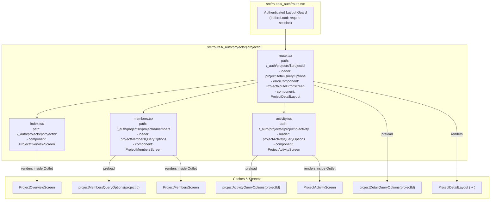

# Milestone 6 — Frontend Step 6: Project Nested File Routes (src/routes/_auth/projects/$projectId/)

ในขั้นตอนสุดท้ายของ **Milestone 6** เราจะสร้าง **Nested File Routes (`src/routes/_auth/projects/$projectId/`)** ของ TanStack Router เพื่อเชื่อมโยง URL ของหน้ารายละเอียดโครงการ (`/projects/$projectId`), หน้าจัดการสมาชิก (`/projects/$projectId/members`) และหน้าประวัติกิจกรรม (`/projects/$projectId/activity`) เข้ากับ Data Loaders (`client/caches/projects/queries/*`) และ Composition Root Screens (`client/features/projects/screens/*`) ที่เราสร้างไว้ใน Steps 1–5

---

## 1. เป้าหมายและขอบเขต Boundary (Boundary Context & Goal)

### เป้าหมายของ Step นี้
1. สร้าง **Parent Layout Route (`src/routes/_auth/projects/$projectId/route.tsx`)** สำหรับ Preload ข้อมูล `projectDetailQueryOptions(params.projectId)`, กำหนด `errorComponent` เป็น `ProjectRouteErrorScreen` และกำหนด `component` เป็น `ProjectDetailLayout`
2. สร้าง **Index Route (`src/routes/_auth/projects/$projectId/index.tsx`)** สำหรับเรนเดอร์ `ProjectOverviewScreen` เมื่อเข้าสู่ `/projects/$projectId`
3. สร้าง **Sub-routes (`members.tsx`, `activity.tsx`)** พร้อม `loader` สำหรับ Preload ข้อมูลสมาชิกและประวัติกิจกรรมของโครงการก่อนแสดงผลหน้าจอ
4. สั่งสร้าง Route Tree อัตโนมัติด้วย `bun run generate-routes` และทดสอบ Flow การทำงานจริงของ Milestone 6 ทั้งหมดแบบครบวงจร

### ตารางสรุปไฟล์ใน Step นี้

| ลำดับ | Path ของไฟล์ | บทบาทหน้าที่ (Responsibility) |
| :--- | :--- | :--- |
| 1 | `src/routes/_auth/projects/$projectId/route.tsx` | Parent Layout Route ของ `/projects/$projectId` โหลดข้อมูลโครงการหลักและครอบด้วย `ProjectDetailLayout` |
| 2 | `src/routes/_auth/projects/$projectId/index.tsx` | Index Route (`/projects/$projectId/`) แสดงหน้าภาพรวมและตั้งค่าโครงการ (`ProjectOverviewScreen`) |
| 3 | `src/routes/_auth/projects/$projectId/members.tsx` | Child Route (`/projects/$projectId/members`) โหลดข้อมูลสมาชิกและแสดง `ProjectMembersScreen` |
| 4 | `src/routes/_auth/projects/$projectId/activity.tsx` | Child Route (`/projects/$projectId/activity`) โหลดประวัติกิจกรรมและแสดง `ProjectActivityScreen` |

### แผนผังโครงสร้าง Nested Routing และการโหลดข้อมูล (Mermaid Diagram)



---

## 2. ทฤษฎี ความสำคัญ และกฎสถาปัตยกรรมเฉพาะ Boundary นี้

### 2.1 กฎสถาปัตยกรรมที่บังคับใช้ (`.agents/rules/architecture.md`, `client.md` & `server.md`)
- **`client.md` ข้อ 1 (Thin Route Ownership)**: Route ควรรู้เพียงว่า URL นี้ต้อง Preload Query ใดใน `loader` และใช้ Screen ใดจาก `features/**/screens/*.tsx` มาแสดงผล ห้ามประกอบ UI ย่อยในไฟล์ Route โดยเด็ดขาด
- **`server.md` ข้อ 3 (Allowed Gateway Callers)**: `loader` ของ Route เรียกใช้งาน `context.queryClient.query(...)` โดยส่ง `queryOptions` จาก `src/client/caches/projects/queries/*` เข้าไป เพื่อให้ข้อมูลพร้อมอยู่ใน TanStack Query Cache ทันทีที่ Component เรียก `useQuery`

### 2.2 การทำงานของ Nested Route Loaders ใน TanStack Router
เมื่อผู้ใช้เข้าสู่ URL `/projects/$projectId/members`:
1. TanStack Router จะรัน `loader` ของ Parent Route (`route.tsx` -> `projectDetailQueryOptions`) และ Child Route (`members.tsx` -> `projectMembersQueryOptions`) **ควบคู่กันแบบขนาน (Parallel Loading)**
2. หากผู้ใช้ไม่มีสิทธิ์เข้าถึงโครงการนี้ `projectDetailQueryOptions` จะโยน Error ตั้งแต่ระดับ Parent Route และ TanStack Router จะตัดไปแสดง `errorComponent: ProjectRouteErrorScreen` ทันทีโดยไม่เกิดหน้าจอพัง
3. เมื่อผู้ใช้คลิกสลับไปมาระหว่างแท็บ **ภาพรวม & ตั้งค่า**, **สมาชิก** และ **ประวัติกิจกรรม** ส่วนหัว `<ProjectHeader />` บน `ProjectDetailLayout` จะยังคงอยู่กับที่โดยไม่กระพริบ และเปลี่ยนเฉพาะเนื้อหาภายใน `<Outlet />` อย่างลื่นไหล

---

## 3. ลงมือเขียนโค้ด (Step-by-Step Implementation)

### 3.1 สร้าง Parent Layout Route ของโครงการ (`src/routes/_auth/projects/$projectId/route.tsx`)

สร้างไฟล์ `src/routes/_auth/projects/$projectId/route.tsx` เพื่อทำหน้าที่เป็น Layout Route ของทุกหน้าภายใต้ `/projects/$projectId`:

```tsx
import { createFileRoute } from "@tanstack/react-router";
import { projectDetailQueryOptions } from "#/client/caches/projects/queries/project-detail.query";
import { ProjectDetailLayout } from "#/client/features/projects/screens/project-detail.layout";
import { ProjectRouteErrorScreen } from "#/client/features/projects/screens/project-route-error.screen";

export const Route = createFileRoute("/_auth/projects/$projectId")({
	loader: ({ context, params }) =>
		context.queryClient.query(projectDetailQueryOptions(params.projectId)),
	errorComponent: ProjectRouteErrorScreen,
	component: ProjectDetailLayout,
});
```

---

### 3.2 สร้าง Index Route สำหรับหน้าภาพรวมและตั้งค่าโครงการ (`src/routes/_auth/projects/$projectId/index.tsx`)

สร้างไฟล์ `src/routes/_auth/projects/$projectId/index.tsx` โดยไม่ต้องเขียน `loader` ซ้ำเนื่องจากข้อมูล `projectDetail` ถูกโหลดไว้แล้วจาก Parent Route (`route.tsx`):

```tsx
import { createFileRoute } from "@tanstack/react-router";
import { ProjectOverviewScreen } from "#/client/features/projects/screens/project-overview.screen";

export const Route = createFileRoute("/_auth/projects/$projectId/")({
	component: ProjectOverviewScreen,
});
```

---

### 3.3 สร้าง Child Route สำหรับหน้าจัดการสมาชิกโครงการ (`src/routes/_auth/projects/$projectId/members.tsx`)

สร้างไฟล์ `src/routes/_auth/projects/$projectId/members.tsx` พร้อม `loader` ที่โหลด `projectMembersQueryOptions(params.projectId)`:

```tsx
import { createFileRoute } from "@tanstack/react-router";
import { projectMembersQueryOptions } from "#/client/caches/projects/queries/project-members.query";
import { ProjectMembersScreen } from "#/client/features/projects/screens/project-members.screen";

export const Route = createFileRoute("/_auth/projects/$projectId/members")({
	loader: ({ context, params }) =>
		context.queryClient.query(projectMembersQueryOptions(params.projectId)),
	component: ProjectMembersScreen,
});
```

---

### 3.4 สร้าง Child Route สำหรับหน้าประวัติกิจกรรมของโครงการ (`src/routes/_auth/projects/$projectId/activity.tsx`)

สร้างไฟล์ `src/routes/_auth/projects/$projectId/activity.tsx` พร้อม `loader` ที่โหลด `projectActivityQueryOptions(params.projectId)`:

```tsx
import { createFileRoute } from "@tanstack/react-router";
import { projectActivityQueryOptions } from "#/client/caches/projects/queries/project-activity.query";
import { ProjectActivityScreen } from "#/client/features/projects/screens/project-activity.screen";

export const Route = createFileRoute("/_auth/projects/$projectId/activity")({
	loader: ({ context, params }) =>
		context.queryClient.query(projectActivityQueryOptions(params.projectId)),
	component: ProjectActivityScreen,
});
```

---

## 4. การตรวจสอบความถูกต้องและ Git Commit (Verification & Commit)

### 4.1 สั่งสร้าง Route Tree และตรวจสอบความถูกต้องของโค้ด
รันคำสั่ง `bun run generate-routes` เพื่อให้ TanStack Router อัปเดตไฟล์ `src/routeTree.gen.ts` ให้รู้จัก Nested Routes ทั้งหมดของ `/projects/$projectId` จากนั้นตรวจสอบ Linting และ Typecheck:

```bash
bun run generate-routes
bun run typecheck
bun run format
bun run check
```

### 4.2 ขั้นตอนการทดสอบใช้งานจริงท้าย Milestone 6 (End-to-End Manual Verification)
รันเซิร์ฟเวอร์พัฒนาด้วย `bun run dev` แล้วทดสอบ Flow การทำงานของ **Milestone 6** ตามลำดับดังนี้:

1. **คลิกเข้าสู่หน้ารายละเอียดโครงการ (`/projects/$projectId`)**:
   - ไปที่หน้า `/projects` แล้วคลิกปุ่ม **"เปิดดูโครงการ"** บนการ์ดโครงการที่ต้องการ
   - ตรวจสอบว่าส่วนหัว (`ProjectHeader`) แสดงรหัสโครงการ (`Key`), ชื่อโครงการ, สถานะ, บทบาทของคุณในโครงการ และแท็บนำทางครบถ้วน
   - ตรวจสอบการ์ด **"ข้อมูลโครงการและสิทธิ์ของคุณ"** ว่าแสดงชื่อผู้สร้าง, จำนวนสมาชิก/งาน, บทบาทในโครงการ และรายการ Permission Badges (`project:view`, `project:update`, `project:delete`, `project:manage_members`, `task:*`) ครบตามบทบาท
2. **ทดสอบแก้ไขตั้งค่าโครงการและสลับสถานะเก็บถาวร (`Project Settings`)**:
   - ในการ์ด **"ตั้งค่าโครงการ"** ทดลองแก้ไขชื่อโครงการและคำอธิบาย แล้วกด **"บันทึกการแก้ไข"** — ต้องมี Toast แจ้งเตือนสำเร็จและชื่อบน `ProjectHeader` อัปเดตทันที
   - ทดลองกดปุ่ม **"เก็บถาวร"** — สถานะโครงการจะเปลี่ยนเป็น `"เก็บถาวร"` และช่องกรอกชื่อ/คำอธิบายจะถูกล็อก (`disabled`)
   - กดปุ่ม **"กู้คืน"** เพื่อเปลี่ยนสถานะโครงการกลับมาเป็น `"ใช้งานอยู่"` ดังเดิม
3. **ทดสอบเพิ่มสมาชิกใหม่เข้าโครงการ (`/projects/$projectId/members`)**:
   - คลิกแท็บ **"สมาชิก"**
   - ในการ์ด **"เพิ่มสมาชิกเข้าโครงการ"** เลือกผู้ใช้งานจากรายการ และเลือกบทบาทในโครงการเป็น `Contributor` หรือ `Viewer` แล้วกด **"เพิ่มสมาชิก"**
   - ตรวจสอบว่ามี Toast แจ้งเตือนสำเร็จ รายชื่อสมาชิกใหม่ปรากฏในตารางทางขวา จำนวนสมาชิกบนแท็บเพิ่มขึ้น และผู้ใช้งานที่เพิ่งถูกเพิ่มหายไปจากตัวเลือกเชิญซ้ำ
4. **ทดสอบเปลี่ยนบทบาทสมาชิก (`Change Member Role`)**:
   - ในตารางสมาชิก คลิกปุ่ม **"เปลี่ยนบทบาท"** ที่แถวของสมาชิกที่เพิ่งเพิ่มเข้ามา
   - เปลี่ยนบทบาทจาก `Viewer` เป็น `Contributor` (หรือ `Project Owner`) แล้วกด **"บันทึกบทบาท"** — Badge บทบาทในตารางต้องอัปเดตทันที
5. **ทดสอบการป้องกันการถอดหรือลดสิทธิ์ `Project Owner` คนสุดท้าย (`Last Owner Protection`)**:
   - หากในโครงการมี `Project Owner` เพียงคนเดียว ให้ทดลองกด **"เปลี่ยนบทบาท"** ของ `Project Owner` คนนั้นเป็น `Contributor` หรือกดปุ่ม **"นำออก"** แล้วกดยืนยัน
   - ระบบต้องไม่อนุญาตให้ทำรายการและแสดง Error Toast แจ้งเตือนจาก Domain Invariant ว่าโครงการต้องมีเจ้าของโครงการอย่างน้อย 1 คนเสมอ
6. **ตรวจสอบประวัติกิจกรรมของโครงการ (`/projects/$projectId/activity`)**:
   - คลิกแท็บ **"ประวัติกิจกรรม"**
   - ตรวจสอบว่าทุกเหตุการณ์ที่เราเพิ่งทดสอบไป (แก้ไขรายละเอียดโปรเจกต์, เก็บถาวรโปรเจกต์, กู้คืนโปรเจกต์, เพิ่มสมาชิกเข้าโปรเจกต์, เปลี่ยนบทบาทของสมาชิก) ถูกบันทึกและแสดงผลพร้อมรายละเอียดชื่อผู้กระทำและเวลาอย่างครบถ้วน

### 4.3 บันทึกการเปลี่ยนแปลงลง Git (Git Commit)
เมื่อตรวจสอบและทดสอบผ่านครบถ้วนแล้ว ให้ Stage ไฟล์ Routes (รวมถึง `src/routeTree.gen.ts` หากมีการอัปเดต) และทำการ Commit ปิดท้าย Milestone 6:

```bash
git add src/routes/_auth/projects/\$projectId/ src/routeTree.gen.ts
git commit -m "milestone-6.frontend.step-6: Project Detail Nested File Routes"
```
