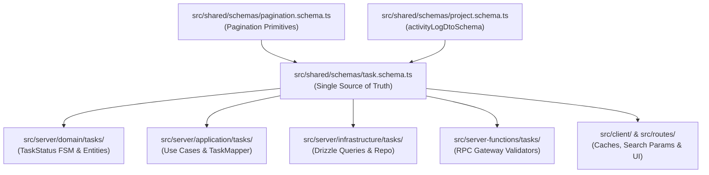

# Milestone 7 — Backend Step 1: Shared Task Schemas (src/shared/schemas/)

เอกสารบทเรียนสำหรับ **Milestone 7 (ฝั่ง Backend: Step 1)** มุ่งเน้นการออกแบบและสร้าง **Data Contract กลาง** สำหรับระบบจัดการงาน (Tasks) และความคิดเห็น (Task Comments) ในเลเยอร์ `src/shared/schemas/` เพื่อให้ทั้งฝั่ง Server (Domain, Use Cases, Infrastructure, RPC Gateway) และฝั่ง Client (TanStack Router Search Params, TanStack Query Caches, Forms และ UI Components) ใช้สัญญาข้อมูลชุดเดียวกันอย่างเข้มงวด

---

## 1. เป้าหมายและขอบเขต Boundary (Boundary Context & Goal)

ในขั้นตอนนี้ เราจะสร้างไฟล์ `src/shared/schemas/task.schema.ts` ซึ่งเป็น **Isomorphic Shared Schema Layer** ที่รวบรวมศูนย์กลางของ:
1. **Enums & Domain Primitives**: สถานะของงาน (`TaskStatus`), ระดับความสำคัญ (`TaskPriority`), ตัวกรอง (`TaskStatusFilter`, `TaskPriorityFilter`) และฟิลด์สำหรับจัดเรียงข้อมูล (`TaskSortField`)
2. **URL Search Params Schema**: `tasksSearchSchema` สำหรับตรวจสอบและคืนค่าเริ่มต้น (Fallback Default) ให้กับ Query String บน URL ของหน้าตารางงาน
3. **Field & Input Payload Schemas**: สัญญาข้อมูลขาเข้าสำหรับทุกการกระทำ (List, Get Detail, Create, Update, Transition Status, Assign, Delete Task, Add/Delete Comment)
4. **Output DTO Schemas**: สัญญาข้อมูลขาออก (`TaskDto`, `TaskCommentDto`, `TaskListItemDto`, `ListTasksResultDto`, `TaskDetailDto`) รวมถึงฟิลด์ `allowedTransitions` ที่ส่งรายการสถานะถัดไปที่อนุญาตจาก Domain State Machine ไปให้ UI แสดงปุ่มเปลี่ยนสถานะอย่างแม่นยำ

### ตารางสรุปไฟล์ใน Step นี้

| ลำดับ | เส้นทางไฟล์ (File Path) | บทบาทหน้าที่ (Responsibility) | จำนวนบรรทัด |
| :--- | :--- | :--- | :---: |
| 1 | `src/shared/schemas/task.schema.ts` | นิยาม Zod Schemas และ Inferred Types ทั้งหมดของโมดูล Tasks และ Task Comments | 238 |

### แผนผังการพึ่งพาระหว่างเลเยอร์ (Architecture Dependency Flow)



---

## 2. ทฤษฎี ความสำคัญ และกฎสถาปัตยกรรมเฉพาะ Boundary นี้

### 2.1 กฎ Shared Schemas จาก `.agents/rules/globals.md` (ข้อ 1–4)

- **Shared Schemas ข้อ 1 (`shared/schemas/**` คือ Source of Truth กลาง)**: ห้ามให้ `server/` และ `client/` นิยาม Type หรือ Shape ของข้อมูลเดียวกันแยกกัน เพื่อป้องกัน Schema Drift
- **Shared Schemas ข้อ 2 (เริ่มจาก Zod Schema เสมอ)**: ทุก DTO และ Payload ต้องสร้างเป็น Zod Schema ก่อน แล้วจึงสกัด TypeScript Type ออกมาด้วย `z.infer<typeof ...>` เพื่อให้การตรวจสอบขณะรันไทม์ (Runtime Validation) และชนิดข้อมูลตอนคอมไพล์ (Compile-time Type) ตรงกัน 100%
- **Shared Schemas ข้อ 3 (Server และ Client ต้อง Consume Contract เดียวกัน)**: การที่ทั้ง `task-status.vo.ts` (Domain FSM), `drizzle-task.queries.ts` (Read Projection), `*.fn.ts` (Server Functions) และฝั่ง Client นำเข้า `taskStatusSchema` และ `TaskDetailDto` จากจุดเดียว ทำให้เมื่อมีการปรับปรุงกฎหรือสถานะ ระบบ Type System จะแจ้งเตือนทุกจุดที่ได้รับผลกระทบทันที
- **Shared Schemas ข้อ 4 (แชร์เฉพาะข้อมูลที่ข้าม Application Boundary)**: เก็บเฉพาะ DTO, Request Input, Response Output และ Search Params โดยไม่นำ Internal Database Model เข้ามาปะปน

### 2.2 การเชื่อมโยงสถานะงาน (`TaskStatus`) และ `allowedTransitions` ระหว่าง Server กับ Client

ในระบบที่มี **Finite State Machine (FSM)** สำหรับควบคุมการเปลี่ยนสถานะงาน (`todo`, `in_progress`, `in_review`, `done`, `cancelled`):
- เราประกาศ `taskStatusSchema` เป็น Enum กลางใน `src/shared/schemas/task.schema.ts`
- ในฝั่ง Domain (`src/server/domain/tasks/task-status.vo.ts`) จะใช้ `TaskStatus` จาก Shared Schema นี้เป็น Key และ Value ของตารางการเปลี่ยนสถานะ (`TASK_ALLOWED_STATUS_TRANSITIONS` / `TASK_ALLOWED_TRANSITIONS`)
- และใน `taskDetailDtoSchema` เราได้กำหนดฟิลด์ `allowedTransitions: z.array(taskStatusSchema)` เอาไว้ในสัญญา DTO ขาออก เพื่อให้ฝั่ง Server คำนวณสถานะถัดไปที่อนุญาตจากกฎ Domain FSM แล้วส่งมอบให้ฝั่ง Client นำไปเรนเดอร์ปุ่มหรือตัวเลือกเปลี่ยนสถานะได้โดยตรง โดยที่ทั้งสองฝั่งอ้างอิงชุดสถานะจากสัญญาเดียวกัน

### 2.3 การออกแบบ Resilient Search Schema ด้วย `.default(...).catch(...)`

สำหรับ `tasksSearchSchema` ซึ่งถูกใช้ตรวจสอบ Query Parameters บน URL:
- หากผู้ใช้พิมพ์ URL ผิดพลาดหรือส่งค่าที่ไม่ตรงกับ Enum เข้ามา การใช้ `.default(...).catch(...)` จะช่วยแปลงค่าที่ผิดพลาดให้กลับเป็นค่าเริ่มต้นที่ปลอดภัย (เช่น `status: "all"`, `page: 1`, `sortBy: "updatedAt"`) โดยไม่ทำให้หน้าเว็บพัง

---

## 3. ลงมือเขียนโค้ด (Step-by-Step Implementation)

### 3.1 ไฟล์ `src/shared/schemas/task.schema.ts`

สร้างไฟล์ `src/shared/schemas/task.schema.ts` เพื่อนิยาม Schema และ Type สำหรับงาน (Tasks) และความคิดเห็น (Task Comments) ทั้งหมดดังนี้:

```typescript
import { z } from "zod";
import {
	createPaginatedResultSchema,
	DEFAULT_PAGE,
	DEFAULT_PAGE_SIZE,
	sortOrderSchema,
} from "./pagination.schema";
import { activityLogDtoSchema } from "./project.schema";

export const taskStatusSchema = z.enum([
	"todo",
	"in_progress",
	"in_review",
	"done",
	"cancelled",
]);
export type TaskStatus = z.infer<typeof taskStatusSchema>;

export const taskPrioritySchema = z.enum(["low", "medium", "high", "urgent"]);
export type TaskPriority = z.infer<typeof taskPrioritySchema>;

export const taskStatusFilterSchema = z.enum([
	"all",
	"todo",
	"in_progress",
	"in_review",
	"done",
	"cancelled",
]);
export type TaskStatusFilter = z.infer<typeof taskStatusFilterSchema>;

export const taskPriorityFilterSchema = z.enum([
	"all",
	"low",
	"medium",
	"high",
	"urgent",
]);
export type TaskPriorityFilter = z.infer<typeof taskPriorityFilterSchema>;

export const taskSortFieldSchema = z.enum([
	"code",
	"title",
	"status",
	"priority",
	"dueDate",
	"createdAt",
	"updatedAt",
]);
export type TaskSortField = z.infer<typeof taskSortFieldSchema>;

export const tasksSearchSchema = z.object({
	search: z.string().trim().max(100).default("").catch(""),
	status: taskStatusFilterSchema.default("all").catch("all"),
	priority: taskPriorityFilterSchema.default("all").catch("all"),
	assigneeFilter: z.string().trim().max(128).default("all").catch("all"),
	sortBy: taskSortFieldSchema.default("updatedAt").catch("updatedAt"),
	sortOrder: sortOrderSchema.default("desc").catch("desc"),
	page: z.number().int().min(1).default(DEFAULT_PAGE).catch(DEFAULT_PAGE),
	pageSize: z
		.number()
		.int()
		.min(1)
		.max(100)
		.default(DEFAULT_PAGE_SIZE)
		.catch(DEFAULT_PAGE_SIZE),
});
export type TasksSearch = z.infer<typeof tasksSearchSchema>;

export const taskTitleSchema = z
	.string()
	.trim()
	.min(2, "หัวข้องานต้องมีอย่างน้อย 2 ตัวอักษร")
	.max(200, "หัวข้องานต้องไม่เกิน 200 ตัวอักษร");

export const taskDescriptionSchema = z
	.string()
	.trim()
	.max(5000, "รายละเอียดงานต้องไม่เกิน 5000 ตัวอักษร");

export const taskDueDateInputSchema = z
	.string()
	.trim()
	.max(40, "รูปแบบวันครบกำหนดไม่ถูกต้อง")
	.refine(
		(value) => value === "" || !Number.isNaN(Date.parse(value)),
		"รูปแบบวันครบกำหนดไม่ถูกต้อง",
	);

export const taskCommentBodySchema = z
	.string()
	.trim()
	.min(1, "กรุณากรอกข้อความความคิดเห็น")
	.max(3000, "ความคิดเห็นต้องไม่เกิน 3000 ตัวอักษร");

export const listTasksInputSchema = z.object({
	projectId: z.uuid("รหัสโครงการไม่ถูกต้อง"),
	params: tasksSearchSchema,
});
export type ListTasksInput = z.infer<typeof listTasksInputSchema>;

export const getTaskDetailInputSchema = z.object({
	projectId: z.uuid("รหัสโครงการไม่ถูกต้อง"),
	taskId: z.uuid("รหัสงานไม่ถูกต้อง"),
});
export type GetTaskDetailInput = z.infer<typeof getTaskDetailInputSchema>;

export const createTaskInputSchema = z.object({
	projectId: z.uuid("รหัสโครงการไม่ถูกต้อง"),
	title: taskTitleSchema,
	description: taskDescriptionSchema,
	priority: taskPrioritySchema,
	assigneeId: z.string().min(1).nullable(),
	dueDate: taskDueDateInputSchema.nullable(),
});
export type CreateTaskInput = z.infer<typeof createTaskInputSchema>;

export const updateTaskInputSchema = z.object({
	projectId: z.uuid("รหัสโครงการไม่ถูกต้อง"),
	taskId: z.uuid("รหัสงานไม่ถูกต้อง"),
	title: taskTitleSchema,
	description: taskDescriptionSchema,
	priority: taskPrioritySchema,
	dueDate: taskDueDateInputSchema.nullable(),
});
export type UpdateTaskInput = z.infer<typeof updateTaskInputSchema>;

export const transitionTaskStatusInputSchema = z.object({
	projectId: z.uuid("รหัสโครงการไม่ถูกต้อง"),
	taskId: z.uuid("รหัสงานไม่ถูกต้อง"),
	status: taskStatusSchema,
});
export type TransitionTaskStatusInput = z.infer<
	typeof transitionTaskStatusInputSchema
>;

export const assignTaskInputSchema = z.object({
	projectId: z.uuid("รหัสโครงการไม่ถูกต้อง"),
	taskId: z.uuid("รหัสงานไม่ถูกต้อง"),
	assigneeId: z.string().min(1).nullable(),
});
export type AssignTaskInput = z.infer<typeof assignTaskInputSchema>;

export const deleteTaskInputSchema = z.object({
	projectId: z.uuid("รหัสโครงการไม่ถูกต้อง"),
	taskId: z.uuid("รหัสงานไม่ถูกต้อง"),
});
export type DeleteTaskInput = z.infer<typeof deleteTaskInputSchema>;

export const addTaskCommentInputSchema = z.object({
	projectId: z.uuid("รหัสโครงการไม่ถูกต้อง"),
	taskId: z.uuid("รหัสงานไม่ถูกต้อง"),
	body: taskCommentBodySchema,
});
export type AddTaskCommentInput = z.infer<typeof addTaskCommentInputSchema>;

export const deleteTaskCommentInputSchema = z.object({
	projectId: z.uuid("รหัสโครงการไม่ถูกต้อง"),
	taskId: z.uuid("รหัสงานไม่ถูกต้อง"),
	commentId: z.uuid("รหัสความคิดเห็นไม่ถูกต้อง"),
});
export type DeleteTaskCommentInput = z.infer<
	typeof deleteTaskCommentInputSchema
>;

export const taskDtoSchema = z.object({
	id: z.uuid(),
	projectId: z.uuid(),
	code: z.string(),
	title: z.string(),
	description: z.string(),
	status: taskStatusSchema,
	priority: taskPrioritySchema,
	assigneeId: z.string().nullable(),
	reporterId: z.string(),
	dueDate: z.string().nullable(),
	createdAt: z.string(),
	updatedAt: z.string(),
});
export type TaskDto = z.infer<typeof taskDtoSchema>;

export const taskUserSummarySchema = z.object({
	id: z.string(),
	name: z.string(),
	email: z.string(),
});
export type TaskUserSummary = z.infer<typeof taskUserSummarySchema>;

export const taskCommentDtoSchema = z.object({
	id: z.uuid(),
	taskId: z.uuid(),
	author: taskUserSummarySchema,
	body: z.string(),
	createdAt: z.string(),
	updatedAt: z.string(),
});
export type TaskCommentDto = z.infer<typeof taskCommentDtoSchema>;

export const taskListItemDtoSchema = z.object({
	id: z.uuid(),
	projectId: z.uuid(),
	code: z.string(),
	title: z.string(),
	description: z.string(),
	status: taskStatusSchema,
	priority: taskPrioritySchema,
	assignee: taskUserSummarySchema.nullable(),
	reporter: taskUserSummarySchema,
	dueDate: z.string().nullable(),
	commentCount: z.number().int().nonnegative(),
	createdAt: z.string(),
	updatedAt: z.string(),
});
export type TaskListItemDto = z.infer<typeof taskListItemDtoSchema>;

export const listTasksResultDtoSchema = createPaginatedResultSchema(
	taskListItemDtoSchema,
);
export type ListTasksResultDto = z.infer<typeof listTasksResultDtoSchema>;

export const taskDetailDtoSchema = z.object({
	id: z.uuid(),
	projectId: z.uuid(),
	code: z.string(),
	title: z.string(),
	description: z.string(),
	status: taskStatusSchema,
	priority: taskPrioritySchema,
	allowedTransitions: z.array(taskStatusSchema),
	assignee: taskUserSummarySchema.nullable(),
	reporter: taskUserSummarySchema,
	dueDate: z.string().nullable(),
	comments: z.array(taskCommentDtoSchema),
	activities: z.array(activityLogDtoSchema),
	createdAt: z.string(),
	updatedAt: z.string(),
});
export type TaskDetailDto = z.infer<typeof taskDetailDtoSchema>;
```

#### คำอธิบายโค้ดอย่างละเอียด
- **บรรทัดที่ 10–50**: นิยาม Enum พื้นฐานสำหรับสถานะงาน (`taskStatusSchema`), ความสำคัญ (`taskPrioritySchema`), ตัวกรองที่รองรับค่า `"all"` สำหรับหน้าค้นหา (`taskStatusFilterSchema`, `taskPriorityFilterSchema`), และคอลัมน์ที่อนุญาตให้เรียงลำดับ (`taskSortFieldSchema`)
- **บรรทัดที่ 52–68**: `tasksSearchSchema` กำหนดโครงสร้างพารามิเตอร์การค้นหา กรอง เรียงลำดับ และแบ่งหน้า โดยใช้ `DEFAULT_PAGE` และ `DEFAULT_PAGE_SIZE` จาก `pagination.schema.ts`
- **บรรทัดที่ 70–95**: นิยามกฎการตรวจสอบข้อมูลระดับฟิลด์ ได้แก่ `taskTitleSchema` (2–200 ตัวอักษร), `taskDescriptionSchema` (ไม่เกิน 5,000 ตัวอักษร), `taskDueDateInputSchema` (ตรวจสอบว่าเป็นวันที่ที่ `Date.parse` แปลงได้จริง) และ `taskCommentBodySchema` (1–3,000 ตัวอักษร)
- **บรรทัดที่ 96–164**: นิยาม Input Payload Schema ทั้ง 9 รายการสำหรับทุก Use Case และ Server Function ของโมดูล Tasks
- **บรรทัดที่ 166–238**: นิยาม Output DTO Schema ทั้งสำหรับ Write Operations (`taskDtoSchema`, `taskCommentDtoSchema`) และสำหรับ CQRS Read Projections (`taskListItemDtoSchema`, `listTasksResultDtoSchema`, `taskDetailDtoSchema`) โดยใน `taskDetailDtoSchema` จะแนบ `allowedTransitions`, `comments` และ `activities` มาพร้อมกันในก้อนเดียว

---

## 4. การตรวจสอบความถูกต้องและ Git Commit (Verification & Commit)

หลังจากสร้างไฟล์เสร็จเรียบร้อยแล้ว ให้ตรวจสอบความถูกต้องของ Type และ Format ด้วยคำสั่งของ `bun` จากนั้นทำการบันทึก Commit ประจำ Step ที่ 1:

```bash
bun run check
git add src/shared/schemas/task.schema.ts
git commit -m "milestone-7.backend.step-1: Shared Task & Comment Schemas"
```
