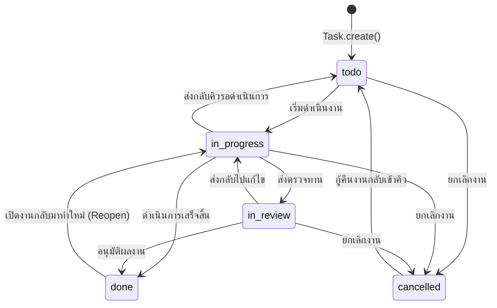
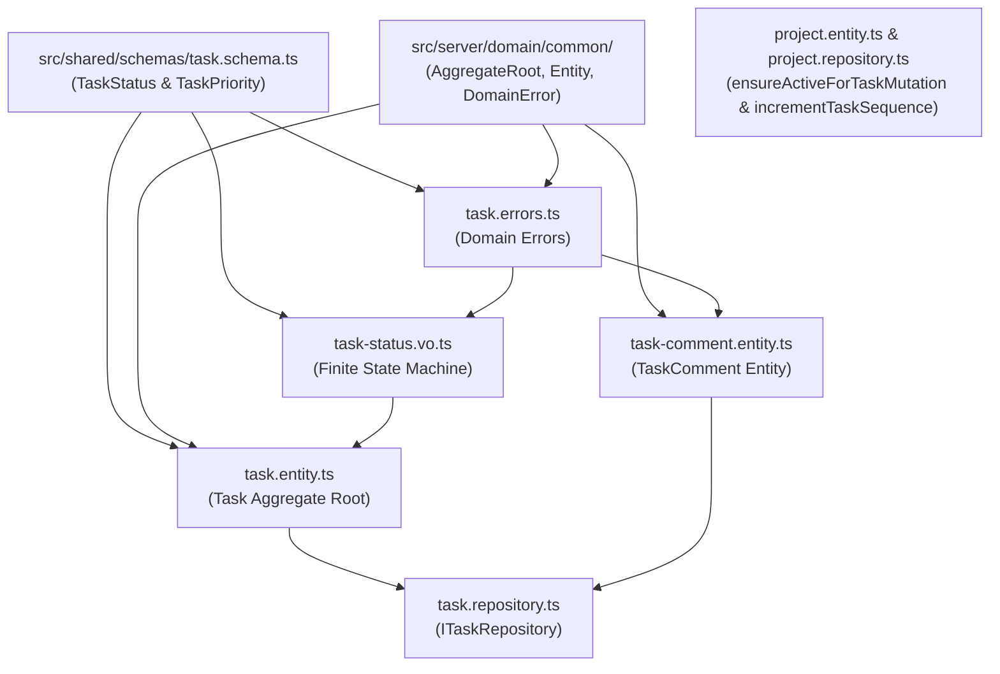

# Milestone 7 — Backend Step 2: Domain Tasks & Finite State Machine (src/server/domain/tasks/ & projects/)

เอกสารบทเรียนสำหรับ **Milestone 7 (ฝั่ง Backend: Step 2)** มุ่งเน้นการสร้างแกนกลางทางธุรกิจ (Pure Domain Layer) สำหรับโมดูลงาน (`src/server/domain/tasks/`) และการขยายความสามารถของโมดูลโครงการ (`src/server/domain/projects/`) เพื่อรองรับการรันเลขลำดับงานและการป้องกันการแก้ไขงานเมื่อโครงการถูกจัดเก็บ (Archive)

---

## 1. เป้าหมายและขอบเขต Boundary (Boundary Context & Goal)

ในขั้นตอนนี้ เราจะสร้างโมเดลทางธุรกิจบริสุทธิ์ใน `src/server/domain/tasks/` จำนวน 5 ไฟล์ และต่อเติม `src/server/domain/projects/` จำนวน 2 ไฟล์ เพื่อบังคับใช้กฎทางธุรกิจ (Business Invariants) และ **Finite State Machine (FSM)** ของสถานะงานโดยไม่พึ่งพา Database หรือ Framework ภายนอก

### ตารางสรุปไฟล์ใน Step นี้

| ลำดับ | เส้นทางไฟล์ (File Path) | บทบาทหน้าที่ (Responsibility) | จำนวนบรรทัด |
| :---: | :--- | :--- | :---: |
| 1 | `src/server/domain/tasks/task-status.vo.ts` | นิยาม Finite State Machine ของ `TaskStatus` และฟังก์ชันตรวจสอบการเปลี่ยนสถานะ | 38 |
| 2 | `src/server/domain/tasks/task.entity.ts` | Aggregate Root ของ `Task` ดูแล Invariants, การแก้ไขรายละเอียด, การเปลี่ยนสถานะ และการมอบหมายงาน | 211 |
| 3 | `src/server/domain/tasks/task-comment.entity.ts` | Entity ของ `TaskComment` ดูแลความถูกต้องของข้อความและสิทธิ์การลบความคิดเห็น | 78 |
| 4 | `src/server/domain/tasks/task.errors.ts` | Custom Domain Errors ประจำโมดูล Tasks และ Task Comments | 46 |
| 5 | `src/server/domain/tasks/task.repository.ts` | สัญญา `ITaskRepository` สำหรับบันทึก/ดึง/ลบ `Task` และ `TaskComment` | 15 |
| 6 | `src/server/domain/projects/project.entity.ts` | ต่อเติมเมธอด `ensureActiveForTaskMutation()` เพื่อห้ามแก้ไขงานในโครงการที่ถูก Archive | 161 |
| 7 | `src/server/domain/projects/project.repository.ts` | ต่อเติมเมธอด `incrementTaskSequence(projectId)` ในสัญญา `IProjectRepository` | 46 |

### แผนผังสถานะงาน (TaskStatus Finite State Machine)



### แผนผังความสัมพันธ์ภายใน Domain Layer



---

## 2. ทฤษฎี ความสำคัญ และกฎสถาปัตยกรรมเฉพาะ Boundary นี้

### 2.1 กฎ Domain Layer จาก `.agents/rules/server.md` (ข้อ 1, 4, 5, 6, 7)

- **ข้อ 1 (Inward-only Dependency Rule)**: `src/server/domain/tasks/` นำเข้าได้เฉพาะ Base Classes จาก `#/server/domain/common/` และ Shared Contract จาก `#/shared/schemas/task.schema` เท่านั้น ห้ามนำเข้า Drizzle ORM, HTTP Status หรือโค้ดจาก Application/Infrastructure เด็ดขาด
- **ข้อ 4 (Rich Domain Model & Encapsulation)**: `Task` และ `TaskComment` ซ่อนสถานะไว้ใน `protected props` และเปิดให้เปลี่ยนแปลงสถานะผ่าน Domain Methods ที่มีความหมายทางธุรกิจเท่านั้น ได้แก่ `task.updateDetails(...)`, `task.transitionTo(...)`, `task.assignTo(...)` และ `comment.ensureDeletableBy(...)`
- **ข้อ 5 (Factory Method vs. Reconstitution)**:
  - ใช้ `Task.create(...)` และ `TaskComment.create(...)` สำหรับสร้างอินสแตนซ์ใหม่ พร้อมกำหนด UUID, สถานะเริ่มต้น (`"todo"`), เวลาปัจจุบัน และตรวจสอบ Invariants ทุกข้อ
  - ใช้ `Task.reconstitute(...)` และ `TaskComment.reconstitute(...)` สำหรับคืนสภาพข้อมูลที่มีอยู่แล้วจากฐานข้อมูลภายใน Repository เท่านั้น
- **ข้อ 6 (Pure Repository Interface)**: `ITaskRepository` และ `IProjectRepository` รับและคืนค่าเฉพาะ Domain Entities (`Task`, `TaskComment`, `Project`) หรือ Primitives (`string`, `number`, `boolean`) โดยไม่รั่วไหลโครงสร้างตารางของฐานข้อมูล
- **ข้อ 7 (Domain Errors)**: ข้อผิดพลาดทั้งหมดใน `task.errors.ts` สืบทอดจาก `NotFoundDomainError`, `InvalidStateTransitionError`, `ValidationDomainError` และ `ForbiddenDomainError` โดยไม่ผูกติดกับโปรโตคอลเครือข่าย

### 2.2 การทำงานของ Finite State Machine (FSM) ใน Value Object และ Aggregate Root

การเปลี่ยนสถานะของงานไม่ใช่การเขียนค่าทับลงฟิลด์ `status` โดยอิสระ แต่ต้องเป็นไปตามกราฟสถานะที่กำหนดไว้ใน `TASK_ALLOWED_TRANSITIONS`:
1. **`todo`**: เปลี่ยนไปเป็น `in_progress` หรือ `cancelled` ได้เท่านั้น (จะข้ามไป `done` หรือ `in_review` ทันทีไม่ได้)
2. **`in_progress`**: เปลี่ยนไปเป็น `in_review`, `done`, ถอยกลับเป็น `todo`, หรือ `cancelled` ได้
3. **`in_review`**: เมื่อตรวจงานแล้ว สามารถอนุมัติเป็น `done`, ส่งกลับไปแก้ไขที่ `in_progress`, หรือ `cancelled` ได้
4. **`done`**: หากพบปัญหาหลังจบงาน สามารถ Reopen กลับมาที่ `in_progress` ได้เพียงทางเดียว
5. **`cancelled`**: งานที่ถูกยกเลิกไปแล้ว หากต้องการนำกลับมาทำใหม่ ต้องกู้คืนกลับไปเริ่มที่ `todo` เท่านั้น

เมื่อเรียก `task.transitionTo(nextStatus)` ตัว Aggregate Root จะเรียก `assertTaskStatusTransition(this.props.status, nextStatus)` ทันที หากสถานะซ้ำเดิมหรือไม่อยู่ในรายการที่อนุญาต ระบบจะโยน `InvalidTaskStatusTransitionError` เพื่อปกป้องความถูกต้องของข้อมูลเสมอ

---

## 3. ลงมือเขียนโค้ด (Step-by-Step Implementation)

### 3.1 ไฟล์ `src/server/domain/tasks/task.errors.ts`

สร้างคลาส Domain Errors ประจำโมดูล Tasks เพื่อสื่อสารความผิดพลาดทางธุรกิจอย่างชัดเจน:

```typescript
import {
	ForbiddenDomainError,
	InvalidStateTransitionError,
	NotFoundDomainError,
	ValidationDomainError,
} from "#/server/domain/common/errors";
import type { TaskStatus } from "#/shared/schemas/task.schema";

export class TaskNotFoundError extends NotFoundDomainError {
	constructor(identifier: string) {
		super(`ไม่พบงานที่ระบุ (${identifier})`);
	}
}

export class TaskCommentNotFoundError extends NotFoundDomainError {
	constructor(commentId: string) {
		super(`ไม่พบความคิดเห็นที่ระบุ (${commentId})`);
	}
}

export class InvalidTaskStatusTransitionError extends InvalidStateTransitionError {
	constructor(
		fromStatus: TaskStatus,
		toStatus: TaskStatus,
		customMessage?: string,
	) {
		super(
			customMessage ??
				`ไม่สามารถเปลี่ยนสถานะงานจาก '${fromStatus}' เป็น '${toStatus}' ได้`,
		);
	}
}

export class InvalidTaskAssigneeError extends ValidationDomainError {
	constructor(userId: string) {
		super(`ผู้ใช้งาน (${userId}) ไม่ได้เป็นสมาชิกของโครงการนี้ จึงไม่สามารถมอบหมายงานได้`);
	}
}

export class TaskCommentDeletionForbiddenError extends ForbiddenDomainError {
	constructor() {
		super(
			"คุณไม่มีสิทธิ์ลบความคิดเห็นของผู้ใช้อื่น (ต้องเป็นเจ้าของหรือมีสิทธิ์ comment:delete_any)",
		);
	}
}
```

### 3.2 ไฟล์ `src/server/domain/tasks/task-status.vo.ts`

สร้างโมดูลควบคุมกฎ Finite State Machine ของสถานะงาน:

```typescript
import type { TaskStatus } from "#/shared/schemas/task.schema";
import { InvalidTaskStatusTransitionError } from "./task.errors";

const TASK_ALLOWED_TRANSITIONS: Record<TaskStatus, readonly TaskStatus[]> = {
	todo: ["in_progress", "cancelled"],
	in_progress: ["in_review", "done", "todo", "cancelled"],
	in_review: ["done", "in_progress", "cancelled"],
	done: ["in_progress"],
	cancelled: ["todo"],
};

export function getAllowedTaskTransitions(status: TaskStatus): TaskStatus[] {
	return [...TASK_ALLOWED_TRANSITIONS[status]];
}

export function canTransitionTaskStatus(
	fromStatus: TaskStatus,
	toStatus: TaskStatus,
): boolean {
	return TASK_ALLOWED_TRANSITIONS[fromStatus].includes(toStatus);
}

export function assertTaskStatusTransition(
	fromStatus: TaskStatus,
	toStatus: TaskStatus,
): void {
	if (fromStatus === toStatus) {
		throw new InvalidTaskStatusTransitionError(
			fromStatus,
			toStatus,
			`Task อยู่ในสถานะ '${fromStatus}' อยู่แล้ว`,
		);
	}

	if (!canTransitionTaskStatus(fromStatus, toStatus)) {
		throw new InvalidTaskStatusTransitionError(fromStatus, toStatus);
	}
}
```

### 3.3 ไฟล์ `src/server/domain/tasks/task.entity.ts`

สร้าง Aggregate Root `Task` ที่ดูแลกฎความถูกต้องของข้อมูลงาน การแปลงวันครบกำหนด (`parseDueDate`) และการเปลี่ยนสถานะผ่าน FSM:

```typescript
import { AggregateRoot } from "#/server/domain/common/aggregate-root.base";
import { ValidationDomainError } from "#/server/domain/common/errors";
import type { TaskPriority, TaskStatus } from "#/shared/schemas/task.schema";
import {
	assertTaskStatusTransition,
	getAllowedTaskTransitions,
} from "./task-status.vo";

const DATE_ONLY_PATTERN = /^(\d{4})-(\d{2})-(\d{2})$/;

export interface TaskProps {
	readonly projectId: string;
	readonly code: string;
	readonly title: string;
	readonly description: string;
	readonly status: TaskStatus;
	readonly priority: TaskPriority;
	readonly assigneeId: string | null;
	readonly reporterId: string;
	readonly dueDate: Date | null;
	readonly createdAt: Date;
	readonly updatedAt: Date;
}

export interface CreateTaskParams {
	readonly projectId: string;
	readonly code: string;
	readonly title: string;
	readonly description: string;
	readonly priority: TaskPriority;
	readonly assigneeId: string | null;
	readonly reporterId: string;
	readonly dueDate: string | null;
}

export interface UpdateTaskDetailsParams {
	readonly title: string;
	readonly description: string;
	readonly priority: TaskPriority;
	readonly dueDate: string | null;
}

export class Task extends AggregateRoot<TaskProps> {
	private constructor(id: string, props: TaskProps) {
		super(id, props);
	}

	static create(params: CreateTaskParams): Task {
		const validatedCode = params.code.trim();
		if (validatedCode.length === 0) {
			throw new ValidationDomainError("รหัส Task ต้องไม่ว่างเปล่า");
		}

		const now = new Date();

		return new Task(crypto.randomUUID(), {
			projectId: params.projectId,
			code: validatedCode,
			title: Task.validateTitle(params.title),
			description: Task.validateDescription(params.description),
			status: "todo",
			priority: params.priority,
			assigneeId: Task.normalizeAssigneeId(params.assigneeId),
			reporterId: params.reporterId,
			dueDate: Task.parseDueDate(params.dueDate),
			createdAt: now,
			updatedAt: now,
		});
	}

	static reconstitute(id: string, props: TaskProps): Task {
		return new Task(id, props);
	}

	get projectId(): string {
		return this.props.projectId;
	}

	get code(): string {
		return this.props.code;
	}

	get title(): string {
		return this.props.title;
	}

	get description(): string {
		return this.props.description;
	}

	get status(): TaskStatus {
		return this.props.status;
	}

	get priority(): TaskPriority {
		return this.props.priority;
	}

	get assigneeId(): string | null {
		return this.props.assigneeId;
	}

	get reporterId(): string {
		return this.props.reporterId;
	}

	get dueDate(): Date | null {
		return this.props.dueDate;
	}

	get createdAt(): Date {
		return this.props.createdAt;
	}

	get updatedAt(): Date {
		return this.props.updatedAt;
	}

	getAllowedTransitions(): TaskStatus[] {
		return getAllowedTaskTransitions(this.props.status);
	}

	updateDetails(params: UpdateTaskDetailsParams): void {
		this.props = {
			...this.props,
			title: Task.validateTitle(params.title),
			description: Task.validateDescription(params.description),
			priority: params.priority,
			dueDate: Task.parseDueDate(params.dueDate),
			updatedAt: new Date(),
		};
	}

	transitionTo(nextStatus: TaskStatus): void {
		assertTaskStatusTransition(this.props.status, nextStatus);

		this.props = {
			...this.props,
			status: nextStatus,
			updatedAt: new Date(),
		};
	}

	assignTo(nextAssigneeId: string | null): void {
		const normalized = Task.normalizeAssigneeId(nextAssigneeId);
		this.props = {
			...this.props,
			assigneeId: normalized,
			updatedAt: new Date(),
		};
	}

	private static normalizeAssigneeId(assigneeId: string | null): string | null {
		if (assigneeId === null) {
			return null;
		}
		const trimmed = assigneeId.trim();
		return trimmed.length > 0 ? trimmed : null;
	}

	private static validateTitle(rawTitle: string): string {
		const trimmed = rawTitle.trim();
		if (trimmed.length < 2) {
			throw new ValidationDomainError("หัวข้อ Task ต้องมีอย่างน้อย 2 ตัวอักษร");
		}
		if (trimmed.length > 200) {
			throw new ValidationDomainError("หัวข้อ Task ต้องไม่เกิน 200 ตัวอักษร");
		}
		return trimmed;
	}

	private static validateDescription(rawDescription: string): string {
		const trimmed = rawDescription.trim();
		if (trimmed.length > 5000) {
			throw new ValidationDomainError("รายละเอียด Task ต้องไม่เกิน 5000 ตัวอักษร");
		}
		return trimmed;
	}

	private static parseDueDate(rawDueDate: string | null): Date | null {
		if (rawDueDate === null) {
			return null;
		}
		const trimmed = rawDueDate.trim();
		if (trimmed.length === 0) {
			return null;
		}

		const dateOnlyMatch = DATE_ONLY_PATTERN.exec(trimmed);
		if (dateOnlyMatch) {
			const year = Number(dateOnlyMatch[1]);
			const month = Number(dateOnlyMatch[2]);
			const day = Number(dateOnlyMatch[3]);
			const parsedUtc = new Date(Date.UTC(year, month - 1, day));
			if (
				parsedUtc.getUTCFullYear() !== year ||
				parsedUtc.getUTCMonth() + 1 !== month ||
				parsedUtc.getUTCDate() !== day
			) {
				throw new ValidationDomainError("วันที่ครบกำหนดไม่ถูกต้องตามปฏิทิน");
			}
			return parsedUtc;
		}

		const parsed = new Date(trimmed);
		if (Number.isNaN(parsed.getTime())) {
			throw new ValidationDomainError("รูปแบบวันครบกำหนดไม่ถูกต้อง");
		}
		return parsed;
	}
}
```

### 3.4 ไฟล์ `src/server/domain/tasks/task-comment.entity.ts`

สร้าง Entity `TaskComment` พร้อมเมธอด `ensureDeletableBy` ที่ตรวจสอบว่าผู้ลบเป็นเจ้าของความคิดเห็นเองหรือมีสิทธิ์ `comment:delete_any`:

```typescript
import { Entity } from "#/server/domain/common/entity.base";
import { ValidationDomainError } from "#/server/domain/common/errors";
import { TaskCommentDeletionForbiddenError } from "./task.errors";

export interface TaskCommentProps {
	readonly taskId: string;
	readonly authorId: string;
	readonly body: string;
	readonly createdAt: Date;
	readonly updatedAt: Date;
}

export interface CreateTaskCommentParams {
	readonly taskId: string;
	readonly authorId: string;
	readonly body: string;
}

export class TaskComment extends Entity<TaskCommentProps> {
	private constructor(id: string, props: TaskCommentProps) {
		super(id, props);
	}

	static create(params: CreateTaskCommentParams): TaskComment {
		const validatedBody = TaskComment.validateBody(params.body);
		const now = new Date();

		return new TaskComment(crypto.randomUUID(), {
			taskId: params.taskId,
			authorId: params.authorId,
			body: validatedBody,
			createdAt: now,
			updatedAt: now,
		});
	}

	static reconstitute(id: string, props: TaskCommentProps): TaskComment {
		return new TaskComment(id, props);
	}

	get taskId(): string {
		return this.props.taskId;
	}

	get authorId(): string {
		return this.props.authorId;
	}

	get body(): string {
		return this.props.body;
	}

	get createdAt(): Date {
		return this.props.createdAt;
	}

	get updatedAt(): Date {
		return this.props.updatedAt;
	}

	ensureDeletableBy(actorUserId: string, canDeleteAny: boolean): void {
		if (this.props.authorId === actorUserId || canDeleteAny) {
			return;
		}
		throw new TaskCommentDeletionForbiddenError();
	}

	private static validateBody(rawBody: string): string {
		const trimmed = rawBody.trim();
		if (trimmed.length === 0) {
			throw new ValidationDomainError("กรุณากรอกข้อความความคิดเห็น");
		}
		if (trimmed.length > 3000) {
			throw new ValidationDomainError("ความคิดเห็นต้องไม่เกิน 3000 ตัวอักษร");
		}
		return trimmed;
	}
}
```

### 3.5 ไฟล์ `src/server/domain/tasks/task.repository.ts`

สร้างสัญญา `ITaskRepository` สำหรับการเข้าถึงและบันทึกข้อมูลของ `Task` และ `TaskComment`:

```typescript
import type { Task } from "./task.entity";
import type { TaskComment } from "./task-comment.entity";

export interface ITaskRepository {
	findById(projectId: string, taskId: string): Promise<Task | null>;
	save(task: Task): Promise<void>;
	delete(projectId: string, taskId: string): Promise<boolean>;
	findCommentById(
		projectId: string,
		taskId: string,
		commentId: string,
	): Promise<TaskComment | null>;
	saveComment(comment: TaskComment): Promise<void>;
	deleteComment(taskId: string, commentId: string): Promise<boolean>;
}
```

### 3.6 ต่อเติมไฟล์ `src/server/domain/projects/project.entity.ts`

ใน `Project` Aggregate Root มีเมธอด `ensureActiveForTaskMutation()` (บรรทัดที่ 136–142) เพื่อป้องกันไม่ให้สร้าง แก้ไข เปลี่ยนสถานะ หรือลบงานและคอมเมนต์ หากโครงการอยู่ในสถานะ `"archived"` รวมถึงฟิลด์ `taskSequence` สำหรับติดตามลำดับเลขงานของโครงการ:

```typescript
import { AggregateRoot } from "#/server/domain/common/aggregate-root.base";
import { ValidationDomainError } from "#/server/domain/common/errors";
import type { ProjectStatus } from "#/shared/schemas/project.schema";
import {
	ProjectAlreadyActiveError,
	ProjectArchivedError,
} from "./project.errors";
import { ProjectKey } from "./project-key.vo";

export interface ProjectProps {
	readonly key: ProjectKey;
	readonly name: string;
	readonly description: string;
	readonly status: ProjectStatus;
	readonly taskSequence: number;
	readonly createdById: string;
	readonly createdAt: Date;
	readonly updatedAt: Date;
}

export interface CreateProjectParams {
	readonly key: string;
	readonly name: string;
	readonly description: string;
	readonly createdById: string;
}

export class Project extends AggregateRoot<ProjectProps> {
	private constructor(id: string, props: ProjectProps) {
		super(id, props);
	}

	static create(params: CreateProjectParams): Project {
		const projectKey = ProjectKey.create(params.key);
		const validatedName = Project.validateName(params.name);
		const validatedDescription = Project.validateDescription(
			params.description,
		);
		const now = new Date();

		return new Project(crypto.randomUUID(), {
			key: projectKey,
			name: validatedName,
			description: validatedDescription,
			status: "active",
			taskSequence: 0,
			createdById: params.createdById,
			createdAt: now,
			updatedAt: now,
		});
	}

	static reconstitute(id: string, props: ProjectProps): Project {
		return new Project(id, props);
	}

	get key(): ProjectKey {
		return this.props.key;
	}

	get name(): string {
		return this.props.name;
	}

	get description(): string {
		return this.props.description;
	}

	get status(): ProjectStatus {
		return this.props.status;
	}

	get taskSequence(): number {
		return this.props.taskSequence;
	}

	get createdById(): string {
		return this.props.createdById;
	}

	get createdAt(): Date {
		return this.props.createdAt;
	}

	get updatedAt(): Date {
		return this.props.updatedAt;
	}

	updateDetails(name: string, description: string): void {
		if (this.props.status === "archived") {
			throw new ProjectArchivedError(
				"ไม่สามารถแก้ไขรายละเอียดโครงการที่ถูกจัดเก็บแล้ว กรุณากู้คืนก่อน",
			);
		}

		this.props = {
			...this.props,
			name: Project.validateName(name),
			description: Project.validateDescription(description),
			updatedAt: new Date(),
		};
	}

	archive(): void {
		if (this.props.status === "archived") {
			throw new ProjectArchivedError("โครงการนี้ถูกจัดเก็บไว้แล้ว");
		}

		this.props = {
			...this.props,
			status: "archived",
			updatedAt: new Date(),
		};
	}

	restore(): void {
		if (this.props.status === "active") {
			throw new ProjectAlreadyActiveError();
		}

		this.props = {
			...this.props,
			status: "active",
			updatedAt: new Date(),
		};
	}

	ensureActiveForMemberManagement(): void {
		if (this.props.status === "archived") {
			throw new ProjectArchivedError(
				"ไม่สามารถจัดการสมาชิกในโครงการที่ถูกจัดเก็บแล้วได้ กรุณากู้คืนโครงการก่อน",
			);
		}
	}

	ensureActiveForTaskMutation(): void {
		if (this.props.status === "archived") {
			throw new ProjectArchivedError(
				"ไม่สามารถสร้าง แก้ไข หรือดำเนินการกับงานในโครงการที่ถูกจัดเก็บแล้วได้ กรุณากู้คืนโครงการก่อน",
			);
		}
	}

	private static validateName(rawName: string): string {
		const trimmed = rawName.trim();
		if (trimmed.length < 2 || trimmed.length > 150) {
			throw new ValidationDomainError(
				"ชื่อโครงการต้องมีความยาวระหว่าง 2–150 ตัวอักษร",
			);
		}
		return trimmed;
	}

	private static validateDescription(rawDescription: string): string {
		const trimmed = rawDescription.trim();
		if (trimmed.length > 1000) {
			throw new ValidationDomainError("คำอธิบายโครงการต้องไม่เกิน 1000 ตัวอักษร");
		}
		return trimmed;
	}
}
```

### 3.7 ต่อเติมไฟล์ `src/server/domain/projects/project.repository.ts`

ในสัญญา `IProjectRepository` มีการระบุเมธอด `incrementTaskSequence(projectId: string): Promise<number>` (บรรทัดที่ 36) เพื่อให้ Application Layer ขอเลขลำดับงานถัดไปของโครงการแบบ Atomic ได้โดยไม่ต้องผูกติดกับ SQL ในชั้น Domain:

```typescript
import type { ProjectPermissionCode } from "#/shared/schemas/rbac.schema";
import type { Project } from "./project.entity";
import type { ProjectMember } from "./project-member.entity";

export interface AddProjectMemberParams {
	readonly id: string;
	readonly projectId: string;
	readonly userId: string;
	readonly roleId: string;
}

export interface RecordProjectActivityParams {
	readonly projectId: string;
	readonly taskId?: string | null;
	readonly actorId: string;
	readonly action: string;
	readonly metadata?: Record<string, unknown>;
}

export interface IProjectRepository {
	findById(projectId: string): Promise<Project | null>;
	findByKey(key: string): Promise<Project | null>;
	save(project: Project): Promise<void>;
	delete(projectId: string): Promise<boolean>;
	addMember(params: AddProjectMemberParams): Promise<void>;
	findMemberById(
		projectId: string,
		memberId: string,
	): Promise<ProjectMember | null>;
	findMemberByUserId(
		projectId: string,
		userId: string,
	): Promise<ProjectMember | null>;
	saveMember(member: ProjectMember): Promise<void>;
	removeMember(projectId: string, memberId: string): Promise<boolean>;
	incrementTaskSequence(projectId: string): Promise<number>;
	countMembersWithRoleSlug(
		projectId: string,
		roleSlug: string,
	): Promise<number>;
	recordActivity(params: RecordProjectActivityParams): Promise<void>;
	getUserProjectPermissions(
		projectId: string,
		userId: string,
	): Promise<ProjectPermissionCode[]>;
}
```

---

## 4. การตรวจสอบความถูกต้องและ Git Commit (Verification & Commit)

ตรวจสอบความถูกต้องของ Type และ Linter ด้วย `bun` แล้วทำการ Commit ประจำ Step ที่ 2:

```bash
bun run check
git add src/server/domain/tasks/ src/server/domain/projects/
git commit -m "milestone-7.backend.step-2: Domain Task Aggregate Root, TaskStatus FSM & Comment Entity"
```
