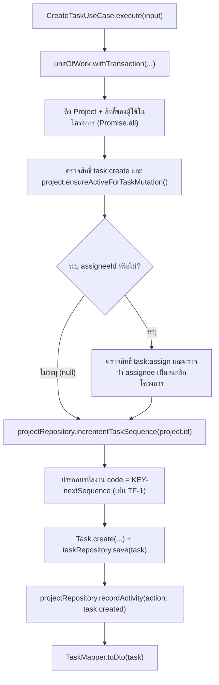

# Milestone 7 — Backend Step 3: Application Tasks & Mapper (src/server/application/tasks/ & mappers/)

เอกสารบทเรียนสำหรับ **Milestone 7 (ฝั่ง Backend: Step 3)** มุ่งเน้นการพัฒนา **Application Layer** สำหรับโมดูลงาน (Tasks) และความคิดเห็น (Task Comments) ซึ่งประกอบด้วย Data Mapper (`TaskMapper`), สัญญา CQRS Read Queries (`ITaskQueries`), และ Use Cases ทั้ง 9 คลาสที่ทำหน้าที่เป็น Orchestrator ประสานงานระหว่าง Domain Entities, Repositories, Authorization Service และ Unit of Work

---

## 1. เป้าหมายและขอบเขต Boundary (Boundary Context & Goal)

ในขั้นตอนนี้ เราจะสร้างไฟล์ใน `src/server/application/mappers/` และ `src/server/application/tasks/` รวมทั้งสิ้น 11 ไฟล์ โดยแยกความรับผิดชอบตามหลัก **1 ไฟล์ต่อ 1 Use Case** และแยกฝั่ง **Write Model (Command Use Cases)** ออกจาก **Read Model (Query Use Cases)** อย่างชัดเจน

### ตารางสรุปไฟล์ใน Step นี้

| ลำดับ | เส้นทางไฟล์ (File Path) | บทบาทหน้าที่ (Responsibility) | จำนวนบรรทัด |
| :---: | :--- | :--- | :---: |
| 1 | `src/server/application/mappers/task.mapper.ts` | แปลง `Task` และ `TaskComment` Entity ให้เป็น `TaskDto` และ `TaskCommentDto` | 40 |
| 2 | `src/server/application/tasks/task-queries.interface.ts` | สัญญา `ITaskQueries` สำหรับ CQRS Read Projections (รายการงานและรายละเอียดงานเชิงลึก) | 16 |
| 3 | `src/server/application/tasks/create-task.use-case.ts` | สร้างงานใหม่ รันเลขลำดับ `KEY-N` บันทึกงานและประวัติกิจกรรมภายใต้ Transaction | 92 |
| 4 | `src/server/application/tasks/update-task.use-case.ts` | แก้ไขหัวข้อ รายละเอียด ความสำคัญ และวันครบกำหนดของงานพร้อมบันทึก Activity Log | 74 |
| 5 | `src/server/application/tasks/transition-task-status.use-case.ts` | เปลี่ยนสถานะงานผ่าน Domain FSM พร้อมบันทึก `previousStatus` และ `nextStatus` ลง Activity Log | 74 |
| 6 | `src/server/application/tasks/assign-task.use-case.ts` | มอบหมายหรือยกเลิกผู้รับผิดชอบงาน โดยตรวจสอบว่าผู้รับเป็นสมาชิกโครงการจริง | 89 |
| 7 | `src/server/application/tasks/delete-task.use-case.ts` | ลบงานออกจากโครงการและบันทึก Audit Trail (`taskId: null` เพื่อไม่ชน FK Constraint) | 71 |
| 8 | `src/server/application/tasks/get-task-detail.use-case.ts` | ดึงรายละเอียดงานพร้อม `allowedTransitions`, ความคิดเห็น และประวัติกิจกรรมผ่าน `ITaskQueries` | 52 |
| 9 | `src/server/application/tasks/list-tasks.use-case.ts` | ดึงรายการงานแบบแบ่งหน้า ค้นหา กรอง และจัดเรียงผ่าน `ITaskQueries` | 43 |
| 10 | `src/server/application/tasks/add-task-comment.use-case.ts` | เพิ่มความคิดเห็นใหม่ลงในงานพร้อมบันทึก Activity Log | 78 |
| 11 | `src/server/application/tasks/delete-task-comment.use-case.ts` | ลบความคิดเห็นโดยตรวจสิทธิ์เจ้าของหรือ `comment:delete_any` พร้อมบันทึก Activity Log | 93 |

### แผนผังการทำงานของ Atomic Workflow ใน `CreateTaskUseCase`



---

## 2. ทฤษฎี ความสำคัญ และกฎสถาปัตยกรรมเฉพาะ Boundary นี้

### 2.1 กฎ Application Layer จาก `.agents/rules/server.md` (ข้อ 8–12 และ 15)

- **ข้อ 8 (Single Responsibility — 1 ไฟล์ต่อ 1 Use Case)**: แยกแต่ละการกระทำออกเป็นคลาสอิสระที่มีเมธอด `execute(input)` เพียงเมธอดเดียว ไม่ยุบรวมเป็น `TaskService` ขนาดใหญ่
- **ข้อ 9 (Explicit Input Object)**: ทุก Use Case นิยาม Interface สำหรับ Input เช่น `CreateTaskUseCaseInput`, `AssignTaskUseCaseInput` แทนการส่งพารามิเตอร์เรียงต่อกันหลายตัว
- **ข้อ 10 (Use Case as Pure Orchestrator)**: Use Case ไม่เขียนคำสั่ง SQL หรือ Drizzle ORM เอง แต่ทำหน้าที่ประสานงานระหว่าง `IProjectRepository`, `ITaskRepository`, `ITaskQueries`, `AuthorizationService` และ `IUnitOfWork`
- **ข้อ 11 (Data Mapper Class)**: ใช้ `TaskMapper.toDto(task)` และ `TaskMapper.toCommentDto(comment, author)` เพื่อแปลง Domain Entity เป็น DTO จาก `shared/schemas/task.schema.ts` ก่อนส่งออกนอก Application Layer เสมอ
- **ข้อ 12 (Atomic Multi-Entity Operations ผ่าน `IUnitOfWork`)**: ทุก Use Case ที่มีการเปลี่ยนแปลงข้อมูล (Write Operations) จะครอบการทำงานทั้งหมดไว้ใน `this.unitOfWork.withTransaction(async () => { ... })`
- **ข้อ 15 (CQRS Query Projections)**: สำหรับ `ListTasksUseCase` และ `GetTaskDetailUseCase` ซึ่งเป็นการอ่านข้อมูลที่ต้อง Join ตารางผู้ใช้ นับจำนวนความคิดเห็น และดึงประวัติกิจกรรม เราเรียกผ่านสัญญา `ITaskQueries` เพื่อคืนค่า DTO โดยตรงโดยไม่ต้อง Reconstitute Aggregate Root ทั้งก้อน

### 2.2 เจาะลึก Atomic Workflow ใน `CreateTaskUseCase` และ Cross-Aggregate Invariants

ในการสร้างงานใหม่หรือแก้ไขงาน มีกฎข้าม Aggregate (**Cross-Aggregate Invariants**) ที่สำคัญ 3 ประการ:
1. **การป้องกันการแก้ไขงานในโครงการที่ถูก Archive (`project.ensureActiveForTaskMutation()`)**:
   ก่อนที่จะสร้าง แก้ไข เปลี่ยนสถานะ มอบหมาย ลบงาน หรือจัดการความคิดเห็น ทุก Write Use Case ต้องโหลด `Project` Aggregate Root ขึ้นมาและเรียก `project.ensureActiveForTaskMutation()` เสมอ หากโครงการถูกจัดเก็บ (`archived`) จะโยน `ProjectArchivedError` ทันที
2. **การตรวจสอบผู้รับผิดชอบงาน (`InvalidTaskAssigneeError`)**:
   ใน `CreateTaskUseCase` และ `AssignTaskUseCase` หากมีการระบุ `assigneeId` (ไม่เป็น `null`) ระบบต้องตรวจสอบทั้งสิทธิ์ `PROJECT_PERMISSIONS.TASK_ASSIGN` ของผู้สั่งการ และตรวจสอบผ่าน `this.projectRepository.findMemberByUserId(project.id, assigneeId)` ว่าผู้ใช้คนนั้นเป็นสมาชิกของโครงการนี้จริง หากไม่ใช่สมาชิกจะโยน `InvalidTaskAssigneeError`
3. **การสร้างรหัสงานอัตโนมัติพร้อมบันทึก Activity Log ภายใต้ Transaction เดียวกัน**:
   ภายใน `unitOfWork.withTransaction(...)` ของ `CreateTaskUseCase`:
   - เรียก `const nextSequence = await this.projectRepository.incrementTaskSequence(project.id)` เพื่อเพิ่มค่า `task_sequence` ของโครงการขึ้น 1 และรับเลขลำดับใหม่กลับมา
   - นำมาประกอบกับ Project Key เป็นรหัสงาน เช่น `${project.key.value}-${nextSequence}` (ได้ผลลัพธ์เช่น `TF-1`, `TF-2`)
   - สร้าง `Task.create(...)` และบันทึกด้วย `this.taskRepository.save(task)`
   - บันทึกประวัติกิจกรรม `this.projectRepository.recordActivity({ action: "task.created", ... })`
   - หากขั้นตอนใดขั้นตอนหนึ่งล้มเหลว Transaction ทั้งหมดจะถูก Rollback รวมถึงเลข `task_sequence` ที่เพิ่งบวกเพิ่มไปด้วย จึงไม่เกิดเลขกระโดดหรือข้อมูลค้างครึ่งๆ กลางๆ

---

## 3. ลงมือเขียนโค้ด (Step-by-Step Implementation)

### 3.1 ไฟล์ `src/server/application/mappers/task.mapper.ts`

สร้างคลาส `TaskMapper` สำหรับแปลง `Task` และ `TaskComment` เป็น DTO:

```typescript
import type { Task } from "#/server/domain/tasks/task.entity";
import type { TaskComment } from "#/server/domain/tasks/task-comment.entity";
import type {
	TaskCommentDto,
	TaskDto,
	TaskUserSummary,
} from "#/shared/schemas/task.schema";

export class TaskMapper {
	static toDto(task: Task): TaskDto {
		return {
			id: task.id,
			projectId: task.projectId,
			code: task.code,
			title: task.title,
			description: task.description,
			status: task.status,
			priority: task.priority,
			assigneeId: task.assigneeId,
			reporterId: task.reporterId,
			dueDate: task.dueDate ? task.dueDate.toISOString() : null,
			createdAt: task.createdAt.toISOString(),
			updatedAt: task.updatedAt.toISOString(),
		};
	}

	static toCommentDto(
		comment: TaskComment,
		author: TaskUserSummary,
	): TaskCommentDto {
		return {
			id: comment.id,
			taskId: comment.taskId,
			author,
			body: comment.body,
			createdAt: comment.createdAt.toISOString(),
			updatedAt: comment.updatedAt.toISOString(),
		};
	}
}
```

### 3.2 ไฟล์ `src/server/application/tasks/task-queries.interface.ts`

สร้างสัญญา `ITaskQueries` สำหรับฝั่งการอ่านข้อมูล (CQRS Read Side):

```typescript
import type {
	ListTasksResultDto,
	TaskDetailDto,
	TasksSearch,
} from "#/shared/schemas/task.schema";

export interface ITaskQueries {
	listTasks(
		projectId: string,
		params: TasksSearch,
	): Promise<ListTasksResultDto>;
	findTaskDetailById(
		projectId: string,
		taskId: string,
	): Promise<TaskDetailDto | null>;
}
```

### 3.3 ไฟล์ `src/server/application/tasks/create-task.use-case.ts`

สร้าง Use Case สำหรับการสร้างงานใหม่ในโครงการ:

```typescript
import type { AuthorizationService } from "#/server/application/common/authorization.service";
import { TaskMapper } from "#/server/application/mappers/task.mapper";
import type { IUnitOfWork } from "#/server/domain/common/unit-of-work.interface";
import { ProjectNotFoundError } from "#/server/domain/projects/project.errors";
import type { IProjectRepository } from "#/server/domain/projects/project.repository";
import { PROJECT_PERMISSIONS } from "#/server/domain/rbac/permission-codes";
import { Task } from "#/server/domain/tasks/task.entity";
import { InvalidTaskAssigneeError } from "#/server/domain/tasks/task.errors";
import type { ITaskRepository } from "#/server/domain/tasks/task.repository";
import type { CreateTaskInput, TaskDto } from "#/shared/schemas/task.schema";

export interface CreateTaskUseCaseInput {
	actorUserId: string;
	payload: CreateTaskInput;
}

export class CreateTaskUseCase {
	constructor(
		private readonly projectRepository: IProjectRepository,
		private readonly taskRepository: ITaskRepository,
		private readonly authorizationService: AuthorizationService,
		private readonly unitOfWork: IUnitOfWork,
	) {}

	async execute(input: CreateTaskUseCaseInput): Promise<TaskDto> {
		return this.unitOfWork.withTransaction(async () => {
			const [project, projectPermissions] = await Promise.all([
				this.projectRepository.findById(input.payload.projectId),
				this.projectRepository.getUserProjectPermissions(
					input.payload.projectId,
					input.actorUserId,
				),
			]);

			if (!project) {
				throw new ProjectNotFoundError(input.payload.projectId);
			}

			this.authorizationService.assertProjectPermission(
				projectPermissions,
				PROJECT_PERMISSIONS.TASK_CREATE,
			);
			project.ensureActiveForTaskMutation();

			const assigneeId = input.payload.assigneeId;
			if (assigneeId !== null) {
				this.authorizationService.assertProjectPermission(
					projectPermissions,
					PROJECT_PERMISSIONS.TASK_ASSIGN,
				);

				const assigneeMember = await this.projectRepository.findMemberByUserId(
					project.id,
					assigneeId,
				);
				if (!assigneeMember) {
					throw new InvalidTaskAssigneeError(assigneeId);
				}
			}

			const nextSequence = await this.projectRepository.incrementTaskSequence(
				project.id,
			);
			const code = `${project.key.value}-${nextSequence}`;

			const task = Task.create({
				projectId: project.id,
				code,
				title: input.payload.title,
				description: input.payload.description,
				priority: input.payload.priority,
				assigneeId,
				reporterId: input.actorUserId,
				dueDate: input.payload.dueDate,
			});

			await this.taskRepository.save(task);
			await this.projectRepository.recordActivity({
				projectId: project.id,
				taskId: task.id,
				actorId: input.actorUserId,
				action: "task.created",
				metadata: {
					code: task.code,
					title: task.title,
				},
			});

			return TaskMapper.toDto(task);
		});
	}
}
```

### 3.4 ไฟล์ `src/server/application/tasks/update-task.use-case.ts`

สร้าง Use Case สำหรับแก้ไขรายละเอียดของงาน:

```typescript
import type { AuthorizationService } from "#/server/application/common/authorization.service";
import { TaskMapper } from "#/server/application/mappers/task.mapper";
import type { IUnitOfWork } from "#/server/domain/common/unit-of-work.interface";
import { ProjectNotFoundError } from "#/server/domain/projects/project.errors";
import type { IProjectRepository } from "#/server/domain/projects/project.repository";
import { PROJECT_PERMISSIONS } from "#/server/domain/rbac/permission-codes";
import { TaskNotFoundError } from "#/server/domain/tasks/task.errors";
import type { ITaskRepository } from "#/server/domain/tasks/task.repository";
import type { TaskDto, UpdateTaskInput } from "#/shared/schemas/task.schema";

export interface UpdateTaskUseCaseInput {
	actorUserId: string;
	payload: UpdateTaskInput;
}

export class UpdateTaskUseCase {
	constructor(
		private readonly projectRepository: IProjectRepository,
		private readonly taskRepository: ITaskRepository,
		private readonly authorizationService: AuthorizationService,
		private readonly unitOfWork: IUnitOfWork,
	) {}

	async execute(input: UpdateTaskUseCaseInput): Promise<TaskDto> {
		return this.unitOfWork.withTransaction(async () => {
			const [project, projectPermissions, task] = await Promise.all([
				this.projectRepository.findById(input.payload.projectId),
				this.projectRepository.getUserProjectPermissions(
					input.payload.projectId,
					input.actorUserId,
				),
				this.taskRepository.findById(
					input.payload.projectId,
					input.payload.taskId,
				),
			]);

			if (!project) {
				throw new ProjectNotFoundError(input.payload.projectId);
			}

			this.authorizationService.assertProjectPermission(
				projectPermissions,
				PROJECT_PERMISSIONS.TASK_UPDATE,
			);
			project.ensureActiveForTaskMutation();

			if (!task) {
				throw new TaskNotFoundError(input.payload.taskId);
			}

			task.updateDetails({
				title: input.payload.title,
				description: input.payload.description,
				priority: input.payload.priority,
				dueDate: input.payload.dueDate,
			});

			await this.taskRepository.save(task);
			await this.projectRepository.recordActivity({
				projectId: project.id,
				taskId: task.id,
				actorId: input.actorUserId,
				action: "task.updated",
				metadata: {
					code: task.code,
					title: task.title,
				},
			});

			return TaskMapper.toDto(task);
		});
	}
}
```

### 3.5 ไฟล์ `src/server/application/tasks/transition-task-status.use-case.ts`

สร้าง Use Case สำหรับเปลี่ยนสถานะงานตามกฎ Finite State Machine:

```typescript
import type { AuthorizationService } from "#/server/application/common/authorization.service";
import { TaskMapper } from "#/server/application/mappers/task.mapper";
import type { IUnitOfWork } from "#/server/domain/common/unit-of-work.interface";
import { ProjectNotFoundError } from "#/server/domain/projects/project.errors";
import type { IProjectRepository } from "#/server/domain/projects/project.repository";
import { PROJECT_PERMISSIONS } from "#/server/domain/rbac/permission-codes";
import { TaskNotFoundError } from "#/server/domain/tasks/task.errors";
import type { ITaskRepository } from "#/server/domain/tasks/task.repository";
import type {
	TaskDto,
	TransitionTaskStatusInput,
} from "#/shared/schemas/task.schema";

export interface TransitionTaskStatusUseCaseInput {
	actorUserId: string;
	payload: TransitionTaskStatusInput;
}

export class TransitionTaskStatusUseCase {
	constructor(
		private readonly projectRepository: IProjectRepository,
		private readonly taskRepository: ITaskRepository,
		private readonly authorizationService: AuthorizationService,
		private readonly unitOfWork: IUnitOfWork,
	) {}

	async execute(input: TransitionTaskStatusUseCaseInput): Promise<TaskDto> {
		return this.unitOfWork.withTransaction(async () => {
			const [project, projectPermissions, task] = await Promise.all([
				this.projectRepository.findById(input.payload.projectId),
				this.projectRepository.getUserProjectPermissions(
					input.payload.projectId,
					input.actorUserId,
				),
				this.taskRepository.findById(
					input.payload.projectId,
					input.payload.taskId,
				),
			]);

			if (!project) {
				throw new ProjectNotFoundError(input.payload.projectId);
			}

			this.authorizationService.assertProjectPermission(
				projectPermissions,
				PROJECT_PERMISSIONS.TASK_UPDATE,
			);
			project.ensureActiveForTaskMutation();

			if (!task) {
				throw new TaskNotFoundError(input.payload.taskId);
			}

			const previousStatus = task.status;
			task.transitionTo(input.payload.status);

			await this.taskRepository.save(task);
			await this.projectRepository.recordActivity({
				projectId: project.id,
				taskId: task.id,
				actorId: input.actorUserId,
				action: "task.status_changed",
				metadata: {
					code: task.code,
					previousStatus,
					nextStatus: task.status,
				},
			});

			return TaskMapper.toDto(task);
		});
	}
}
```

### 3.6 ไฟล์ `src/server/application/tasks/assign-task.use-case.ts`

สร้าง Use Case สำหรับมอบหมายงานหรือยกเลิกผู้รับผิดชอบงาน:

```typescript
import type { AuthorizationService } from "#/server/application/common/authorization.service";
import { TaskMapper } from "#/server/application/mappers/task.mapper";
import type { IUnitOfWork } from "#/server/domain/common/unit-of-work.interface";
import { ProjectNotFoundError } from "#/server/domain/projects/project.errors";
import type { IProjectRepository } from "#/server/domain/projects/project.repository";
import { PROJECT_PERMISSIONS } from "#/server/domain/rbac/permission-codes";
import {
	InvalidTaskAssigneeError,
	TaskNotFoundError,
} from "#/server/domain/tasks/task.errors";
import type { ITaskRepository } from "#/server/domain/tasks/task.repository";
import type { AssignTaskInput, TaskDto } from "#/shared/schemas/task.schema";

export interface AssignTaskUseCaseInput {
	actorUserId: string;
	payload: AssignTaskInput;
}

export class AssignTaskUseCase {
	constructor(
		private readonly projectRepository: IProjectRepository,
		private readonly taskRepository: ITaskRepository,
		private readonly authorizationService: AuthorizationService,
		private readonly unitOfWork: IUnitOfWork,
	) {}

	async execute(input: AssignTaskUseCaseInput): Promise<TaskDto> {
		return this.unitOfWork.withTransaction(async () => {
			const [project, projectPermissions, task] = await Promise.all([
				this.projectRepository.findById(input.payload.projectId),
				this.projectRepository.getUserProjectPermissions(
					input.payload.projectId,
					input.actorUserId,
				),
				this.taskRepository.findById(
					input.payload.projectId,
					input.payload.taskId,
				),
			]);

			if (!project) {
				throw new ProjectNotFoundError(input.payload.projectId);
			}

			this.authorizationService.assertProjectPermission(
				projectPermissions,
				PROJECT_PERMISSIONS.TASK_ASSIGN,
			);
			project.ensureActiveForTaskMutation();

			if (!task) {
				throw new TaskNotFoundError(input.payload.taskId);
			}

			const nextAssigneeId = input.payload.assigneeId;
			if (nextAssigneeId !== null) {
				const member = await this.projectRepository.findMemberByUserId(
					project.id,
					nextAssigneeId,
				);
				if (!member) {
					throw new InvalidTaskAssigneeError(nextAssigneeId);
				}
			}

			const previousAssigneeId = task.assigneeId;
			if (previousAssigneeId === nextAssigneeId) {
				return TaskMapper.toDto(task);
			}

			task.assignTo(nextAssigneeId);

			await this.taskRepository.save(task);
			await this.projectRepository.recordActivity({
				projectId: project.id,
				taskId: task.id,
				actorId: input.actorUserId,
				action: "task.assigned",
				metadata: {
					code: task.code,
					previousAssigneeId,
					nextAssigneeId: task.assigneeId,
				},
			});

			return TaskMapper.toDto(task);
		});
	}
}
```

### 3.7 ไฟล์ `src/server/application/tasks/delete-task.use-case.ts`

สร้าง Use Case สำหรับลบงานออกจากโครงการ:

```typescript
import type { AuthorizationService } from "#/server/application/common/authorization.service";
import type { IUnitOfWork } from "#/server/domain/common/unit-of-work.interface";
import { ProjectNotFoundError } from "#/server/domain/projects/project.errors";
import type { IProjectRepository } from "#/server/domain/projects/project.repository";
import { PROJECT_PERMISSIONS } from "#/server/domain/rbac/permission-codes";
import { TaskNotFoundError } from "#/server/domain/tasks/task.errors";
import type { ITaskRepository } from "#/server/domain/tasks/task.repository";
import type { DeleteTaskInput } from "#/shared/schemas/task.schema";

export interface DeleteTaskUseCaseInput {
	actorUserId: string;
	payload: DeleteTaskInput;
}

export class DeleteTaskUseCase {
	constructor(
		private readonly projectRepository: IProjectRepository,
		private readonly taskRepository: ITaskRepository,
		private readonly authorizationService: AuthorizationService,
		private readonly unitOfWork: IUnitOfWork,
	) {}

	async execute(input: DeleteTaskUseCaseInput): Promise<{ deleted: true }> {
		return this.unitOfWork.withTransaction(async () => {
			const [project, projectPermissions, task] = await Promise.all([
				this.projectRepository.findById(input.payload.projectId),
				this.projectRepository.getUserProjectPermissions(
					input.payload.projectId,
					input.actorUserId,
				),
				this.taskRepository.findById(
					input.payload.projectId,
					input.payload.taskId,
				),
			]);

			if (!project) {
				throw new ProjectNotFoundError(input.payload.projectId);
			}

			this.authorizationService.assertProjectPermission(
				projectPermissions,
				PROJECT_PERMISSIONS.TASK_DELETE,
			);
			project.ensureActiveForTaskMutation();

			if (!task) {
				throw new TaskNotFoundError(input.payload.taskId);
			}

			const deleted = await this.taskRepository.delete(project.id, task.id);
			if (!deleted) {
				throw new TaskNotFoundError(task.id);
			}

			// บันทึก taskId: null หลังลบเพื่อป้องกัน FK constraint violation ขณะคงรหัสไว้ใน Audit Trail
			await this.projectRepository.recordActivity({
				projectId: project.id,
				taskId: null,
				actorId: input.actorUserId,
				action: "task.deleted",
				metadata: {
					code: task.code,
					title: task.title,
				},
			});

			return { deleted: true };
		});
	}
}
```

### 3.8 ไฟล์ `src/server/application/tasks/get-task-detail.use-case.ts`

สร้าง Read Use Case สำหรับดึงรายละเอียดงานเชิงลึก:

```typescript
import type { AuthorizationService } from "#/server/application/common/authorization.service";
import { ProjectNotFoundError } from "#/server/domain/projects/project.errors";
import type { IProjectRepository } from "#/server/domain/projects/project.repository";
import { TaskNotFoundError } from "#/server/domain/tasks/task.errors";
import type {
	GetTaskDetailInput,
	TaskDetailDto,
} from "#/shared/schemas/task.schema";
import type { ITaskQueries } from "./task-queries.interface";

export interface GetTaskDetailUseCaseInput {
	actorUserId: string;
	actorSystemPermissions: readonly string[];
	payload: GetTaskDetailInput;
}

export class GetTaskDetailUseCase {
	constructor(
		private readonly projectRepository: IProjectRepository,
		private readonly taskQueries: ITaskQueries,
		private readonly authorizationService: AuthorizationService,
	) {}

	async execute(input: GetTaskDetailUseCaseInput): Promise<TaskDetailDto> {
		const [project, projectPermissions, detail] = await Promise.all([
			this.projectRepository.findById(input.payload.projectId),
			this.projectRepository.getUserProjectPermissions(
				input.payload.projectId,
				input.actorUserId,
			),
			this.taskQueries.findTaskDetailById(
				input.payload.projectId,
				input.payload.taskId,
			),
		]);

		if (!project) {
			throw new ProjectNotFoundError(input.payload.projectId);
		}

		this.authorizationService.assertProjectReadAccess(
			input.actorSystemPermissions,
			projectPermissions,
		);

		if (!detail) {
			throw new TaskNotFoundError(input.payload.taskId);
		}

		return detail;
	}
}
```

### 3.9 ไฟล์ `src/server/application/tasks/list-tasks.use-case.ts`

สร้าง Read Use Case สำหรับดึงรายการงานแบบแบ่งหน้า:

```typescript
import type { AuthorizationService } from "#/server/application/common/authorization.service";
import { ProjectNotFoundError } from "#/server/domain/projects/project.errors";
import type { IProjectRepository } from "#/server/domain/projects/project.repository";
import type {
	ListTasksInput,
	ListTasksResultDto,
} from "#/shared/schemas/task.schema";
import type { ITaskQueries } from "./task-queries.interface";

export interface ListTasksUseCaseInput {
	actorUserId: string;
	actorSystemPermissions: readonly string[];
	payload: ListTasksInput;
}

export class ListTasksUseCase {
	constructor(
		private readonly projectRepository: IProjectRepository,
		private readonly taskQueries: ITaskQueries,
		private readonly authorizationService: AuthorizationService,
	) {}

	async execute(input: ListTasksUseCaseInput): Promise<ListTasksResultDto> {
		const [project, projectPermissions] = await Promise.all([
			this.projectRepository.findById(input.payload.projectId),
			this.projectRepository.getUserProjectPermissions(
				input.payload.projectId,
				input.actorUserId,
			),
		]);

		if (!project) {
			throw new ProjectNotFoundError(input.payload.projectId);
		}

		this.authorizationService.assertProjectReadAccess(
			input.actorSystemPermissions,
			projectPermissions,
		);

		return this.taskQueries.listTasks(project.id, input.payload.params);
	}
}
```

### 3.10 ไฟล์ `src/server/application/tasks/add-task-comment.use-case.ts`

สร้าง Use Case สำหรับเพิ่มความคิดเห็นใหม่ในงาน:

```typescript
import type { AuthorizationService } from "#/server/application/common/authorization.service";
import { TaskMapper } from "#/server/application/mappers/task.mapper";
import type { IUnitOfWork } from "#/server/domain/common/unit-of-work.interface";
import { ProjectNotFoundError } from "#/server/domain/projects/project.errors";
import type { IProjectRepository } from "#/server/domain/projects/project.repository";
import { PROJECT_PERMISSIONS } from "#/server/domain/rbac/permission-codes";
import { TaskNotFoundError } from "#/server/domain/tasks/task.errors";
import type { ITaskRepository } from "#/server/domain/tasks/task.repository";
import { TaskComment } from "#/server/domain/tasks/task-comment.entity";
import type {
	AddTaskCommentInput,
	TaskCommentDto,
	TaskUserSummary,
} from "#/shared/schemas/task.schema";

export interface AddTaskCommentUseCaseInput {
	actor: TaskUserSummary;
	payload: AddTaskCommentInput;
}

export class AddTaskCommentUseCase {
	constructor(
		private readonly projectRepository: IProjectRepository,
		private readonly taskRepository: ITaskRepository,
		private readonly authorizationService: AuthorizationService,
		private readonly unitOfWork: IUnitOfWork,
	) {}

	async execute(input: AddTaskCommentUseCaseInput): Promise<TaskCommentDto> {
		return this.unitOfWork.withTransaction(async () => {
			const [project, projectPermissions, task] = await Promise.all([
				this.projectRepository.findById(input.payload.projectId),
				this.projectRepository.getUserProjectPermissions(
					input.payload.projectId,
					input.actor.id,
				),
				this.taskRepository.findById(
					input.payload.projectId,
					input.payload.taskId,
				),
			]);

			if (!project) {
				throw new ProjectNotFoundError(input.payload.projectId);
			}

			this.authorizationService.assertProjectPermission(
				projectPermissions,
				PROJECT_PERMISSIONS.COMMENT_CREATE,
			);
			project.ensureActiveForTaskMutation();

			if (!task) {
				throw new TaskNotFoundError(input.payload.taskId);
			}

			const comment = TaskComment.create({
				taskId: task.id,
				authorId: input.actor.id,
				body: input.payload.body,
			});

			await this.taskRepository.saveComment(comment);
			await this.projectRepository.recordActivity({
				projectId: project.id,
				taskId: task.id,
				actorId: input.actor.id,
				action: "task.comment_added",
				metadata: {
					code: task.code,
					commentId: comment.id,
				},
			});

			return TaskMapper.toCommentDto(comment, input.actor);
		});
	}
}
```

### 3.11 ไฟล์ `src/server/application/tasks/delete-task-comment.use-case.ts`

สร้าง Use Case สำหรับลบความคิดเห็นออกจากงาน:

```typescript
import type { AuthorizationService } from "#/server/application/common/authorization.service";
import type { IUnitOfWork } from "#/server/domain/common/unit-of-work.interface";
import { ProjectNotFoundError } from "#/server/domain/projects/project.errors";
import type { IProjectRepository } from "#/server/domain/projects/project.repository";
import { PROJECT_PERMISSIONS } from "#/server/domain/rbac/permission-codes";
import {
	TaskCommentNotFoundError,
	TaskNotFoundError,
} from "#/server/domain/tasks/task.errors";
import type { ITaskRepository } from "#/server/domain/tasks/task.repository";
import type { DeleteTaskCommentInput } from "#/shared/schemas/task.schema";

export interface DeleteTaskCommentUseCaseInput {
	actorUserId: string;
	payload: DeleteTaskCommentInput;
}

export class DeleteTaskCommentUseCase {
	constructor(
		private readonly projectRepository: IProjectRepository,
		private readonly taskRepository: ITaskRepository,
		private readonly authorizationService: AuthorizationService,
		private readonly unitOfWork: IUnitOfWork,
	) {}

	async execute(
		input: DeleteTaskCommentUseCaseInput,
	): Promise<{ deleted: true }> {
		return this.unitOfWork.withTransaction(async () => {
			const [project, projectPermissions, task, comment] = await Promise.all([
				this.projectRepository.findById(input.payload.projectId),
				this.projectRepository.getUserProjectPermissions(
					input.payload.projectId,
					input.actorUserId,
				),
				this.taskRepository.findById(
					input.payload.projectId,
					input.payload.taskId,
				),
				this.taskRepository.findCommentById(
					input.payload.projectId,
					input.payload.taskId,
					input.payload.commentId,
				),
			]);

			if (!project) {
				throw new ProjectNotFoundError(input.payload.projectId);
			}

			this.authorizationService.assertProjectPermission(
				projectPermissions,
				PROJECT_PERMISSIONS.PROJECT_READ,
			);
			project.ensureActiveForTaskMutation();

			if (!task) {
				throw new TaskNotFoundError(input.payload.taskId);
			}

			if (!comment) {
				throw new TaskCommentNotFoundError(input.payload.commentId);
			}

			const canDeleteAny = this.authorizationService.hasProjectPermission(
				projectPermissions,
				PROJECT_PERMISSIONS.COMMENT_DELETE_ANY,
			);
			comment.ensureDeletableBy(input.actorUserId, canDeleteAny);

			const deleted = await this.taskRepository.deleteComment(
				task.id,
				comment.id,
			);
			if (!deleted) {
				throw new TaskCommentNotFoundError(comment.id);
			}

			await this.projectRepository.recordActivity({
				projectId: project.id,
				taskId: task.id,
				actorId: input.actorUserId,
				action: "task.comment_deleted",
				metadata: {
					code: task.code,
					commentId: comment.id,
				},
			});

			return { deleted: true };
		});
	}
}
```

---

## 4. การตรวจสอบความถูกต้องและ Git Commit (Verification & Commit)

ตรวจสอบความถูกต้องของ Type และ Linter ด้วย `bun` แล้วทำการ Commit ประจำ Step ที่ 3:

```bash
bun run check
git add src/server/application/mappers/task.mapper.ts src/server/application/tasks/
git commit -m "milestone-7.backend.step-3: Application Tasks & Comments Use Cases and Mapper"
```
