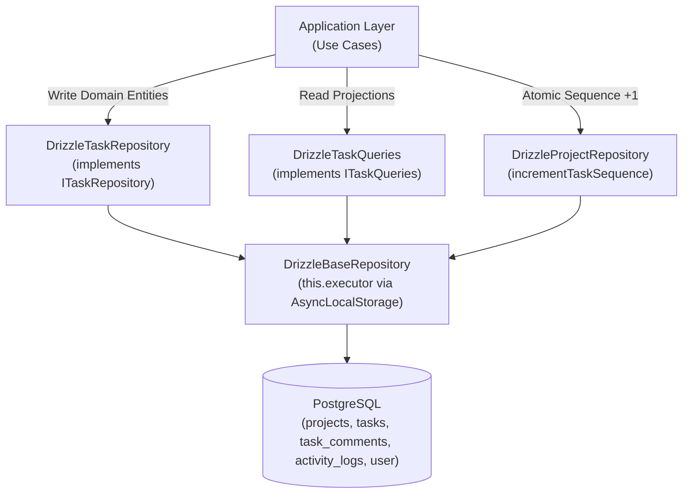

# Milestone 7 — Backend Step 4: Infrastructure Tasks (src/server/infrastructure/tasks/ & projects/)

เอกสารบทเรียนสำหรับ **Milestone 7 (ฝั่ง Backend: Step 4)** มุ่งเน้นการพัฒนา **Infrastructure Layer** ด้วย Drizzle ORM และ PostgreSQL เพื่อทำให้สัญญา `ITaskRepository`, `ITaskQueries` และ `IProjectRepository.incrementTaskSequence` ทำงานร่วมกับฐานข้อมูลจริงได้อย่างมีประสิทธิภาพสูงสุดและปลอดภัยต่อภาวะการทำงานพร้อมกัน (Concurrency-safe)

---

## 1. เป้าหมายและขอบเขต Boundary (Boundary Context & Goal)

ในขั้นตอนนี้ เราจะสร้างไฟล์ใน `src/server/infrastructure/tasks/` จำนวน 2 ไฟล์ และต่อเติม `src/server/infrastructure/projects/drizzle-project.repository.ts` อีก 1 ไฟล์ เพื่อจัดการ Persistence ของ `Task` และ `TaskComment`, การคิวรีข้อมูลแบบ CQRS Read Projection และการรันเลขลำดับงานของโครงการแบบ Atomic ใน PostgreSQL

### ตารางสรุปไฟล์ใน Step นี้

| ลำดับ | เส้นทางไฟล์ (File Path) | บทบาทหน้าที่ (Responsibility) | จำนวนบรรทัด |
| :---: | :--- | :--- | :---: |
| 1 | `src/server/infrastructure/tasks/drizzle-task.repository.ts` | Implement `ITaskRepository` ด้วย Drizzle ORM (Upsert, Delete with Returning, Reconstitution) | 145 |
| 2 | `src/server/infrastructure/tasks/drizzle-task.queries.ts` | Implement `ITaskQueries` สำหรับดึงตารางงาน (Batch Comment Count, Multi-Join) และรายละเอียดงานเชิงลึก | 311 |
| 3 | `src/server/infrastructure/projects/drizzle-project.repository.ts` | ต่อเติมเมธอด `incrementTaskSequence(projectId)` ด้วย Atomic SQL Update พร้อม `.returning()` | 283 |

### แผนผังการทำงานของ Infrastructure Tasks & Concurrency-safe Sequence



---

## 2. ทฤษฎี ความสำคัญ และกฎสถาปัตยกรรมเฉพาะ Boundary นี้

### 2.1 กฎ Infrastructure Layer จาก `.agents/rules/server.md` (ข้อ 13–16)

- **ข้อ 13 (Encapsulate Persistence Details & Reconstitution)**: `DrizzleTaskRepository` ซ่อนโครงสร้าง Row ของ Drizzle ไว้ภายในคลาส และใช้เมธอด `private toTaskEntity(row)` กับ `private toCommentEntity(row)` เพื่อแปลงข้อมูลจากฐานข้อมูลกลับเป็น Domain Entity ผ่าน `Task.reconstitute(...)` และ `TaskComment.reconstitute(...)`
- **ข้อ 14 (Single Round-trip & Batch Queries)**:
  - ใช้ `.insert(...).onConflictDoUpdate(...)` (Upsert) ใน `save()` และ `saveComment()` เพื่อจบการบันทึกในคำสั่งเดียวโดยไม่ต้อง `SELECT` ก่อน
  - ใช้ `.delete(...).where(...).returning({ id: ... })` เพื่อลบและตรวจสอบว่ามีแถวถูกลบจริงใน Round-trip เดียว
  - ป้องกันปัญหา **N+1 Queries** ใน `listTasks()` ด้วยการรวบรวม `pageTaskIds` แล้วดึงจำนวนความคิดเห็นทั้งหมดในหน้านั้นด้วย `inArray(taskComments.taskId, pageTaskIds)` และ `.groupBy(taskComments.taskId)` เพียงคิวรีเดียว
- **ข้อ 15 (CQRS Query Projections)**: `DrizzleTaskQueries` ใช้ `alias(user, "task_assignee")` และ `alias(user, "task_reporter")` เพื่อ Join ตาราง `user` สองบทบาทพร้อมกันในคิวรีเดียว และคำนวณ `allowedTransitions: getAllowedTaskTransitions(row.status)` ส่งกลับเป็น DTO ทันที
- **ข้อ 16 (Implicit Transaction Context ผ่าน `AsyncLocalStorage`)**: ทุกคลาสสืบทอดจาก `DrizzleBaseRepository<AppDb, AppTx>` และเรียกใช้งานผ่าน `this.executor` ซึ่งจะสลับไปใช้ Transaction (`tx`) โดยอัตโนมัติเมื่อถูกเรียกภายใน `unitOfWork.withTransaction(...)`

### 2.2 การทำ Concurrency-safe Sequence Generation ใน PostgreSQL (`server.md` ข้อ 14)

ในการสร้างรหัสงานของโครงการ (เช่น `TF-1`, `TF-2`, `TF-3`) หากเราใช้วิธีดึง `project.taskSequence` มาบวก 1 ใน JavaScript แล้วค่อยสั่ง `UPDATE`:
- เมื่อมีผู้ใช้ 2 คนกดสร้างงานพร้อมกันในเสี้ยววินาทีเดียวกัน (Race Condition) ทั้งสอง Request อาจอ่านค่า `taskSequence` ได้ `5` เหมือนกัน และพยายามสร้างงานรหัส `TF-6` ซ้ำกันจนชน Unique Constraint (`tasks_project_code_unique`)!

เพื่อแก้ปัญหานี้อย่างเด็ดขาดในระดับ Database Engine เราจึงใช้คำสั่ง **Atomic SQL Update with Returning** ใน `DrizzleProjectRepository.incrementTaskSequence(projectId)`:

```sql
UPDATE "projects"
SET "task_sequence" = "projects"."task_sequence" + 1,
    "updated_at" = NOW()
WHERE "projects"."id" = $1
RETURNING "projects"."task_sequence";
```

ใน Drizzle ORM เราเขียนด้วย `sql`${projects.taskSequence} + 1`` ร่วมกับ `.returning({ taskSequence: projects.taskSequence })`:
1. **Row-level Locking อัตโนมัติ**: PostgreSQL จะล็อกแถวของโครงการนั้นขณะทำคำสั่ง `UPDATE` ทำให้การบวกค่าเกิดขึ้นแบบเรียงลำดับ (Serialized) อย่างปลอดภัยแม้มีคำขอเข้ามาพร้อมกันจำนวนมาก
2. **Single Round-trip**: บวกค่าและคืนค่าเลขลำดับใหม่กลับมาในคำสั่งเดียวตามกฎ `server.md` ข้อ 14

---

## 3. ลงมือเขียนโค้ด (Step-by-Step Implementation)

### 3.1 ไฟล์ `src/server/infrastructure/tasks/drizzle-task.repository.ts`

สร้างคลาส `DrizzleTaskRepository` สำหรับจัดการ Persistence ของ `Task` และ `TaskComment`:

```typescript
import { and, eq } from "drizzle-orm";
import { Task } from "#/server/domain/tasks/task.entity";
import type { ITaskRepository } from "#/server/domain/tasks/task.repository";
import { TaskComment } from "#/server/domain/tasks/task-comment.entity";
import { DrizzleBaseRepository } from "#/server/infrastructure/drizzle/base.repository";
import type { AppDb, AppTx } from "#/server/infrastructure/drizzle/db";
import { taskComments, tasks } from "#/server/infrastructure/drizzle/schema";

type TaskRow = typeof tasks.$inferSelect;
type TaskCommentRow = typeof taskComments.$inferSelect;

export class DrizzleTaskRepository
	extends DrizzleBaseRepository<AppDb, AppTx>
	implements ITaskRepository
{
	async findById(projectId: string, taskId: string): Promise<Task | null> {
		const [row] = await this.executor
			.select()
			.from(tasks)
			.where(and(eq(tasks.projectId, projectId), eq(tasks.id, taskId)))
			.limit(1);

		return row ? this.toTaskEntity(row) : null;
	}

	async save(task: Task): Promise<void> {
		await this.executor
			.insert(tasks)
			.values({
				id: task.id,
				projectId: task.projectId,
				code: task.code,
				title: task.title,
				description: task.description,
				status: task.status,
				priority: task.priority,
				assigneeId: task.assigneeId,
				reporterId: task.reporterId,
				dueDate: task.dueDate,
				createdAt: task.createdAt,
				updatedAt: task.updatedAt,
			})
			.onConflictDoUpdate({
				target: tasks.id,
				set: {
					title: task.title,
					description: task.description,
					status: task.status,
					priority: task.priority,
					assigneeId: task.assigneeId,
					dueDate: task.dueDate,
					updatedAt: task.updatedAt,
				},
			});
	}

	async delete(projectId: string, taskId: string): Promise<boolean> {
		const deleted = await this.executor
			.delete(tasks)
			.where(and(eq(tasks.projectId, projectId), eq(tasks.id, taskId)))
			.returning({ id: tasks.id });

		return deleted.length > 0;
	}

	async findCommentById(
		projectId: string,
		taskId: string,
		commentId: string,
	): Promise<TaskComment | null> {
		const [row] = await this.executor
			.select({
				comment: taskComments,
			})
			.from(taskComments)
			.innerJoin(tasks, eq(taskComments.taskId, tasks.id))
			.where(
				and(
					eq(taskComments.id, commentId),
					eq(taskComments.taskId, taskId),
					eq(tasks.projectId, projectId),
				),
			)
			.limit(1);

		return row ? this.toCommentEntity(row.comment) : null;
	}

	async saveComment(comment: TaskComment): Promise<void> {
		await this.executor
			.insert(taskComments)
			.values({
				id: comment.id,
				taskId: comment.taskId,
				authorId: comment.authorId,
				body: comment.body,
				createdAt: comment.createdAt,
				updatedAt: comment.updatedAt,
			})
			.onConflictDoUpdate({
				target: taskComments.id,
				set: {
					body: comment.body,
					updatedAt: comment.updatedAt,
				},
			});
	}

	async deleteComment(taskId: string, commentId: string): Promise<boolean> {
		const deleted = await this.executor
			.delete(taskComments)
			.where(
				and(eq(taskComments.id, commentId), eq(taskComments.taskId, taskId)),
			)
			.returning({ id: taskComments.id });

		return deleted.length > 0;
	}

	private toTaskEntity(row: TaskRow): Task {
		return Task.reconstitute(row.id, {
			projectId: row.projectId,
			code: row.code,
			title: row.title,
			description: row.description,
			status: row.status,
			priority: row.priority,
			assigneeId: row.assigneeId,
			reporterId: row.reporterId,
			dueDate: row.dueDate,
			createdAt: row.createdAt,
			updatedAt: row.updatedAt,
		});
	}

	private toCommentEntity(row: TaskCommentRow): TaskComment {
		return TaskComment.reconstitute(row.id, {
			taskId: row.taskId,
			authorId: row.authorId,
			body: row.body,
			createdAt: row.createdAt,
			updatedAt: row.updatedAt,
		});
	}
}
```

### 3.2 ไฟล์ `src/server/infrastructure/tasks/drizzle-task.queries.ts`

สร้างคลาส `DrizzleTaskQueries` สำหรับ CQRS Read Projections ของรายการงานและรายละเอียดงาน:

```typescript
import type { SQL } from "drizzle-orm";
import {
	and,
	asc,
	count,
	desc,
	eq,
	ilike,
	inArray,
	isNull,
	or,
} from "drizzle-orm";
import { alias } from "drizzle-orm/pg-core";
import type { ITaskQueries } from "#/server/application/tasks/task-queries.interface";
import { getAllowedTaskTransitions } from "#/server/domain/tasks/task-status.vo";
import { DrizzleBaseRepository } from "#/server/infrastructure/drizzle/base.repository";
import type { AppDb, AppTx } from "#/server/infrastructure/drizzle/db";
import {
	activityLogs,
	taskComments,
	tasks,
	user,
} from "#/server/infrastructure/drizzle/schema";
import { activityLogMetadataSchema } from "#/shared/schemas/project.schema";
import type {
	ListTasksResultDto,
	TaskDetailDto,
	TaskSortField,
	TasksSearch,
} from "#/shared/schemas/task.schema";

const SORT_COLUMN_MAP = {
	code: tasks.code,
	title: tasks.title,
	status: tasks.status,
	priority: tasks.priority,
	dueDate: tasks.dueDate,
	createdAt: tasks.createdAt,
	updatedAt: tasks.updatedAt,
} as const satisfies Record<TaskSortField, unknown>;

export class DrizzleTaskQueries
	extends DrizzleBaseRepository<AppDb, AppTx>
	implements ITaskQueries
{
	async listTasks(
		projectId: string,
		params: TasksSearch,
	): Promise<ListTasksResultDto> {
		const conditions: SQL[] = [eq(tasks.projectId, projectId)];

		if (params.status !== "all") {
			conditions.push(eq(tasks.status, params.status));
		}

		if (params.priority !== "all") {
			conditions.push(eq(tasks.priority, params.priority));
		}

		if (params.assigneeFilter === "unassigned") {
			conditions.push(isNull(tasks.assigneeId));
		} else if (params.assigneeFilter !== "all") {
			conditions.push(eq(tasks.assigneeId, params.assigneeFilter));
		}

		const trimmedSearch = params.search.trim();
		if (trimmedSearch.length > 0) {
			const pattern = `%${trimmedSearch}%`;
			const searchCondition = or(
				ilike(tasks.code, pattern),
				ilike(tasks.title, pattern),
				ilike(tasks.description, pattern),
			);
			if (searchCondition) {
				conditions.push(searchCondition);
			}
		}

		const whereClause = and(...conditions);
		const sortColumn = SORT_COLUMN_MAP[params.sortBy];
		const primaryOrder =
			params.sortOrder === "asc" ? asc(sortColumn) : desc(sortColumn);
		const offset = (params.page - 1) * params.pageSize;

		const assigneeUser = alias(user, "task_assignee");
		const reporterUser = alias(user, "task_reporter");

		const [[totalRow], pageRows] = await Promise.all([
			this.executor.select({ total: count() }).from(tasks).where(whereClause),
			this.executor
				.select({
					id: tasks.id,
					projectId: tasks.projectId,
					code: tasks.code,
					title: tasks.title,
					description: tasks.description,
					status: tasks.status,
					priority: tasks.priority,
					dueDate: tasks.dueDate,
					createdAt: tasks.createdAt,
					updatedAt: tasks.updatedAt,
					assigneeId: assigneeUser.id,
					assigneeName: assigneeUser.name,
					assigneeEmail: assigneeUser.email,
					reporterId: reporterUser.id,
					reporterName: reporterUser.name,
					reporterEmail: reporterUser.email,
				})
				.from(tasks)
				.leftJoin(assigneeUser, eq(tasks.assigneeId, assigneeUser.id))
				.innerJoin(reporterUser, eq(tasks.reporterId, reporterUser.id))
				.where(whereClause)
				.orderBy(primaryOrder, asc(tasks.id))
				.limit(params.pageSize)
				.offset(offset),
		]);

		const total = Number(totalRow?.total ?? 0);
		const totalPages = Math.max(1, Math.ceil(total / params.pageSize));

		if (pageRows.length === 0) {
			return {
				items: [],
				total,
				page: params.page,
				pageSize: params.pageSize,
				totalPages,
			};
		}

		const pageTaskIds = pageRows.map((row) => row.id);
		const commentCountRows = await this.executor
			.select({
				taskId: taskComments.taskId,
				total: count(),
			})
			.from(taskComments)
			.where(inArray(taskComments.taskId, pageTaskIds))
			.groupBy(taskComments.taskId);

		const commentCountMap = new Map<string, number>();
		for (const row of commentCountRows) {
			commentCountMap.set(row.taskId, Number(row.total));
		}

		return {
			items: pageRows.map((row) => ({
				id: row.id,
				projectId: row.projectId,
				code: row.code,
				title: row.title,
				description: row.description,
				status: row.status,
				priority: row.priority,
				assignee:
					row.assigneeId && row.assigneeName && row.assigneeEmail
						? {
								id: row.assigneeId,
								name: row.assigneeName,
								email: row.assigneeEmail,
							}
						: null,
				reporter: {
					id: row.reporterId,
					name: row.reporterName,
					email: row.reporterEmail,
				},
				dueDate: row.dueDate ? row.dueDate.toISOString() : null,
				commentCount: commentCountMap.get(row.id) ?? 0,
				createdAt: row.createdAt.toISOString(),
				updatedAt: row.updatedAt.toISOString(),
			})),
			total,
			page: params.page,
			pageSize: params.pageSize,
			totalPages,
		};
	}

	async findTaskDetailById(
		projectId: string,
		taskId: string,
	): Promise<TaskDetailDto | null> {
		const assigneeUser = alias(user, "task_detail_assignee");
		const reporterUser = alias(user, "task_detail_reporter");

		const [row] = await this.executor
			.select({
				id: tasks.id,
				projectId: tasks.projectId,
				code: tasks.code,
				title: tasks.title,
				description: tasks.description,
				status: tasks.status,
				priority: tasks.priority,
				dueDate: tasks.dueDate,
				createdAt: tasks.createdAt,
				updatedAt: tasks.updatedAt,
				assigneeId: assigneeUser.id,
				assigneeName: assigneeUser.name,
				assigneeEmail: assigneeUser.email,
				reporterId: reporterUser.id,
				reporterName: reporterUser.name,
				reporterEmail: reporterUser.email,
			})
			.from(tasks)
			.leftJoin(assigneeUser, eq(tasks.assigneeId, assigneeUser.id))
			.innerJoin(reporterUser, eq(tasks.reporterId, reporterUser.id))
			.where(and(eq(tasks.projectId, projectId), eq(tasks.id, taskId)))
			.limit(1);

		if (!row) {
			return null;
		}

		const [commentRows, activityRows] = await Promise.all([
			this.executor
				.select({
					id: taskComments.id,
					taskId: taskComments.taskId,
					body: taskComments.body,
					createdAt: taskComments.createdAt,
					updatedAt: taskComments.updatedAt,
					authorId: user.id,
					authorName: user.name,
					authorEmail: user.email,
				})
				.from(taskComments)
				.innerJoin(user, eq(taskComments.authorId, user.id))
				.where(eq(taskComments.taskId, row.id))
				.orderBy(asc(taskComments.createdAt), asc(taskComments.id)),
			this.executor
				.select({
					id: activityLogs.id,
					projectId: activityLogs.projectId,
					taskId: activityLogs.taskId,
					actorId: activityLogs.actorId,
					actorName: user.name,
					actorEmail: user.email,
					action: activityLogs.action,
					metadata: activityLogs.metadata,
					createdAt: activityLogs.createdAt,
				})
				.from(activityLogs)
				.innerJoin(user, eq(activityLogs.actorId, user.id))
				.where(
					and(
						eq(activityLogs.projectId, projectId),
						eq(activityLogs.taskId, row.id),
					),
				)
				.orderBy(desc(activityLogs.createdAt))
				.limit(50),
		]);

		return {
			id: row.id,
			projectId: row.projectId,
			code: row.code,
			title: row.title,
			description: row.description,
			status: row.status,
			priority: row.priority,
			allowedTransitions: getAllowedTaskTransitions(row.status),
			assignee:
				row.assigneeId && row.assigneeName && row.assigneeEmail
					? {
							id: row.assigneeId,
							name: row.assigneeName,
							email: row.assigneeEmail,
						}
					: null,
			reporter: {
				id: row.reporterId,
				name: row.reporterName,
				email: row.reporterEmail,
			},
			dueDate: row.dueDate ? row.dueDate.toISOString() : null,
			comments: commentRows.map((commentRow) => ({
				id: commentRow.id,
				taskId: commentRow.taskId,
				author: {
					id: commentRow.authorId,
					name: commentRow.authorName,
					email: commentRow.authorEmail,
				},
				body: commentRow.body,
				createdAt: commentRow.createdAt.toISOString(),
				updatedAt: commentRow.updatedAt.toISOString(),
			})),
			activities: activityRows.map((activityRow) => {
				const parsedMetadata = activityLogMetadataSchema.safeParse(
					activityRow.metadata,
				);
				return {
					id: activityRow.id,
					projectId: activityRow.projectId,
					taskId: activityRow.taskId,
					actorId: activityRow.actorId,
					actorName: activityRow.actorName,
					actorEmail: activityRow.actorEmail,
					action: activityRow.action,
					metadata: parsedMetadata.success ? parsedMetadata.data : {},
					createdAt: activityRow.createdAt.toISOString(),
				};
			}),
			createdAt: row.createdAt.toISOString(),
			updatedAt: row.updatedAt.toISOString(),
		};
	}
}
```

### 3.3 ต่อเติมไฟล์ `src/server/infrastructure/projects/drizzle-project.repository.ts`

ใน `DrizzleProjectRepository` มีเมธอด `incrementTaskSequence(projectId: string)` (บรรทัดที่ 198–213) ที่ใช้ `sql`${projects.taskSequence} + 1`` พร้อม `.returning({ taskSequence: projects.taskSequence })` เพื่อรันเลขลำดับงานแบบ Concurrency-safe:

```typescript
import { and, count, eq, sql } from "drizzle-orm";
import { Project } from "#/server/domain/projects/project.entity";
import {
	ProjectKeyAlreadyExistsError,
	ProjectMemberAlreadyExistsError,
	ProjectNotFoundError,
} from "#/server/domain/projects/project.errors";
import type {
	AddProjectMemberParams,
	IProjectRepository,
	RecordProjectActivityParams,
} from "#/server/domain/projects/project.repository";
import { ProjectKey } from "#/server/domain/projects/project-key.vo";
import { ProjectMember } from "#/server/domain/projects/project-member.entity";
import { DrizzleBaseRepository } from "#/server/infrastructure/drizzle/base.repository";
import type { AppDb, AppTx } from "#/server/infrastructure/drizzle/db";
import { hasPgErrorCode } from "#/server/infrastructure/drizzle/pg-error";
import {
	activityLogs,
	permissions,
	projectMembers,
	projects,
	rolePermissions,
	roles,
} from "#/server/infrastructure/drizzle/schema";
import type { ProjectPermissionCode } from "#/shared/schemas/rbac.schema";
import { projectPermissionCodeSchema } from "#/shared/schemas/rbac.schema";

type ProjectRow = typeof projects.$inferSelect;

export class DrizzleProjectRepository
	extends DrizzleBaseRepository<AppDb, AppTx>
	implements IProjectRepository
{
	async findById(projectId: string): Promise<Project | null> {
		const [row] = await this.executor
			.select()
			.from(projects)
			.where(eq(projects.id, projectId))
			.limit(1);

		return row ? this.toEntity(row) : null;
	}

	async findByKey(key: string): Promise<Project | null> {
		const normalizedKey = key.trim().toUpperCase();
		const [row] = await this.executor
			.select()
			.from(projects)
			.where(eq(projects.key, normalizedKey))
			.limit(1);

		return row ? this.toEntity(row) : null;
	}

	async save(project: Project): Promise<void> {
		try {
			await this.executor
				.insert(projects)
				.values({
					id: project.id,
					key: project.key.value,
					name: project.name,
					description: project.description,
					status: project.status,
					taskSequence: project.taskSequence,
					createdById: project.createdById,
					createdAt: project.createdAt,
					updatedAt: project.updatedAt,
				})
				.onConflictDoUpdate({
					target: projects.id,
					set: {
						name: project.name,
						description: project.description,
						status: project.status,
						taskSequence: project.taskSequence,
						updatedAt: project.updatedAt,
					},
				});
		} catch (error) {
			if (hasPgErrorCode(error, "23505")) {
				throw new ProjectKeyAlreadyExistsError(project.key.value);
			}
			throw error;
		}
	}

	async delete(projectId: string): Promise<boolean> {
		const deleted = await this.executor
			.delete(projects)
			.where(eq(projects.id, projectId))
			.returning({ id: projects.id });

		return deleted.length > 0;
	}

	async addMember(params: AddProjectMemberParams): Promise<void> {
		await this.executor.insert(projectMembers).values({
			id: params.id,
			projectId: params.projectId,
			userId: params.userId,
			roleId: params.roleId,
		});
	}

	async findMemberById(
		projectId: string,
		memberId: string,
	): Promise<ProjectMember | null> {
		const [row] = await this.executor
			.select({
				id: projectMembers.id,
				projectId: projectMembers.projectId,
				userId: projectMembers.userId,
				roleId: projectMembers.roleId,
				roleSlug: roles.slug,
				joinedAt: projectMembers.joinedAt,
			})
			.from(projectMembers)
			.innerJoin(roles, eq(projectMembers.roleId, roles.id))
			.where(
				and(
					eq(projectMembers.id, memberId),
					eq(projectMembers.projectId, projectId),
				),
			)
			.limit(1);

		return row ? ProjectMember.reconstitute(row.id, row) : null;
	}

	async findMemberByUserId(
		projectId: string,
		userId: string,
	): Promise<ProjectMember | null> {
		const [row] = await this.executor
			.select({
				id: projectMembers.id,
				projectId: projectMembers.projectId,
				userId: projectMembers.userId,
				roleId: projectMembers.roleId,
				roleSlug: roles.slug,
				joinedAt: projectMembers.joinedAt,
			})
			.from(projectMembers)
			.innerJoin(roles, eq(projectMembers.roleId, roles.id))
			.where(
				and(
					eq(projectMembers.projectId, projectId),
					eq(projectMembers.userId, userId),
				),
			)
			.limit(1);

		return row ? ProjectMember.reconstitute(row.id, row) : null;
	}

	async saveMember(member: ProjectMember): Promise<void> {
		try {
			await this.executor
				.insert(projectMembers)
				.values({
					id: member.id,
					projectId: member.projectId,
					userId: member.userId,
					roleId: member.roleId,
					joinedAt: member.joinedAt,
				})
				.onConflictDoUpdate({
					target: projectMembers.id,
					set: {
						roleId: member.roleId,
					},
				});
		} catch (error) {
			if (hasPgErrorCode(error, "23505")) {
				throw new ProjectMemberAlreadyExistsError();
			}
			throw error;
		}
	}

	async removeMember(projectId: string, memberId: string): Promise<boolean> {
		const deleted = await this.executor
			.delete(projectMembers)
			.where(
				and(
					eq(projectMembers.id, memberId),
					eq(projectMembers.projectId, projectId),
				),
			)
			.returning({ id: projectMembers.id });

		return deleted.length > 0;
	}

	async incrementTaskSequence(projectId: string): Promise<number> {
		const [updated] = await this.executor
			.update(projects)
			.set({
				taskSequence: sql`${projects.taskSequence} + 1`,
				updatedAt: new Date(),
			})
			.where(eq(projects.id, projectId))
			.returning({ taskSequence: projects.taskSequence });

		if (!updated) {
			throw new ProjectNotFoundError(projectId);
		}

		return updated.taskSequence;
	}

	async countMembersWithRoleSlug(
		projectId: string,
		roleSlug: string,
	): Promise<number> {
		const [row] = await this.executor
			.select({ total: count() })
			.from(projectMembers)
			.innerJoin(roles, eq(projectMembers.roleId, roles.id))
			.where(
				and(eq(projectMembers.projectId, projectId), eq(roles.slug, roleSlug)),
			);

		return Number(row?.total ?? 0);
	}

	async recordActivity(params: RecordProjectActivityParams): Promise<void> {
		await this.executor.insert(activityLogs).values({
			projectId: params.projectId,
			taskId: params.taskId ?? null,
			actorId: params.actorId,
			action: params.action,
			metadata: params.metadata ?? {},
		});
	}

	async getUserProjectPermissions(
		projectId: string,
		userId: string,
	): Promise<ProjectPermissionCode[]> {
		const rows = await this.executor
			.select({
				permissionCode: permissions.code,
			})
			.from(projectMembers)
			.innerJoin(roles, eq(projectMembers.roleId, roles.id))
			.innerJoin(rolePermissions, eq(roles.id, rolePermissions.roleId))
			.innerJoin(permissions, eq(rolePermissions.permissionId, permissions.id))
			.where(
				and(
					eq(projectMembers.projectId, projectId),
					eq(projectMembers.userId, userId),
					eq(roles.scope, "project"),
				),
			);

		const permissionSet = new Set<ProjectPermissionCode>();
		for (const row of rows) {
			const parsed = projectPermissionCodeSchema.safeParse(row.permissionCode);
			if (parsed.success) {
				permissionSet.add(parsed.data);
			}
		}

		return [...permissionSet];
	}

	private toEntity(row: ProjectRow): Project {
		return Project.reconstitute(row.id, {
			key: ProjectKey.reconstitute(row.key),
			name: row.name,
			description: row.description,
			status: row.status,
			taskSequence: row.taskSequence,
			createdById: row.createdById,
			createdAt: row.createdAt,
			updatedAt: row.updatedAt,
		});
	}
}
```

---

## 4. การตรวจสอบความถูกต้องและ Git Commit (Verification & Commit)

ตรวจสอบความถูกต้องของ Type และ Linter ด้วย `bun` แล้วทำการ Commit ประจำ Step ที่ 4:

```bash
bun run check
git add src/server/infrastructure/tasks/ src/server/infrastructure/projects/drizzle-project.repository.ts
git commit -m "milestone-7.backend.step-4: Infrastructure Drizzle Task Repository & CQRS Queries"
```
