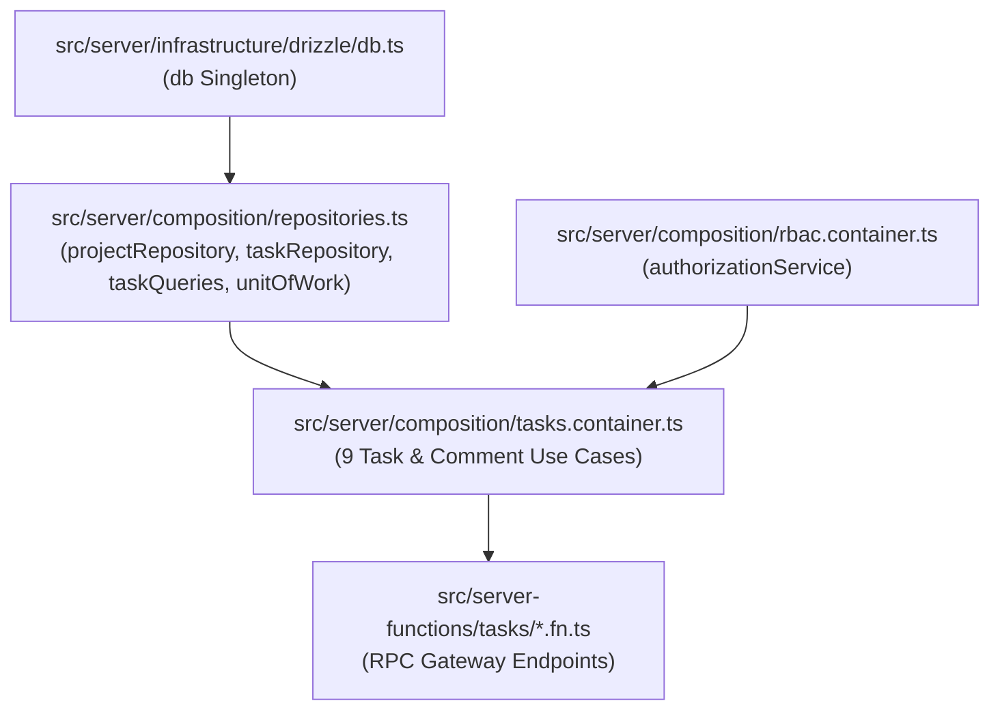

# Milestone 7 — Backend Step 5: Composition Tasks (src/server/composition/)

เอกสารบทเรียนสำหรับ **Milestone 7 (ฝั่ง Backend: Step 5)** มุ่งเน้นการประกอบ Object Graph ด้วยรูปแบบ **Pure Manual Dependency Injection (DI)** ในเลเยอร์ `src/server/composition/` เพื่อเชื่อมต่อ Infrastructure Repositories (`DrizzleTaskRepository`, `DrizzleTaskQueries`, `DrizzleProjectRepository`, `DrizzleUnitOfWork`) และ `authorizationService` เข้ากับ Use Cases ทั้ง 9 คลาสของโมดูล Tasks

---

## 1. เป้าหมายและขอบเขต Boundary (Boundary Context & Goal)

ในขั้นตอนนี้ เราจะต่อเติมไฟล์ `src/server/composition/repositories.ts` เพื่อสร้าง Singleton Instances ของ `taskRepository` และ `taskQueries` จากนั้นสร้างไฟล์ `src/server/composition/tasks.container.ts` เพื่อประกอบ Use Cases ทั้ง 9 รายการให้พร้อมสำหรับนำไปเรียกใช้งานใน `src/server-functions/tasks/`

### ตารางสรุปไฟล์ใน Step นี้

| ลำดับ | เส้นทางไฟล์ (File Path) | บทบาทหน้าที่ (Responsibility) | จำนวนบรรทัด |
| :---: | :--- | :--- | :---: |
| 1 | `src/server/composition/repositories.ts` | สร้าง Singleton Instances ของ Repositories, Queries และ Unit of Work จาก `db` (เพิ่ม `taskRepository` และ `taskQueries`) | 19 |
| 2 | `src/server/composition/tasks.container.ts` | DI Container ประจำโมดูล Tasks สำหรับประกอบ Use Cases ทั้ง 9 ตัว | 77 |

### แผนผังการประกอบ Object Graph ใน Composition Layer



---

## 2. ทฤษฎี ความสำคัญ และกฎสถาปัตยกรรมเฉพาะ Boundary นี้

### 2.1 กฎ Composition Layer จาก `.agents/rules/server.md` (ข้อ 17) และ `globals.md` (ข้อ 5)

- **ข้อ 17 (Pure Manual Dependency Injection)**:
  - รวมศูนย์การสร้าง Concrete Repositories และ Query Services ไว้ที่ `src/server/composition/repositories.ts` เพียงจุดเดียว
  - ประกอบ Use Cases ประจำโมดูลไว้ใน `src/server/composition/tasks.container.ts`
  - ห้าม Use Case หรือ Server Function สั่ง `new DrizzleTaskRepository(db)` ด้วยตัวเอง เพื่อรักษาหลักการ Dependency Inversion Principle (DIP) และทำให้สามารถสลับ Mock/Stub ในการทดสอบระดับ Unit Test ได้ทันที
  - ไม่ใช้ DI Framework ที่พึ่งพา Reflection หรือ Decorators เพื่อให้ TypeScript ตรวจสอบชนิดข้อมูลของ Constructor Parameters ได้อย่างครบถ้วนตั้งแต่เวลาคอมไพล์
- **กฎ `globals.md` ข้อ 5 (Direct Import — No Barrel Files)**:
  - ส่งออก Use Cases จาก `src/server/composition/tasks.container.ts` เพื่อให้ `src/server-functions/tasks/*.fn.ts` นำเข้าจากไฟล์ Container ประจำโมดูลโดยตรง ไม่สร้างไฟล์ Barrel ที่ทำหน้าที่เพียง Re-export ข้ามหลายโมดูล

### 2.2 การแยก Dependencies ระหว่าง Query Use Cases และ Command Use Cases

สังเกตการฉีด Dependencies ใน `src/server/composition/tasks.container.ts`:
1. **Query Use Cases (`listTasksUseCase`, `getTaskDetailUseCase`)**:
   - รับเฉพาะ `(projectRepository, taskQueries, authorizationService)`
   - ไม่จำเป็นต้องรับ `unitOfWork` หรือ `taskRepository` เนื่องจากเป็นการอ่านข้อมูลแบบ Read-only Projection
2. **Command Use Cases (`createTaskUseCase`, `updateTaskUseCase`, `transitionTaskStatusUseCase`, `assignTaskUseCase`, `deleteTaskUseCase`, `addTaskCommentUseCase`, `deleteTaskCommentUseCase`)**:
   - รับ `(projectRepository, taskRepository, authorizationService, unitOfWork)`
   - ใช้ `unitOfWork` เพื่อครอบ Transaction ระหว่างการบันทึกงาน/ความคิดเห็น และการบันทึก `activityLogs`

---

## 3. ลงมือเขียนโค้ด (Step-by-Step Implementation)

### 3.1 ไฟล์ `src/server/composition/repositories.ts`

ต่อเติม `src/server/composition/repositories.ts` โดยนำเข้า `DrizzleTaskRepository` และ `DrizzleTaskQueries` แล้วสร้าง Singleton Instances `taskRepository` และ `taskQueries` (บรรทัดที่ 7–8 และ 17–18):

```typescript
import type { AppTx } from "#/server/infrastructure/drizzle/db";
import { db } from "#/server/infrastructure/drizzle/db";
import { DrizzleUnitOfWork } from "#/server/infrastructure/drizzle/unit-of-work";
import { DrizzleProjectQueries } from "#/server/infrastructure/projects/drizzle-project.queries";
import { DrizzleProjectRepository } from "#/server/infrastructure/projects/drizzle-project.repository";
import { DrizzleRbacRepository } from "#/server/infrastructure/rbac/drizzle-rbac.repository";
import { DrizzleTaskQueries } from "#/server/infrastructure/tasks/drizzle-task.queries";
import { DrizzleTaskRepository } from "#/server/infrastructure/tasks/drizzle-task.repository";
import { DrizzleUserQueries } from "#/server/infrastructure/users/drizzle-user.queries";
import { DrizzleWorkspaceQueries } from "#/server/infrastructure/workspace/drizzle-workspace.queries";

export const unitOfWork = new DrizzleUnitOfWork<AppTx>(db);
export const rbacRepository = new DrizzleRbacRepository(db);
export const userQueries = new DrizzleUserQueries(db);
export const projectRepository = new DrizzleProjectRepository(db);
export const projectQueries = new DrizzleProjectQueries(db);
export const taskRepository = new DrizzleTaskRepository(db);
export const taskQueries = new DrizzleTaskQueries(db);
export const workspaceQueries = new DrizzleWorkspaceQueries(db);
```

### 3.2 ไฟล์ `src/server/composition/tasks.container.ts`

สร้างไฟล์ `src/server/composition/tasks.container.ts` เพื่อประกอบ Use Cases ทั้ง 9 รายการของโมดูล Tasks และ Task Comments:

```typescript
import { AddTaskCommentUseCase } from "#/server/application/tasks/add-task-comment.use-case";
import { AssignTaskUseCase } from "#/server/application/tasks/assign-task.use-case";
import { CreateTaskUseCase } from "#/server/application/tasks/create-task.use-case";
import { DeleteTaskUseCase } from "#/server/application/tasks/delete-task.use-case";
import { DeleteTaskCommentUseCase } from "#/server/application/tasks/delete-task-comment.use-case";
import { GetTaskDetailUseCase } from "#/server/application/tasks/get-task-detail.use-case";
import { ListTasksUseCase } from "#/server/application/tasks/list-tasks.use-case";
import { TransitionTaskStatusUseCase } from "#/server/application/tasks/transition-task-status.use-case";
import { UpdateTaskUseCase } from "#/server/application/tasks/update-task.use-case";
import { authorizationService } from "./rbac.container";
import {
	projectRepository,
	taskQueries,
	taskRepository,
	unitOfWork,
} from "./repositories";

export const listTasksUseCase = new ListTasksUseCase(
	projectRepository,
	taskQueries,
	authorizationService,
);

export const getTaskDetailUseCase = new GetTaskDetailUseCase(
	projectRepository,
	taskQueries,
	authorizationService,
);

export const createTaskUseCase = new CreateTaskUseCase(
	projectRepository,
	taskRepository,
	authorizationService,
	unitOfWork,
);

export const updateTaskUseCase = new UpdateTaskUseCase(
	projectRepository,
	taskRepository,
	authorizationService,
	unitOfWork,
);

export const transitionTaskStatusUseCase = new TransitionTaskStatusUseCase(
	projectRepository,
	taskRepository,
	authorizationService,
	unitOfWork,
);

export const assignTaskUseCase = new AssignTaskUseCase(
	projectRepository,
	taskRepository,
	authorizationService,
	unitOfWork,
);

export const deleteTaskUseCase = new DeleteTaskUseCase(
	projectRepository,
	taskRepository,
	authorizationService,
	unitOfWork,
);

export const addTaskCommentUseCase = new AddTaskCommentUseCase(
	projectRepository,
	taskRepository,
	authorizationService,
	unitOfWork,
);

export const deleteTaskCommentUseCase = new DeleteTaskCommentUseCase(
	projectRepository,
	taskRepository,
	authorizationService,
	unitOfWork,
);
```

---

## 4. การตรวจสอบความถูกต้องและ Git Commit (Verification & Commit)

ตรวจสอบความถูกต้องของ Type และ Linter ด้วย `bun` แล้วทำการ Commit ประจำ Step ที่ 5:

```bash
bun run check
git add src/server/composition/repositories.ts src/server/composition/tasks.container.ts
git commit -m "milestone-7.backend.step-5: Composition Tasks DI Container"
```
