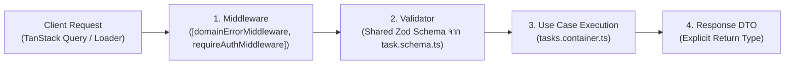

# Milestone 7 — Backend Step 6: Server Functions Tasks (src/server-functions/tasks/)

เอกสารบทเรียนสำหรับ **Milestone 7 (ฝั่ง Backend: Step 6)** มุ่งเน้นการสร้าง **RPC Gateway (Thin Driving Adapter)** ในเลเยอร์ `src/server-functions/tasks/` จำนวน 9 ไฟล์ เพื่อเป็นช่องทางสื่อสารเดียวระหว่างฝั่ง Client (`src/client/caches/tasks/`) กับฝั่ง Server (`src/server/composition/tasks.container.ts`) ภายใต้มาตรฐานความปลอดภัยและการตรวจสอบข้อมูลอย่างเคร่งครัด

---

## 1. เป้าหมายและขอบเขต Boundary (Boundary Context & Goal)

ในขั้นตอนนี้ เราจะสร้าง Server Function Endpoints ทั้ง 9 ไฟล์ใน `src/server-functions/tasks/` โดยแยก **1 RPC Endpoint ต่อ 1 ไฟล์ (`*.fn.ts`)** และปฏิบัติตาม **Standard 4-Step Pipeline** อย่างสม่ำเสมอ

### ตารางสรุปไฟล์ใน Step นี้

| ลำดับ | เส้นทางไฟล์ (File Path) | HTTP Method | Exported Symbol | บทบาทหน้าที่ (Responsibility) | จำนวนบรรทัด |
| :---: | :--- | :---: | :--- | :--- | :---: |
| 1 | `src/server-functions/tasks/list-tasks.fn.ts` | `GET` | `listTasksFn` | ดึงรายการงานแบบแบ่งหน้า ค้นหา กรอง และจัดเรียง | 17 |
| 2 | `src/server-functions/tasks/get-task-detail.fn.ts` | `GET` | `getTaskDetailFn` | ดึงรายละเอียดงานพร้อม `allowedTransitions`, ความคิดเห็น และประวัติกิจกรรม | 17 |
| 3 | `src/server-functions/tasks/create-task.fn.ts` | `POST` | `createTaskFn` | สร้างงานใหม่ในโครงการ | 16 |
| 4 | `src/server-functions/tasks/update-task.fn.ts` | `POST` | `updateTaskFn` | แก้ไขรายละเอียดของงาน | 16 |
| 5 | `src/server-functions/tasks/transition-task-status.fn.ts` | `POST` | `transitionTaskStatusFn` | เปลี่ยนสถานะงานตามกฎ Finite State Machine | 16 |
| 6 | `src/server-functions/tasks/assign-task.fn.ts` | `POST` | `assignTaskFn` | มอบหมายหรือยกเลิกผู้รับผิดชอบงาน | 16 |
| 7 | `src/server-functions/tasks/delete-task.fn.ts` | `POST` | `deleteTaskFn` | ลบงานออกจากโครงการ | 15 |
| 8 | `src/server-functions/tasks/add-task-comment.fn.ts` | `POST` | `addTaskCommentFn` | เพิ่มความคิดเห็นใหม่ลงในงาน | 21 |
| 9 | `src/server-functions/tasks/delete-task-comment.fn.ts` | `POST` | `deleteTaskCommentFn` | ลบความคิดเห็นออกจากงาน | 15 |

### แผนผัง Standard 4-Step Pipeline ของ Server Functions



---

## 2. ทฤษฎี ความสำคัญ และกฎสถาปัตยกรรมเฉพาะ Boundary นี้

### 2.1 กฎ Server Functions จาก `.agents/rules/architecture.md` และ `.agents/rules/server.md` (ข้อ 2, 3, 18)

1. **Thin Driving Adapter (`server.md` ข้อ 18)**:
   - Server Function ทำหน้าที่เฉพาะการประสานงานระดับ Transport เท่านั้น ห้ามเขียน Business Logic, ห้ามตรวจสอบสถานะงานเอง และห้ามเรียก Database (`db`) หรือ Repository โดยตรง
2. **One Function per File (`architecture.md`)**:
   - แยก 1 RPC Endpoint ต่อ 1 ไฟล์ โดยตั้งชื่อไฟล์ตรงกับ Use Case ลงท้ายด้วย `.fn.ts` และตั้งชื่อตัวแปรที่ส่งออกลงท้ายด้วย `Fn` (เช่น `create-task.fn.ts` ส่งออก `createTaskFn`)
3. **Middleware Chain (`[domainErrorMiddleware, requireAuthMiddleware]`)**:
   - `domainErrorMiddleware`: ดักจับ `DomainError` จากชั้น Domain/Application แล้วแปลงเป็นโครงสร้างข้อผิดพลาดมาตรฐานที่ฝั่ง Client อ่านข้อความภาษาไทยไปแสดงผลได้อย่างปลอดภัย
   - `requireAuthMiddleware`: ตรวจสอบ Session ของผู้ใช้จาก Better Auth และฉีด `context.authSession` (ซึ่งประกอบด้วย `user.id`, `user.name`, `user.email`, `user.systemPermissions`) เข้ามาให้ `.handler(...)`
4. **Shared Contract Only (`globals.md` Shared Schemas ข้อ 3)**:
   - ตรวจสอบข้อมูลขาเข้าผ่าน `.validator(...InputSchema)` จาก `#/shared/schemas/task.schema`
   - ระบุ Explicit Return Type บน `.handler(async ({ context, data }): Promise<...Dto> => ...)` เสมอ

---

## 3. ลงมือเขียนโค้ด (Step-by-Step Implementation)

### 3.1 ไฟล์ `src/server-functions/tasks/list-tasks.fn.ts`

สร้าง RPC Endpoint สำหรับดึงรายการงานแบบแบ่งหน้า:

```typescript
import { createServerFn } from "@tanstack/react-start";
import { listTasksUseCase } from "#/server/composition/tasks.container";
import { requireAuthMiddleware } from "#/server-functions/middlewares/auth.middleware";
import { domainErrorMiddleware } from "#/server-functions/middlewares/domain-error.middleware";
import type { ListTasksResultDto } from "#/shared/schemas/task.schema";
import { listTasksInputSchema } from "#/shared/schemas/task.schema";

export const listTasksFn = createServerFn({ method: "GET" })
	.middleware([domainErrorMiddleware, requireAuthMiddleware])
	.validator(listTasksInputSchema)
	.handler(async ({ context, data }): Promise<ListTasksResultDto> => {
		return listTasksUseCase.execute({
			actorUserId: context.authSession.user.id,
			actorSystemPermissions: context.authSession.user.systemPermissions,
			payload: data,
		});
	});
```

### 3.2 ไฟล์ `src/server-functions/tasks/get-task-detail.fn.ts`

สร้าง RPC Endpoint สำหรับดึงรายละเอียดของงานพร้อมรายการสถานะถัดไป ความคิดเห็น และประวัติกิจกรรม:

```typescript
import { createServerFn } from "@tanstack/react-start";
import { getTaskDetailUseCase } from "#/server/composition/tasks.container";
import { requireAuthMiddleware } from "#/server-functions/middlewares/auth.middleware";
import { domainErrorMiddleware } from "#/server-functions/middlewares/domain-error.middleware";
import type { TaskDetailDto } from "#/shared/schemas/task.schema";
import { getTaskDetailInputSchema } from "#/shared/schemas/task.schema";

export const getTaskDetailFn = createServerFn({ method: "GET" })
	.middleware([domainErrorMiddleware, requireAuthMiddleware])
	.validator(getTaskDetailInputSchema)
	.handler(async ({ context, data }): Promise<TaskDetailDto> => {
		return getTaskDetailUseCase.execute({
			actorUserId: context.authSession.user.id,
			actorSystemPermissions: context.authSession.user.systemPermissions,
			payload: data,
		});
	});
```

### 3.3 ไฟล์ `src/server-functions/tasks/create-task.fn.ts`

สร้าง RPC Endpoint สำหรับสร้างงานใหม่:

```typescript
import { createServerFn } from "@tanstack/react-start";
import { createTaskUseCase } from "#/server/composition/tasks.container";
import { requireAuthMiddleware } from "#/server-functions/middlewares/auth.middleware";
import { domainErrorMiddleware } from "#/server-functions/middlewares/domain-error.middleware";
import type { TaskDto } from "#/shared/schemas/task.schema";
import { createTaskInputSchema } from "#/shared/schemas/task.schema";

export const createTaskFn = createServerFn({ method: "POST" })
	.middleware([domainErrorMiddleware, requireAuthMiddleware])
	.validator(createTaskInputSchema)
	.handler(async ({ context, data }): Promise<TaskDto> => {
		return createTaskUseCase.execute({
			actorUserId: context.authSession.user.id,
			payload: data,
		});
	});
```

### 3.4 ไฟล์ `src/server-functions/tasks/update-task.fn.ts`

สร้าง RPC Endpoint สำหรับแก้ไขรายละเอียดของงาน:

```typescript
import { createServerFn } from "@tanstack/react-start";
import { updateTaskUseCase } from "#/server/composition/tasks.container";
import { requireAuthMiddleware } from "#/server-functions/middlewares/auth.middleware";
import { domainErrorMiddleware } from "#/server-functions/middlewares/domain-error.middleware";
import type { TaskDto } from "#/shared/schemas/task.schema";
import { updateTaskInputSchema } from "#/shared/schemas/task.schema";

export const updateTaskFn = createServerFn({ method: "POST" })
	.middleware([domainErrorMiddleware, requireAuthMiddleware])
	.validator(updateTaskInputSchema)
	.handler(async ({ context, data }): Promise<TaskDto> => {
		return updateTaskUseCase.execute({
			actorUserId: context.authSession.user.id,
			payload: data,
		});
	});
```

### 3.5 ไฟล์ `src/server-functions/tasks/transition-task-status.fn.ts`

สร้าง RPC Endpoint สำหรับเปลี่ยนสถานะงานตามกฎ Finite State Machine:

```typescript
import { createServerFn } from "@tanstack/react-start";
import { transitionTaskStatusUseCase } from "#/server/composition/tasks.container";
import { requireAuthMiddleware } from "#/server-functions/middlewares/auth.middleware";
import { domainErrorMiddleware } from "#/server-functions/middlewares/domain-error.middleware";
import type { TaskDto } from "#/shared/schemas/task.schema";
import { transitionTaskStatusInputSchema } from "#/shared/schemas/task.schema";

export const transitionTaskStatusFn = createServerFn({ method: "POST" })
	.middleware([domainErrorMiddleware, requireAuthMiddleware])
	.validator(transitionTaskStatusInputSchema)
	.handler(async ({ context, data }): Promise<TaskDto> => {
		return transitionTaskStatusUseCase.execute({
			actorUserId: context.authSession.user.id,
			payload: data,
		});
	});
```

### 3.6 ไฟล์ `src/server-functions/tasks/assign-task.fn.ts`

สร้าง RPC Endpoint สำหรับมอบหมายหรือยกเลิกผู้รับผิดชอบงาน:

```typescript
import { createServerFn } from "@tanstack/react-start";
import { assignTaskUseCase } from "#/server/composition/tasks.container";
import { requireAuthMiddleware } from "#/server-functions/middlewares/auth.middleware";
import { domainErrorMiddleware } from "#/server-functions/middlewares/domain-error.middleware";
import type { TaskDto } from "#/shared/schemas/task.schema";
import { assignTaskInputSchema } from "#/shared/schemas/task.schema";

export const assignTaskFn = createServerFn({ method: "POST" })
	.middleware([domainErrorMiddleware, requireAuthMiddleware])
	.validator(assignTaskInputSchema)
	.handler(async ({ context, data }): Promise<TaskDto> => {
		return assignTaskUseCase.execute({
			actorUserId: context.authSession.user.id,
			payload: data,
		});
	});
```

### 3.7 ไฟล์ `src/server-functions/tasks/delete-task.fn.ts`

สร้าง RPC Endpoint สำหรับลบงานออกจากโครงการ:

```typescript
import { createServerFn } from "@tanstack/react-start";
import { deleteTaskUseCase } from "#/server/composition/tasks.container";
import { requireAuthMiddleware } from "#/server-functions/middlewares/auth.middleware";
import { domainErrorMiddleware } from "#/server-functions/middlewares/domain-error.middleware";
import { deleteTaskInputSchema } from "#/shared/schemas/task.schema";

export const deleteTaskFn = createServerFn({ method: "POST" })
	.middleware([domainErrorMiddleware, requireAuthMiddleware])
	.validator(deleteTaskInputSchema)
	.handler(async ({ context, data }): Promise<{ deleted: true }> => {
		return deleteTaskUseCase.execute({
			actorUserId: context.authSession.user.id,
			payload: data,
		});
	});
```

### 3.8 ไฟล์ `src/server-functions/tasks/add-task-comment.fn.ts`

สร้าง RPC Endpoint สำหรับเพิ่มความคิดเห็นใหม่ลงในงาน โดยส่งข้อมูลผู้เขียน (`id`, `name`, `email`) จาก `context.authSession.user` เข้าสู่ Use Case เพื่อใช้ประกอบ `TaskCommentDto` ตอบกลับได้ทันทีโดยไม่ต้องคิวรีตาราง `user` ซ้ำ:

```typescript
import { createServerFn } from "@tanstack/react-start";
import { addTaskCommentUseCase } from "#/server/composition/tasks.container";
import { requireAuthMiddleware } from "#/server-functions/middlewares/auth.middleware";
import { domainErrorMiddleware } from "#/server-functions/middlewares/domain-error.middleware";
import type { TaskCommentDto } from "#/shared/schemas/task.schema";
import { addTaskCommentInputSchema } from "#/shared/schemas/task.schema";

export const addTaskCommentFn = createServerFn({ method: "POST" })
	.middleware([domainErrorMiddleware, requireAuthMiddleware])
	.validator(addTaskCommentInputSchema)
	.handler(async ({ context, data }): Promise<TaskCommentDto> => {
		const actor = context.authSession.user;
		return addTaskCommentUseCase.execute({
			actor: {
				id: actor.id,
				name: actor.name,
				email: actor.email,
			},
			payload: data,
		});
	});
```

### 3.9 ไฟล์ `src/server-functions/tasks/delete-task-comment.fn.ts`

สร้าง RPC Endpoint สำหรับลบความคิดเห็นออกจากงาน:

```typescript
import { createServerFn } from "@tanstack/react-start";
import { deleteTaskCommentUseCase } from "#/server/composition/tasks.container";
import { requireAuthMiddleware } from "#/server-functions/middlewares/auth.middleware";
import { domainErrorMiddleware } from "#/server-functions/middlewares/domain-error.middleware";
import { deleteTaskCommentInputSchema } from "#/shared/schemas/task.schema";

export const deleteTaskCommentFn = createServerFn({ method: "POST" })
	.middleware([domainErrorMiddleware, requireAuthMiddleware])
	.validator(deleteTaskCommentInputSchema)
	.handler(async ({ context, data }): Promise<{ deleted: true }> => {
		return deleteTaskCommentUseCase.execute({
			actorUserId: context.authSession.user.id,
			payload: data,
		});
	});
```

---

## 4. การตรวจสอบความถูกต้องและ Git Commit (Verification & Commit)

ตรวจสอบความถูกต้องของ Type และ Linter ด้วย `bun` แล้วทำการ Commit ประจำ Step ที่ 6:

```bash
bun run check
git add src/server-functions/tasks/
git commit -m "milestone-7.backend.step-6: Tasks & Comments Server Functions Gateway"
```
