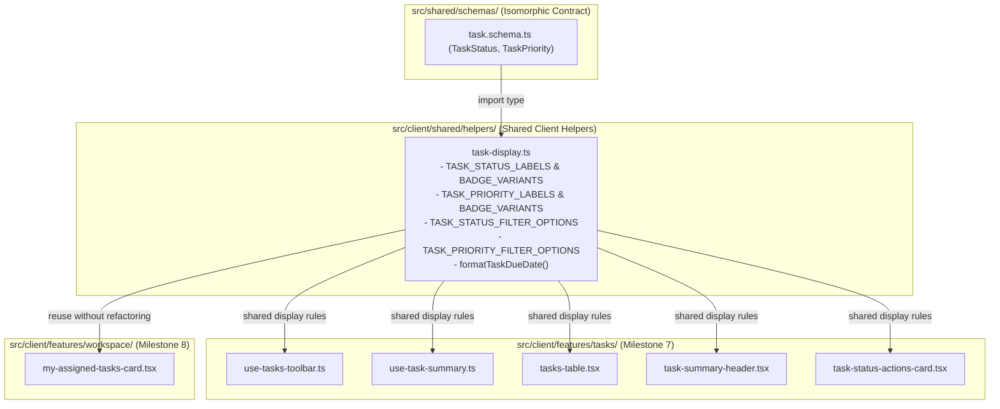

# Milestone 7 — Frontend Step 1: Client Shared Task Display Helper (src/client/shared/helpers/)

ในขั้นตอนนี้เราจะเริ่มต้นพัฒนาฝั่ง Frontend ของ **Milestone 7 (Tasks, Status Workflow & Comments)** โดยเริ่มจากการวางรากฐานในชั้น **Client Shared Helpers (`src/client/shared/helpers/`)** เพื่อรวมศูนย์การแปลงค่าสถานะ (`TaskStatus`), ระดับความสำคัญ (`TaskPriority`), ตัวเลือกสำหรับตัวกรอง (Filter Options) และฟังก์ชันจัดรูปแบบวันครบกำหนด (`formatTaskDueDate`) ไว้ที่เดียวตั้งแต่วันแรก

---

## 1. เป้าหมายและขอบเขต Boundary (Boundary Context & Goal)

### เป้าหมายของ Step นี้
1. สร้างไฟล์ `src/client/shared/helpers/task-display.ts` เพื่อเก็บ Mapping ของป้ายชื่อภาษาไทย (`TASK_STATUS_LABELS`, `TASK_PRIORITY_LABELS`) และรูปแบบสีของ Badge (`TASK_STATUS_BADGE_VARIANTS`, `TASK_PRIORITY_BADGE_VARIANTS`)
2. สร้างตัวเลือกคงที่สำหรับ Dropdown กรองข้อมูล (`TASK_STATUS_FILTER_OPTIONS`, `TASK_PRIORITY_FILTER_OPTIONS`)
3. สร้างฟังก์ชันบริสุทธิ์ `formatTaskDueDate(isoDate)` สำหรับแปลงวันที่แบบ ISO String ให้เป็นรูปแบบวันที่ภาษาไทยที่อ่านเข้าใจง่ายโดยอิงเขตเวลา `UTC` เพื่อความสม่ำเสมอตรงกันระหว่าง Server และ Client

### ตารางสรุปไฟล์ใน Step นี้

| ลำดับ | Path ของไฟล์ | บทบาทหน้าที่ (Responsibility) |
| :--- | :--- | :--- |
| 1 | `src/client/shared/helpers/task-display.ts` | รวมศูนย์ Labels, Badge Variants, Filter Options และฟังก์ชันจัดรูปแบบวันครบกำหนดของงาน สำหรับใช้ร่วมกันข้ามฟีเจอร์ (`tasks` และ `workspace`) |

### แผนผังสถาปัตยกรรมและการใช้ซ้ำข้ามฟีเจอร์ (Mermaid Diagram)



---

## 2. ทฤษฎี ความสำคัญ และกฎสถาปัตยกรรมเฉพาะ Boundary นี้

### 2.1 ทำไมต้องวาง `task-display.ts` ไว้ที่ `src/client/shared/helpers/` ตั้งแต่วันแรก?
ในระบบบริหารจัดการโครงการ ข้อมูลของงาน (Task) ไม่ได้ปรากฏแค่ในหน้า **รายการงานภายในโครงการ (`/projects/$projectId/tasks`)** ของโมดูล `tasks` เท่านั้น แต่ยังต้องนำไปแสดงผลในหน้า **ภาพรวมพื้นที่ทำงาน (`/workspace` — ตารางงานที่ได้รับมอบหมาย)** ของโมดูล `workspace` ใน Milestone 8 ด้วย:
- หากเราสร้าง Mapping ของสถานะและความสำคัญไว้ภายใน `src/client/features/tasks/` เมื่อถึง Milestone 8 ที่โมดูล `workspace` ต้องแสดง Badge สถานะ, ความสำคัญ และวันครบกำหนดของงานที่ได้รับมอบหมาย เราจะเกิดปัญหา **Cross-Feature Coupling** (ฟีเจอร์ `workspace` ต้องแอบ import โค้ดภายใน `features/tasks/`) หรือต้องเสียเวลาย้ายไฟล์และแก้ import ย้อนหลัง (Retroactive Refactoring)
- การจัดเก็บ Labels, Badge Variants และฟังก์ชันจัดรูปแบบวันที่ไว้ใน `src/client/shared/helpers/task-display.ts` ตั้งแต่วันแรก ทำให้ทั้งโมดูล `tasks` (Milestone 7) และโมดูล `workspace` (Milestone 8) เรียกใช้จากเลเยอร์ `client/shared/` ร่วมกันได้อย่างสะอาดตามกฎสถาปัตยกรรม

### 2.2 กฎสถาปัตยกรรมที่บังคับใช้ (`.agents/rules/client.md` & `globals.md`)
- **`globals.md` ข้อ 3 (Type-Only Imports)**: ใช้ `import type { TaskPriority, TaskStatus } from "#/shared/schemas/task.schema"` เพื่อนำเข้าเฉพาะชนิดข้อมูลจาก Shared Contract โดยไม่ดึงโค้ดที่ไม่จำเป็นเข้ามาใน Runtime
- **`client.md` ข้อ 12 & 14 (Design System & Badge Variants)**: การกำหนดสีของสถานะและระดับความสำคัญต้องอ้างอิงผ่าน Semantic Variants ของ shadcn `<Badge>` (`"outline" | "secondary" | "default" | "destructive"`) เท่านั้น ห้ามฮาร์ดโค้ดสี CSS เฉพาะจุด เพื่อให้รองรับการสลับโหมดสว่าง/มืด (Light/Dark Mode) ของระบบอย่างสมบูรณ์
- **Type-Safe Exhaustiveness ด้วย `Record<TaskStatus, ...>`**: การระบุ Type เป็น `Record<TaskStatus, string>` และ `Record<TaskPriority, string>` บังคับให้ TypeScript ตรวจสอบว่าเราได้กำหนดป้ายชื่อและสีครบทุกสถานะ (`todo`, `in_progress`, `in_review`, `done`, `cancelled`) และทุกระดับความสำคัญ (`low`, `medium`, `high`, `urgent`) หากอนาคตมีการเพิ่มสถานะใหม่ใน `task.schema.ts` ตัวตรวจสอบ Type จะแจ้งเตือนที่ไฟล์นี้ทันที

---

## 3. ลงมือเขียนโค้ด (Step-by-Step Implementation)

### 3.1 สร้างไฟล์ `src/client/shared/helpers/task-display.ts`

สร้างไฟล์ `src/client/shared/helpers/task-display.ts` เพื่อส่งออกค่าคงที่สำหรับการแสดงผลสถานะ ความสำคัญ ตัวเลือกการกรอง และฟังก์ชันจัดรูปแบบวันครบกำหนด

```typescript
import type { TaskPriority, TaskStatus } from "#/shared/schemas/task.schema";

export const TASK_STATUS_LABELS: Record<TaskStatus, string> = {
	todo: "ต้องทำ",
	in_progress: "กำลังดำเนินการ",
	in_review: "รอตรวจสอบ",
	done: "เสร็จสิ้น",
	cancelled: "ยกเลิก",
};

export const TASK_STATUS_BADGE_VARIANTS: Record<
	TaskStatus,
	"outline" | "secondary" | "default" | "destructive"
> = {
	todo: "outline",
	in_progress: "default",
	in_review: "secondary",
	done: "secondary",
	cancelled: "destructive",
};

export const TASK_PRIORITY_LABELS: Record<TaskPriority, string> = {
	low: "ต่ำ",
	medium: "กลาง",
	high: "สูง",
	urgent: "เร่งด่วน",
};

export const TASK_PRIORITY_BADGE_VARIANTS: Record<
	TaskPriority,
	"outline" | "secondary" | "default" | "destructive"
> = {
	low: "outline",
	medium: "secondary",
	high: "default",
	urgent: "destructive",
};

export const TASK_STATUS_FILTER_OPTIONS = [
	{ label: "สถานะทั้งหมด", value: "all" },
	{ label: "ต้องทำ", value: "todo" },
	{ label: "กำลังดำเนินการ", value: "in_progress" },
	{ label: "รอตรวจสอบ", value: "in_review" },
	{ label: "เสร็จสิ้น", value: "done" },
	{ label: "ยกเลิก", value: "cancelled" },
] as const;

export const TASK_PRIORITY_FILTER_OPTIONS = [
	{ label: "ความสำคัญทั้งหมด", value: "all" },
	{ label: "ต่ำ", value: "low" },
	{ label: "กลาง", value: "medium" },
	{ label: "สูง", value: "high" },
	{ label: "เร่งด่วน", value: "urgent" },
] as const;

export function formatTaskDueDate(isoDate: string | null): string {
	if (!isoDate) {
		return "ไม่ระบุ";
	}
	return new Date(isoDate).toLocaleDateString("th-TH", {
		timeZone: "UTC",
		dateStyle: "medium",
	});
}
```

#### คำอธิบายการทำงานทีละส่วน:
1. **`TASK_STATUS_LABELS` และ `TASK_STATUS_BADGE_VARIANTS`**:
   - แปลงสถานะทั้ง 5 ของระบบ Finite State Machine (`todo`, `in_progress`, `in_review`, `done`, `cancelled`) ให้เป็นป้ายชื่อภาษาไทยและ Variant ของ `<Badge>` ที่สื่อความหมายชัดเจน เช่น `in_progress` ใช้ `"default"` (โดดเด่นว่ากำลังทำ), `done` และ `in_review` ใช้ `"secondary"`, และ `cancelled` ใช้ `"destructive"`
2. **`TASK_PRIORITY_LABELS` และ `TASK_PRIORITY_BADGE_VARIANTS`**:
   - แปลงระดับความสำคัญทั้ง 4 ระดับ (`low`, `medium`, `high`, `urgent`) ให้เป็นชื่อภาษาไทยและไล่ระดับความเข้มของ `<Badge>` ตั้งแต่งานทั่วไป (`"outline"`, `"secondary"`) ไปจนถึงงานสำคัญ (`"default"`) และเร่งด่วน (`"urgent"` -> `"destructive"`)
3. **`TASK_STATUS_FILTER_OPTIONS` และ `TASK_PRIORITY_FILTER_OPTIONS`**:
   - เตรียมรายการ `{ label, value }` แบบ `as const` ที่มีตัวเลือก `"all"` สำหรับใช้ใน `<Select>` บนแถบเครื่องมือกรองงาน (`TasksToolbar`)
4. **`formatTaskDueDate(isoDate: string | null)`**:
   - หากงานไม่ได้กำหนดวันครบกำหนด (`null`) จะคืนข้อความ `"ไม่ระบุ"`
   - หากมีค่าวันที่ จะแปลงเป็นวันที่ภาษาไทย (`th-TH`) แบบ `dateStyle: "medium"` โดยระบุ `timeZone: "UTC"` เสมอ เพื่อป้องกันปัญหาวันที่คลาดเคลื่อนข้ามวันจาก Timezone Offset ระหว่างเซิร์ฟเวอร์กับเบราว์เซอร์ของผู้ใช้

---

## 4. การตรวจสอบความถูกต้องและ Git Commit (Verification & Commit)

### 4.1 ตรวจสอบ Type Safety และ Linting
รันคำสั่งตรวจสอบด้วย `bun` เพื่อยืนยันว่าไฟล์ `task-display.ts` สอดคล้องกับ Shared Schema และไม่มีข้อผิดพลาดทางไวยากรณ์:

```bash
bun run typecheck
bun run format
bun run check
```

### 4.2 บันทึกการเปลี่ยนแปลงลง Git (Git Commit)
เมื่อตรวจสอบผ่านเรียบร้อยแล้ว ให้ Stage ไฟล์และทำการ Commit ประจำ Step ที่ 1:

```bash
git add src/client/shared/helpers/task-display.ts
git commit -m "milestone-7.frontend.step-1: Client Shared Task Display Helper"
```
