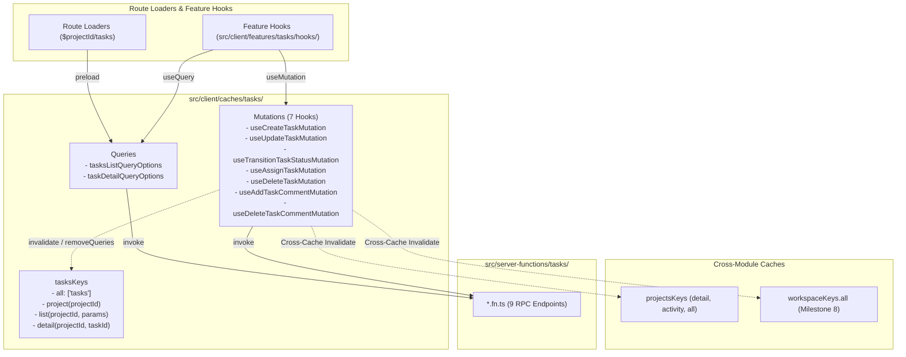

# Milestone 7 — Frontend Step 2: Client Caches Tasks (src/client/caches/tasks/)

ในขั้นตอนนี้เราจะสร้างเลเยอร์ **Client Caches (`src/client/caches/tasks/`)** เพื่อเป็นศูนย์กลางจัดการ Server State ทั้งหมดของโมดูล `tasks` ด้วย TanStack Query ครอบคลุมทั้งการดึงรายการงานแบบแบ่งหน้า/กรอง/เรียงลำดับ, การดึงรายละเอียดงานเชิงลึก และการเปลี่ยนแปลงข้อมูลงานทั้ง 7 คำสั่ง (สร้าง, แก้ไขรายละเอียด, เปลี่ยนสถานะตาม FSM, มอบหมายงาน, ลบงาน, เพิ่มความคิดเห็น และลบความคิดเห็น)

---

## 1. เป้าหมายและขอบเขต Boundary (Boundary Context & Goal)

### เป้าหมายของ Step นี้
1. สร้าง **Query Key Factory** (`tasksKeys`) ใน `src/client/caches/tasks/keys.ts` ที่จัดโครงสร้าง Cache Key ตามลำดับชั้นของโครงการ (`["tasks", projectId, ...]`)
2. สร้าง **Query Options** ทั้ง 2 ไฟล์ (`tasksListQueryOptions`, `taskDetailQueryOptions`) สำหรับเชื่อมโยงกับ RPC Server Functions และรองรับการ Preload ใน Route Loader
3. สร้าง **Mutation Hooks** ทั้ง 7 ไฟล์ พร้อมตั้งค่า `meta.successToast` และจัดการ **Cross-Domain Cache Invalidation** ระหว่าง `tasksKeys`, `projectsKeys` (รวมถึง `workspaceKeys` สำหรับหน้าแดชบอร์ดใน Milestone 8)

### ตารางสรุปไฟล์ใน Step นี้

| ลำดับ | Path ของไฟล์ | บทบาทหน้าที่ (Responsibility) |
| :--- | :--- | :--- |
| 1 | `src/client/caches/tasks/keys.ts` | Query Key Factory ของโมดูล Tasks (`all`, `project`, `list`, `detail`) |
| 2 | `src/client/caches/tasks/queries/tasks.query.ts` | `queryOptions` สำหรับดึงรายการงานของโครงการตามเงื่อนไขการค้นหา กรอง และแบ่งหน้า (`listTasksFn`) |
| 3 | `src/client/caches/tasks/queries/task-detail.query.ts` | `queryOptions` สำหรับดึงข้อมูลเชิงลึกของงาน ความคิดเห็น และประวัติกิจกรรม (`getTaskDetailFn`) |
| 4 | `src/client/caches/tasks/mutates/create-task.mutate.ts` | Mutation Hook สำหรับสร้างงานใหม่ พร้อม Invalidate Caches ที่เกี่ยวข้อง |
| 5 | `src/client/caches/tasks/mutates/update-task.mutate.ts` | Mutation Hook สำหรับแก้ไขหัวข้อ รายละเอียด ความสำคัญ และวันครบกำหนดของงาน |
| 6 | `src/client/caches/tasks/mutates/transition-task-status.mutate.ts` | Mutation Hook สำหรับเปลี่ยนสถานะงานตามกฎ Finite State Machine (FSM) |
| 7 | `src/client/caches/tasks/mutates/assign-task.mutate.ts` | Mutation Hook สำหรับกำหนดหรือยกเลิกผู้รับผิดชอบงาน |
| 8 | `src/client/caches/tasks/mutates/delete-task.mutate.ts` | Mutation Hook สำหรับลบงานถาวร พร้อมล้าง Cache ของหน้ารายละเอียดงานทันที (`removeQueries`) |
| 9 | `src/client/caches/tasks/mutates/add-task-comment.mutate.ts` | Mutation Hook สำหรับเพิ่มความคิดเห็นในงาน |
| 10 | `src/client/caches/tasks/mutates/delete-task-comment.mutate.ts` | Mutation Hook สำหรับลบความคิดเห็นออกจากงาน |

### แผนผังสถาปัตยกรรมและกลไก Cache Invalidation (Mermaid Diagram)



---

## 2. ทฤษฎี ความสำคัญ และกฎสถาปัตยกรรมเฉพาะ Boundary นี้

### 2.1 กฎสถาปัตยกรรมที่บังคับใช้ (`.agents/rules/client.md` & `server.md`)
- **`server.md` ข้อ 3 (Server-State Ownership)**: ห้าม Feature Hooks, Screens หรือ Components เรียก `server-functions/tasks/*.fn.ts` โดยตรง ทุกการติดต่อกับเซิร์ฟเวอร์ต้องผ่าน `src/client/caches/tasks/**` เท่านั้น
- **`client.md` ข้อ 8 (Single Owner of Mutation Feedback)**: ข้อความแจ้งเตือนเมื่อทำรายการสำเร็จ (`meta: { successToast: "..." }`) ต้องนิยามไว้ใน Mutation Hook ภายใต้ `client/caches/tasks/mutates/` เท่านั้น เพื่อให้ Global `MutationCache` ใน `src/client/caches/global.ts` เป็นผู้แสดง Toast อัตโนมัติ

### 2.2 การออกแบบ Hierarchical Query Keys (`tasksKeys`)
สังเกตโครงสร้างของ `tasksKeys`:
- `all`: `["tasks"]`
- `project(projectId)`: `["tasks", projectId]`
- `list(projectId, params)`: `["tasks", projectId, "list", params]`
- `detail(projectId, taskId)`: `["tasks", projectId, "detail", taskId]`

การจัดลำดับชั้นให้มี `tasksKeys.project(projectId)` คั่นกลางก่อนแยกเป็น `"list"` และ `"detail"` มีประโยชน์อย่างมาก: เมื่อเกิดการแก้ไขข้อมูลงาน เปลี่ยนสถานะ หรือเพิ่มความคิดเห็น เราเพียงสั่ง `queryClient.invalidateQueries({ queryKey: tasksKeys.project(variables.projectId) })` เพียงคำสั่งเดียว TanStack Query จะสั่ง Invalidate ทั้งตารางรายการงานทุกหน้า/ทุกตัวกรอง (`list`) และหน้ารายละเอียดของงานนั้น (`detail`) ภายในโครงการเดียวกันโดยอัตโนมัติ!

### 2.3 กลยุทธ์ Cross-Cache Invalidation และการลบ Cache ทันทีเมื่อลบงาน (`removeQueries`)
1. **การซิงค์ข้อมูลกับโมดูล `projects`**:
   - ทุกครั้งที่มีการกระทำกับงาน ระบบฝั่ง Backend จะบันทึก `ActivityLog` เสมอ ดังนั้นทุก Mutation ใน `tasks` จึงต้องสั่ง Invalidate `projectsKeys.activity(variables.projectId)` เพื่อให้ไทม์ไลน์กิจกรรมในหน้าภาพรวมโครงการอัปเดตตรงกัน
   - เมื่อ **สร้างงานใหม่ (`createTask`)** หรือ **ลบงาน (`deleteTask`)** จำนวนงานรวมของโครงการ (`taskCount`) จะเปลี่ยนแปลง จึงต้อง Invalidate `projectsKeys.detail(variables.projectId)` และ `projectsKeys.all` ด้วย
2. **การป้องกัน Stale Request หลังลบงาน (`deleteTask`)**:
   - ใน `useDeleteTaskMutation` ก่อนสั่ง Invalidate รายการงานของโครงการ เราเรียก `queryClient.removeQueries({ queryKey: tasksKeys.detail(variables.projectId, variables.taskId) })` เพื่อลบ Cache ของหน้ารายละเอียดงานที่ถูกลบไปแล้วออกจากหน่วยความจำทันที ป้องกันไม่ให้ TanStack Query พยายามยิง Refetch ไปยัง `getTaskDetailFn` ของงานที่ไม่มีอยู่แล้วในฐานข้อมูล (ซึ่งจะเกิด Error 404 โดยไม่จำเป็นระหว่างกำลังเปลี่ยนหน้ากลับไป `/projects/$projectId/tasks`)

> [!NOTE]
> **หมายเหตุสำคัญเกี่ยวกับ `workspaceKeys.all` (ความเชื่อมโยงกับ Milestone 8)**:
> ในโค้ดฉบับสมบูรณ์ของโปรเจกต์ ด้านล่างนี้จะมีการนำเข้า `workspaceKeys` จาก `#/client/caches/workspace/keys` เพื่อสั่ง Invalidate ข้อมูลหน้าแดชบอร์ดและตาราง "งานที่ได้รับมอบหมาย" เมื่อมีการสร้าง แก้ไข เปลี่ยนสถานะ มอบหมาย หรือลบงาน
> - **หากคุณกำลังลงมือเขียนโค้ดเรียงตามลำดับบทเรียนและยังไม่ได้สร้างโฟลเดอร์ `src/client/caches/workspace/` (ซึ่งจะสร้างใน Milestone 8 Frontend Step 1)**: ในจังหวะที่ทำ Milestone 7 นี้ คุณสามารถเว้นบรรทัด `import { workspaceKeys } ...` และ `queryClient.invalidateQueries({ queryKey: workspaceKeys.all })` ไว้ก่อนเพื่อให้ `bun run typecheck` ผ่าน แล้วจึงกลับมาเพิ่มการ Invalidate `workspaceKeys.all` ใน Milestone 8 เมื่อสร้าง `src/client/caches/workspace/keys.ts` เรียบร้อยแล้ว

---

## 3. ลงมือเขียนโค้ด (Step-by-Step Implementation)

### 3.1 สร้าง Query Key Factory (`src/client/caches/tasks/keys.ts`)

สร้างไฟล์ `src/client/caches/tasks/keys.ts` สำหรับสร้าง Query Keys แบบ Type-safe ที่ผูกกับ `projectId`, `params` (`TasksSearch`) และ `taskId`

```typescript
import type { TasksSearch } from "#/shared/schemas/task.schema";

export const tasksKeys = {
	all: ["tasks"] as const,
	project: (projectId: string) => [...tasksKeys.all, projectId] as const,
	list: (projectId: string, params: TasksSearch) =>
		[...tasksKeys.project(projectId), "list", params] as const,
	detail: (projectId: string, taskId: string) =>
		[...tasksKeys.project(projectId), "detail", taskId] as const,
};
```

---

### 3.2 สร้าง Query Options สำหรับดึงรายการงาน (`src/client/caches/tasks/queries/tasks.query.ts`)

สร้างไฟล์ `src/client/caches/tasks/queries/tasks.query.ts` โดยรับ `projectId` และ `params` (`TasksSearch`) เพื่อเรียก `listTasksFn` และกำหนด `staleTime: 15_000` (15 วินาที)

```typescript
import { queryOptions } from "@tanstack/react-query";
import { listTasksFn } from "#/server-functions/tasks/list-tasks.fn";
import type { TasksSearch } from "#/shared/schemas/task.schema";
import { tasksKeys } from "../keys";

export function tasksListQueryOptions(projectId: string, params: TasksSearch) {
	return queryOptions({
		queryKey: tasksKeys.list(projectId, params),
		queryFn: () => listTasksFn({ data: { projectId, params } }),
		staleTime: 15_000,
	});
}
```

---

### 3.3 สร้าง Query Options สำหรับดึงรายละเอียดงาน (`src/client/caches/tasks/queries/task-detail.query.ts`)

สร้างไฟล์ `src/client/caches/tasks/queries/task-detail.query.ts` สำหรับดึงข้อมูลงานรายตัวพร้อมรายการสถานะถัดไปที่อนุญาต (`allowedTransitions`), ความคิดเห็น (`comments`) และประวัติกิจกรรมของงาน (`activities`)

```typescript
import { queryOptions } from "@tanstack/react-query";
import { getTaskDetailFn } from "#/server-functions/tasks/get-task-detail.fn";
import { tasksKeys } from "../keys";

export function taskDetailQueryOptions(projectId: string, taskId: string) {
	return queryOptions({
		queryKey: tasksKeys.detail(projectId, taskId),
		queryFn: () => getTaskDetailFn({ data: { projectId, taskId } }),
		staleTime: 15_000,
	});
}
```

---

### 3.4 สร้าง Mutation Hook สำหรับสร้างงานใหม่ (`src/client/caches/tasks/mutates/create-task.mutate.ts`)

สร้างไฟล์ `src/client/caches/tasks/mutates/create-task.mutate.ts` เพื่อเรียก `createTaskFn` เมื่อสำเร็จจะสั่ง Invalidate ทั้ง `tasksKeys.project`, `projectsKeys.detail`, `projectsKeys.activity`, `projectsKeys.all` (และ `workspaceKeys.all` เมื่อเชื่อมต่อกับ Milestone 8)

```typescript
import { useMutation, useQueryClient } from "@tanstack/react-query";
import { projectsKeys } from "#/client/caches/projects/keys";
import { workspaceKeys } from "#/client/caches/workspace/keys";
import { createTaskFn } from "#/server-functions/tasks/create-task.fn";
import type { CreateTaskInput } from "#/shared/schemas/task.schema";
import { tasksKeys } from "../keys";

export function useCreateTaskMutation() {
	const queryClient = useQueryClient();

	return useMutation({
		mutationFn: (input: CreateTaskInput) => createTaskFn({ data: input }),
		meta: {
			successToast: "สร้างงานใหม่สำเร็จ",
		},
		onSuccess: async (_data, variables) => {
			await Promise.all([
				queryClient.invalidateQueries({
					queryKey: tasksKeys.project(variables.projectId),
				}),
				queryClient.invalidateQueries({
					queryKey: projectsKeys.detail(variables.projectId),
				}),
				queryClient.invalidateQueries({
					queryKey: projectsKeys.activity(variables.projectId),
				}),
				queryClient.invalidateQueries({
					queryKey: projectsKeys.all,
				}),
				queryClient.invalidateQueries({
					queryKey: workspaceKeys.all,
				}),
			]);
		},
	});
}
```

---

### 3.5 สร้าง Mutation Hook สำหรับแก้ไขรายละเอียดงาน (`src/client/caches/tasks/mutates/update-task.mutate.ts`)

สร้างไฟล์ `src/client/caches/tasks/mutates/update-task.mutate.ts` สำหรับบันทึกการแก้ไขหัวข้อ คำอธิบาย ความสำคัญ และวันครบกำหนดของงาน

```typescript
import { useMutation, useQueryClient } from "@tanstack/react-query";
import { projectsKeys } from "#/client/caches/projects/keys";
import { workspaceKeys } from "#/client/caches/workspace/keys";
import { updateTaskFn } from "#/server-functions/tasks/update-task.fn";
import type { UpdateTaskInput } from "#/shared/schemas/task.schema";
import { tasksKeys } from "../keys";

export function useUpdateTaskMutation() {
	const queryClient = useQueryClient();

	return useMutation({
		mutationFn: (input: UpdateTaskInput) => updateTaskFn({ data: input }),
		meta: {
			successToast: "บันทึกการแก้ไขงานสำเร็จ",
		},
		onSuccess: async (_data, variables) => {
			await Promise.all([
				queryClient.invalidateQueries({
					queryKey: tasksKeys.project(variables.projectId),
				}),
				queryClient.invalidateQueries({
					queryKey: projectsKeys.activity(variables.projectId),
				}),
				queryClient.invalidateQueries({
					queryKey: workspaceKeys.all,
				}),
			]);
		},
	});
}
```

---

### 3.6 สร้าง Mutation Hook สำหรับเปลี่ยนสถานะงาน (`src/client/caches/tasks/mutates/transition-task-status.mutate.ts`)

สร้างไฟล์ `src/client/caches/tasks/mutates/transition-task-status.mutate.ts` สำหรับเรียก `transitionTaskStatusFn` เพื่อเปลี่ยนสถานะงานตามขั้นตอนการทำงาน (FSM)

```typescript
import { useMutation, useQueryClient } from "@tanstack/react-query";
import { projectsKeys } from "#/client/caches/projects/keys";
import { workspaceKeys } from "#/client/caches/workspace/keys";
import { transitionTaskStatusFn } from "#/server-functions/tasks/transition-task-status.fn";
import type { TransitionTaskStatusInput } from "#/shared/schemas/task.schema";
import { tasksKeys } from "../keys";

export function useTransitionTaskStatusMutation() {
	const queryClient = useQueryClient();

	return useMutation({
		mutationFn: (input: TransitionTaskStatusInput) =>
			transitionTaskStatusFn({ data: input }),
		meta: {
			successToast: "อัปเดตสถานะงานสำเร็จ",
		},
		onSuccess: async (_data, variables) => {
			await Promise.all([
				queryClient.invalidateQueries({
					queryKey: tasksKeys.project(variables.projectId),
				}),
				queryClient.invalidateQueries({
					queryKey: projectsKeys.activity(variables.projectId),
				}),
				queryClient.invalidateQueries({
					queryKey: workspaceKeys.all,
				}),
			]);
		},
	});
}
```

---

### 3.7 สร้าง Mutation Hook สำหรับมอบหมายงาน (`src/client/caches/tasks/mutates/assign-task.mutate.ts`)

สร้างไฟล์ `src/client/caches/tasks/mutates/assign-task.mutate.ts` สำหรับกำหนดผู้รับผิดชอบงานหรือยกเลิกการมอบหมายงาน (`assigneeId: null`)

```typescript
import { useMutation, useQueryClient } from "@tanstack/react-query";
import { projectsKeys } from "#/client/caches/projects/keys";
import { workspaceKeys } from "#/client/caches/workspace/keys";
import { assignTaskFn } from "#/server-functions/tasks/assign-task.fn";
import type { AssignTaskInput } from "#/shared/schemas/task.schema";
import { tasksKeys } from "../keys";

export function useAssignTaskMutation() {
	const queryClient = useQueryClient();

	return useMutation({
		mutationFn: (input: AssignTaskInput) => assignTaskFn({ data: input }),
		meta: {
			successToast: "อัปเดตผู้รับผิดชอบงานสำเร็จ",
		},
		onSuccess: async (_data, variables) => {
			await Promise.all([
				queryClient.invalidateQueries({
					queryKey: tasksKeys.project(variables.projectId),
				}),
				queryClient.invalidateQueries({
					queryKey: projectsKeys.activity(variables.projectId),
				}),
				queryClient.invalidateQueries({
					queryKey: workspaceKeys.all,
				}),
			]);
		},
	});
}
```

---

### 3.8 สร้าง Mutation Hook สำหรับลบงานถาวร (`src/client/caches/tasks/mutates/delete-task.mutate.ts`)

สร้างไฟล์ `src/client/caches/tasks/mutates/delete-task.mutate.ts` โดยใช้ `queryClient.removeQueries` ล้าง Cache ของ `tasksKeys.detail(variables.projectId, variables.taskId)` ก่อนสั่ง Invalidate รายการงานและข้อมูลโครงการ

```typescript
import { useMutation, useQueryClient } from "@tanstack/react-query";
import { projectsKeys } from "#/client/caches/projects/keys";
import { workspaceKeys } from "#/client/caches/workspace/keys";
import { deleteTaskFn } from "#/server-functions/tasks/delete-task.fn";
import type { DeleteTaskInput } from "#/shared/schemas/task.schema";
import { tasksKeys } from "../keys";

export function useDeleteTaskMutation() {
	const queryClient = useQueryClient();

	return useMutation({
		mutationFn: (input: DeleteTaskInput) => deleteTaskFn({ data: input }),
		meta: {
			successToast: "ลบงานเรียบร้อยแล้ว",
		},
		onSuccess: async (_data, variables) => {
			queryClient.removeQueries({
				queryKey: tasksKeys.detail(variables.projectId, variables.taskId),
			});
			await Promise.all([
				queryClient.invalidateQueries({
					queryKey: tasksKeys.project(variables.projectId),
				}),
				queryClient.invalidateQueries({
					queryKey: projectsKeys.detail(variables.projectId),
				}),
				queryClient.invalidateQueries({
					queryKey: projectsKeys.activity(variables.projectId),
				}),
				queryClient.invalidateQueries({
					queryKey: projectsKeys.all,
				}),
				queryClient.invalidateQueries({
					queryKey: workspaceKeys.all,
				}),
			]);
		},
	});
}
```

---

### 3.9 สร้าง Mutation Hook สำหรับเพิ่มความคิดเห็น (`src/client/caches/tasks/mutates/add-task-comment.mutate.ts`)

สร้างไฟล์ `src/client/caches/tasks/mutates/add-task-comment.mutate.ts` สำหรับส่งความคิดเห็นใหม่เข้าสู่งาน และ Invalidate ทั้ง `tasksKeys.project` (เพื่อให้ตัวเลข `commentCount` ในตารางและรายการ `comments` ในหน้ารายละเอียดอัปเดตทันที) และ `projectsKeys.activity`

```typescript
import { useMutation, useQueryClient } from "@tanstack/react-query";
import { projectsKeys } from "#/client/caches/projects/keys";
import { addTaskCommentFn } from "#/server-functions/tasks/add-task-comment.fn";
import type { AddTaskCommentInput } from "#/shared/schemas/task.schema";
import { tasksKeys } from "../keys";

export function useAddTaskCommentMutation() {
	const queryClient = useQueryClient();

	return useMutation({
		mutationFn: (input: AddTaskCommentInput) =>
			addTaskCommentFn({ data: input }),
		meta: {
			successToast: "เพิ่มความคิดเห็นสำเร็จ",
		},
		onSuccess: async (_data, variables) => {
			await Promise.all([
				queryClient.invalidateQueries({
					queryKey: tasksKeys.project(variables.projectId),
				}),
				queryClient.invalidateQueries({
					queryKey: projectsKeys.activity(variables.projectId),
				}),
			]);
		},
	});
}
```

---

### 3.10 สร้าง Mutation Hook สำหรับลบความคิดเห็น (`src/client/caches/tasks/mutates/delete-task-comment.mutate.ts`)

สร้างไฟล์ `src/client/caches/tasks/mutates/delete-task-comment.mutate.ts` สำหรับลบความคิดเห็นออกจากงาน และสั่ง Invalidate `tasksKeys.project` พร้อม `projectsKeys.activity`

```typescript
import { useMutation, useQueryClient } from "@tanstack/react-query";
import { projectsKeys } from "#/client/caches/projects/keys";
import { deleteTaskCommentFn } from "#/server-functions/tasks/delete-task-comment.fn";
import type { DeleteTaskCommentInput } from "#/shared/schemas/task.schema";
import { tasksKeys } from "../keys";

export function useDeleteTaskCommentMutation() {
	const queryClient = useQueryClient();

	return useMutation({
		mutationFn: (input: DeleteTaskCommentInput) =>
			deleteTaskCommentFn({ data: input }),
		meta: {
			successToast: "ลบความคิดเห็นแล้ว",
		},
		onSuccess: async (_data, variables) => {
			await Promise.all([
				queryClient.invalidateQueries({
					queryKey: tasksKeys.project(variables.projectId),
				}),
				queryClient.invalidateQueries({
					queryKey: projectsKeys.activity(variables.projectId),
				}),
			]);
		},
	});
}
```

---

## 4. การตรวจสอบความถูกต้องและ Git Commit (Verification & Commit)

### 4.1 ตรวจสอบ Type Safety และ Linting
รันคำสั่งตรวจสอบด้วย `bun` เพื่อยืนยันความถูกต้องของ Query Keys, Query Options และ Mutation Hooks ทั้ง 10 ไฟล์:

```bash
bun run typecheck
bun run format
bun run check
```

### 4.2 บันทึกการเปลี่ยนแปลงลง Git (Git Commit)
เมื่อตรวจสอบผ่านเรียบร้อยแล้ว ให้ Stage โฟลเดอร์ `src/client/caches/tasks/` และทำการ Commit ประจำ Step ที่ 2:

```bash
git add src/client/caches/tasks/
git commit -m "milestone-7.frontend.step-2: Client Caches Tasks Queries & Mutations"
```
