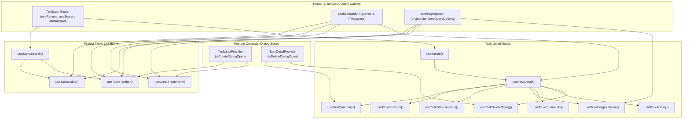

# Milestone 7 — Frontend Step 3: Feature Tasks Models, Contexts & Hooks (src/client/features/tasks/)

ในขั้นตอนนี้เราจะสร้างหัวใจของตรรกะฝั่ง Frontend สำหรับโมดูล `tasks` ภายใต้สถาปัตยกรรม **Zero Props & Single-Responsibility Hooks** ประกอบด้วย Feature View Models (`models/`), Compound Contexts สำหรับควบคุม Dialog (`contexts/`) และ Single-Responsibility Hooks ทั้ง 13 ตัว (`hooks/`) ที่แบ่งขอบเขตความรับผิดชอบอย่างชัดเจนสำหรับหน้ารายการงาน (`/projects/$projectId/tasks`) และหน้ารายละเอียดงาน (`/projects/$projectId/tasks/$taskId`)

---

## 1. เป้าหมายและขอบเขต Boundary (Boundary Context & Goal)

### เป้าหมายของ Step นี้
1. สร้าง **Feature UI Model** (`src/client/features/tasks/models/task-ui.ts`) สำหรับเก็บค่าคงที่เฉพาะของฟอร์มและปุ่มเปลี่ยนสถานะงาน (`UNASSIGNED_ASSIGNEE_VALUE`, `TASK_STATUS_TRANSITION_LABELS`, `TASK_PRIORITY_OPTIONS`, `toDateInputValue`)
2. สร้าง **Feature Contexts** (`TasksListProvider` และ `TaskDetailProvider`) เพื่อแชร์สถานะเปิด/ปิด Dialog ระหว่างปุ่มกดบนหน้าจอกับตัว Dialog โดยไม่ต้องส่ง Props ข้ามคอมโพเนนต์
3. สร้าง **Single-Responsibility Hooks** ทั้ง 13 ตัว ที่แยกหน้าที่ตามบริบทของแต่ละการ์ดและตารางอย่างอิสระ (เช่น ตารางแบบ Server-driven, แถบเครื่องมือกรองข้อมูลพร้อม Debounce Search, ฟอร์มสร้างงาน, ฟอร์มแก้ไขรายละเอียด, ปุ่มเปลี่ยนสถานะ FSM, ฟอร์มมอบหมายผู้รับผิดชอบ, ระบบความคิดเห็น และไทม์ไลน์กิจกรรม)

### ตารางสรุปไฟล์ใน Step นี้

| ลำดับ | Path ของไฟล์ | บทบาทหน้าที่ (Responsibility) |
| :--- | :--- | :--- |
| 1 | `src/client/features/tasks/models/task-ui.ts` | ค่าคงที่และฟังก์ชันช่วยเหลือสำหรับฟอร์มและปุ่มเปลี่ยนสถานะภายในฟีเจอร์ `tasks` |
| 2 | `src/client/features/tasks/contexts/tasks-list.context.tsx` | Context ควบคุมสถานะการเปิด/ปิด `CreateTaskDialog` ในหน้ารายการงาน |
| 3 | `src/client/features/tasks/contexts/task-detail.context.tsx` | Context ควบคุมสถานะการเปิด/ปิด `TaskDeleteDialog` ในหน้ารายละเอียดงาน |
| 4 | `src/client/features/tasks/hooks/use-task-id.ts` | ดึงพารามิเตอร์ `taskId` จาก URL Route อย่างปลอดภัย |
| 5 | `src/client/features/tasks/hooks/use-tasks-search.ts` | อ่านและอัปเดต URL Search Params (`TasksSearch`) ของตารางงาน |
| 6 | `src/client/features/tasks/hooks/use-tasks-table.ts` | จัดการ TanStack Table แบบ Server-driven (`manualPagination`, `manualSorting`) สำหรับตารางงาน |
| 7 | `src/client/features/tasks/hooks/use-tasks-toolbar.ts` | จัดการแถบค้นหา (Debounce 300ms) ตัวกรองสถานะ ความสำคัญ ผู้รับผิดชอบ และปุ่มเปิด Dialog สร้างงาน |
| 8 | `src/client/features/tasks/hooks/use-create-task-form.ts` | จัดการฟอร์มสร้างงานใหม่ (`useAppForm`) พร้อมตรวจสอบสิทธิ์ `task:assign` |
| 9 | `src/client/features/tasks/hooks/use-task-detail.ts` | ดึงข้อมูลรายละเอียดงาน (`taskDetailQueryOptions`) ร่วมกับสิทธิ์ระดับโครงการและสถานะ `isArchived` |
| 10 | `src/client/features/tasks/hooks/use-task-summary.ts` | เตรียมข้อมูลแสดงผลส่วนหัวของหน้ารายละเอียดงาน และปุ่มเปิด Dialog ยืนยันการลบงาน |
| 11 | `src/client/features/tasks/hooks/use-task-edit-form.ts` | จัดการฟอร์มแก้ไขหัวข้อ รายละเอียด ความสำคัญ และวันครบกำหนดของงาน |
| 12 | `src/client/features/tasks/hooks/use-task-status-actions.ts` | จัดการปุ่มเปลี่ยนสถานะงานตาม `allowedTransitions` จาก Finite State Machine |
| 13 | `src/client/features/tasks/hooks/use-task-assignee-form.ts` | จัดการฟอร์มเปลี่ยนหรือยกเลิกผู้รับผิดชอบงานจากรายชื่อสมาชิกในโครงการ |
| 14 | `src/client/features/tasks/hooks/use-task-comments.ts` | จัดการการแสดงรายการความคิดเห็น ฟอร์มเพิ่มความคิดเห็น และการลบความคิดเห็นตามสิทธิ์ |
| 15 | `src/client/features/tasks/hooks/use-task-activity.ts` | แปลงรายการประวัติกิจกรรมของงาน (`task.activities`) ด้วย `formatActivityLogItem` |
| 16 | `src/client/features/tasks/hooks/use-task-delete-dialog.ts` | จัดการการยืนยันลบงานถาวร และนำทางกลับสู่หน้ารายการงานของโครงการ |

### แผนผังสถาปัตยกรรมและการแยกหน้าที่ของ Hooks (Mermaid Diagram)



---

## 2. ทฤษฎี ความสำคัญ และกฎสถาปัตยกรรมเฉพาะ Boundary นี้

### 2.1 กฎสถาปัตยกรรมที่บังคับใช้ (`.agents/rules/client.md`)
- **`client.md` ข้อ 3, 4, 5 (Local Ownership & No Prop Drilling)**: Component แต่ละตัวต้องเรียก Hook ที่ตรงกับขอบเขตหน้าที่ของตัวเองโดยตรง ห้ามสร้าง God Hook ตัวเดียวใน Screen แล้วส่งค่าลงไปยังลูกๆ ผ่าน Props
- **`client.md` ข้อ 6 & 7 (Single Responsibility & High Cohesion)**: แยก Hook ตามหน้าที่ที่มีความหมายชัดเจน เช่น ในหน้ารายละเอียดงาน เราแยก `useTaskEditForm`, `useTaskStatusActions`, `useTaskAssigneeForm`, `useTaskComments`, `useTaskActivity` และ `useTaskDeleteDialog` ออกจากกัน เพื่อให้เวลาผู้ใช้พิมพ์ในช่องความคิดเห็นหรือกดปุ่มเปลี่ยนสถานะ จะเกิดการ Re-render เฉพาะการ์ดใบนั้นโดยไม่กระทบฟอร์มแก้ไขรายละเอียดงานที่อยู่ข้างกัน
- **`client.md` ข้อ 8 & 9 (Server-State vs Local UI State)**: การยิง Toast เมื่อสำเร็จหรือเกิดข้อผิดพลาดถูกจัดการโดย `MutationCache` ใน `client/caches/` แล้ว ดังนั้นใน `try { await mutation.mutateAsync(...) } catch { return; }` ของ Feature Hook จึงมีหน้าที่เพียงจัดการ Local UI Lifecycle เช่น `form.reset()`, `closeCreateDialog()`, `setDeletingCommentId(null)` หรือ `navigate(...)` เท่านั้น

### 2.2 การจัดการค่า Sentinel สำหรับ Select ที่อนุญาตให้เว้นว่าง (`UNASSIGNED_ASSIGNEE_VALUE`)
ในคอมโพเนนต์ `<Select>` ของ UI Library ค่า `value` ของแต่ละ `<SelectItem>` ต้องเป็น String ที่ไม่ว่างเปล่า (Non-empty String) เพื่อให้แสดงผลและจับคู่รายการที่เลือกได้อย่างถูกต้อง ดังนั้นสำหรับกรณี "ยังไม่ระบุผู้รับผิดชอบ (Unassigned)" ซึ่งฝั่งฐานข้อมูลและ API Contract ต้องการค่า `assigneeId: null` เราจึงกำหนดค่าคงที่ `UNASSIGNED_ASSIGNEE_VALUE = "__unassigned__"` ไว้ใน `models/task-ui.ts` และแปลงกลับเป็น `null` ใน `onSubmit` ของ `useCreateTaskForm` และ `useTaskAssigneeForm`

---

## 3. ลงมือเขียนโค้ด (Step-by-Step Implementation)

### 3.1 สร้าง Feature UI Model (`src/client/features/tasks/models/task-ui.ts`)

สร้างไฟล์ `src/client/features/tasks/models/task-ui.ts` เพื่อเก็บค่า `UNASSIGNED_ASSIGNEE_VALUE`, ป้ายข้อความบนปุ่มเปลี่ยนสถานะ (`TASK_STATUS_TRANSITION_LABELS`), ตัวเลือกระดับความสำคัญสำหรับฟอร์ม (`TASK_PRIORITY_OPTIONS`) และฟังก์ชันแปลงวันที่ ISO ให้เป็นรูปแบบ `YYYY-MM-DD` สำหรับ `<input type="date">` (`toDateInputValue`)

```typescript
import type { TaskStatus } from "#/shared/schemas/task.schema";

export const UNASSIGNED_ASSIGNEE_VALUE = "__unassigned__";

export const TASK_STATUS_TRANSITION_LABELS: Record<TaskStatus, string> = {
	todo: "ย้ายกลับไปต้องทำ",
	in_progress: "เริ่มดำเนินการ",
	in_review: "ส่งตรวจงาน",
	done: "ปิดงานเสร็จสิ้น",
	cancelled: "ยกเลิกงาน",
};

export const TASK_PRIORITY_OPTIONS = [
	{ label: "ต่ำ", value: "low" },
	{ label: "กลาง", value: "medium" },
	{ label: "สูง", value: "high" },
	{ label: "เร่งด่วน", value: "urgent" },
] as const;

export function toDateInputValue(isoDate: string | null): string {
	return isoDate ? isoDate.slice(0, 10) : "";
}
```

---

### 3.2 สร้าง Context สำหรับหน้ารายการงาน (`src/client/features/tasks/contexts/tasks-list.context.tsx`)

สร้างไฟล์ `src/client/features/tasks/contexts/tasks-list.context.tsx` เพื่อเชื่อมปุ่ม "สร้างงานใหม่" ใน `<TasksToolbar />` เข้ากับ `<CreateTaskDialog />`

```typescript
import type { ReactNode } from "react";
import { createContext, useContext, useState } from "react";

interface TasksListContextValue {
	isCreateDialogOpen: boolean;
	openCreateDialog: () => void;
	closeCreateDialog: () => void;
}

const TasksListContext = createContext<TasksListContextValue | null>(null);

export function TasksListProvider({ children }: { children: ReactNode }) {
	const [isCreateDialogOpen, setIsCreateDialogOpen] = useState(false);

	const value: TasksListContextValue = {
		isCreateDialogOpen,
		openCreateDialog: () => setIsCreateDialogOpen(true),
		closeCreateDialog: () => setIsCreateDialogOpen(false),
	};

	return (
		<TasksListContext.Provider value={value}>
			{children}
		</TasksListContext.Provider>
	);
}

export function useTasksListContext(): TasksListContextValue {
	const ctx = useContext(TasksListContext);
	if (!ctx) {
		throw new Error(
			"useTasksListContext must be used inside <TasksListProvider>",
		);
	}
	return ctx;
}
```

---

### 3.3 สร้าง Context สำหรับหน้ารายละเอียดงาน (`src/client/features/tasks/contexts/task-detail.context.tsx`)

สร้างไฟล์ `src/client/features/tasks/contexts/task-detail.context.tsx` เพื่อเชื่อมปุ่ม "ลบงาน" ใน `<TaskSummaryHeader />` เข้ากับ `<TaskDeleteDialog />`

```typescript
import type { ReactNode } from "react";
import { createContext, useContext, useState } from "react";

interface TaskDetailContextValue {
	isDeleteDialogOpen: boolean;
	openDeleteDialog: () => void;
	closeDeleteDialog: () => void;
}

const TaskDetailContext = createContext<TaskDetailContextValue | null>(null);

export function TaskDetailProvider({ children }: { children: ReactNode }) {
	const [isDeleteDialogOpen, setIsDeleteDialogOpen] = useState(false);

	const value: TaskDetailContextValue = {
		isDeleteDialogOpen,
		openDeleteDialog: () => setIsDeleteDialogOpen(true),
		closeDeleteDialog: () => setIsDeleteDialogOpen(false),
	};

	return (
		<TaskDetailContext.Provider value={value}>
			{children}
		</TaskDetailContext.Provider>
	);
}

export function useTaskDetailContext(): TaskDetailContextValue {
	const ctx = useContext(TaskDetailContext);
	if (!ctx) {
		throw new Error(
			"useTaskDetailContext must be used inside <TaskDetailProvider>",
		);
	}
	return ctx;
}
```

---

### 3.4 สร้าง Hook ดึง `taskId` จาก URL (`src/client/features/tasks/hooks/use-task-id.ts`)

สร้างไฟล์ `src/client/features/tasks/hooks/use-task-id.ts` เพื่ออ่านพารามิเตอร์ `taskId` จาก TanStack Router แบบไม่ต้องผูกติดกับ Route Path เฉพาะจุด (`strict: false`)

```typescript
import { useParams } from "@tanstack/react-router";

export function useTaskId(): string {
	const params = useParams({ strict: false });
	return "taskId" in params && typeof params.taskId === "string"
		? params.taskId
		: "";
}
```

---

### 3.5 สร้าง Hook จัดการ URL Search Params ของตารางงาน (`src/client/features/tasks/hooks/use-tasks-search.ts`)

สร้างไฟล์ `src/client/features/tasks/hooks/use-tasks-search.ts` เพื่ออ่านค่า URL Query String ผ่าน `tasksSearchSchema.parse(rawSearch)` และมีฟังก์ชัน `updateSearch(patch)` สำหรับอัปเดตเงื่อนไขการค้นหา ตัวกรอง การเรียงลำดับ และการเปลี่ยนหน้าบน URL

```typescript
import { useNavigate, useSearch } from "@tanstack/react-router";
import { useCallback } from "react";
import { useProjectId } from "#/client/features/projects/hooks/use-project-id";
import type { TasksSearch } from "#/shared/schemas/task.schema";
import { tasksSearchSchema } from "#/shared/schemas/task.schema";

export function useTasksSearch() {
	const navigate = useNavigate();
	const projectId = useProjectId();
	const rawSearch = useSearch({ strict: false });
	const search = tasksSearchSchema.parse(rawSearch);

	const updateSearch = useCallback(
		(patch: Partial<TasksSearch>) => {
			if (!projectId) {
				return;
			}
			void navigate({
				to: "/projects/$projectId/tasks",
				params: { projectId },
				search: (prev) => ({
					...tasksSearchSchema.parse(prev),
					...patch,
				}),
			});
		},
		[navigate, projectId],
	);

	return {
		projectId,
		search,
		updateSearch,
	};
}
```

---

### 3.6 สร้าง Hook จัดการตารางงานแบบ Server-Driven (`src/client/features/tasks/hooks/use-tasks-table.ts`)

สร้างไฟล์ `src/client/features/tasks/hooks/use-tasks-table.ts` สำหรับกำหนดคอลัมน์ทั้ง 8 คอลัมน์ของตารางงาน (`code`, `title`, `status`, `priority`, `assignee`, `dueDate`, `commentCount`, `updatedAt`) และผูกสถานะ `pagination` กับ `sorting` ของ TanStack Table เข้ากับ URL Search Params พร้อมใช้ `placeholderData: keepPreviousData` เพื่อให้ตารางไม่กระพริบขณะเปลี่ยนหน้าหรือเรียงลำดับ

```typescript
import { keepPreviousData, useQuery } from "@tanstack/react-query";
import type {
	OnChangeFn,
	PaginationState,
	SortingState,
} from "@tanstack/react-table";
import { functionalUpdate, useTable } from "@tanstack/react-table";
import { useMemo } from "react";
import { tasksListQueryOptions } from "#/client/caches/tasks/queries/tasks.query";
import {
	createServerColumnHelper,
	serverTableFeatures,
} from "#/client/shared/components/app-data-table";
import type { TaskListItemDto } from "#/shared/schemas/task.schema";
import { taskSortFieldSchema } from "#/shared/schemas/task.schema";
import { useTasksSearch } from "./use-tasks-search";

const taskColumnHelper = createServerColumnHelper<TaskListItemDto>();

const taskTableColumns = taskColumnHelper.columns([
	taskColumnHelper.accessor("code", {
		header: "รหัส",
		enableSorting: true,
	}),
	taskColumnHelper.accessor("title", {
		header: "หัวข้องาน",
		enableSorting: true,
	}),
	taskColumnHelper.accessor("status", {
		header: "สถานะ",
		enableSorting: true,
	}),
	taskColumnHelper.accessor("priority", {
		header: "ความสำคัญ",
		enableSorting: true,
	}),
	taskColumnHelper.accessor("assignee", {
		header: "ผู้รับผิดชอบ",
		enableSorting: false,
	}),
	taskColumnHelper.accessor("dueDate", {
		header: "วันครบกำหนด",
		enableSorting: true,
	}),
	taskColumnHelper.accessor("commentCount", {
		header: "ความคิดเห็น",
		enableSorting: false,
	}),
	taskColumnHelper.accessor("updatedAt", {
		header: "อัปเดตล่าสุด",
		enableSorting: true,
	}),
]);

export function useTasksTable() {
	const { projectId, search, updateSearch } = useTasksSearch();

	const { data, isPending } = useQuery({
		...tasksListQueryOptions(projectId, search),
		enabled: Boolean(projectId),
		placeholderData: keepPreviousData,
	});

	const pagination: PaginationState = useMemo(
		() => ({
			pageIndex: Math.max(0, search.page - 1),
			pageSize: search.pageSize,
		}),
		[search.page, search.pageSize],
	);

	const sorting: SortingState = useMemo(
		() => [
			{
				id: search.sortBy,
				desc: search.sortOrder === "desc",
			},
		],
		[search.sortBy, search.sortOrder],
	);

	const onPaginationChange: OnChangeFn<PaginationState> = (updater) => {
		const next = functionalUpdate(updater, pagination);
		const isPageSizeChanged = next.pageSize !== pagination.pageSize;

		updateSearch({
			page: isPageSizeChanged ? 1 : next.pageIndex + 1,
			pageSize: next.pageSize,
		});
	};

	const onSortingChange: OnChangeFn<SortingState> = (updater) => {
		const next = functionalUpdate(updater, sorting);
		const firstSort = next[0];

		if (!firstSort) {
			updateSearch({
				sortBy: "updatedAt",
				sortOrder: "desc",
				page: 1,
			});
			return;
		}

		const parsedField = taskSortFieldSchema.safeParse(firstSort.id);
		if (!parsedField.success) {
			return;
		}

		updateSearch({
			sortBy: parsedField.data,
			sortOrder: firstSort.desc ? "desc" : "asc",
			page: 1,
		});
	};

	const table = useTable({
		features: serverTableFeatures,
		columns: taskTableColumns,
		data: data?.items ?? [],
		rowCount: data?.total ?? 0,
		manualPagination: true,
		manualSorting: true,
		state: {
			pagination,
			sorting,
		},
		onPaginationChange,
		onSortingChange,
		getRowId: (row) => row.id,
	});

	return {
		table,
		columnCount: taskTableColumns.length,
		isPending,
	};
}
```

---

### 3.7 สร้าง Hook จัดการแถบเครื่องมือค้นหาและตัวกรอง (`src/client/features/tasks/hooks/use-tasks-toolbar.ts`)

สร้างไฟล์ `src/client/features/tasks/hooks/use-tasks-toolbar.ts` เพื่อจัดการช่องค้นหาแบบ Debounce 300ms, ตัวกรองตามสถานะ ความสำคัญ และผู้รับผิดชอบ (ดึงรายชื่อสมาชิกจาก `projectMembersQueryOptions` พร้อมตัวเลือก `"all"` และ `"unassigned"`), ปุ่มล้างตัวกรอง และตรวจสอบสิทธิ์ `can("task:create") && !isArchived` สำหรับแสดงปุ่มสร้างงานใหม่

```typescript
import { keepPreviousData, useQuery } from "@tanstack/react-query";
import { useEffect, useMemo, useState } from "react";
import { projectMembersQueryOptions } from "#/client/caches/projects/queries/project-members.query";
import { tasksListQueryOptions } from "#/client/caches/tasks/queries/tasks.query";
import { useProjectDetail } from "#/client/features/projects/hooks/use-project-detail";
import {
	TASK_PRIORITY_FILTER_OPTIONS,
	TASK_STATUS_FILTER_OPTIONS,
} from "#/client/shared/helpers/task-display";
import {
	taskPriorityFilterSchema,
	taskStatusFilterSchema,
} from "#/shared/schemas/task.schema";
import { useTasksListContext } from "../contexts/tasks-list.context";
import { useTasksSearch } from "./use-tasks-search";

export function useTasksToolbar() {
	const { projectId, search, updateSearch } = useTasksSearch();
	const { isArchived, can } = useProjectDetail();
	const { openCreateDialog } = useTasksListContext();
	const [searchInput, setSearchInput] = useState(search.search);

	const { isFetching } = useQuery({
		...tasksListQueryOptions(projectId, search),
		enabled: Boolean(projectId),
		placeholderData: keepPreviousData,
	});

	const { data: membersData } = useQuery({
		...projectMembersQueryOptions(projectId),
		enabled: Boolean(projectId),
	});

	const assigneeFilterOptions = useMemo(() => {
		const memberOptions = (membersData?.members ?? []).map((member) => ({
			label: member.userName,
			value: member.userId,
		}));

		return [
			{ label: "ผู้รับผิดชอบทั้งหมด", value: "all" },
			{ label: "ยังไม่มอบหมาย (Unassigned)", value: "unassigned" },
			...memberOptions,
		];
	}, [membersData]);

	const canCreateTask = can("task:create") && !isArchived;

	const hasActiveFilters =
		search.search !== "" ||
		search.status !== "all" ||
		search.priority !== "all" ||
		search.assigneeFilter !== "all";

	useEffect(() => {
		setSearchInput(search.search);
	}, [search.search]);

	useEffect(() => {
		const trimmed = searchInput.trim();
		if (trimmed === search.search) {
			return;
		}

		const timer = setTimeout(() => {
			updateSearch({ search: trimmed, page: 1 });
		}, 300);

		return () => clearTimeout(timer);
	}, [searchInput, search.search, updateSearch]);

	const handleClearSearch = () => {
		setSearchInput("");
		if (search.search !== "") {
			updateSearch({ search: "", page: 1 });
		}
	};

	const handleStatusChange = (nextValue: string | null) => {
		const parsed = taskStatusFilterSchema.safeParse(nextValue);
		if (!parsed.success || parsed.data === search.status) {
			return;
		}
		updateSearch({ status: parsed.data, page: 1 });
	};

	const handlePriorityChange = (nextValue: string | null) => {
		const parsed = taskPriorityFilterSchema.safeParse(nextValue);
		if (!parsed.success || parsed.data === search.priority) {
			return;
		}
		updateSearch({ priority: parsed.data, page: 1 });
	};

	const handleAssigneeFilterChange = (nextValue: string | null) => {
		if (!nextValue || nextValue === search.assigneeFilter) {
			return;
		}
		updateSearch({ assigneeFilter: nextValue, page: 1 });
	};

	const handleResetFilters = () => {
		setSearchInput("");
		updateSearch({
			search: "",
			status: "all",
			priority: "all",
			assigneeFilter: "all",
			page: 1,
		});
	};

	return {
		searchInput,
		status: search.status,
		priority: search.priority,
		assigneeFilter: search.assigneeFilter,
		statusOptions: TASK_STATUS_FILTER_OPTIONS,
		priorityOptions: TASK_PRIORITY_FILTER_OPTIONS,
		assigneeFilterOptions,
		hasActiveFilters,
		isFetching,
		isArchived,
		canCreateTask,
		setSearchInput,
		handleClearSearch,
		handleStatusChange,
		handlePriorityChange,
		handleAssigneeFilterChange,
		handleResetFilters,
		openCreateDialog,
	};
}
```

---

### 3.8 สร้าง Hook จัดการฟอร์มสร้างงานใหม่ (`src/client/features/tasks/hooks/use-create-task-form.ts`)

สร้างไฟล์ `src/client/features/tasks/hooks/use-create-task-form.ts` สำหรับควบคุมฟอร์มใน `CreateTaskDialog` โดยตรวจสอบสิทธิ์ `can("task:assign")` หากผู้ใช้มีสิทธิ์มอบหมายงานจะเปิดให้เลือกผู้รับผิดชอบได้ตั้งแต่ตอนสร้างงาน

```typescript
import { useQuery } from "@tanstack/react-query";
import { useMemo } from "react";
import { z } from "zod";
import { projectMembersQueryOptions } from "#/client/caches/projects/queries/project-members.query";
import { useCreateTaskMutation } from "#/client/caches/tasks/mutates/create-task.mutate";
import { useProjectDetail } from "#/client/features/projects/hooks/use-project-detail";
import { useAppForm } from "#/client/shared/components/app-form";
import type { TaskPriority } from "#/shared/schemas/task.schema";
import {
	taskDescriptionSchema,
	taskDueDateInputSchema,
	taskPrioritySchema,
	taskTitleSchema,
} from "#/shared/schemas/task.schema";
import { useTasksListContext } from "../contexts/tasks-list.context";
import {
	TASK_PRIORITY_OPTIONS,
	UNASSIGNED_ASSIGNEE_VALUE,
} from "../models/task-ui";

const createTaskFormSchema = z.object({
	title: taskTitleSchema,
	description: taskDescriptionSchema,
	priority: taskPrioritySchema,
	assigneeId: z.string(),
	dueDate: taskDueDateInputSchema,
});

export function useCreateTaskForm() {
	const { projectId, can } = useProjectDetail();
	const { isCreateDialogOpen, closeCreateDialog } = useTasksListContext();
	const createMutation = useCreateTaskMutation();

	const canAssignTask = can("task:assign");

	const { data: membersData } = useQuery({
		...projectMembersQueryOptions(projectId),
		enabled: Boolean(projectId) && canAssignTask,
	});

	const assigneeOptions = useMemo(() => {
		const members = (membersData?.members ?? []).map((member) => ({
			label: `${member.userName} (${member.roleName})`,
			value: member.userId,
		}));

		return [
			{
				label: "ยังไม่ระบุผู้รับผิดชอบ (Unassigned)",
				value: UNASSIGNED_ASSIGNEE_VALUE,
			},
			...members,
		];
	}, [membersData]);

	const form = useAppForm({
		defaultValues: {
			title: "",
			description: "",
			priority: "medium" as TaskPriority,
			assigneeId: UNASSIGNED_ASSIGNEE_VALUE,
			dueDate: "",
		},
		validators: {
			onBlur: createTaskFormSchema,
			onSubmit: createTaskFormSchema,
		},
		onSubmit: async ({ value }) => {
			if (!projectId) {
				return;
			}
			const assigneeId =
				!canAssignTask ||
				value.assigneeId === UNASSIGNED_ASSIGNEE_VALUE ||
				value.assigneeId.trim() === ""
					? null
					: value.assigneeId;
			const dueDate = value.dueDate.trim() === "" ? null : value.dueDate.trim();

			try {
				await createMutation.mutateAsync({
					projectId,
					title: value.title,
					description: value.description,
					priority: value.priority,
					assigneeId,
					dueDate,
				});
				form.reset();
				closeCreateDialog();
			} catch {
				// Error toast is centrally handled by MutationCache in client/caches/global.ts
				return;
			}
		},
	});

	const handleOpenChange = (open: boolean) => {
		if (!open) {
			form.reset();
			closeCreateDialog();
		}
	};

	return {
		isOpen: isCreateDialogOpen,
		canAssignTask,
		priorityOptions: TASK_PRIORITY_OPTIONS,
		assigneeOptions,
		handleOpenChange,
		form,
	};
}
```

---

### 3.9 สร้าง Hook กลางดึงข้อมูลรายละเอียดงานและสิทธิ์ (`src/client/features/tasks/hooks/use-task-detail.ts`)

สร้างไฟล์ `src/client/features/tasks/hooks/use-task-detail.ts` เพื่อรวบรวมข้อมูลงาน (`taskDetailQueryOptions`) ร่วมกับข้อมูลผู้ใช้ปัจจุบัน (`useSession`) และสิทธิ์ในโครงการ (`useProjectDetail`) ให้ Hooks ย่อยในหน้ารายละเอียดงานเรียกใช้ต่อได้อย่างสะดวก

```typescript
import { useQuery } from "@tanstack/react-query";
import { taskDetailQueryOptions } from "#/client/caches/tasks/queries/task-detail.query";
import { useSession } from "#/client/features/auth/hooks/use-session";
import { useProjectDetail } from "#/client/features/projects/hooks/use-project-detail";
import { useTaskId } from "./use-task-id";

export function useTaskDetail() {
	const { session } = useSession();
	const { projectId, isArchived, can } = useProjectDetail();
	const taskId = useTaskId();

	const { data: task, isPending } = useQuery({
		...taskDetailQueryOptions(projectId, taskId),
		enabled: Boolean(projectId) && Boolean(taskId),
	});

	return {
		projectId,
		taskId,
		task: task ?? null,
		isPending,
		isArchived,
		currentUserId: session?.user.id ?? "",
		canUpdateTask: can("task:update"),
		canAssignTask: can("task:assign"),
		canDeleteTask: can("task:delete"),
		canCreateComment: can("comment:create"),
		canDeleteAnyComment: can("comment:delete_any"),
	};
}
```

---

### 3.10 สร้าง Hook สำหรับส่วนหัวสรุปข้อมูลงาน (`src/client/features/tasks/hooks/use-task-summary.ts`)

สร้างไฟล์ `src/client/features/tasks/hooks/use-task-summary.ts` สำหรับเตรียมป้ายวันที่ครบกำหนด (`dueDateLabel`), เวลาที่อัปเดตล่าสุด (`updatedAtLabel`), สิทธิ์ในการลบงาน (`canDeleteTask && !isArchived`) และฟังก์ชัน `openDeleteDialog`

```typescript
import { formatTaskDueDate } from "#/client/shared/helpers/task-display";
import { useTaskDetailContext } from "../contexts/task-detail.context";
import { useTaskDetail } from "./use-task-detail";

export function useTaskSummary() {
	const { projectId, task, isPending, isArchived, canDeleteTask } =
		useTaskDetail();
	const { openDeleteDialog } = useTaskDetailContext();

	return {
		projectId,
		task,
		isPending,
		isArchived,
		canDeleteTask: canDeleteTask && !isArchived,
		dueDateLabel: formatTaskDueDate(task?.dueDate ?? null),
		updatedAtLabel: task ? new Date(task.updatedAt).toLocaleString() : "",
		openDeleteDialog,
	};
}
```

---

### 3.11 สร้าง Hook จัดการฟอร์มแก้ไขรายละเอียดงาน (`src/client/features/tasks/hooks/use-task-edit-form.ts`)

สร้างไฟล์ `src/client/features/tasks/hooks/use-task-edit-form.ts` สำหรับการ์ดแก้ไขข้อมูลงาน พร้อม `useEffect` เพื่อซิงค์ค่าเริ่มต้นของฟอร์มเมื่อข้อมูล `task` โหลดเสร็จหรือถูกอัปเดตจากเซิร์ฟเวอร์

```typescript
import { useEffect } from "react";
import { z } from "zod";
import { useUpdateTaskMutation } from "#/client/caches/tasks/mutates/update-task.mutate";
import { useAppForm } from "#/client/shared/components/app-form";
import type { TaskPriority } from "#/shared/schemas/task.schema";
import {
	taskDescriptionSchema,
	taskDueDateInputSchema,
	taskPrioritySchema,
	taskTitleSchema,
} from "#/shared/schemas/task.schema";
import { TASK_PRIORITY_OPTIONS, toDateInputValue } from "../models/task-ui";
import { useTaskDetail } from "./use-task-detail";

const editTaskFormSchema = z.object({
	title: taskTitleSchema,
	description: taskDescriptionSchema,
	priority: taskPrioritySchema,
	dueDate: taskDueDateInputSchema,
});

export function useTaskEditForm() {
	const { projectId, task, isArchived, canUpdateTask } = useTaskDetail();
	const updateMutation = useUpdateTaskMutation();

	const form = useAppForm({
		defaultValues: {
			title: task?.title ?? "",
			description: task?.description ?? "",
			priority: (task?.priority ?? "medium") as TaskPriority,
			dueDate: toDateInputValue(task?.dueDate ?? null),
		},
		validators: {
			onBlur: editTaskFormSchema,
			onSubmit: editTaskFormSchema,
		},
		onSubmit: async ({ value }) => {
			if (!projectId || !task) {
				return;
			}
			const dueDate = value.dueDate.trim() === "" ? null : value.dueDate.trim();
			try {
				await updateMutation.mutateAsync({
					projectId,
					taskId: task.id,
					title: value.title,
					description: value.description,
					priority: value.priority,
					dueDate,
				});
			} catch {
				// Error toast is centrally handled by MutationCache in client/caches/global.ts
				return;
			}
		},
	});

	useEffect(() => {
		if (!task) {
			return;
		}
		form.reset({
			title: task.title,
			description: task.description,
			priority: task.priority,
			dueDate: toDateInputValue(task.dueDate),
		});
	}, [task, form]);

	return {
		task,
		canUpdateTask,
		isArchived,
		priorityOptions: TASK_PRIORITY_OPTIONS,
		form,
	};
}
```

---

### 3.12 สร้าง Hook จัดการปุ่มเปลี่ยนสถานะงานตาม FSM (`src/client/features/tasks/hooks/use-task-status-actions.ts`)

สร้างไฟล์ `src/client/features/tasks/hooks/use-task-status-actions.ts` เพื่ออ่าน `task.allowedTransitions` ที่คำนวณมาจาก Domain Entity ฝั่งเซิร์ฟเวอร์ และส่งคำสั่ง `transitionMutation.mutateAsync` พร้อมติดตามสถานะ `pendingStatus` เพื่อแสดง Spinner เฉพาะปุ่มที่ผู้ใช้เพิ่งคลิก

```typescript
import { useTransitionTaskStatusMutation } from "#/client/caches/tasks/mutates/transition-task-status.mutate";
import type { TaskStatus } from "#/shared/schemas/task.schema";
import { useTaskDetail } from "./use-task-detail";

export function useTaskStatusActions() {
	const { projectId, task, isArchived, canUpdateTask } = useTaskDetail();
	const transitionMutation = useTransitionTaskStatusMutation();

	const handleTransition = async (nextStatus: TaskStatus) => {
		if (!task || !projectId) {
			return;
		}
		try {
			await transitionMutation.mutateAsync({
				projectId,
				taskId: task.id,
				status: nextStatus,
			});
		} catch {
			// Error toast is centrally handled by MutationCache in client/caches/global.ts
			return;
		}
	};

	return {
		currentStatus: task?.status ?? null,
		allowedTransitions: task?.allowedTransitions ?? [],
		canUpdateTask,
		isArchived,
		isTransitioning: transitionMutation.isPending,
		pendingStatus: transitionMutation.variables?.status ?? null,
		handleTransition,
	};
}
```

---

### 3.13 สร้าง Hook จัดการฟอร์มผู้รับผิดชอบงาน (`src/client/features/tasks/hooks/use-task-assignee-form.ts`)

สร้างไฟล์ `src/client/features/tasks/hooks/use-task-assignee-form.ts` สำหรับดึงรายชื่อสมาชิกในโครงการมาเป็นตัวเลือกผู้รับผิดชอบ และบันทึกผ่าน `useAssignTaskMutation`

```typescript
import { useQuery } from "@tanstack/react-query";
import { useEffect, useMemo } from "react";
import { z } from "zod";
import { projectMembersQueryOptions } from "#/client/caches/projects/queries/project-members.query";
import { useAssignTaskMutation } from "#/client/caches/tasks/mutates/assign-task.mutate";
import { useAppForm } from "#/client/shared/components/app-form";
import { UNASSIGNED_ASSIGNEE_VALUE } from "../models/task-ui";
import { useTaskDetail } from "./use-task-detail";

const assignTaskFormSchema = z.object({
	assigneeId: z.string().min(1),
});

export function useTaskAssigneeForm() {
	const { projectId, task, isArchived, canAssignTask } = useTaskDetail();
	const assignMutation = useAssignTaskMutation();

	const { data: membersData } = useQuery({
		...projectMembersQueryOptions(projectId),
		enabled: Boolean(projectId),
	});

	const assigneeOptions = useMemo(() => {
		const members = (membersData?.members ?? []).map((member) => ({
			label: `${member.userName} (${member.roleName})`,
			value: member.userId,
		}));

		return [
			{
				label: "ยังไม่ระบุผู้รับผิดชอบ (Unassigned)",
				value: UNASSIGNED_ASSIGNEE_VALUE,
			},
			...members,
		];
	}, [membersData]);

	const form = useAppForm({
		defaultValues: {
			assigneeId: task?.assignee?.id ?? UNASSIGNED_ASSIGNEE_VALUE,
		},
		validators: {
			onSubmit: assignTaskFormSchema,
		},
		onSubmit: async ({ value }) => {
			if (!projectId || !task) {
				return;
			}
			const nextAssigneeId =
				value.assigneeId === UNASSIGNED_ASSIGNEE_VALUE
					? null
					: value.assigneeId;

			try {
				await assignMutation.mutateAsync({
					projectId,
					taskId: task.id,
					assigneeId: nextAssigneeId,
				});
			} catch {
				// Error toast is centrally handled by MutationCache in client/caches/global.ts
				return;
			}
		},
	});

	useEffect(() => {
		if (!task) {
			return;
		}
		form.reset({
			assigneeId: task.assignee?.id ?? UNASSIGNED_ASSIGNEE_VALUE,
		});
	}, [task, form]);

	return {
		task,
		canAssignTask,
		isArchived,
		assigneeOptions,
		form,
	};
}
```

---

### 3.14 สร้าง Hook จัดการระบบความคิดเห็นของงาน (`src/client/features/tasks/hooks/use-task-comments.ts`)

สร้างไฟล์ `src/client/features/tasks/hooks/use-task-comments.ts` โดยคำนวณสิทธิ์ `canDelete` รายความคิดเห็นว่าผู้ใช้คนนั้นเป็นเจ้าของความคิดเห็น (`comment.author.id === currentUserId`) หรือมีสิทธิ์ `comment:delete_any` (`canDeleteAnyComment`) และโครงการต้องยังไม่ถูกเก็บถาวร (`!isArchived`)

```typescript
import { useMemo, useState } from "react";
import { z } from "zod";
import { useAddTaskCommentMutation } from "#/client/caches/tasks/mutates/add-task-comment.mutate";
import { useDeleteTaskCommentMutation } from "#/client/caches/tasks/mutates/delete-task-comment.mutate";
import { useAppForm } from "#/client/shared/components/app-form";
import { taskCommentBodySchema } from "#/shared/schemas/task.schema";
import { useTaskDetail } from "./use-task-detail";

const addCommentFormSchema = z.object({
	body: taskCommentBodySchema,
});

export function useTaskComments() {
	const {
		projectId,
		task,
		isArchived,
		currentUserId,
		canCreateComment,
		canDeleteAnyComment,
	} = useTaskDetail();
	const addCommentMutation = useAddTaskCommentMutation();
	const deleteCommentMutation = useDeleteTaskCommentMutation();
	const [deletingCommentId, setDeletingCommentId] = useState<string | null>(
		null,
	);

	const form = useAppForm({
		defaultValues: {
			body: "",
		},
		validators: {
			onSubmit: addCommentFormSchema,
		},
		onSubmit: async ({ value }) => {
			if (!projectId || !task) {
				return;
			}
			try {
				await addCommentMutation.mutateAsync({
					projectId,
					taskId: task.id,
					body: value.body,
				});
				form.reset();
			} catch {
				// Error toast is centrally handled by MutationCache in client/caches/global.ts
				return;
			}
		},
	});

	const comments = useMemo(
		() =>
			(task?.comments ?? []).map((comment) => ({
				id: comment.id,
				authorName: comment.author.name,
				authorEmail: comment.author.email,
				body: comment.body,
				createdAtLabel: new Date(comment.createdAt).toLocaleString(),
				canDelete:
					!isArchived &&
					(comment.author.id === currentUserId || canDeleteAnyComment),
			})),
		[task?.comments, currentUserId, canDeleteAnyComment, isArchived],
	);

	const handleDeleteComment = async (commentId: string) => {
		if (!projectId || !task) {
			return;
		}
		setDeletingCommentId(commentId);
		try {
			await deleteCommentMutation.mutateAsync({
				projectId,
				taskId: task.id,
				commentId,
			});
		} catch {
			// Error toast is centrally handled by MutationCache in client/caches/global.ts
			return;
		} finally {
			setDeletingCommentId(null);
		}
	};

	return {
		comments,
		canCreateComment,
		isArchived,
		deletingCommentId,
		handleDeleteComment,
		form,
	};
}
```

---

### 3.15 สร้าง Hook จัดการประวัติกิจกรรมของงาน (`src/client/features/tasks/hooks/use-task-activity.ts`)

สร้างไฟล์ `src/client/features/tasks/hooks/use-task-activity.ts` โดยนำ `formatActivityLogItem` จาก `src/client/shared/helpers/activity-formatter.ts` (ที่สร้างไว้ตั้งแต่ Milestone 6) มาแปลงรายการ `task.activities` ให้เป็น View Model ที่พร้อมแสดงผลทันที

```typescript
import { useMemo } from "react";
import { formatActivityLogItem } from "#/client/shared/helpers/activity-formatter";
import { useTaskDetail } from "./use-task-detail";

export function useTaskActivity() {
	const { task, isPending } = useTaskDetail();

	const items = useMemo(
		() => (task?.activities ?? []).map(formatActivityLogItem),
		[task?.activities],
	);

	return {
		items,
		isPending,
	};
}
```

---

### 3.16 สร้าง Hook จัดการ Dialog ยืนยันการลบงาน (`src/client/features/tasks/hooks/use-task-delete-dialog.ts`)

สร้างไฟล์ `src/client/features/tasks/hooks/use-task-delete-dialog.ts` เพื่อเชื่อมต่อกับ `TaskDetailContext` และ `useDeleteTaskMutation` เมื่อลบสำเร็จจะปิด Dialog และนำทางผู้ใช้กลับไปยังหน้ารายการงานของโครงการ (`/projects/$projectId/tasks`)

```typescript
import { useNavigate } from "@tanstack/react-router";
import { useDeleteTaskMutation } from "#/client/caches/tasks/mutates/delete-task.mutate";
import { useTaskDetailContext } from "../contexts/task-detail.context";
import { useTaskDetail } from "./use-task-detail";

export function useTaskDeleteDialog() {
	const navigate = useNavigate();
	const { projectId, task } = useTaskDetail();
	const { isDeleteDialogOpen, closeDeleteDialog } = useTaskDetailContext();
	const deleteMutation = useDeleteTaskMutation();

	const handleOpenChange = (open: boolean) => {
		if (!open) {
			closeDeleteDialog();
		}
	};

	const handleConfirmDelete = async () => {
		if (!projectId || !task) {
			return;
		}
		try {
			await deleteMutation.mutateAsync({
				projectId,
				taskId: task.id,
			});
			closeDeleteDialog();
			await navigate({
				to: "/projects/$projectId/tasks",
				params: { projectId },
			});
		} catch {
			// Error toast is centrally handled by MutationCache in client/caches/global.ts
			return;
		}
	};

	return {
		task,
		isOpen: isDeleteDialogOpen,
		isDeleting: deleteMutation.isPending,
		handleOpenChange,
		handleConfirmDelete,
	};
}
```

---

## 4. การตรวจสอบความถูกต้องและ Git Commit (Verification & Commit)

### 4.1 ตรวจสอบ Type Safety และ Linting
รันคำสั่งตรวจสอบด้วย `bun` เพื่อยืนยันว่า Models, Contexts และ Hooks ทั้ง 16 ไฟล์ไม่มีข้อผิดพลาดด้าน Type หรือ Lint:

```bash
bun run typecheck
bun run format
bun run check
```

### 4.2 บันทึกการเปลี่ยนแปลงลง Git (Git Commit)
เมื่อตรวจสอบผ่านเรียบร้อยแล้ว ให้ Stage ไฟล์ทั้ง 16 ไฟล์ใน `models/`, `contexts/` และ `hooks/` แล้วทำการ Commit ประจำ Step ที่ 3:

```bash
git add src/client/features/tasks/models/ src/client/features/tasks/contexts/ src/client/features/tasks/hooks/
git commit -m "milestone-7.frontend.step-3: Feature Tasks Models, Contexts & Single-Responsibility Hooks"
```
