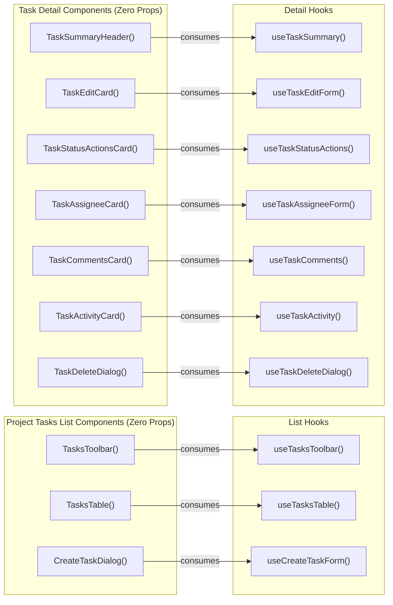

# Milestone 7 — Frontend Step 4: Feature Tasks Zero-Props Components (src/client/features/tasks/components/)

ในขั้นตอนนี้เราจะสร้าง Presentation Components ทั้ง 10 ไฟล์ของฟีเจอร์ `tasks` ภายใต้กฎเหล็ก **Zero Props Architecture**, **One Component per File**, **No Custom Borders (`border-*`/`ring-*`)** และ **No Emoji in UI (Lucide SVG Icons Only)** โดยแต่ละ Component จะเรียก Single-Responsibility Hook ประจำตัวจาก Step ที่ 3 มาแสดงผลทันทีโดยไม่รับ Props ใดๆ จากภายนอก

---

## 1. เป้าหมายและขอบเขต Boundary (Boundary Context & Goal)

### เป้าหมายของ Step นี้
1. สร้าง **Components สำหรับหน้ารายการงาน (3 ไฟล์)**:
   - `TasksToolbar`: แถบเครื่องมือค้นหา กรองสถานะ ความสำคัญ ผู้รับผิดชอบ ปุ่มล้างตัวกรอง และปุ่มเปิด Dialog สร้างงานใหม่
   - `TasksTable`: ตารางแสดงรายการงานผ่าน `<AppDataTable />` พร้อมลิงก์ `<AppButtonLink />` ไปยังหน้ารายละเอียดงาน
   - `CreateTaskDialog`: หน้าต่างแบบจำลองสำหรับกรอกข้อมูลสร้างงานใหม่
2. สร้าง **Components สำหรับหน้ารายละเอียดงาน (7 ไฟล์)**:
   - `TaskSummaryHeader`: ส่วนหัวแสดงรหัสงาน สถานะ ความสำคัญ ผู้สร้าง ผู้รับผิดชอบ วันครบกำหนด และปุ่มลบงาน
   - `TaskEditCard`: การ์ดแก้ไขหัวข้อ รายละเอียด ความสำคัญ และวันครบกำหนด (สลับเป็นโหมดอ่านอย่างเดียวอัตโนมัติหากไม่มีสิทธิ์หรือโครงการถูกเก็บถาวร)
   - `TaskStatusActionsCard`: การ์ดแสดงปุ่มเปลี่ยนสถานะงานตามกฎ Finite State Machine (`allowedTransitions`)
   - `TaskAssigneeCard`: การ์ดเลือกหรือยกเลิกผู้รับผิดชอบงานจากรายชื่อสมาชิกในโครงการ
   - `TaskCommentsCard`: การ์ดแสดงรายการความคิดเห็น ปุ่มลบความคิดเห็น และฟอร์มเพิ่มความคิดเห็นใหม่
   - `TaskActivityCard`: การ์ดแสดงไทม์ไลน์ประวัติกิจกรรมที่เกิดขึ้นกับงานนี้
   - `TaskDeleteDialog`: หน้าต่างยืนยันการลบงานถาวร

### ตารางสรุปไฟล์ใน Step นี้

| ลำดับ | Path ของไฟล์ | บทบาทหน้าที่ (Responsibility) |
| :--- | :--- | :--- |
| 1 | `src/client/features/tasks/components/tasks-toolbar.tsx` | แถบค้นหาและตัวกรองรายการงาน พร้อมปุ่มเปิด Dialog สร้างงานใหม่ |
| 2 | `src/client/features/tasks/components/tasks-table.tsx` | ตารางรายการงานแบบ Server-driven พร้อมลิงก์เข้าสู่หน้ารายละเอียดงาน |
| 3 | `src/client/features/tasks/components/create-task-dialog.tsx` | Dialog ฟอร์มสร้างงานใหม่ |
| 4 | `src/client/features/tasks/components/task-summary-header.tsx` | การ์ดส่วนหัวสรุปข้อมูลหลักของงาน ป้ายสถานะ และปุ่มลบงาน |
| 5 | `src/client/features/tasks/components/task-edit-card.tsx` | การ์ดแก้ไขรายละเอียดงาน หรือแสดงผลแบบอ่านอย่างเดียวตามสิทธิ์ |
| 6 | `src/client/features/tasks/components/task-status-actions-card.tsx` | การ์ดปุ่มกดเปลี่ยนสถานะงานตามขั้นตอน Finite State Machine |
| 7 | `src/client/features/tasks/components/task-assignee-card.tsx` | การ์ดกำหนดหรือเปลี่ยนผู้รับผิดชอบงาน |
| 8 | `src/client/features/tasks/components/task-comments-card.tsx` | การ์ดแสดงรายการความคิดเห็น ลบความคิดเห็น และส่งความคิดเห็นใหม่ |
| 9 | `src/client/features/tasks/components/task-activity-card.tsx` | การ์ดแสดงประวัติกิจกรรมเฉพาะของงาน |
| 10 | `src/client/features/tasks/components/task-delete-dialog.tsx` | Dialog ยืนยันการลบงานถาวร |

### แผนผังการจับคู่ 1:1 ระหว่าง Zero-Props Components กับ Hooks (Mermaid Diagram)



---

## 2. ทฤษฎี ความสำคัญ และกฎสถาปัตยกรรมเฉพาะ Boundary นี้

### 2.1 กฎสถาปัตยกรรมที่บังคับใช้ (`.agents/rules/client.md`)
- **`client.md` ข้อ 2 & 3 (Zero Props & Pure Presentation)**: สังเกตซิกเนเจอร์ของฟังก์ชันทั้ง 10 ไฟล์ เช่น `export function TasksToolbar()`, `export function TasksTable()`, `export function TaskStatusActionsCard()` จะไม่มีพารามิเตอร์หรือ Props ใดๆ ทั้งสิ้น (`()`) และไม่มีการคำนวณ Logic ภายใน Component
- **`client.md` ข้อ 15 (Visual Boundary via Primitives Only)**: ห้ามเขียน `border-*` หรือ `ring-*` เองใน `className` โดยเด็ดขาด ให้ใช้ `<Card>`, `<Separator />`, `<Badge variant="outline">` และ `<Button variant="outline">` จาก `src/client/shared/shadcn/components/ui/` ในการแบ่งขอบเขตสายตา
- **`client.md` ข้อ 18 (SVG Icons Only, No Emoji)**: ใช้ไอคอนจาก `lucide-react` (`Search`, `RotateCcw`, `Plus`, `Lock`, `Calendar`, `MessageSquare`, `UserCheck`, `ArrowLeft`, `ArrowRight`, `Trash2`, `Pencil`, `ShieldAlert`, `Activity`, `Clock`, `Loader2`, `X`) พร้อมระบุ `aria-hidden="true"` เสมอ
- **`client.md` ข้อ 19 (One Component per File)**: 1 ไฟล์ `.tsx` มีได้เพียง 1 Component เท่านั้น ไม่มีการประกาศ Sub-component ซ้อนภายในไฟล์เดียวกัน

---

## 3. ลงมือเขียนโค้ด (Step-by-Step Implementation)

### 3.1 สร้างแถบเครื่องมือค้นหาและกรองงาน (`src/client/features/tasks/components/tasks-toolbar.tsx`)

สร้างไฟล์ `src/client/features/tasks/components/tasks-toolbar.tsx` สำหรับแสดงช่องค้นหา, `<Select>` ทั้ง 3 ตัว (สถานะ, ความสำคัญ, ผู้รับผิดชอบ), ปุ่มล้างตัวกรอง, ป้ายแจ้งเตือนกรณีโครงการถูกเก็บถาวร และปุ่มเปิด Dialog สร้างงานใหม่

```tsx
import { Loader2, Lock, Plus, RotateCcw, Search, X } from "lucide-react";
import { Badge } from "#/client/shared/shadcn/components/ui/badge";
import { Button } from "#/client/shared/shadcn/components/ui/button";
import { Input } from "#/client/shared/shadcn/components/ui/input";
import {
	Select,
	SelectContent,
	SelectItem,
	SelectTrigger,
	SelectValue,
} from "#/client/shared/shadcn/components/ui/select";
import { useTasksToolbar } from "../hooks/use-tasks-toolbar";

export function TasksToolbar() {
	const {
		searchInput,
		status,
		priority,
		assigneeFilter,
		statusOptions,
		priorityOptions,
		assigneeFilterOptions,
		hasActiveFilters,
		isFetching,
		isArchived,
		canCreateTask,
		setSearchInput,
		handleClearSearch,
		handleStatusChange,
		handlePriorityChange,
		handleAssigneeFilterChange,
		handleResetFilters,
		openCreateDialog,
	} = useTasksToolbar();

	return (
		<div className="flex flex-wrap items-center justify-between gap-3">
			<div className="flex flex-wrap items-center gap-2.5">
				<div className="flex w-60 items-center gap-1.5">
					<Search
						className="size-4 shrink-0 text-muted-foreground"
						aria-hidden="true"
					/>
					<Input
						type="search"
						value={searchInput}
						placeholder="ค้นหารหัสหรือหัวข้องาน..."
						aria-label="ค้นหางาน"
						onChange={(event) => setSearchInput(event.target.value)}
					/>
					{searchInput ? (
						<Button
							type="button"
							variant="ghost"
							size="icon-sm"
							aria-label="ล้างคำค้นหา"
							onClick={handleClearSearch}
						>
							<X aria-hidden="true" />
						</Button>
					) : null}
				</div>

				<Select
					items={statusOptions}
					value={status}
					onValueChange={handleStatusChange}
				>
					<SelectTrigger size="sm" aria-label="กรองตามสถานะ">
						<SelectValue />
					</SelectTrigger>
					<SelectContent alignItemWithTrigger={false}>
						{statusOptions.map((option) => (
							<SelectItem key={option.value} value={option.value}>
								{option.label}
							</SelectItem>
						))}
					</SelectContent>
				</Select>

				<Select
					items={priorityOptions}
					value={priority}
					onValueChange={handlePriorityChange}
				>
					<SelectTrigger size="sm" aria-label="กรองตามระดับความสำคัญ">
						<SelectValue />
					</SelectTrigger>
					<SelectContent alignItemWithTrigger={false}>
						{priorityOptions.map((option) => (
							<SelectItem key={option.value} value={option.value}>
								{option.label}
							</SelectItem>
						))}
					</SelectContent>
				</Select>

				<Select
					items={assigneeFilterOptions}
					value={assigneeFilter}
					onValueChange={handleAssigneeFilterChange}
				>
					<SelectTrigger size="sm" aria-label="กรองตามผู้รับผิดชอบ">
						<SelectValue />
					</SelectTrigger>
					<SelectContent alignItemWithTrigger={false}>
						{assigneeFilterOptions.map((option) => (
							<SelectItem key={option.value} value={option.value}>
								{option.label}
							</SelectItem>
						))}
					</SelectContent>
				</Select>

				{hasActiveFilters ? (
					<Button
						type="button"
						variant="ghost"
						size="sm"
						onClick={handleResetFilters}
					>
						<RotateCcw aria-hidden="true" />
						<span>ล้างตัวกรอง</span>
					</Button>
				) : null}

				{isFetching ? (
					<Loader2
						className="size-4 animate-spin text-muted-foreground"
						aria-hidden="true"
					/>
				) : null}
			</div>

			<div className="flex items-center gap-2">
				{isArchived ? (
					<Badge variant="secondary">
						<Lock aria-hidden="true" />
						<span>เก็บถาวรแล้ว</span>
					</Badge>
				) : null}
				{canCreateTask ? (
					<Button type="button" size="sm" onClick={openCreateDialog}>
						<Plus aria-hidden="true" />
						<span>สร้างงานใหม่</span>
					</Button>
				) : null}
			</div>
		</div>
	);
}
```

---

### 3.2 สร้างตารางแสดงรายการงาน (`src/client/features/tasks/components/tasks-table.tsx`)

สร้างไฟล์ `src/client/features/tasks/components/tasks-table.tsx` โดยใช้ `<AppDataTable />` และกำหนดการแสดงผลของแต่ละคอลัมน์ผ่าน `renderCell` พร้อมใช้ Mapping จาก `src/client/shared/helpers/task-display.ts`

```tsx
import { Calendar, MessageSquare, UserCheck } from "lucide-react";
import { AppDataTable } from "#/client/shared/components/app-data-table";
import { AppButtonLink } from "#/client/shared/components/app-link";
import {
	formatTaskDueDate,
	TASK_PRIORITY_BADGE_VARIANTS,
	TASK_PRIORITY_LABELS,
	TASK_STATUS_BADGE_VARIANTS,
	TASK_STATUS_LABELS,
} from "#/client/shared/helpers/task-display";
import { Badge } from "#/client/shared/shadcn/components/ui/badge";
import { useTasksTable } from "../hooks/use-tasks-table";

export function TasksTable() {
	const { table, columnCount, isPending } = useTasksTable();

	return (
		<AppDataTable
			table={table}
			columnCount={columnCount}
			isLoading={isPending}
			emptyMessage="ไม่พบงานที่ตรงกับเงื่อนไขหรือยังไม่มีงานในโครงการนี้"
			renderCell={(cell) => {
				const task = cell.row.original;

				if (cell.column.id === "code") {
					return (
						<AppButtonLink
							to="/projects/$projectId/tasks/$taskId"
							params={{ projectId: task.projectId, taskId: task.id }}
							variant="link"
							size="sm"
							className="h-auto p-0"
						>
							<Badge variant="outline">{task.code}</Badge>
						</AppButtonLink>
					);
				}

				if (cell.column.id === "title") {
					return (
						<div className="flex max-w-sm flex-col gap-0.5">
							<AppButtonLink
								to="/projects/$projectId/tasks/$taskId"
								params={{ projectId: task.projectId, taskId: task.id }}
								variant="link"
								size="sm"
								className="h-auto justify-start p-0 text-left font-medium"
							>
								<span className="truncate">{task.title}</span>
							</AppButtonLink>
							{task.description ? (
								<span className="truncate text-xs text-muted-foreground">
									{task.description}
								</span>
							) : null}
						</div>
					);
				}

				if (cell.column.id === "status") {
					return (
						<Badge variant={TASK_STATUS_BADGE_VARIANTS[task.status]}>
							{TASK_STATUS_LABELS[task.status]}
						</Badge>
					);
				}

				if (cell.column.id === "priority") {
					return (
						<Badge variant={TASK_PRIORITY_BADGE_VARIANTS[task.priority]}>
							{TASK_PRIORITY_LABELS[task.priority]}
						</Badge>
					);
				}

				if (cell.column.id === "assignee") {
					return task.assignee ? (
						<div className="flex items-center gap-1.5 text-sm">
							<UserCheck
								className="size-3.5 shrink-0 text-muted-foreground"
								aria-hidden="true"
							/>
							<span className="truncate">{task.assignee.name}</span>
						</div>
					) : (
						<span className="text-xs text-muted-foreground">ยังไม่มอบหมาย</span>
					);
				}

				if (cell.column.id === "dueDate") {
					return (
						<div className="flex items-center gap-1.5 text-xs text-muted-foreground">
							<Calendar className="size-3.5 shrink-0" aria-hidden="true" />
							<span>{formatTaskDueDate(task.dueDate)}</span>
						</div>
					);
				}

				if (cell.column.id === "commentCount") {
					return (
						<div className="flex items-center gap-1.5 text-muted-foreground">
							<MessageSquare className="size-3.5" aria-hidden="true" />
							<span>{task.commentCount}</span>
						</div>
					);
				}

				if (cell.column.id === "updatedAt") {
					return (
						<span className="text-xs text-muted-foreground">
							{new Date(task.updatedAt).toLocaleString()}
						</span>
					);
				}

				return null;
			}}
		/>
	);
}
```

---

### 3.3 สร้าง Dialog สำหรับสร้างงานใหม่ (`src/client/features/tasks/components/create-task-dialog.tsx`)

สร้างไฟล์ `src/client/features/tasks/components/create-task-dialog.tsx` สำหรับกรอกหัวข้อ รายละเอียด ความสำคัญ ผู้รับผิดชอบ (แสดงเฉพาะเมื่อ `canAssignTask` เป็นจริง) และวันครบกำหนด

```tsx
import { Button } from "#/client/shared/shadcn/components/ui/button";
import {
	Dialog,
	DialogContent,
	DialogDescription,
	DialogFooter,
	DialogHeader,
	DialogTitle,
} from "#/client/shared/shadcn/components/ui/dialog";
import { FieldGroup } from "#/client/shared/shadcn/components/ui/field";
import { useCreateTaskForm } from "../hooks/use-create-task-form";

export function CreateTaskDialog() {
	const {
		isOpen,
		canAssignTask,
		priorityOptions,
		assigneeOptions,
		handleOpenChange,
		form,
	} = useCreateTaskForm();

	return (
		<Dialog open={isOpen} onOpenChange={handleOpenChange}>
			<DialogContent>
				<DialogHeader>
					<DialogTitle>สร้างงานใหม่</DialogTitle>
					<DialogDescription>
						ระบบจะสร้างรหัสงานอัตโนมัติ (เช่น TSK-1) และกำหนดสถานะเริ่มต้นเป็น "ต้องทำ"
					</DialogDescription>
				</DialogHeader>

				<form
					noValidate
					onSubmit={(event) => {
						event.preventDefault();
						event.stopPropagation();
						void form.handleSubmit();
					}}
				>
					<form.AppForm>
						<FieldGroup>
							<form.AppField name="title">
								{(field) => (
									<field.TextField
										label="หัวข้อ"
										placeholder="เช่น ออกแบบระบบยืนยันตัวตน"
									/>
								)}
							</form.AppField>

							<form.AppField name="description">
								{(field) => (
									<field.TextareaField
										label="รายละเอียด"
										placeholder="อธิบายขอบเขตงานและเกณฑ์ความสำเร็จ"
									/>
								)}
							</form.AppField>

							<form.AppField name="priority">
								{(field) => (
									<field.SelectField
										label="ระดับความสำคัญ"
										options={priorityOptions}
									/>
								)}
							</form.AppField>

							{canAssignTask ? (
								<form.AppField name="assigneeId">
									{(field) => (
										<field.SelectField
											label="ผู้รับผิดชอบ"
											options={assigneeOptions}
										/>
									)}
								</form.AppField>
							) : null}

							<form.AppField name="dueDate">
								{(field) => (
									<field.TextField type="date" label="วันครบกำหนด (ไม่บังคับ)" />
								)}
							</form.AppField>

							<DialogFooter>
								<Button
									type="button"
									variant="outline"
									onClick={() => handleOpenChange(false)}
								>
									ยกเลิก
								</Button>
								<form.SubmitButton loadingLabel="กำลังสร้างงาน...">
									สร้างงาน
								</form.SubmitButton>
							</DialogFooter>
						</FieldGroup>
					</form.AppForm>
				</form>
			</DialogContent>
		</Dialog>
	);
}
```

---

### 3.4 สร้างส่วนหัวสรุปข้อมูลงาน (`src/client/features/tasks/components/task-summary-header.tsx`)

สร้างไฟล์ `src/client/features/tasks/components/task-summary-header.tsx` สำหรับแสดงปุ่มย้อนกลับไปหน้ารายการงานทั้งหมด, รหัสงาน (`task.code`), ป้ายสถานะ, ป้ายความสำคัญ, ชื่อผู้สร้างงาน, ผู้รับผิดชอบ, วันครบกำหนด และปุ่มลบงาน

```tsx
import { ArrowLeft, Calendar, Lock, Trash2, UserCheck } from "lucide-react";
import { AppButtonLink } from "#/client/shared/components/app-link";
import {
	TASK_PRIORITY_BADGE_VARIANTS,
	TASK_PRIORITY_LABELS,
	TASK_STATUS_BADGE_VARIANTS,
	TASK_STATUS_LABELS,
} from "#/client/shared/helpers/task-display";
import { Badge } from "#/client/shared/shadcn/components/ui/badge";
import { Button } from "#/client/shared/shadcn/components/ui/button";
import {
	Card,
	CardContent,
	CardDescription,
	CardHeader,
	CardTitle,
} from "#/client/shared/shadcn/components/ui/card";
import { Separator } from "#/client/shared/shadcn/components/ui/separator";
import { Skeleton } from "#/client/shared/shadcn/components/ui/skeleton";
import { useTaskSummary } from "../hooks/use-task-summary";

export function TaskSummaryHeader() {
	const {
		projectId,
		task,
		isPending,
		isArchived,
		canDeleteTask,
		dueDateLabel,
		updatedAtLabel,
		openDeleteDialog,
	} = useTaskSummary();

	if (isPending) {
		return (
			<Card>
				<CardHeader className="gap-3">
					<Skeleton className="h-6 w-40" />
					<Skeleton className="h-8 w-2/3" />
				</CardHeader>
			</Card>
		);
	}

	if (!task) {
		return null;
	}

	return (
		<Card>
			<CardHeader className="gap-3">
				<div className="flex flex-wrap items-center justify-between gap-3">
					<div className="flex flex-wrap items-center gap-2">
						<AppButtonLink
							to="/projects/$projectId/tasks"
							params={{ projectId }}
							variant="ghost"
							size="sm"
						>
							<ArrowLeft aria-hidden="true" />
							<span>รายการงานทั้งหมด</span>
						</AppButtonLink>
						<Badge variant="outline">{task.code}</Badge>
						<Badge variant={TASK_STATUS_BADGE_VARIANTS[task.status]}>
							{TASK_STATUS_LABELS[task.status]}
						</Badge>
						<Badge variant={TASK_PRIORITY_BADGE_VARIANTS[task.priority]}>
							{TASK_PRIORITY_LABELS[task.priority]}
						</Badge>
						{isArchived ? (
							<Badge variant="secondary">
								<Lock aria-hidden="true" />
								<span>โครงการถูกเก็บถาวร</span>
							</Badge>
						) : null}
					</div>

					{canDeleteTask ? (
						<Button
							type="button"
							variant="destructive"
							size="sm"
							onClick={openDeleteDialog}
						>
							<Trash2 aria-hidden="true" />
							<span>ลบงาน</span>
						</Button>
					) : null}
				</div>

				<CardTitle className="text-xl">{task.title}</CardTitle>
				<CardDescription>
					ผู้สร้างงาน: {task.reporter.name} ({task.reporter.email}) &middot;
					อัปเดตล่าสุด {updatedAtLabel}
				</CardDescription>
				<Separator />
			</CardHeader>
			<CardContent className="flex flex-wrap items-center gap-6 text-sm text-muted-foreground">
				<div className="flex items-center gap-1.5">
					<UserCheck className="size-4" aria-hidden="true" />
					<span>
						ผู้รับผิดชอบ:{" "}
						<strong className="font-medium text-foreground">
							{task.assignee ? task.assignee.name : "ยังไม่ระบุ"}
						</strong>
					</span>
				</div>
				<div className="flex items-center gap-1.5">
					<Calendar className="size-4" aria-hidden="true" />
					<span>
						วันครบกำหนด:{" "}
						<strong className="font-medium text-foreground">
							{dueDateLabel}
						</strong>
					</span>
				</div>
			</CardContent>
		</Card>
	);
}
```

---

### 3.5 สร้างการ์ดแก้ไขรายละเอียดงาน (`src/client/features/tasks/components/task-edit-card.tsx`)

สร้างไฟล์ `src/client/features/tasks/components/task-edit-card.tsx` หากผู้ใช้ไม่มีสิทธิ์ `task:update` หรือโครงการถูกเก็บถาวรแล้ว การ์ดจะสลับไปแสดงข้อความคำอธิบายงานในโหมดอ่านอย่างเดียว (`isReadOnly`) พร้อมแจ้งเหตุผลอย่างชัดเจน

```tsx
import { Lock, Pencil, ShieldAlert } from "lucide-react";
import {
	Card,
	CardContent,
	CardDescription,
	CardHeader,
	CardTitle,
} from "#/client/shared/shadcn/components/ui/card";
import { FieldGroup } from "#/client/shared/shadcn/components/ui/field";
import { Separator } from "#/client/shared/shadcn/components/ui/separator";
import { useTaskEditForm } from "../hooks/use-task-edit-form";

export function TaskEditCard() {
	const { task, canUpdateTask, isArchived, priorityOptions, form } =
		useTaskEditForm();

	if (!task) {
		return null;
	}

	const isReadOnly = !canUpdateTask || isArchived;

	return (
		<Card>
			<CardHeader>
				<div className="flex items-center gap-2">
					<Pencil className="size-5 text-primary" aria-hidden="true" />
					<CardTitle>รายละเอียดและแก้ไขงาน</CardTitle>
				</div>
				<CardDescription>
					ปรับปรุงหัวข้อ คำอธิบาย ระดับความสำคัญ และวันครบกำหนดของงาน
				</CardDescription>
				<Separator />
			</CardHeader>
			<CardContent className="flex flex-col gap-4">
				{!canUpdateTask ? (
					<div className="flex items-center gap-2 text-sm text-muted-foreground">
						<ShieldAlert className="size-4 shrink-0" aria-hidden="true" />
						<span>คุณอยู่ในโหมดอ่านอย่างเดียว (ต้องมีสิทธิ์แก้ไขงาน)</span>
					</div>
				) : isArchived ? (
					<div className="flex items-center gap-2 text-sm text-muted-foreground">
						<Lock className="size-4 shrink-0" aria-hidden="true" />
						<span>โครงการถูกเก็บถาวรแล้ว ไม่สามารถแก้ไขรายละเอียดได้</span>
					</div>
				) : null}

				{isReadOnly ? (
					<div className="flex flex-col gap-3 text-sm">
						<div>
							<p className="text-xs font-medium text-muted-foreground">
								รายละเอียดงาน
							</p>
							<p className="mt-1 whitespace-pre-wrap text-foreground">
								{task.description || "ไม่มีรายละเอียดเพิ่มเติม"}
							</p>
						</div>
					</div>
				) : (
					<form
						noValidate
						onSubmit={(event) => {
							event.preventDefault();
							event.stopPropagation();
							void form.handleSubmit();
						}}
					>
						<form.AppForm>
							<FieldGroup>
								<form.AppField name="title">
									{(field) => (
										<field.TextField label="หัวข้องาน" placeholder="ระบุหัวข้องาน" />
									)}
								</form.AppField>

								<form.AppField name="description">
									{(field) => (
										<field.TextareaField
											label="รายละเอียด"
											rows={5}
											placeholder="รายละเอียดของงาน..."
										/>
									)}
								</form.AppField>

								<form.AppField name="priority">
									{(field) => (
										<field.SelectField
											label="ระดับความสำคัญ"
											options={priorityOptions}
										/>
									)}
								</form.AppField>

								<form.AppField name="dueDate">
									{(field) => (
										<field.TextField
											type="date"
											label="วันครบกำหนด (เว้นว่างหากไม่มี)"
										/>
									)}
								</form.AppField>

								<div className="flex justify-end">
									<form.SubmitButton loadingLabel="กำลังบันทึก...">
										บันทึกการแก้ไข
									</form.SubmitButton>
								</div>
							</FieldGroup>
						</form.AppForm>
					</form>
				)}
			</CardContent>
		</Card>
	);
}
```

---

### 3.6 สร้างการ์ดเปลี่ยนสถานะงานตาม FSM (`src/client/features/tasks/components/task-status-actions-card.tsx`)

สร้างไฟล์ `src/client/features/tasks/components/task-status-actions-card.tsx` สำหรับเรนเดอร์ปุ่มเปลี่ยนสถานะเฉพาะสถานะที่อยู่ใน `allowedTransitions` เท่านั้น เช่น เมื่ออยู่ที่ `todo` จะแสดงปุ่ม "เริ่มดำเนินการ" (`in_progress`) และ "ยกเลิกงาน" (`cancelled`) โดยไม่แสดงปุ่มข้ามขั้นไป "เสร็จสิ้น" (`done`)

```tsx
import { ArrowRight, Loader2, Lock, ShieldAlert } from "lucide-react";
import {
	TASK_STATUS_BADGE_VARIANTS,
	TASK_STATUS_LABELS,
} from "#/client/shared/helpers/task-display";
import { Badge } from "#/client/shared/shadcn/components/ui/badge";
import { Button } from "#/client/shared/shadcn/components/ui/button";
import {
	Card,
	CardContent,
	CardDescription,
	CardHeader,
	CardTitle,
} from "#/client/shared/shadcn/components/ui/card";
import { Separator } from "#/client/shared/shadcn/components/ui/separator";
import { useTaskStatusActions } from "../hooks/use-task-status-actions";
import { TASK_STATUS_TRANSITION_LABELS } from "../models/task-ui";

export function TaskStatusActionsCard() {
	const {
		currentStatus,
		allowedTransitions,
		canUpdateTask,
		isArchived,
		isTransitioning,
		pendingStatus,
		handleTransition,
	} = useTaskStatusActions();

	if (!currentStatus) {
		return null;
	}

	return (
		<Card>
			<CardHeader>
				<div className="flex items-center justify-between gap-2">
					<CardTitle>เปลี่ยนสถานะงาน</CardTitle>
					<Badge variant={TASK_STATUS_BADGE_VARIANTS[currentStatus]}>
						{TASK_STATUS_LABELS[currentStatus]}
					</Badge>
				</div>
				<CardDescription>
					แสดงเฉพาะสถานะถัดไปที่สามารถเปลี่ยนได้ตามขั้นตอนการทำงาน
				</CardDescription>
				<Separator />
			</CardHeader>
			<CardContent className="flex flex-col gap-2">
				{!canUpdateTask ? (
					<div className="flex items-center gap-2 text-sm text-muted-foreground">
						<ShieldAlert className="size-4 shrink-0" aria-hidden="true" />
						<span>ต้องมีสิทธิ์แก้ไขงานจึงจะเปลี่ยนสถานะงานได้</span>
					</div>
				) : isArchived ? (
					<div className="flex items-center gap-2 text-sm text-muted-foreground">
						<Lock className="size-4 shrink-0" aria-hidden="true" />
						<span>ไม่สามารถเปลี่ยนสถานะในโครงการที่ถูกเก็บถาวรแล้ว</span>
					</div>
				) : allowedTransitions.length === 0 ? (
					<p className="text-sm text-muted-foreground">
						ไม่มีสถานะถัดไปสำหรับสถานะนี้
					</p>
				) : (
					allowedTransitions.map((nextStatus) => {
						const isLoadingThis =
							isTransitioning && pendingStatus === nextStatus;

						return (
							<Button
								key={nextStatus}
								type="button"
								variant={nextStatus === "cancelled" ? "outline" : "secondary"}
								className="justify-between"
								disabled={isTransitioning}
								onClick={() => void handleTransition(nextStatus)}
							>
								<span>{TASK_STATUS_TRANSITION_LABELS[nextStatus]}</span>
								{isLoadingThis ? (
									<Loader2 className="size-4 animate-spin" aria-hidden="true" />
								) : (
									<ArrowRight className="size-4" aria-hidden="true" />
								)}
							</Button>
						);
					})
				)}
			</CardContent>
		</Card>
	);
}
```

---

### 3.7 สร้างการ์ดกำหนดผู้รับผิดชอบงาน (`src/client/features/tasks/components/task-assignee-card.tsx`)

สร้างไฟล์ `src/client/features/tasks/components/task-assignee-card.tsx` สำหรับเลือกผู้รับผิดชอบจากรายชื่อสมาชิกในโครงการ

```tsx
import { Lock, ShieldAlert, UserCheck } from "lucide-react";
import {
	Card,
	CardContent,
	CardDescription,
	CardHeader,
	CardTitle,
} from "#/client/shared/shadcn/components/ui/card";
import { FieldGroup } from "#/client/shared/shadcn/components/ui/field";
import { Separator } from "#/client/shared/shadcn/components/ui/separator";
import { useTaskAssigneeForm } from "../hooks/use-task-assignee-form";

export function TaskAssigneeCard() {
	const { task, canAssignTask, isArchived, assigneeOptions, form } =
		useTaskAssigneeForm();

	if (!task) {
		return null;
	}

	return (
		<Card>
			<CardHeader>
				<div className="flex items-center gap-2">
					<UserCheck className="size-5 text-primary" aria-hidden="true" />
					<CardTitle>ผู้รับผิดชอบ</CardTitle>
				</div>
				<CardDescription>
					มอบหมายงานได้เฉพาะผู้ใช้งานที่เป็นสมาชิกในโครงการนี้เท่านั้น
				</CardDescription>
				<Separator />
			</CardHeader>
			<CardContent>
				{!canAssignTask ? (
					<div className="flex items-center gap-2 text-sm text-muted-foreground">
						<ShieldAlert className="size-4 shrink-0" aria-hidden="true" />
						<span>ต้องมีสิทธิ์มอบหมายงานจึงจะกำหนดผู้รับผิดชอบได้</span>
					</div>
				) : isArchived ? (
					<div className="flex items-center gap-2 text-sm text-muted-foreground">
						<Lock className="size-4 shrink-0" aria-hidden="true" />
						<span>ไม่สามารถเปลี่ยนผู้รับผิดชอบในโครงการที่ถูกเก็บถาวรแล้ว</span>
					</div>
				) : (
					<form
						noValidate
						onSubmit={(event) => {
							event.preventDefault();
							event.stopPropagation();
							void form.handleSubmit();
						}}
					>
						<form.AppForm>
							<FieldGroup>
								<form.AppField name="assigneeId">
									{(field) => (
										<field.SelectField
											label="สมาชิกในโครงการ"
											options={assigneeOptions}
										/>
									)}
								</form.AppField>

								<form.SubmitButton
									className="w-full"
									loadingLabel="กำลังอัปเดต..."
								>
									อัปเดตผู้รับผิดชอบ
								</form.SubmitButton>
							</FieldGroup>
						</form.AppForm>
					</form>
				)}
			</CardContent>
		</Card>
	);
}
```

---

### 3.8 สร้างการ์ดความคิดเห็นของงาน (`src/client/features/tasks/components/task-comments-card.tsx`)

สร้างไฟล์ `src/client/features/tasks/components/task-comments-card.tsx` สำหรับแสดงรายการความคิดเห็น คั่นแต่ละรายการด้วย `<Separator />`, แสดงปุ่มลบเฉพาะความคิดเห็นที่ `comment.canDelete` เป็นจริง และแสดงฟอร์มพิมพ์ความคิดเห็นใหม่ด้านล่าง

```tsx
import {
	Loader2,
	Lock,
	MessageSquare,
	ShieldAlert,
	Trash2,
} from "lucide-react";
import { Button } from "#/client/shared/shadcn/components/ui/button";
import {
	Card,
	CardContent,
	CardDescription,
	CardHeader,
	CardTitle,
} from "#/client/shared/shadcn/components/ui/card";
import { FieldGroup } from "#/client/shared/shadcn/components/ui/field";
import { Separator } from "#/client/shared/shadcn/components/ui/separator";
import { useTaskComments } from "../hooks/use-task-comments";

export function TaskCommentsCard() {
	const {
		comments,
		canCreateComment,
		isArchived,
		deletingCommentId,
		handleDeleteComment,
		form,
	} = useTaskComments();

	return (
		<Card>
			<CardHeader>
				<div className="flex items-center gap-2">
					<MessageSquare className="size-5 text-primary" aria-hidden="true" />
					<CardTitle>ความคิดเห็น ({comments.length})</CardTitle>
				</div>
				<CardDescription>
					แลกเปลี่ยนความคืบหน้าและข้อมูลเพิ่มเติมกับสมาชิกในโครงการ
				</CardDescription>
				<Separator />
			</CardHeader>
			<CardContent className="flex flex-col gap-4">
				{comments.length === 0 ? (
					<p className="text-sm text-muted-foreground">ยังไม่มีความคิดเห็นบนงานนี้</p>
				) : (
					<div className="flex flex-col gap-3">
						{comments.map((comment, index) => {
							const isDeletingThis = deletingCommentId === comment.id;

							return (
								<div key={comment.id} className="flex flex-col gap-3">
									<div className="flex items-start justify-between gap-2">
										<div className="flex flex-col gap-1">
											<div className="flex flex-wrap items-center gap-2 text-xs">
												<span className="font-medium text-foreground">
													{comment.authorName}
												</span>
												<span className="text-muted-foreground">
													({comment.authorEmail})
												</span>
												<span className="text-muted-foreground">
													&middot; {comment.createdAtLabel}
												</span>
											</div>
											<p className="text-sm whitespace-pre-wrap text-foreground">
												{comment.body}
											</p>
										</div>

										{comment.canDelete ? (
											<Button
												type="button"
												variant="ghost"
												size="icon-sm"
												aria-label="ลบความคิดเห็น"
												disabled={isDeletingThis}
												onClick={() => void handleDeleteComment(comment.id)}
											>
												{isDeletingThis ? (
													<Loader2
														className="size-4 animate-spin"
														aria-hidden="true"
													/>
												) : (
													<Trash2
														className="size-4 text-destructive"
														aria-hidden="true"
													/>
												)}
											</Button>
										) : null}
									</div>
									{index < comments.length - 1 ? <Separator /> : null}
								</div>
							);
						})}
					</div>
				)}

				<Separator />

				{!canCreateComment ? (
					<div className="flex items-center gap-2 text-sm text-muted-foreground">
						<ShieldAlert className="size-4 shrink-0" aria-hidden="true" />
						<span>ต้องมีสิทธิ์แสดงความคิดเห็นจึงจะเพิ่มความคิดเห็นได้</span>
					</div>
				) : isArchived ? (
					<div className="flex items-center gap-2 text-sm text-muted-foreground">
						<Lock className="size-4 shrink-0" aria-hidden="true" />
						<span>ไม่สามารถเพิ่มหรือลบความคิดเห็นในโครงการที่ถูกเก็บถาวรแล้ว</span>
					</div>
				) : (
					<form
						noValidate
						onSubmit={(event) => {
							event.preventDefault();
							event.stopPropagation();
							void form.handleSubmit();
						}}
					>
						<form.AppForm>
							<FieldGroup>
								<form.AppField name="body">
									{(field) => (
										<field.TextareaField
											label="เพิ่มความคิดเห็นใหม่"
											rows={3}
											placeholder="พิมพ์ข้อความความคิดเห็นของคุณ..."
										/>
									)}
								</form.AppField>

								<div className="flex justify-end">
									<form.SubmitButton loadingLabel="กำลังส่ง...">
										ส่งความคิดเห็น
									</form.SubmitButton>
								</div>
							</FieldGroup>
						</form.AppForm>
					</form>
				)}
			</CardContent>
		</Card>
	);
}
```

---

### 3.9 สร้างการ์ดประวัติกิจกรรมของงาน (`src/client/features/tasks/components/task-activity-card.tsx`)

สร้างไฟล์ `src/client/features/tasks/components/task-activity-card.tsx` สำหรับแสดงไทม์ไลน์ประวัติการสร้างงาน การเปลี่ยนสถานะ การมอบหมายงาน และการแสดงความคิดเห็นที่เกิดขึ้นเฉพาะกับงานนี้

```tsx
import { Activity, Clock } from "lucide-react";
import {
	Card,
	CardContent,
	CardDescription,
	CardHeader,
	CardTitle,
} from "#/client/shared/shadcn/components/ui/card";
import { Separator } from "#/client/shared/shadcn/components/ui/separator";
import { Skeleton } from "#/client/shared/shadcn/components/ui/skeleton";
import { useTaskActivity } from "../hooks/use-task-activity";

export function TaskActivityCard() {
	const { items, isPending } = useTaskActivity();

	return (
		<Card>
			<CardHeader>
				<div className="flex items-center gap-2">
					<Activity className="size-5 text-primary" aria-hidden="true" />
					<CardTitle>ประวัติกิจกรรมของงาน</CardTitle>
				</div>
				<CardDescription>รายการเหตุการณ์ทั้งหมดที่เกิดขึ้นเฉพาะกับงานนี้</CardDescription>
				<Separator />
			</CardHeader>
			<CardContent className="flex flex-col gap-3">
				{isPending ? (
					<div className="flex flex-col gap-2">
						<Skeleton className="h-12 w-full" />
						<Skeleton className="h-12 w-full" />
					</div>
				) : items.length === 0 ? (
					<p className="text-sm text-muted-foreground">
						ยังไม่มีประวัติกิจกรรมบนงานนี้
					</p>
				) : (
					items.map((item, index) => (
						<div key={item.id} className="flex flex-col gap-3">
							<div className="flex flex-col gap-1 text-sm">
								<span className="font-medium text-foreground">
									{item.title}
								</span>
								<span className="text-xs text-muted-foreground">
									{item.detail} &mdash; โดย {item.actorName}
								</span>
								<div className="flex items-center gap-1 text-xs text-muted-foreground">
									<Clock className="size-3" aria-hidden="true" />
									<span>{item.createdAtLabel}</span>
								</div>
							</div>
							{index < items.length - 1 ? <Separator /> : null}
						</div>
					))
				)}
			</CardContent>
		</Card>
	);
}
```

---

### 3.10 สร้าง Dialog ยืนยันการลบงานถาวร (`src/client/features/tasks/components/task-delete-dialog.tsx`)

สร้างไฟล์ `src/client/features/tasks/components/task-delete-dialog.tsx` สำหรับยืนยันการลบงานพร้อมแจ้งเตือนผู้ใช้ว่าความคิดเห็นทั้งหมดภายใต้งานนี้จะถูกลบถาวรด้วย

```tsx
import { Button } from "#/client/shared/shadcn/components/ui/button";
import {
	Dialog,
	DialogContent,
	DialogDescription,
	DialogFooter,
	DialogHeader,
	DialogTitle,
} from "#/client/shared/shadcn/components/ui/dialog";
import { useTaskDeleteDialog } from "../hooks/use-task-delete-dialog";

export function TaskDeleteDialog() {
	const { task, isOpen, isDeleting, handleOpenChange, handleConfirmDelete } =
		useTaskDeleteDialog();

	return (
		<Dialog open={isOpen} onOpenChange={handleOpenChange}>
			<DialogContent>
				<DialogHeader>
					<DialogTitle>ยืนยันการลบงานถาวร</DialogTitle>
					<DialogDescription>
						คุณต้องการลบงาน {task?.code} (&ldquo;{task?.title}&rdquo;) ใช่หรือไม่?
						ความคิดเห็นทั้งหมดภายใต้งานนี้จะถูกลบถาวร
					</DialogDescription>
				</DialogHeader>
				<DialogFooter>
					<Button
						type="button"
						variant="outline"
						disabled={isDeleting}
						onClick={() => handleOpenChange(false)}
					>
						ยกเลิก
					</Button>
					<Button
						type="button"
						variant="destructive"
						disabled={isDeleting}
						onClick={() => void handleConfirmDelete()}
					>
						{isDeleting ? "กำลังลบ..." : "ยืนยันลบงาน"}
					</Button>
				</DialogFooter>
			</DialogContent>
		</Dialog>
	);
}
```

---

## 4. การตรวจสอบความถูกต้องและ Git Commit (Verification & Commit)

### 4.1 ตรวจสอบ Type Safety และ Linting
รันคำสั่งตรวจสอบด้วย `bun` เพื่อยืนยันว่า Zero-Props Components ทั้ง 10 ไฟล์ผ่านการตรวจสอบ Type และ Biome Linter:

```bash
bun run typecheck
bun run format
bun run check
```

### 4.2 บันทึกการเปลี่ยนแปลงลง Git (Git Commit)
เมื่อตรวจสอบผ่านเรียบร้อยแล้ว ให้ Stage โฟลเดอร์ `src/client/features/tasks/components/` และทำการ Commit ประจำ Step ที่ 4:

```bash
git add src/client/features/tasks/components/
git commit -m "milestone-7.frontend.step-4: Zero-Props Tasks Table, Detail, FSM Actions & Comments Components"
```
