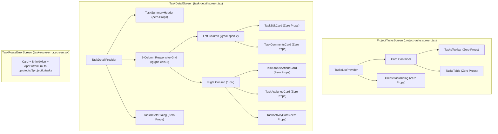

# Milestone 7 — Frontend Step 5: Feature Tasks Screens (src/client/features/tasks/screens/)

ในขั้นตอนนี้เราจะสร้าง **Composition Roots (Screens)** ทั้ง 3 ไฟล์ใน `src/client/features/tasks/screens/` เพื่อทำหน้าที่ประกอบร่าง Context Providers และ Zero-Props Components ที่เราสร้างไว้ใน Step ที่ 3 และ 4 ให้กลายเป็นหน้าจอที่สมบูรณ์สำหรับหน้ารายการงาน (`ProjectTasksScreen`), หน้ารายละเอียดงาน (`TaskDetailScreen`) และหน้าแสดงข้อผิดพลาดกรณีไม่พบงานหรือไม่มีสิทธิ์เข้าถึง (`TaskRouteErrorScreen`)

---

## 1. เป้าหมายและขอบเขต Boundary (Boundary Context & Goal)

### เป้าหมายของ Step นี้
1. สร้าง `ProjectTasksScreen` สำหรับประกอบ `TasksListProvider`, `<TasksToolbar />`, `<TasksTable />` และ `<CreateTaskDialog />`
2. สร้าง `TaskDetailScreen` สำหรับประกอบ `TaskDetailProvider`, `<TaskSummaryHeader />`, โครงสร้างตาราง 2 คอลัมน์ (`lg:grid-cols-3` แบ่งเป็นฝั่งซ้าย 2 ส่วนสำหรับแก้ไขงานและความคิดเห็น และฝั่งขวา 1 ส่วนสำหรับเปลี่ยนสถานะ มอบหมายงาน และประวัติกิจกรรม) พร้อม `<TaskDeleteDialog />`
3. สร้าง `TaskRouteErrorScreen` สำหรับรองรับกรณีที่ผู้ใช้เปิด URL ของงานที่ถูกลบไปแล้ว หรืออยู่นอกโครงการที่ตนมีสิทธิ์เข้าถึง พร้อมปุ่มนำทางกลับสู่หน้ารายการงานทั้งหมดของโครงการ

### ตารางสรุปไฟล์ใน Step นี้

| ลำดับ | Path ของไฟล์ | บทบาทหน้าที่ (Responsibility) |
| :--- | :--- | :--- |
| 1 | `src/client/features/tasks/screens/project-tasks.screen.tsx` | Composition Root ของหน้ารายการงานภายในโครงการ (`/projects/$projectId/tasks`) |
| 2 | `src/client/features/tasks/screens/task-detail.screen.tsx` | Composition Root ของหน้ารายละเอียดงาน (`/projects/$projectId/tasks/$taskId`) |
| 3 | `src/client/features/tasks/screens/task-route-error.screen.tsx` | Error Screen เฉพาะระดับ Route ของงานเมื่อเกิดข้อผิดพลาด 404/403 |

### แผนผังการประกอบร่างระดับ Screen (Mermaid Diagram)



---

## 2. ทฤษฎี ความสำคัญ และกฎสถาปัตยกรรมเฉพาะ Boundary นี้

### 2.1 กฎสถาปัตยกรรมที่บังคับใช้ (`.agents/rules/client.md`)
- **`client.md` ข้อ 1 & 2 (Screen as Composition Root)**: Route จะไม่รู้จักหรือนำเข้า Component ย่อย (`TasksToolbar`, `TasksTable`, `TaskEditCard` ฯลฯ) โดยตรง แต่จะเรียกใช้เฉพาะ Screen จาก `src/client/features/tasks/screens/*.tsx` เท่านั้น
- **`client.md` ข้อ 3 & 5 (No State/Logic in Screen & Zero Props Composition)**: สังเกตว่าใน `ProjectTasksScreen` และ `TaskDetailScreen` ไม่มี `useState`, `useQuery` หรือ `useMutation` เลยแม้แต่บรรทัดเดียว และเรียกใช้ลูกทุกตัวแบบ `<TasksToolbar />`, `<TasksTable />`, `<TaskEditCard />` โดยไม่มีการส่ง Props ใดๆ ทั้งสิ้น
- **ทำไมต้องแยก `TaskRouteErrorScreen` ไว้ใน `features/tasks/screens/`?**: เมื่อผู้ใช้คลิกลิงก์งานที่เพิ่งถูกลบโดยสมาชิกคนอื่น หรือพิมพ์รหัส `taskId` ที่ไม่มีอยู่จริงใน URL ตัว `loader` ของ Route `/_auth/projects/$projectId/tasks/$taskId` จะโยนข้อผิดพลาดออกมา การมี `TaskRouteErrorScreen` ผูกไว้กับ `errorComponent` ของ Route นั้นช่วยให้กรอบโครงสร้างหลักของโครงการ (`ProjectDetailLayoutScreen` ที่มีส่วนหัวโครงการและแท็บนำทาง) ยังคงแสดงผลอยู่ตามปกติ โดยเปลี่ยนเฉพาะพื้นที่เนื้อหาด้านล่างให้เป็นการ์ดแจ้งเตือนพร้อมปุ่มกดกลับไปหน้ารายการงานของโครงการได้ทันที

---

## 3. ลงมือเขียนโค้ด (Step-by-Step Implementation)

### 3.1 สร้างหน้าจอรายการงานภายในโครงการ (`src/client/features/tasks/screens/project-tasks.screen.tsx`)

สร้างไฟล์ `src/client/features/tasks/screens/project-tasks.screen.tsx` เพื่อครอบด้วย `<TasksListProvider>` และจัดวาง `<TasksToolbar />`, `<TasksTable />` ภายใน `<Card>` ตามด้วย `<CreateTaskDialog />`

```tsx
import {
	Card,
	CardContent,
	CardDescription,
	CardHeader,
	CardTitle,
} from "#/client/shared/shadcn/components/ui/card";
import { CreateTaskDialog } from "../components/create-task-dialog";
import { TasksTable } from "../components/tasks-table";
import { TasksToolbar } from "../components/tasks-toolbar";
import { TasksListProvider } from "../contexts/tasks-list.context";

export function ProjectTasksScreen() {
	return (
		<TasksListProvider>
			<Card>
				<CardHeader>
					<CardTitle>รายการงานภายในโครงการ</CardTitle>
					<CardDescription>
						ค้นหา กรองตามสถานะ ความสำคัญ ผู้รับผิดชอบ และเรียงลำดับข้อมูล
					</CardDescription>
				</CardHeader>
				<CardContent className="flex flex-col gap-4">
					<TasksToolbar />
					<TasksTable />
				</CardContent>
			</Card>
			<CreateTaskDialog />
		</TasksListProvider>
	);
}
```

---

### 3.2 สร้างหน้าจอรายละเอียดงาน (`src/client/features/tasks/screens/task-detail.screen.tsx`)

สร้างไฟล์ `src/client/features/tasks/screens/task-detail.screen.tsx` เพื่อครอบด้วย `<TaskDetailProvider>` และจัดวางองค์ประกอบของหน้ารายละเอียดงานแบบ Responsive Grid (`lg:grid-cols-3`)

```tsx
import { TaskActivityCard } from "../components/task-activity-card";
import { TaskAssigneeCard } from "../components/task-assignee-card";
import { TaskCommentsCard } from "../components/task-comments-card";
import { TaskDeleteDialog } from "../components/task-delete-dialog";
import { TaskEditCard } from "../components/task-edit-card";
import { TaskStatusActionsCard } from "../components/task-status-actions-card";
import { TaskSummaryHeader } from "../components/task-summary-header";
import { TaskDetailProvider } from "../contexts/task-detail.context";

export function TaskDetailScreen() {
	return (
		<TaskDetailProvider>
			<TaskSummaryHeader />
			<div className="grid gap-4 lg:grid-cols-3">
				<div className="flex flex-col gap-4 lg:col-span-2">
					<TaskEditCard />
					<TaskCommentsCard />
				</div>
				<div className="flex flex-col gap-4">
					<TaskStatusActionsCard />
					<TaskAssigneeCard />
					<TaskActivityCard />
				</div>
			</div>
			<TaskDeleteDialog />
		</TaskDetailProvider>
	);
}
```

---

### 3.3 สร้างหน้าจอแจ้งเตือนเมื่อไม่พบงานหรือไม่มีสิทธิ์เข้าถึง (`src/client/features/tasks/screens/task-route-error.screen.tsx`)

สร้างไฟล์ `src/client/features/tasks/screens/task-route-error.screen.tsx` โดยใช้ `useProjectId()` เพื่อสร้างลิงก์ `<AppButtonLink>` พาผู้ใช้กลับไปยังหน้ารายการงานทั้งหมดของโครงการปัจจุบัน (`/projects/$projectId/tasks`)

```tsx
import { ShieldAlert } from "lucide-react";
import { useProjectId } from "#/client/features/projects/hooks/use-project-id";
import { AppButtonLink } from "#/client/shared/components/app-link";
import {
	Card,
	CardContent,
	CardDescription,
	CardHeader,
	CardTitle,
} from "#/client/shared/shadcn/components/ui/card";

export function TaskRouteErrorScreen() {
	const projectId = useProjectId();

	return (
		<Card>
			<CardHeader>
				<div className="flex items-center gap-2">
					<ShieldAlert className="size-5 text-destructive" aria-hidden="true" />
					<CardTitle>ไม่พบงานหรือไม่มีสิทธิ์เข้าถึง</CardTitle>
				</div>
				<CardDescription>
					งานนี้อาจถูกลบออกจากโครงการแล้ว หรืออยู่นอกขอบเขตโครงการที่คุณมีสิทธิ์
				</CardDescription>
			</CardHeader>
			<CardContent>
				<AppButtonLink
					to="/projects/$projectId/tasks"
					params={{ projectId }}
					variant="outline"
					size="sm"
				>
					กลับหน้ารายการงานทั้งหมด
				</AppButtonLink>
			</CardContent>
		</Card>
	);
}
```

---

## 4. การตรวจสอบความถูกต้องและ Git Commit (Verification & Commit)

### 4.1 ตรวจสอบ Type Safety และ Linting
รันคำสั่งตรวจสอบด้วย `bun` เพื่อยืนยันว่า Screens ทั้ง 3 ไฟล์ทำงานร่วมกับ Components และ Contexts ได้อย่างสมบูรณ์:

```bash
bun run typecheck
bun run format
bun run check
```

### 4.2 บันทึกการเปลี่ยนแปลงลง Git (Git Commit)
เมื่อตรวจสอบผ่านเรียบร้อยแล้ว ให้ Stage โฟลเดอร์ `src/client/features/tasks/screens/` และทำการ Commit ประจำ Step ที่ 5:

```bash
git add src/client/features/tasks/screens/
git commit -m "milestone-7.frontend.step-5: Feature Tasks List, Detail & Error Screens"
```
