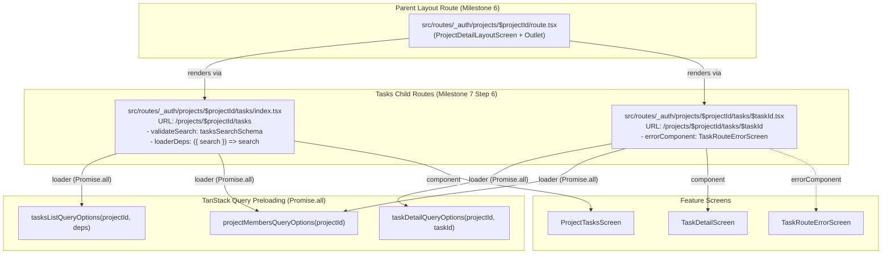

# Milestone 7 — Frontend Step 6: Tasks File Routes (src/routes/_auth/projects/$projectId/tasks/)

ในขั้นตอนสุดท้ายของ **Milestone 7 (Tasks, Status Workflow & Comments)** เราจะเชื่อมโยง Screens และ Query Options เข้ากับระบบ File-Based Routing ของ TanStack Router ภายใต้โฟลเดอร์ `src/routes/_auth/projects/$projectId/tasks/` เพื่อให้ URL `/projects/$projectId/tasks` และ `/projects/$projectId/tasks/$taskId` สามารถตรวจสอบ Search Params, ทำ Parallel Data Preloading ใน `loader` และเรนเดอร์หน้าจอพร้อมใช้งานจริงครบวงจร

---

## 1. เป้าหมายและขอบเขต Boundary (Boundary Context & Goal)

### เป้าหมายของ Step นี้
1. สร้าง File Route `src/routes/_auth/projects/$projectId/tasks/index.tsx` สำหรับหน้ารายการงานภายในโครงการ พร้อมผูก `validateSearch: tasksSearchSchema`, `loaderDeps` และ `loader` ที่โหลดทั้งรายการงาน (`tasksListQueryOptions`) และรายชื่อสมาชิกในโครงการ (`projectMembersQueryOptions`) แบบขนานด้วย `Promise.all`
2. สร้าง File Route `src/routes/_auth/projects/$projectId/tasks/$taskId.tsx` สำหรับหน้ารายละเอียดงาน พร้อมโหลดข้อมูลรายละเอียดงาน (`taskDetailQueryOptions`) และรายชื่อสมาชิกในโครงการ (`projectMembersQueryOptions`) แบบขนาน รวมถึงกำหนด `errorComponent: TaskRouteErrorScreen`
3. รันคำสั่งสร้าง Route Tree (`bun run generate-routes`) และทดสอบการทำงานจริงครบทุกฟีเจอร์ของ Milestone 7

### ตารางสรุปไฟล์ใน Step นี้

| ลำดับ | Path ของไฟล์ | บทบาทหน้าที่ (Responsibility) |
| :--- | :--- | :--- |
| 1 | `src/routes/_auth/projects/$projectId/tasks/index.tsx` | File Route ของ `/projects/$projectId/tasks` พร้อม Search Validation และ Data Preloading |
| 2 | `src/routes/_auth/projects/$projectId/tasks/$taskId.tsx` | File Route ของ `/projects/$projectId/tasks/$taskId` พร้อม Data Preloading และ Error Boundary |

### แผนผังลำดับชั้นของ Route และการทำ Parallel Preloading (Mermaid Diagram)



---

## 2. ทฤษฎี ความสำคัญ และกฎสถาปัตยกรรมเฉพาะ Boundary นี้

### 2.1 กฎสถาปัตยกรรมที่บังคับใช้ (`.agents/rules/client.md` & `architecture.md`)
- **`client.md` ข้อ 1 (Route Responsibility)**: ไฟล์ใน `src/routes/**` มีหน้าที่เฉพาะจัดการ URL Routing, Search Parameter Validation (`validateSearch`), การดึงข้อมูลล่วงหน้า (`loader`) และการผูก `component` / `errorComponent` เข้ากับ Screen เท่านั้น ห้ามประกอบ UI ย่อยในไฟล์ Route
- **`server.md` ข้อ 3 (Route Loader & Cache Integration)**: Route `loader` เรียกใช้ `context.queryClient.query(...)` โดยส่ง Query Options จาก `src/client/caches/**` เข้าไปโดยตรง ไม่มีการเรียก `server-functions` ตรงๆ ใน Route

### 2.2 ทำไมต้องใช้ `loaderDeps` ร่วมกับ `validateSearch` ใน `tasks/index.tsx`?
ในหน้ารายการงาน (`/projects/$projectId/tasks`) เงื่อนไขการค้นหา (`search`), ตัวกรอง (`status`, `priority`, `assigneeFilter`), การเรียงลำดับ (`sortBy`, `sortOrder`) และหน้าปัจจุบัน (`page`, `pageSize`) ถูกเก็บไว้ใน URL Search Params:
1. `validateSearch: tasksSearchSchema` ทำหน้าที่ตรวจสอบและเติมค่าเริ่มต้น (Default Values) ให้กับ URL Query String ทุกครั้งด้วย Zod Schema จาก `shared/schemas/task.schema.ts`
2. `loaderDeps: ({ search }) => search` บอกให้ TanStack Router ทราบว่า `loader` ของหน้านี้ขึ้นอยู่กับค่า `search` ทุกครั้งที่ผู้ใช้เปลี่ยนตัวกรองหรือเปลี่ยนหน้าในตาราง Router จะรัน `loader` ใหม่ด้วย `deps` ล่าสุดและอุ่นข้อมูลลงใน `queryClient` ทันที
3. การใช้ `Promise.all` โหลดทั้ง `tasksListQueryOptions` และ `projectMembersQueryOptions` พร้อมกันช่วยป้องกันปัญหา Request Waterfall ทำให้ทั้งตารางงานและตัวเลือกรายชื่อสมาชิกในตัวกรองพร้อมแสดงผลในจังหวะเดียวกัน

---

## 3. ลงมือเขียนโค้ด (Step-by-Step Implementation)

### 3.1 สร้าง File Route สำหรับหน้ารายการงานของโครงการ (`src/routes/_auth/projects/$projectId/tasks/index.tsx`)

สร้างไฟล์ `src/routes/_auth/projects/$projectId/tasks/index.tsx` เพื่อเชื่อมโยง URL `/projects/$projectId/tasks` เข้ากับ `ProjectTasksScreen`

```tsx
import { createFileRoute } from "@tanstack/react-router";
import { projectMembersQueryOptions } from "#/client/caches/projects/queries/project-members.query";
import { tasksListQueryOptions } from "#/client/caches/tasks/queries/tasks.query";
import { ProjectTasksScreen } from "#/client/features/tasks/screens/project-tasks.screen";
import { tasksSearchSchema } from "#/shared/schemas/task.schema";

export const Route = createFileRoute("/_auth/projects/$projectId/tasks/")({
	validateSearch: tasksSearchSchema,
	loaderDeps: ({ search }) => search,
	loader: ({ context, params, deps }) =>
		Promise.all([
			context.queryClient.query(tasksListQueryOptions(params.projectId, deps)),
			context.queryClient.query(projectMembersQueryOptions(params.projectId)),
		]),
	component: ProjectTasksScreen,
});
```

---

### 3.2 สร้าง File Route สำหรับหน้ารายละเอียดงาน (`src/routes/_auth/projects/$projectId/tasks/$taskId.tsx`)

สร้างไฟล์ `src/routes/_auth/projects/$projectId/tasks/$taskId.tsx` เพื่อเชื่อมโยง URL `/projects/$projectId/tasks/$taskId` เข้ากับ `TaskDetailScreen` และ `TaskRouteErrorScreen`

```tsx
import { createFileRoute } from "@tanstack/react-router";
import { projectMembersQueryOptions } from "#/client/caches/projects/queries/project-members.query";
import { taskDetailQueryOptions } from "#/client/caches/tasks/queries/task-detail.query";
import { TaskDetailScreen } from "#/client/features/tasks/screens/task-detail.screen";
import { TaskRouteErrorScreen } from "#/client/features/tasks/screens/task-route-error.screen";

export const Route = createFileRoute(
	"/_auth/projects/$projectId/tasks/$taskId",
)({
	loader: ({ context, params }) =>
		Promise.all([
			context.queryClient.query(
				taskDetailQueryOptions(params.projectId, params.taskId),
			),
			context.queryClient.query(projectMembersQueryOptions(params.projectId)),
		]),
	errorComponent: TaskRouteErrorScreen,
	component: TaskDetailScreen,
});
```

---

## 4. การตรวจสอบความถูกต้องและ Git Commit (Verification & Commit)

### 4.1 สร้าง Route Tree และตรวจสอบความถูกต้องของโค้ด
เมื่อสร้างไฟล์ Route ทั้ง 2 ไฟล์เรียบร้อยแล้ว ให้รันคำสั่ง `bun run generate-routes` เพื่อให้ TanStack Router อัปเดตไฟล์ `src/routeTree.gen.ts` จากนั้นตรวจสอบ Linting และ Type Safety ทั้งโปรเจกต์:

```bash
bun run generate-routes
bun run typecheck
bun run format
bun run check
```

### 4.2 ขั้นตอนการทดสอบใช้งานจริงท้าย Milestone 7 (End-to-End Verification)
รันเซิร์ฟเวอร์พัฒนาด้วยคำสั่ง `bun run dev` แล้วเปิดเบราว์เซอร์เพื่อทดสอบระบบบริหารจัดการงานครบวงจรตามลำดับดังนี้:

1. **ทดสอบการสร้างงานใหม่และรหัสงานอัตโนมัติ (`KEY-1`, `KEY-2`)**:
   - เข้าไปที่หน้าโครงการใดโครงการหนึ่ง แล้วคลิกแท็บ **"รายการงาน"** (`/projects/$projectId/tasks`)
   - คลิกปุ่ม **"สร้างงานใหม่"** กรอกหัวข้อ รายละเอียด เลือกระดับความสำคัญ ผู้รับผิดชอบ และวันครบกำหนด แล้วกด **"สร้างงาน"**
   - ตรวจสอบว่ามี Toast แจ้งเตือน *"สร้างงานใหม่สำเร็จ"* และงานที่สร้างปรากฏในตารางพร้อมรหัสอัตโนมัติที่ต่อท้ายจากรหัสย่อของโครงการ เช่น `KEY-1` และเมื่อสร้างงานชิ้นที่สองจะได้รหัส `KEY-2` เรียงลำดับต่อเนื่องกันโดยไม่ซ้ำ
2. **ทดสอบการค้นหา ตัวกรอง และการเรียงลำดับแบบ Server-Driven**:
   - พิมพ์รหัสงานหรือชื่อหัวข้องานในช่องค้นหา ตรวจสอบว่าหลังจากหยุดพิมพ์ 300ms URL Search Params และตารางจะกรองข้อมูลให้ทันที
   - ทดสอบเลือกตัวกรอง **สถานะ**, **ระดับความสำคัญ** และ **ผู้รับผิดชอบ** (รวมถึงตัวเลือก *"ยังไม่มอบหมาย (Unassigned)"*) และคลิกปุ่ม **"ล้างตัวกรอง"** เพื่อรีเซ็ตกลับสู่ค่าเริ่มต้น
   - ทดสอบคลิกที่หัวคอลัมน์ในตาราง (`รหัส`, `หัวข้องาน`, `สถานะ`, `ความสำคัญ`, `วันครบกำหนด`, `อัปเดตล่าสุด`) เพื่อทดสอบการเรียงลำดับจากน้อยไปมากและมากไปน้อย
3. **ทดสอบหน้ารายละเอียดงานและการแก้ไขข้อมูล (`/projects/$projectId/tasks/$taskId`)**:
   - คลิกรหัสงานหรือหัวข้องานในตารางเพื่อเข้าสู่หน้ารายละเอียดงาน
   - ทดสอบแก้ไขหัวข้อ คำอธิบาย ระดับความสำคัญ หรือวันครบกำหนดในการ์ด **"รายละเอียดและแก้ไขงาน"** แล้วคลิก **"บันทึกการแก้ไข"**
4. **ทดสอบการเปลี่ยนสถานะตามปุ่ม Finite State Machine (FSM)**:
   - ในการ์ด **"เปลี่ยนสถานะงาน"** ทางด้านขวา ตรวจสอบว่าเมื่อสถานะเริ่มต้นเป็น **"ต้องทำ"** (`todo`) ระบบจะแสดงเฉพาะปุ่ม **"เริ่มดำเนินการ"** (`in_progress`) และ **"ยกเลิกงาน"** (`cancelled`)
   - คลิก **"เริ่มดำเนินการ"** จะพบว่าสถานะเปลี่ยนเป็น **"กำลังดำเนินการ"** และปุ่มถัดไปที่อนุญาตจะเปลี่ยนเป็น **"ส่งตรวจงาน"** (`in_review`), **"ย้ายกลับไปต้องทำ"** (`todo`) และ **"ยกเลิกงาน"** (`cancelled`) ตามกฎ FSM อย่างเคร่งครัด
5. **ทดสอบการมอบหมายงานให้สมาชิกในโครงการ**:
   - ในการ์ด **"ผู้รับผิดชอบ"** เลือกสมาชิกในโครงการ (หรือเลือก *"ยังไม่ระบุผู้รับผิดชอบ"*) แล้วกด **"อัปเดตผู้รับผิดชอบ"** ตรวจสอบว่าชื่อผู้รับผิดชอบในส่วนหัวของงานอัปเดตตรงกันทันที
6. **ทดสอบการเพิ่มและลบความคิดเห็น (`TaskCommentsCard`)**:
   - พิมพ์ข้อความในช่อง **"เพิ่มความคิดเห็นใหม่"** แล้วคลิก **"ส่งความคิดเห็น"** ตรวจสอบว่าความคิดเห็นปรากฏขึ้นพร้อมชื่อ อีเมล และเวลาที่บันทึก
   - คลิกไอคอนถังขยะเพื่อทดสอบการลบความคิดเห็น ตรวจสอบว่าความคิดเห็นถูกลบออกทันที
7. **ตรวจสอบไทม์ไลน์ประวัติกิจกรรมของงาน (`TaskActivityCard`)**:
   - สังเกตการ์ด **"ประวัติกิจกรรมของงาน"** ทางด้านขวาล่าง จะบันทึกทุกเหตุการณ์ตั้งแต่การสร้างงาน การแก้ไขรายละเอียด การเปลี่ยนสถานะ การมอบหมายงาน ไปจนถึงการเพิ่ม/ลบความคิดเห็น พร้อมระบุชื่อผู้กระทำและเวลาอย่างครบถ้วน

### 4.3 บันทึกการเปลี่ยนแปลงลง Git (Git Commit)
เมื่อตรวจสอบและทดสอบครบถ้วนแล้ว ให้ Stage ไฟล์ Routes และ `routeTree.gen.ts` แล้วทำการ Commit ปิดท้าย Milestone 7:

```bash
git add src/routes/_auth/projects/\$projectId/tasks/ src/routeTree.gen.ts
git commit -m "milestone-7.frontend.step-6: Project Tasks & Task Detail File Routes"
```
