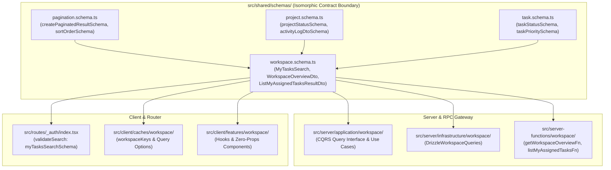

# Milestone 8 — Backend Step 1: Shared Workspace Schemas (src/shared/schemas/)

---

## 1. เป้าหมายและขอบเขต Boundary (Boundary Context & Goal)

ใน Milestone 8 เราจะสร้างโมดูลสุดท้ายของระบบ TaskFlow คือ **Workspace Dashboard & Assigned Tasks Overview** ซึ่งเป็นหน้าแรกหลักหลังเข้าสู่ระบบ (`/_auth/`) ที่รวบรวมภาพรวมของพื้นที่ทำงานทั้งหมดไว้ในจุดเดียว ได้แก่ ตัวชี้วัดหลัก (KPI Summary Cards), ตารางงานที่ได้รับมอบหมายของฉันข้ามทุกโครงการ (My Assigned Tasks Table) พร้อมค้นหา/กรอง/เรียงลำดับผ่าน URL Search Params, รายการโครงการที่กำลังเปิดใช้งานล่าสุด 5 โครงการ และฟีดกิจกรรมความเคลื่อนไหวล่าสุด 10 รายการ

จุดเริ่มต้นของทุกโมดูลในสถาปัตยกรรมของเราคือ **Isomorphic Shared Contract Layer (`src/shared/schemas/`)** เพื่อให้ทั้งฝั่ง Backend (Application Use Cases, Drizzle CQRS Queries, Server Functions) และฝั่ง Frontend (TanStack Router `validateSearch`, TanStack Query Caches, TanStack Table) อ้างอิงสัญญาข้อมูลชุดเดียวกันจากแหล่งความจริงเดียว (Single Source of Truth)

### ตารางสรุปไฟล์ใน Step นี้

| ลำดับ | เส้นทางไฟล์ (Path) | หน้าที่รับผิดชอบ (Responsibility) |
| :--- | :--- | :--- |
| 1 | `src/shared/schemas/workspace.schema.ts` | นิยาม Zod Schemas และ TypeScript Types สำหรับ URL Search Params ของตารางงานที่ได้รับมอบหมาย (`myTasksSearchSchema`), ข้อมูลสรุปภาพรวม (`workspaceSummaryDtoSchema`), โครงการล่าสุด (`workspaceActiveProjectDtoSchema`), งานที่ได้รับมอบหมายพร้อมการแบ่งหน้า (`listMyAssignedTasksResultDtoSchema`) และข้อมูลภาพรวมทั้งหมดของพื้นที่ทำงาน (`workspaceOverviewDtoSchema`) |

### แผนผังขอบเขตสถาปัตยกรรม (Architecture Boundary Diagram)



---

## 2. ทฤษฎี ความสำคัญ และกฎสถาปัตยกรรมเฉพาะ Boundary นี้

### 2.1 การประกอบร่าง Schema ข้ามโดเมน (Cross-Domain Schema Composition)
เนื่องจากหน้า Workspace Dashboard ทำหน้าที่ดึงข้อมูลสรุปข้ามหลายโดเมน (ทั้ง `projects` และ `tasks`) แทนที่จะประกาศ Enum ของสถานะโครงการ สถานะงาน หรือโครงสร้าง Activity Log ซ้ำซ้อนใน `workspace.schema.ts` เราจึงนำเข้า Schema ที่มีอยู่แล้วจาก `pagination.schema.ts`, `project.schema.ts` และ `task.schema.ts` มาประกอบเข้าด้วยกันโดยตรง

ข้อดีเชิงวิศวกรรม:
1. **Zero Schema Drift**: หากมีการเปลี่ยนแปลงสถานะของงานใน `task.schema.ts` หรือเปลี่ยนโครงสร้าง `activityLogDtoSchema` ใน `project.schema.ts` สัญญาข้อมูลของหน้า Workspace Dashboard จะได้รับผลและการตรวจสอบจาก TypeScript ทันทีโดยอัตโนมัติ
2. **Resilient URL Search Params ด้วย `.default().catch()`**: ใน `myTasksSearchSchema` เราใช้รูปแบบ `.default(...).catch(...)` ของ Zod ทุกฟิลด์ เพื่อให้เมื่อผู้ใช้แก้ไข Query String บน URL ของหน้า `/` ด้วยค่าที่ไม่ถูกต้อง (เช่น `?status=invalid&page=-99`) TanStack Router จะไม่พัง แต่จะ Fallback กลับเป็นค่าเริ่มต้นที่ปลอดภัย (`status: "all"`, `page: 1`) โดยอัตโนมัติ

### 2.2 กฎสถาปัตยกรรมที่บังคับใช้ใน Step นี้
- **`globals.md` (Shared Schemas ข้อ 1–4)**:
  - `shared/schemas/**` คือ Source of Truth กลางของ Data Contract ระหว่าง Server และ Client
  - ต้องเริ่มจาก Zod Schema เสมอ และใช้ `z.infer<typeof ...>` เพื่อสร้าง TypeScript Type ห้ามเขียน `interface` หรือ `type` แยกต่างหากด้วยมือ
- **`globals.md` ข้อ 3 (Type-Only Imports)**:
  - แยก `import type` ออกจาก Runtime Import อย่างชัดเจน และใช้ Named Import เสมอ

---

## 3. ลงมือเขียนโค้ด (Step-by-Step Implementation)

### ไฟล์ที่ 1: `src/shared/schemas/workspace.schema.ts`

สร้างไฟล์ `src/shared/schemas/workspace.schema.ts` เพื่อนิยามสัญญาข้อมูลทั้งหมดของหน้า Workspace Dashboard และตารางงานที่ได้รับมอบหมายของฉัน

```typescript
import { z } from "zod";
import {
	createPaginatedResultSchema,
	DEFAULT_PAGE,
	DEFAULT_PAGE_SIZE,
	sortOrderSchema,
} from "./pagination.schema";
import { activityLogDtoSchema, projectStatusSchema } from "./project.schema";
import {
	taskPriorityFilterSchema,
	taskPrioritySchema,
	taskStatusFilterSchema,
	taskStatusSchema,
} from "./task.schema";

export const myTasksSortFieldSchema = z.enum([
	"projectKey",
	"code",
	"title",
	"status",
	"priority",
	"dueDate",
	"updatedAt",
]);
export type MyTasksSortField = z.infer<typeof myTasksSortFieldSchema>;

export const myTasksSearchSchema = z.object({
	search: z.string().trim().max(100).default("").catch(""),
	status: taskStatusFilterSchema.default("all").catch("all"),
	priority: taskPriorityFilterSchema.default("all").catch("all"),
	sortBy: myTasksSortFieldSchema.default("updatedAt").catch("updatedAt"),
	sortOrder: sortOrderSchema.default("desc").catch("desc"),
	page: z.number().int().min(1).default(DEFAULT_PAGE).catch(DEFAULT_PAGE),
	pageSize: z
		.number()
		.int()
		.min(1)
		.max(100)
		.default(DEFAULT_PAGE_SIZE)
		.catch(DEFAULT_PAGE_SIZE),
});
export type MyTasksSearch = z.infer<typeof myTasksSearchSchema>;

export const workspaceSummaryDtoSchema = z.object({
	activeProjectCount: z.number().int().nonnegative(),
	archivedProjectCount: z.number().int().nonnegative(),
	assignedOpenTaskCount: z.number().int().nonnegative(),
	assignedDoneTaskCount: z.number().int().nonnegative(),
});
export type WorkspaceSummaryDto = z.infer<typeof workspaceSummaryDtoSchema>;

export const workspaceActiveProjectDtoSchema = z.object({
	id: z.uuid(),
	key: z.string(),
	name: z.string(),
	status: projectStatusSchema,
	myRoleName: z.string().nullable(),
	openTaskCount: z.number().int().nonnegative(),
	memberCount: z.number().int().nonnegative(),
	updatedAt: z.string(),
});
export type WorkspaceActiveProjectDto = z.infer<
	typeof workspaceActiveProjectDtoSchema
>;

export const myAssignedTaskItemDtoSchema = z.object({
	id: z.uuid(),
	projectId: z.uuid(),
	projectKey: z.string(),
	projectName: z.string(),
	code: z.string(),
	title: z.string(),
	status: taskStatusSchema,
	priority: taskPrioritySchema,
	dueDate: z.string().nullable(),
	commentCount: z.number().int().nonnegative(),
	updatedAt: z.string(),
});
export type MyAssignedTaskItemDto = z.infer<typeof myAssignedTaskItemDtoSchema>;

export const listMyAssignedTasksResultDtoSchema = createPaginatedResultSchema(
	myAssignedTaskItemDtoSchema,
);
export type ListMyAssignedTasksResultDto = z.infer<
	typeof listMyAssignedTasksResultDtoSchema
>;

export const workspaceOverviewDtoSchema = z.object({
	summary: workspaceSummaryDtoSchema,
	activeProjects: z.array(workspaceActiveProjectDtoSchema),
	recentActivities: z.array(activityLogDtoSchema),
});
export type WorkspaceOverviewDto = z.infer<typeof workspaceOverviewDtoSchema>;
```

#### คำอธิบายรายละเอียดโค้ด
1. **`myTasksSortFieldSchema` และ `myTasksSearchSchema`**:
   - กำหนดคอลัมน์ที่อนุญาตให้เรียงลำดับในตารางงานของฉันได้แก่ `projectKey`, `code`, `title`, `status`, `priority`, `dueDate` และ `updatedAt`
   - รองรับการค้นหา (`search`), กรองตามสถานะ (`status`), กรองตามความสำคัญ (`priority`), เรียงลำดับ (`sortBy`, `sortOrder`) และแบ่งหน้า (`page`, `pageSize`) โดยใช้ `.default(...).catch(...)` เพื่อให้ปลอดภัยต่อการพาร์ส URL Search Params เสมอ
2. **`workspaceSummaryDtoSchema`**:
   - โครงสร้างข้อมูลสำหรับแสดงในการ์ดสรุป 4 ใบด้านบนสุดของหน้า Dashboard ได้แก่ จำนวนโครงการที่เปิดใช้งาน (`activeProjectCount`), จำนวนโครงการที่เก็บถาวร (`archivedProjectCount`), จำนวนงานค้างของฉัน (`assignedOpenTaskCount`) และจำนวนงานที่ทำเสร็จแล้วของฉัน (`assignedDoneTaskCount`)
3. **`workspaceActiveProjectDtoSchema`**:
   - ข้อมูลย่อของโครงการที่กำลังเปิดใช้งานแต่ละรายการ พร้อมชื่อบทบาทของผู้ใช้ในโครงการนั้น (`myRoleName` ซึ่งอาจเป็น `null` กรณีผู้ใช้มีสิทธิ์ `project:read:all` ของระบบแต่ไม่ได้เป็นสมาชิกในโครงการโดยตรง), จำนวนงานค้าง (`openTaskCount`) และจำนวนสมาชิก (`memberCount`)
4. **`myAssignedTaskItemDtoSchema` และ `listMyAssignedTasksResultDtoSchema`**:
   - ข้อมูลแถวของงานที่ผู้ใช้นี้ได้รับมอบหมาย พร้อมรหัสและชื่อโครงการ (`projectKey`, `projectName`) เพื่อให้ตารางสามารถทำลิงก์ข้ามไปยังหน้าโครงการหรือหน้ารายละเอียดงานได้ทันที และห่อหุ้มด้วย `createPaginatedResultSchema(...)` เพื่อรองรับ Server-side Pagination
5. **`workspaceOverviewDtoSchema`**:
   - รวม `summary`, `activeProjects` และ `recentActivities` เข้าเป็นก้อนเดียว เพื่อให้หน้า Dashboard ดึงข้อมูลภาพรวมทั้งหมดจบใน RPC Call เดียว (`getWorkspaceOverviewFn`)

---

## 4. การตรวจสอบความถูกต้องและ Git Commit (Verification & Commit)

รันคำสั่งตรวจสอบ TypeScript และ Biome Linter/Formatter เพื่อยืนยันว่าโค้ดถูกต้องตามมาตรฐาน:

```bash
bun run typecheck
bun run check
```

เมื่อผ่านเรียบร้อยแล้ว ให้บันทึก Git Commit สำหรับ Step นี้:

```bash
git add src/shared/schemas/workspace.schema.ts
git commit -m "milestone-8.backend.step-1: Shared Workspace Dashboard Schemas"
```
