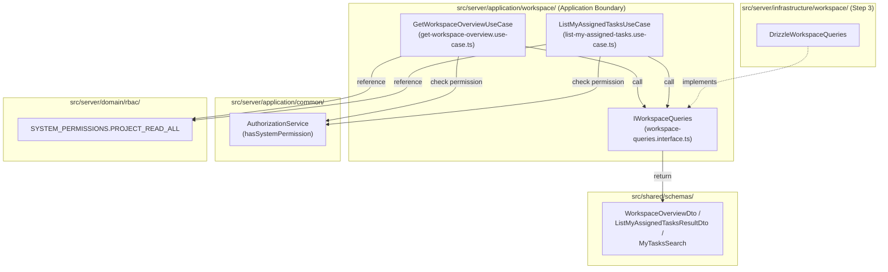

# Milestone 8 — Backend Step 2: Application Workspace CQRS Use Cases (src/server/application/workspace/)

---

## 1. เป้าหมายและขอบเขต Boundary (Boundary Context & Goal)

ใน Step ที่ 2 ของฝั่ง Backend เราจะสร้างชั้น **Application Layer (`src/server/application/workspace/`)** สำหรับโมดูล `workspace` ซึ่งประกอบด้วยพอร์ตสัญญาการคิวรีข้อมูล (`IWorkspaceQueries`) และ Use Cases ทั้ง 2 ตัว ได้แก่ `GetWorkspaceOverviewUseCase` และ `ListMyAssignedTasksUseCase`

ความพิเศษเชิงสถาปัตยกรรมของโมดูล `workspace` คือ **เป็นโมดูลแบบ Read-Only CQRS Projection ล้วน** (ไม่มีการสร้าง/แก้ไข/ลบสถานะของตัวเอง และไม่มีตารางหรือ Aggregate Root ของตัวเองใน `src/server/domain/`) เพราะหน้าที่ของหน้า Workspace Dashboard คือการอ่านและรวบรวมข้อมูลข้าม Aggregate (`projects`, `project_members`, `tasks`, `task_comments`, `activity_logs`) มาฉายภาพ (Project) ออกเป็น DTO สำหรับแสดงผลอย่างมีประสิทธิภาพสูงสุดตามกฎ `server.md` ข้อ 15

### ตารางสรุปไฟล์ใน Step นี้

| ลำดับ | เส้นทางไฟล์ (Path) | หน้าที่รับผิดชอบ (Responsibility) |
| :--- | :--- | :--- |
| 1 | `src/server/application/workspace/workspace-queries.interface.ts` | นิยาม Port Interface `IWorkspaceQueries` และ Input Types สำหรับดึงข้อมูลภาพรวมพื้นที่ทำงานและรายการงานที่ได้รับมอบหมายแบบ Read Projection |
| 2 | `src/server/application/workspace/get-workspace-overview.use-case.ts` | Use Case สำหรับตรวจสอบสิทธิ์ `PROJECT_READ_ALL` ของผู้เรียก แล้วดึงข้อมูลภาพรวมพื้นที่ทำงาน (`WorkspaceOverviewDto`) ผ่าน `IWorkspaceQueries` |
| 3 | `src/server/application/workspace/list-my-assigned-tasks.use-case.ts` | Use Case สำหรับตรวจสอบสิทธิ์ `PROJECT_READ_ALL` ของผู้เรียก แล้วดึงรายการงานที่ได้รับมอบหมายพร้อมค้นหา/กรอง/เรียงลำดับ/แบ่งหน้า (`ListMyAssignedTasksResultDto`) |

### แผนผังขอบเขตสถาปัตยกรรม (Architecture Boundary Diagram)



---

## 2. ทฤษฎี ความสำคัญ และกฎสถาปัตยกรรมเฉพาะ Boundary นี้

### 2.1 ทำไมโมดูล `workspace` จึงเป็น Read-Only CQRS Projection (ไม่มี Domain Entity ของตัวเอง)
ตามหลัก **CQRS (Command Query Responsibility Segregation)** และกฎ **`server.md` ข้อ 15**:
- **ฝั่ง Command (Write Model)**: เมื่อมีการสร้างโครงการ เปลี่ยนสถานะงาน หรือมอบหมายงาน เราต้องใช้ Aggregate Root (`Project`, `Task`) ใน `src/server/domain/` เพื่อบังคับใช้ Business Invariants อย่างเคร่งครัด
- **ฝั่ง Query (Read Model)**: หน้า Workspace Dashboard ไม่ได้ทำการเปลี่ยนแปลงสถานะใดๆ เลย แต่ต้องการข้อมูลเชิงสถิติ (Count Group By Status), รายการโครงการล่าสุดพร้อมจำนวนสมาชิกและงานค้าง, ประวัติกิจกรรมล่าสุด 10 รายการ และตารางงานที่มอบหมายให้ฉันพร้อมชื่อโครงการและจำนวนความคิดเห็น
- หากเราพยายามโหลด `Project` และ `Task` Aggregate Roots ทั้งหมดในระบบเข้ามาในหน่วยความจำเพื่อมานับตัวเลขบน Application Layer จะเกิดปัญหาคอขวดด้าน CPU, Memory และ N+1 Queries ทันที ดังนั้นการออกแบบ `IWorkspaceQueries` ให้ทำ **Direct DTO Projection** จึงเป็นสถาปัตยกรรมที่ถูกต้องและมีประสิทธิภาพสูงสุด

### 2.2 การตัดสินขอบเขตการมองเห็นโครงการด้วย `PROJECT_READ_ALL`
ในทั้ง `GetWorkspaceOverviewUseCase` และ `ListMyAssignedTasksUseCase` เราเรียกใช้:
```typescript
const includeAllProjects = this.authorizationService.hasSystemPermission(
	input.actorSystemPermissions,
	SYSTEM_PERMISSIONS.PROJECT_READ_ALL,
);
```
- หากผู้ใช้มีสิทธิ์ระดับระบบ `project:read:all` (เช่น บทบาท **System Admin**): ค่า `includeAllProjects` จะเป็น `true` ทำให้สามารถดูจำนวนโครงการทั้งหมด โครงการที่เปิดใช้งานล่าสุด และกิจกรรมล่าสุดของทั้งองค์กรได้
- หากผู้ใช้เป็นสมาชิกทั่วไปที่ไม่มีสิทธิ์ `project:read:all`: ค่า `includeAllProjects` จะเป็น `false` ทำให้ Query กรองเฉพาะโครงการที่ผู้ใช้คนนั้นเป็นสมาชิกอยู่ในตาราง `project_members` เท่านั้น

### 2.3 กฎสถาปัตยกรรมที่บังคับใช้ใน Step นี้
- **`server.md` ข้อ 8 (Single Responsibility Use Case)**: แยก 1 ไฟล์ต่อ 1 Use Case (`get-workspace-overview.use-case.ts` และ `list-my-assigned-tasks.use-case.ts`) โดยมีคลาสเดี่ยวและเมธอด `execute(...)` พร้อม Explicit Return Type
- **`server.md` ข้อ 9 (Explicit Input Object)**: นิยาม Interface สำหรับ Input ประจำแต่ละ Use Case (`GetWorkspaceOverviewUseCaseInput`, `ListMyAssignedTasksUseCaseInput`) แทนการส่ง Positional Arguments
- **`server.md` ข้อ 10 (Application Layer Isolation)**: Use Case ทำหน้าที่ประสานงานเท่านั้น ห้าม import `drizzle-orm` หรือโค้ดจาก `src/server/infrastructure/` เข้ามาในชั้น Application

---

## 3. ลงมือเขียนโค้ด (Step-by-Step Implementation)

### ไฟล์ที่ 1: `src/server/application/workspace/workspace-queries.interface.ts`

สร้างไฟล์ `src/server/application/workspace/workspace-queries.interface.ts` เพื่อกำหนดสัญญาการคิวรีข้อมูลของโมดูล Workspace

```typescript
import type {
	ListMyAssignedTasksResultDto,
	MyTasksSearch,
	WorkspaceOverviewDto,
} from "#/shared/schemas/workspace.schema";

export interface WorkspaceOverviewQueryInput {
	actorUserId: string;
	includeAllProjects: boolean;
}

export interface ListMyAssignedTasksQueryInput {
	actorUserId: string;
	includeAllProjects: boolean;
	params: MyTasksSearch;
}

export interface IWorkspaceQueries {
	getWorkspaceOverview(
		input: WorkspaceOverviewQueryInput,
	): Promise<WorkspaceOverviewDto>;
	listMyAssignedTasks(
		input: ListMyAssignedTasksQueryInput,
	): Promise<ListMyAssignedTasksResultDto>;
}
```

#### คำอธิบายรายละเอียดโค้ด
- `WorkspaceOverviewQueryInput` รับ `actorUserId` และแฟล็ก `includeAllProjects` ที่ผ่านการตัดสินสิทธิ์จาก Use Case มาแล้ว เพื่อให้ชั้น Infrastructure นำไปสร้างเงื่อนไข `WHERE` ได้โดยไม่ต้องรู้เรื่อง Permission Codes ของระบบ
- `ListMyAssignedTasksQueryInput` รับ `actorUserId`, `includeAllProjects` และพารามิเตอร์การค้นหา/กรอง/เรียงลำดับ/แบ่งหน้า `params: MyTasksSearch`

---

### ไฟล์ที่ 2: `src/server/application/workspace/get-workspace-overview.use-case.ts`

สร้างไฟล์ `src/server/application/workspace/get-workspace-overview.use-case.ts` สำหรับดึงข้อมูลภาพรวมของพื้นที่ทำงาน

```typescript
import type { AuthorizationService } from "#/server/application/common/authorization.service";
import { SYSTEM_PERMISSIONS } from "#/server/domain/rbac/permission-codes";
import type { WorkspaceOverviewDto } from "#/shared/schemas/workspace.schema";
import type { IWorkspaceQueries } from "./workspace-queries.interface";

export interface GetWorkspaceOverviewUseCaseInput {
	actorUserId: string;
	actorSystemPermissions: readonly string[];
}

export class GetWorkspaceOverviewUseCase {
	constructor(
		private readonly workspaceQueries: IWorkspaceQueries,
		private readonly authorizationService: AuthorizationService,
	) {}

	async execute(
		input: GetWorkspaceOverviewUseCaseInput,
	): Promise<WorkspaceOverviewDto> {
		const includeAllProjects = this.authorizationService.hasSystemPermission(
			input.actorSystemPermissions,
			SYSTEM_PERMISSIONS.PROJECT_READ_ALL,
		);

		return this.workspaceQueries.getWorkspaceOverview({
			actorUserId: input.actorUserId,
			includeAllProjects,
		});
	}
}
```

#### คำอธิบายรายละเอียดโค้ด
- รับ `workspaceQueries` และ `authorizationService` ผ่าน Constructor Injection
- ตรวจสอบว่า `actorSystemPermissions` มีสิทธิ์ `SYSTEM_PERMISSIONS.PROJECT_READ_ALL` หรือไม่ แล้วส่งผลลัพธ์ `includeAllProjects` ไปให้ `this.workspaceQueries.getWorkspaceOverview(...)`

---

### ไฟล์ที่ 3: `src/server/application/workspace/list-my-assigned-tasks.use-case.ts`

สร้างไฟล์ `src/server/application/workspace/list-my-assigned-tasks.use-case.ts` สำหรับดึงรายการงานที่ได้รับมอบหมายของผู้ใช้ปัจจุบัน

```typescript
import type { AuthorizationService } from "#/server/application/common/authorization.service";
import { SYSTEM_PERMISSIONS } from "#/server/domain/rbac/permission-codes";
import type {
	ListMyAssignedTasksResultDto,
	MyTasksSearch,
} from "#/shared/schemas/workspace.schema";
import type { IWorkspaceQueries } from "./workspace-queries.interface";

export interface ListMyAssignedTasksUseCaseInput {
	actorUserId: string;
	actorSystemPermissions: readonly string[];
	params: MyTasksSearch;
}

export class ListMyAssignedTasksUseCase {
	constructor(
		private readonly workspaceQueries: IWorkspaceQueries,
		private readonly authorizationService: AuthorizationService,
	) {}

	async execute(
		input: ListMyAssignedTasksUseCaseInput,
	): Promise<ListMyAssignedTasksResultDto> {
		const includeAllProjects = this.authorizationService.hasSystemPermission(
			input.actorSystemPermissions,
			SYSTEM_PERMISSIONS.PROJECT_READ_ALL,
		);

		return this.workspaceQueries.listMyAssignedTasks({
			actorUserId: input.actorUserId,
			includeAllProjects,
			params: input.params,
		});
	}
}
```

#### คำอธิบายรายละเอียดโค้ด
- ตรวจสอบสิทธิ์ `SYSTEM_PERMISSIONS.PROJECT_READ_ALL` เช่นเดียวกับ `GetWorkspaceOverviewUseCase` เพื่อให้มั่นใจว่าหากผู้ใช้ถูกถอดออกจากโครงการใดโครงการหนึ่งและไม่ได้เป็น System Admin งานในโครงการนั้นจะไม่รั่วไหลมาแสดงในตารางงานของฉัน
- ส่งต่อ `actorUserId`, `includeAllProjects` และ `params` ไปยัง `this.workspaceQueries.listMyAssignedTasks(...)`

---

## 4. การตรวจสอบความถูกต้องและ Git Commit (Verification & Commit)

รันคำสั่งตรวจสอบ TypeScript และ Biome Linter/Formatter:

```bash
bun run typecheck
bun run check
```

เมื่อผ่านเรียบร้อยแล้ว ให้บันทึก Git Commit สำหรับ Step นี้:

```bash
git add src/server/application/workspace/workspace-queries.interface.ts src/server/application/workspace/get-workspace-overview.use-case.ts src/server/application/workspace/list-my-assigned-tasks.use-case.ts
git commit -m "milestone-8.backend.step-2: Application Workspace CQRS Query Interface & Use Cases"
```
