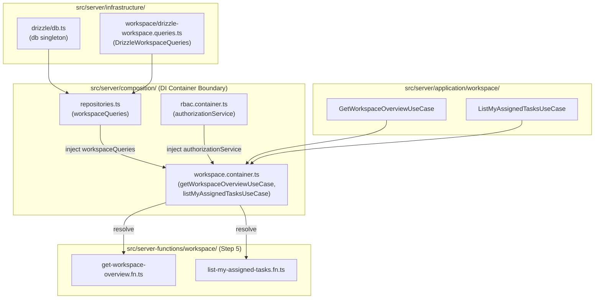

# Milestone 8 — Backend Step 4: Composition Workspace (src/server/composition/)

---

## 1. เป้าหมายและขอบเขต Boundary (Boundary Context & Goal)

ใน Step ที่ 4 ของฝั่ง Backend เราจะทำการเชื่อมต่อ Object Graph ของโมดูล `workspace` เข้ากับ **Composition Root (`src/server/composition/`)** โดยการลงทะเบียน Singleton ของ `DrizzleWorkspaceQueries` ใน `repositories.ts` และประกอบร่าง (Wire) `GetWorkspaceOverviewUseCase` กับ `ListMyAssignedTasksUseCase` ในไฟล์ `workspace.container.ts`

เมื่อจบขั้นตอนนี้ ชั้น `repositories.ts` ของโปรเจกต์ TaskFlow จะสมบูรณ์ครบทุกโมดูล (`unitOfWork`, `rbacRepository`, `userQueries`, `projectRepository`, `projectQueries`, `taskRepository`, `taskQueries` และ `workspaceQueries`) พร้อมให้ชั้น Server Functions เรียกใช้งานได้อย่างสะอาดและปราศจาก Magic DI Framework

### ตารางสรุปไฟล์ใน Step นี้

| ลำดับ | เส้นทางไฟล์ (Path) | หน้าที่รับผิดชอบ (Responsibility) |
| :--- | :--- | :--- |
| 1 | `src/server/composition/repositories.ts` | สร้างและส่งออก Singleton Instance ของ `workspaceQueries` (`new DrizzleWorkspaceQueries(db)`) ร่วมกับ Repositories และ Queries ทั้งหมดในระบบ |
| 2 | `src/server/composition/workspace.container.ts` | ประกอบสร้าง `getWorkspaceOverviewUseCase` และ `listMyAssignedTasksUseCase` โดยฉีด `workspaceQueries` และ `authorizationService` เข้าทาง Constructor |

### แผนผังขอบเขตสถาปัตยกรรม (Architecture Boundary Diagram)



---

## 2. ทฤษฎี ความสำคัญ และกฎสถาปัตยกรรมเฉพาะ Boundary นี้

### 2.1 Pure Manual Dependency Injection ที่สมบูรณ์และตรวจสอบได้ด้วย Type System
ตามกฎ **`server.md` ข้อ 17 (Composition Layer: Pure Dependency Injection)**:
- เราไม่ใช้ไลบรารี DI ที่พึ่งพา `reflect-metadata` หรือ Decorator เพราะทำให้สูญเสียความชัดเจนของกราฟการพึ่งพาและเพิ่ม Overhead ตอนเริ่มต้นระบบ
- การแยก `repositories.ts` (แหล่งสร้าง Infrastructure Singletons) ออกจาก `<module>.container.ts` (แหล่งประกอบ Use Cases ประจำโมดูล) ช่วยให้เราเห็นได้ทันทีว่า `workspace.container.ts` พึ่งพาเพียง `workspaceQueries` และ `authorizationService` เท่านั้น
- นอกจากนี้ เรายังปฏิบัติตามกฎ **`globals.md` ข้อ 5 (No Barrel Files)** โดยให้ Server Functions ของโมดูล `workspace` นำเข้า Use Case จาก `#/server/composition/workspace.container` โดยตรง ไม่ต้องสร้างไฟล์ Barrel กลางที่ทำหน้าที่เพียง re-export ข้ามทุกโมดูล

### 2.2 กฎสถาปัตยกรรมที่บังคับใช้ใน Step นี้
- **`server.md` ข้อ 17**: สร้าง Repository/Query Singletons ใน `src/server/composition/repositories.ts` และประกอบ Use Cases ใน `src/server/composition/workspace.container.ts` ห้าม Use Case สั่ง `new DrizzleWorkspaceQueries(db)` เองภายในคลาส
- **`globals.md` ข้อ 2 & 3**: ใช้ Path Alias `#/server/...` สำหรับการนำเข้าข้ามเลเยอร์ และแยก `import type` ออกจาก Runtime Import อย่างเคร่งครัด

---

## 3. ลงมือเขียนโค้ด (Step-by-Step Implementation)

### ไฟล์ที่ 1: `src/server/composition/repositories.ts`

อัปเดตไฟล์ `src/server/composition/repositories.ts` ให้มี `workspaceQueries` ครบถ้วนสมบูรณ์ (แสดงโค้ดฉบับเต็มของไฟล์):

```typescript
import type { AppTx } from "#/server/infrastructure/drizzle/db";
import { db } from "#/server/infrastructure/drizzle/db";
import { DrizzleUnitOfWork } from "#/server/infrastructure/drizzle/unit-of-work";
import { DrizzleProjectQueries } from "#/server/infrastructure/projects/drizzle-project.queries";
import { DrizzleProjectRepository } from "#/server/infrastructure/projects/drizzle-project.repository";
import { DrizzleRbacRepository } from "#/server/infrastructure/rbac/drizzle-rbac.repository";
import { DrizzleTaskQueries } from "#/server/infrastructure/tasks/drizzle-task.queries";
import { DrizzleTaskRepository } from "#/server/infrastructure/tasks/drizzle-task.repository";
import { DrizzleUserQueries } from "#/server/infrastructure/users/drizzle-user.queries";
import { DrizzleWorkspaceQueries } from "#/server/infrastructure/workspace/drizzle-workspace.queries";

export const unitOfWork = new DrizzleUnitOfWork<AppTx>(db);
export const rbacRepository = new DrizzleRbacRepository(db);
export const userQueries = new DrizzleUserQueries(db);
export const projectRepository = new DrizzleProjectRepository(db);
export const projectQueries = new DrizzleProjectQueries(db);
export const taskRepository = new DrizzleTaskRepository(db);
export const taskQueries = new DrizzleTaskQueries(db);
export const workspaceQueries = new DrizzleWorkspaceQueries(db);
```

#### คำอธิบายรายละเอียดโค้ด
- นำเข้า `DrizzleWorkspaceQueries` จาก `#/server/infrastructure/workspace/drizzle-workspace.queries`
- สร้าง Singleton `workspaceQueries = new DrizzleWorkspaceQueries(db)` ซึ่งรับอินสแตนซ์ `db` เดียวกับ Repositories ตัวอื่น และพร้อมสลับใช้ Transaction Context อัตโนมัติผ่าน `DrizzleBaseRepository`

---

### ไฟล์ที่ 2: `src/server/composition/workspace.container.ts`

สร้างไฟล์ `src/server/composition/workspace.container.ts` เพื่อประกอบ Use Cases ทั้ง 2 ตัวของโมดูล `workspace`:

```typescript
import { GetWorkspaceOverviewUseCase } from "#/server/application/workspace/get-workspace-overview.use-case";
import { ListMyAssignedTasksUseCase } from "#/server/application/workspace/list-my-assigned-tasks.use-case";
import { authorizationService } from "./rbac.container";
import { workspaceQueries } from "./repositories";

export const getWorkspaceOverviewUseCase = new GetWorkspaceOverviewUseCase(
	workspaceQueries,
	authorizationService,
);

export const listMyAssignedTasksUseCase = new ListMyAssignedTasksUseCase(
	workspaceQueries,
	authorizationService,
);
```

#### คำอธิบายรายละเอียดโค้ด
- นำเข้า `authorizationService` จาก `./rbac.container` และ `workspaceQueries` จาก `./repositories` (ซึ่งอยู่ในโฟลเดอร์ `composition/` เดียวกัน จึงใช้ `./` ได้ตามกฎ `globals.md` ข้อ 2)
- ประกอบ `getWorkspaceOverviewUseCase` และ `listMyAssignedTasksUseCase` พร้อมส่งออกให้ชั้น Server Functions เรียกใช้งาน

---

## 4. การตรวจสอบความถูกต้องและ Git Commit (Verification & Commit)

รันคำสั่งตรวจสอบ TypeScript และ Biome Linter/Formatter:

```bash
bun run typecheck
bun run check
```

เมื่อผ่านเรียบร้อยแล้ว ให้บันทึก Git Commit สำหรับ Step นี้:

```bash
git add src/server/composition/repositories.ts src/server/composition/workspace.container.ts
git commit -m "milestone-8.backend.step-4: Composition Workspace DI Container"
```
