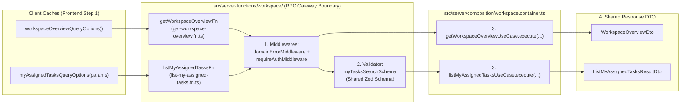

# Milestone 8 — Backend Step 5: Server Functions Workspace (src/server-functions/workspace/)

---

## 1. เป้าหมายและขอบเขต Boundary (Boundary Context & Goal)

ใน Step ที่ 5 ซึ่งเป็นขั้นตอนสุดท้ายของฝั่ง Backend ใน Milestone 8 เราจะสร้าง **Server Functions (`src/server-functions/workspace/`)** เพื่อเปิด RPC Gateway ให้ฝั่ง Client สามารถดึงข้อมูลภาพรวมของพื้นที่ทำงาน (`getWorkspaceOverviewFn`) และดึงรายการงานที่ได้รับมอบหมายพร้อมพารามิเตอร์การค้นหา/กรอง/แบ่งหน้า (`listMyAssignedTasksFn`)

ทุกไฟล์ในชั้นนี้ปฏิบัติตามกฎ **Thin Driving Adapter** และ **Standard 4-Step Pipeline** (`Middleware → Validator → Use Case → Response DTO`) อย่างเคร่งครัด

### ตารางสรุปไฟล์ใน Step นี้

| ลำดับ | เส้นทางไฟล์ (Path) | หน้าที่รับผิดชอบ (Responsibility) |
| :--- | :--- | :--- |
| 1 | `src/server-functions/workspace/get-workspace-overview.fn.ts` | RPC Endpoint (`GET`) สำหรับดึงข้อมูลภาพรวมพื้นที่ทำงาน (`WorkspaceOverviewDto`) ของผู้ใช้ที่เข้าสู่ระบบแล้ว |
| 2 | `src/server-functions/workspace/list-my-assigned-tasks.fn.ts` | RPC Endpoint (`GET`) สำหรับดึงรายการงานที่ได้รับมอบหมายของผู้ใช้ปัจจุบัน พร้อมตรวจสอบ Input ด้วย `myTasksSearchSchema` |

### แผนผังขอบเขตสถาปัตยกรรม (Architecture Boundary Diagram)



---

## 2. ทฤษฎี ความสำคัญ และกฎสถาปัตยกรรมเฉพาะ Boundary นี้

### 2.1 การส่งต่อ Identity & System Permissions จาก `requireAuthMiddleware`
เมื่อคำขอวิ่งผ่าน `.middleware([domainErrorMiddleware, requireAuthMiddleware])`:
1. `domainErrorMiddleware` จะครอบอยู่ชั้นนอกสุดเพื่อดักจับ `DomainError` ใดๆ ที่อาจถูกโยนออกมาจากชั้น Domain/Application แล้วแปลงเป็นข้อความที่ปลอดภัยต่อการส่งกลับไปหา Client
2. `requireAuthMiddleware` จะตรวจสอบ Session จาก Better Auth และโหลดรายการ `systemPermissions` ของผู้ใช้นั้นแนบไว้ใน `context.authSession.user`
3. ใน `.handler(...)` ของทั้ง `getWorkspaceOverviewFn` และ `listMyAssignedTasksFn` เราจึงสามารถหยิบ `context.authSession.user.id` และ `context.authSession.user.systemPermissions` ส่งเข้า Use Case ได้ทันทีโดยไม่ต้องคิวรีสิทธิ์ระดับระบบซ้ำอีก

### 2.2 กฎสถาปัตยกรรมที่บังคับใช้ใน Step นี้
- **`architecture.md` (Server Functions Responsibilities & Invariants ข้อ 1–4)** และ **`server.md` ข้อ 18**:
  1. **Thin Adapter**: ห้ามเขียน Business Logic หรือเรียก Drizzle ORM โดยตรงใน Server Function
  2. **One Function per File (`*.fn.ts`)**: แยก 1 RPC Endpoint ต่อ 1 ไฟล์ และตั้งชื่อตัวแปรที่ส่งออกลงท้ายด้วย `Fn` (`getWorkspaceOverviewFn`, `listMyAssignedTasksFn`)
  3. **Shared Contract Only**: ใช้ `.validator(myTasksSearchSchema)` จาก `src/shared/schemas/workspace.schema.ts` และระบุ Explicit Return Type (`Promise<WorkspaceOverviewDto>`, `Promise<ListMyAssignedTasksResultDto>`) เสมอ
  4. **DI Resolution**: ดึง Use Case มาจาก `#/server/composition/workspace.container` เท่านั้น

---

## 3. ลงมือเขียนโค้ด (Step-by-Step Implementation)

### ไฟล์ที่ 1: `src/server-functions/workspace/get-workspace-overview.fn.ts`

สร้างไฟล์ `src/server-functions/workspace/get-workspace-overview.fn.ts` เพื่อเปิด RPC Endpoint สำหรับดึงข้อมูลภาพรวมของหน้า Dashboard:

```typescript
import { createServerFn } from "@tanstack/react-start";
import { getWorkspaceOverviewUseCase } from "#/server/composition/workspace.container";
import { requireAuthMiddleware } from "#/server-functions/middlewares/auth.middleware";
import { domainErrorMiddleware } from "#/server-functions/middlewares/domain-error.middleware";
import type { WorkspaceOverviewDto } from "#/shared/schemas/workspace.schema";

export const getWorkspaceOverviewFn = createServerFn({ method: "GET" })
	.middleware([domainErrorMiddleware, requireAuthMiddleware])
	.handler(async ({ context }): Promise<WorkspaceOverviewDto> => {
		return getWorkspaceOverviewUseCase.execute({
			actorUserId: context.authSession.user.id,
			actorSystemPermissions: context.authSession.user.systemPermissions,
		});
	});
```

#### คำอธิบายรายละเอียดโค้ด
- ใช้ `createServerFn({ method: "GET" })` เพราะเป็นการอ่านข้อมูลอย่างเดียว
- ไม่ต้องมี `.validator(...)` เนื่องจากไม่รับพารามิเตอร์จาก Client แต่ใช้ตัวตนและสิทธิ์ของผู้เรียกจาก `context.authSession.user` โดยตรง

---

### ไฟล์ที่ 2: `src/server-functions/workspace/list-my-assigned-tasks.fn.ts`

สร้างไฟล์ `src/server-functions/workspace/list-my-assigned-tasks.fn.ts` เพื่อเปิด RPC Endpoint สำหรับตารางงานที่ได้รับมอบหมายของฉัน:

```typescript
import { createServerFn } from "@tanstack/react-start";
import { listMyAssignedTasksUseCase } from "#/server/composition/workspace.container";
import { requireAuthMiddleware } from "#/server-functions/middlewares/auth.middleware";
import { domainErrorMiddleware } from "#/server-functions/middlewares/domain-error.middleware";
import type { ListMyAssignedTasksResultDto } from "#/shared/schemas/workspace.schema";
import { myTasksSearchSchema } from "#/shared/schemas/workspace.schema";

export const listMyAssignedTasksFn = createServerFn({ method: "GET" })
	.middleware([domainErrorMiddleware, requireAuthMiddleware])
	.validator(myTasksSearchSchema)
	.handler(async ({ context, data }): Promise<ListMyAssignedTasksResultDto> => {
		return listMyAssignedTasksUseCase.execute({
			actorUserId: context.authSession.user.id,
			actorSystemPermissions: context.authSession.user.systemPermissions,
			params: data,
		});
	});
```

#### คำอธิบายรายละเอียดโค้ด
- ตรวจสอบความถูกต้องของพารามิเตอร์การค้นหา/กรอง/เรียงลำดับ/แบ่งหน้าด้วย `.validator(myTasksSearchSchema)`
- ส่ง `actorUserId`, `actorSystemPermissions` และ `params: data` เข้าไปที่ `listMyAssignedTasksUseCase.execute(...)` แล้วคืนค่า `ListMyAssignedTasksResultDto`

---

## 4. การตรวจสอบความถูกต้องและ Git Commit (Verification & Commit)

รันคำสั่งตรวจสอบ TypeScript และ Biome Linter/Formatter:

```bash
bun run typecheck
bun run check
```

เมื่อผ่านเรียบร้อยแล้ว ให้บันทึก Git Commit สำหรับ Step นี้:

```bash
git add src/server-functions/workspace/get-workspace-overview.fn.ts src/server-functions/workspace/list-my-assigned-tasks.fn.ts
git commit -m "milestone-8.backend.step-5: Workspace Server Functions Gateway"
```
