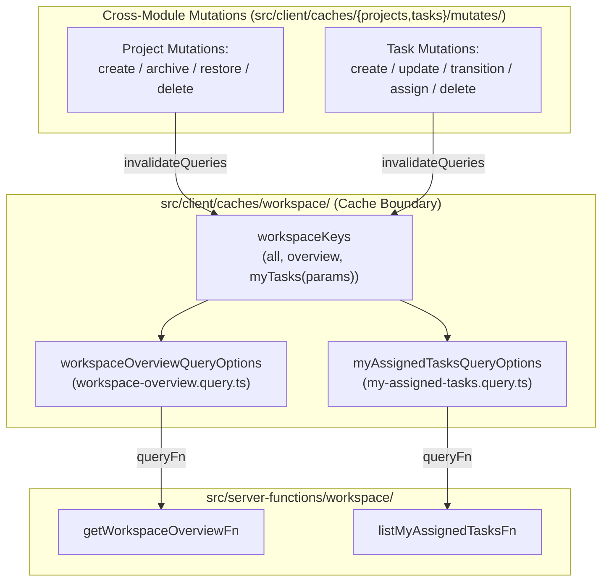

# Milestone 8 — Frontend Step 1: Client Caches Workspace & Cross-Module Invalidation (src/client/caches/workspace/)

---

## 1. เป้าหมายและขอบเขต Boundary (Boundary Context & Goal)

ก้าวเข้าสู่ฝั่ง Frontend ของ Milestone 8! ใน Step ที่ 1 นี้ เราจะสร้างชั้น **Server-State Cache Layer (`src/client/caches/workspace/`)** สำหรับหน้า Workspace Dashboard ซึ่งประกอบด้วย Query Key Factory (`workspaceKeys`) และ Query Options ทั้ง 2 ตัว (`workspaceOverviewQueryOptions`, `myAssignedTasksQueryOptions`)

นอกจากนี้ หัวใจสำคัญระดับสถาปัตยกรรมของการทำ Dashboard ที่รวบรวมข้อมูลข้ามโมดูลคือ **Cross-Module Cache Invalidation**: เมื่อผู้ใช้สร้าง/เก็บถาวร/กู้คืน/ลบโครงการในโมดูล `projects` หรือสร้าง/แก้ไข/เปลี่ยนสถานะ/มอบหมาย/ลบงานในโมดูล `tasks` ข้อมูลบนหน้า Workspace Dashboard (`workspaceKeys.all`) จะต้องถูกสั่ง Invalidate อัตโนมัติ เพื่อให้เมื่อผู้ใช้กดกลับมายังหน้าแรก (`/`) ตัวเลข KPI, รายการโครงการล่าสุด, ประวัติกิจกรรมล่าสุด และตารางงานที่ได้รับมอบหมายจะแสดงข้อมูลที่เป็นปัจจุบันทันทีโดยไม่ต้องกด Refresh เบราว์เซอร์

### ตารางสรุปไฟล์ใน Step นี้

| ลำดับ | เส้นทางไฟล์ (Path) | หน้าที่รับผิดชอบ (Responsibility) |
| :--- | :--- | :--- |
| 1 | `src/client/caches/workspace/keys.ts` | นิยาม Query Key Factory (`workspaceKeys`) สำหรับจัดการคีย์แคชของโมดูล `workspace` อย่างเป็นระบบ |
| 2 | `src/client/caches/workspace/queries/workspace-overview.query.ts` | นิยาม `workspaceOverviewQueryOptions()` เชื่อมต่อกับ `getWorkspaceOverviewFn` |
| 3 | `src/client/caches/workspace/queries/my-assigned-tasks.query.ts` | นิยาม `myAssignedTasksQueryOptions(params)` เชื่อมต่อกับ `listMyAssignedTasksFn` |
| 4 | `src/client/caches/projects/mutates/create-project.mutate.ts` | อัปเดต `onSuccess` ให้สั่ง Invalidate `workspaceKeys.all` ควบคู่กับ `projectsKeys.all` |
| 5 | `src/client/caches/projects/mutates/archive-project.mutate.ts` | อัปเดต `onSuccess` ให้สั่ง Invalidate `workspaceKeys.all` เมื่อเก็บถาวรโครงการ |
| 6 | `src/client/caches/projects/mutates/restore-project.mutate.ts` | อัปเดต `onSuccess` ให้สั่ง Invalidate `workspaceKeys.all` เมื่อคืนค่าโครงการ |
| 7 | `src/client/caches/projects/mutates/delete-project.mutate.ts` | อัปเดต `onSuccess` ให้สั่ง Invalidate `workspaceKeys.all` เมื่อลบโครงการถาวร |
| 8 | `src/client/caches/tasks/mutates/create-task.mutate.ts` | อัปเดต `onSuccess` ให้สั่ง Invalidate `workspaceKeys.all` เมื่อสร้างงานใหม่ |
| 9 | `src/client/caches/tasks/mutates/update-task.mutate.ts` | อัปเดต `onSuccess` ให้สั่ง Invalidate `workspaceKeys.all` เมื่อแก้ไขรายละเอียดงาน |
| 10 | `src/client/caches/tasks/mutates/transition-task-status.mutate.ts` | อัปเดต `onSuccess` ให้สั่ง Invalidate `workspaceKeys.all` เมื่อเปลี่ยนสถานะงาน |
| 11 | `src/client/caches/tasks/mutates/assign-task.mutate.ts` | อัปเดต `onSuccess` ให้สั่ง Invalidate `workspaceKeys.all` เมื่อเปลี่ยนผู้รับผิดชอบงาน |
| 12 | `src/client/caches/tasks/mutates/delete-task.mutate.ts` | อัปเดต `onSuccess` ให้สั่ง Invalidate `workspaceKeys.all` เมื่อลบงาน |

### แผนผังขอบเขตสถาปัตยกรรม (Architecture Boundary Diagram)



---

## 2. ทฤษฎี ความสำคัญ และกฎสถาปัตยกรรมเฉพาะ Boundary นี้

### 2.1 โครงสร้างลำดับชั้นของ `workspaceKeys` และการ Invalidate ข้ามโมดูล
เรากำหนด `workspaceKeys` ให้มีรากเดียวกันคือ `workspaceKeys.all = ["workspace"] as const`:
- `workspaceKeys.overview()` จะได้คีย์ `["workspace", "overview"]`
- `workspaceKeys.myTasks(params)` จะได้คีย์ `["workspace", "my-tasks", params]`
- เนื่องจาก TanStack Query ทำการจับคู่ `invalidateQueries({ queryKey: workspaceKeys.all })` แบบ **Prefix Matching** เพียงเราสั่ง Invalidate ที่ `workspaceKeys.all` คำสั่งเดียว แคชทั้งของ `overview` และของตาราง `my-tasks` ทุกหน้า/ทุกตัวกรองจะถูกทำเครื่องหมายว่า Stale พร้อมกันทันที

### 2.2 กฎสถาปัตยกรรมที่บังคับใช้ใน Step นี้
- **`server.md` ข้อ 3 (Centralized Server-State Ownership)**: อนุญาตให้เฉพาะ Route `loader` และ `src/client/caches/**` เรียกใช้ `src/server-functions/**` เท่านั้น ห้าม Feature Hooks หรือ Components เรียก Server Functions โดยตรง
- **`client.md` ข้อ 8 (Centralized Mutation Feedback & Lifecycle)**: การจัดการ `meta.successToast` และการสั่ง `invalidateQueries` หลัง Mutation สำเร็จต้องรวมศูนย์อยู่ใน `src/client/caches/**/mutates/*.mutate.ts` เท่านั้น

---

## 3. ลงมือเขียนโค้ด (Step-by-Step Implementation)

### ไฟล์ที่ 1: `src/client/caches/workspace/keys.ts`

สร้างไฟล์ `src/client/caches/workspace/keys.ts` สำหรับสร้าง Query Keys ของโมดูล `workspace`:

```typescript
import type { MyTasksSearch } from "#/shared/schemas/workspace.schema";

export const workspaceKeys = {
	all: ["workspace"] as const,
	overview: () => [...workspaceKeys.all, "overview"] as const,
	myTasks: (params: MyTasksSearch) =>
		[...workspaceKeys.all, "my-tasks", params] as const,
};
```

---

### ไฟล์ที่ 2: `src/client/caches/workspace/queries/workspace-overview.query.ts`

สร้างไฟล์ `src/client/caches/workspace/queries/workspace-overview.query.ts` สำหรับดึงข้อมูลภาพรวมของหน้า Dashboard:

```typescript
import { queryOptions } from "@tanstack/react-query";
import { getWorkspaceOverviewFn } from "#/server-functions/workspace/get-workspace-overview.fn";
import { workspaceKeys } from "../keys";

export function workspaceOverviewQueryOptions() {
	return queryOptions({
		queryKey: workspaceKeys.overview(),
		queryFn: () => getWorkspaceOverviewFn(),
		staleTime: 15_000,
	});
}
```

---

### ไฟล์ที่ 3: `src/client/caches/workspace/queries/my-assigned-tasks.query.ts`

สร้างไฟล์ `src/client/caches/workspace/queries/my-assigned-tasks.query.ts` สำหรับดึงรายการงานที่ได้รับมอบหมายตาม URL Search Params:

```typescript
import { queryOptions } from "@tanstack/react-query";
import { listMyAssignedTasksFn } from "#/server-functions/workspace/list-my-assigned-tasks.fn";
import type { MyTasksSearch } from "#/shared/schemas/workspace.schema";
import { workspaceKeys } from "../keys";

export function myAssignedTasksQueryOptions(params: MyTasksSearch) {
	return queryOptions({
		queryKey: workspaceKeys.myTasks(params),
		queryFn: () => listMyAssignedTasksFn({ data: params }),
		staleTime: 15_000,
	});
}
```

---

### ไฟล์ที่ 4–7: อัปเดต Project Mutations เพื่อเชื่อม Cross-Module Invalidation (`src/client/caches/projects/mutates/`)

ตรวจสอบและอัปเดตไฟล์ Mutation ทั้ง 4 ไฟล์ของโมดูล `projects` ให้สั่ง `queryClient.invalidateQueries({ queryKey: workspaceKeys.all })` ใน `onSuccess`

#### 4. `src/client/caches/projects/mutates/create-project.mutate.ts`

```typescript
import { useMutation, useQueryClient } from "@tanstack/react-query";
import { workspaceKeys } from "#/client/caches/workspace/keys";
import { createProjectFn } from "#/server-functions/projects/create-project.fn";
import type { CreateProjectInput } from "#/shared/schemas/project.schema";
import { projectsKeys } from "../keys";

export function useCreateProjectMutation() {
	const queryClient = useQueryClient();
	return useMutation({
		mutationFn: (input: CreateProjectInput) => createProjectFn({ data: input }),
		meta: {
			successToast: "สร้างโครงการใหม่สำเร็จ",
		},
		onSuccess: async () => {
			await Promise.all([
				queryClient.invalidateQueries({ queryKey: projectsKeys.all }),
				queryClient.invalidateQueries({ queryKey: workspaceKeys.all }),
			]);
		},
	});
}
```

#### 5. `src/client/caches/projects/mutates/archive-project.mutate.ts`

```typescript
import { useMutation, useQueryClient } from "@tanstack/react-query";
import { workspaceKeys } from "#/client/caches/workspace/keys";
import { archiveProjectFn } from "#/server-functions/projects/archive-project.fn";
import type { ProjectActionInput } from "#/shared/schemas/project.schema";
import { projectsKeys } from "../keys";

export function useArchiveProjectMutation() {
	const queryClient = useQueryClient();

	return useMutation({
		mutationFn: (input: ProjectActionInput) =>
			archiveProjectFn({ data: input }),
		meta: {
			successToast: "เก็บถาวรโครงการเรียบร้อยแล้ว",
		},
		onSuccess: async () => {
			await Promise.all([
				queryClient.invalidateQueries({ queryKey: projectsKeys.all }),
				queryClient.invalidateQueries({ queryKey: workspaceKeys.all }),
			]);
		},
	});
}
```

#### 6. `src/client/caches/projects/mutates/restore-project.mutate.ts`

```typescript
import { useMutation, useQueryClient } from "@tanstack/react-query";
import { workspaceKeys } from "#/client/caches/workspace/keys";
import { restoreProjectFn } from "#/server-functions/projects/restore-project.fn";
import type { ProjectActionInput } from "#/shared/schemas/project.schema";
import { projectsKeys } from "../keys";

export function useRestoreProjectMutation() {
	const queryClient = useQueryClient();

	return useMutation({
		mutationFn: (input: ProjectActionInput) =>
			restoreProjectFn({ data: input }),
		meta: {
			successToast: "คืนค่าโครงการเรียบร้อยแล้ว",
		},
		onSuccess: async () => {
			await Promise.all([
				queryClient.invalidateQueries({ queryKey: projectsKeys.all }),
				queryClient.invalidateQueries({ queryKey: workspaceKeys.all }),
			]);
		},
	});
}
```

#### 7. `src/client/caches/projects/mutates/delete-project.mutate.ts`

```typescript
import { useMutation, useQueryClient } from "@tanstack/react-query";
import { workspaceKeys } from "#/client/caches/workspace/keys";
import { deleteProjectFn } from "#/server-functions/projects/delete-project.fn";
import type { ProjectActionInput } from "#/shared/schemas/project.schema";
import { projectsKeys } from "../keys";

export function useDeleteProjectMutation() {
	const queryClient = useQueryClient();

	return useMutation({
		mutationFn: (input: ProjectActionInput) => deleteProjectFn({ data: input }),
		meta: {
			successToast: "ลบโครงการถาวรเรียบร้อยแล้ว",
		},
		onSuccess: async (_data, variables) => {
			queryClient.removeQueries({
				queryKey: projectsKeys.detail(variables.projectId),
			});
			queryClient.removeQueries({
				queryKey: projectsKeys.members(variables.projectId),
			});
			queryClient.removeQueries({
				queryKey: projectsKeys.activity(variables.projectId),
			});
			await Promise.all([
				queryClient.invalidateQueries({ queryKey: projectsKeys.all }),
				queryClient.invalidateQueries({ queryKey: workspaceKeys.all }),
			]);
		},
	});
}
```

---

### ไฟล์ที่ 8–12: อัปเดต Task Mutations เพื่อเชื่อม Cross-Module Invalidation (`src/client/caches/tasks/mutates/`)

ตรวจสอบและอัปเดตไฟล์ Mutation ทั้ง 5 ไฟล์ของโมดูล `tasks` ให้สั่ง `queryClient.invalidateQueries({ queryKey: workspaceKeys.all })` ใน `onSuccess`

#### 8. `src/client/caches/tasks/mutates/create-task.mutate.ts`

```typescript
import { useMutation, useQueryClient } from "@tanstack/react-query";
import { projectsKeys } from "#/client/caches/projects/keys";
import { workspaceKeys } from "#/client/caches/workspace/keys";
import { createTaskFn } from "#/server-functions/tasks/create-task.fn";
import type { CreateTaskInput } from "#/shared/schemas/task.schema";
import { tasksKeys } from "../keys";

export function useCreateTaskMutation() {
	const queryClient = useQueryClient();

	return useMutation({
		mutationFn: (input: CreateTaskInput) => createTaskFn({ data: input }),
		meta: {
			successToast: "สร้างงานใหม่สำเร็จ",
		},
		onSuccess: async (_data, variables) => {
			await Promise.all([
				queryClient.invalidateQueries({
					queryKey: tasksKeys.project(variables.projectId),
				}),
				queryClient.invalidateQueries({
					queryKey: projectsKeys.detail(variables.projectId),
				}),
				queryClient.invalidateQueries({
					queryKey: projectsKeys.activity(variables.projectId),
				}),
				queryClient.invalidateQueries({
					queryKey: projectsKeys.all,
				}),
				queryClient.invalidateQueries({
					queryKey: workspaceKeys.all,
				}),
			]);
		},
	});
}
```

#### 9. `src/client/caches/tasks/mutates/update-task.mutate.ts`

```typescript
import { useMutation, useQueryClient } from "@tanstack/react-query";
import { projectsKeys } from "#/client/caches/projects/keys";
import { workspaceKeys } from "#/client/caches/workspace/keys";
import { updateTaskFn } from "#/server-functions/tasks/update-task.fn";
import type { UpdateTaskInput } from "#/shared/schemas/task.schema";
import { tasksKeys } from "../keys";

export function useUpdateTaskMutation() {
	const queryClient = useQueryClient();

	return useMutation({
		mutationFn: (input: UpdateTaskInput) => updateTaskFn({ data: input }),
		meta: {
			successToast: "บันทึกการแก้ไขงานสำเร็จ",
		},
		onSuccess: async (_data, variables) => {
			await Promise.all([
				queryClient.invalidateQueries({
					queryKey: tasksKeys.project(variables.projectId),
				}),
				queryClient.invalidateQueries({
					queryKey: projectsKeys.activity(variables.projectId),
				}),
				queryClient.invalidateQueries({
					queryKey: workspaceKeys.all,
				}),
			]);
		},
	});
}
```

#### 10. `src/client/caches/tasks/mutates/transition-task-status.mutate.ts`

```typescript
import { useMutation, useQueryClient } from "@tanstack/react-query";
import { projectsKeys } from "#/client/caches/projects/keys";
import { workspaceKeys } from "#/client/caches/workspace/keys";
import { transitionTaskStatusFn } from "#/server-functions/tasks/transition-task-status.fn";
import type { TransitionTaskStatusInput } from "#/shared/schemas/task.schema";
import { tasksKeys } from "../keys";

export function useTransitionTaskStatusMutation() {
	const queryClient = useQueryClient();

	return useMutation({
		mutationFn: (input: TransitionTaskStatusInput) =>
			transitionTaskStatusFn({ data: input }),
		meta: {
			successToast: "อัปเดตสถานะงานสำเร็จ",
		},
		onSuccess: async (_data, variables) => {
			await Promise.all([
				queryClient.invalidateQueries({
					queryKey: tasksKeys.project(variables.projectId),
				}),
				queryClient.invalidateQueries({
					queryKey: projectsKeys.activity(variables.projectId),
				}),
				queryClient.invalidateQueries({
					queryKey: workspaceKeys.all,
				}),
			]);
		},
	});
}
```

#### 11. `src/client/caches/tasks/mutates/assign-task.mutate.ts`

```typescript
import { useMutation, useQueryClient } from "@tanstack/react-query";
import { projectsKeys } from "#/client/caches/projects/keys";
import { workspaceKeys } from "#/client/caches/workspace/keys";
import { assignTaskFn } from "#/server-functions/tasks/assign-task.fn";
import type { AssignTaskInput } from "#/shared/schemas/task.schema";
import { tasksKeys } from "../keys";

export function useAssignTaskMutation() {
	const queryClient = useQueryClient();

	return useMutation({
		mutationFn: (input: AssignTaskInput) => assignTaskFn({ data: input }),
		meta: {
			successToast: "อัปเดตผู้รับผิดชอบงานสำเร็จ",
		},
		onSuccess: async (_data, variables) => {
			await Promise.all([
				queryClient.invalidateQueries({
					queryKey: tasksKeys.project(variables.projectId),
				}),
				queryClient.invalidateQueries({
					queryKey: projectsKeys.activity(variables.projectId),
				}),
				queryClient.invalidateQueries({
					queryKey: workspaceKeys.all,
				}),
			]);
		},
	});
}
```

#### 12. `src/client/caches/tasks/mutates/delete-task.mutate.ts`

```typescript
import { useMutation, useQueryClient } from "@tanstack/react-query";
import { projectsKeys } from "#/client/caches/projects/keys";
import { workspaceKeys } from "#/client/caches/workspace/keys";
import { deleteTaskFn } from "#/server-functions/tasks/delete-task.fn";
import type { DeleteTaskInput } from "#/shared/schemas/task.schema";
import { tasksKeys } from "../keys";

export function useDeleteTaskMutation() {
	const queryClient = useQueryClient();

	return useMutation({
		mutationFn: (input: DeleteTaskInput) => deleteTaskFn({ data: input }),
		meta: {
			successToast: "ลบงานเรียบร้อยแล้ว",
		},
		onSuccess: async (_data, variables) => {
			queryClient.removeQueries({
				queryKey: tasksKeys.detail(variables.projectId, variables.taskId),
			});
			await Promise.all([
				queryClient.invalidateQueries({
					queryKey: tasksKeys.project(variables.projectId),
				}),
				queryClient.invalidateQueries({
					queryKey: projectsKeys.detail(variables.projectId),
				}),
				queryClient.invalidateQueries({
					queryKey: projectsKeys.activity(variables.projectId),
				}),
				queryClient.invalidateQueries({
					queryKey: projectsKeys.all,
				}),
				queryClient.invalidateQueries({
					queryKey: workspaceKeys.all,
				}),
			]);
		},
	});
}
```

---

## 4. การตรวจสอบความถูกต้องและ Git Commit (Verification & Commit)

รันคำสั่งตรวจสอบ TypeScript และ Biome Linter/Formatter:

```bash
bun run typecheck
bun run check
```

เมื่อผ่านเรียบร้อยแล้ว ให้บันทึก Git Commit สำหรับ Step นี้:

```bash
git add src/client/caches/workspace/ src/client/caches/projects/mutates/ src/client/caches/tasks/mutates/
git commit -m "milestone-8.frontend.step-1: Client Caches Workspace & Cross-Module Cache Invalidation"
```
