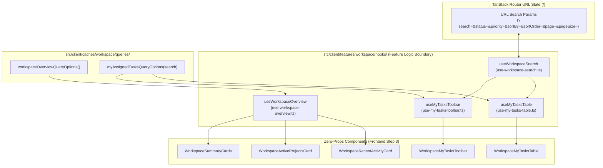

# Milestone 8 — Frontend Step 2: Feature Workspace Hooks (src/client/features/workspace/hooks/)

---

## 1. เป้าหมายและขอบเขต Boundary (Boundary Context & Goal)

ใน Step ที่ 2 ของฝั่ง Frontend เราจะสร้างชุด **Single-Responsibility Feature Hooks (`src/client/features/workspace/hooks/`)** เพิ่มเติมอีก 4 ไฟล์ เพื่อเป็นเจ้าของ State, การซิงค์กับ URL Search Params, การดึงข้อมูลผ่าน TanStack Query Caches, การแปลงข้อมูลเพื่อแสดงผล (View Model Mapping) และการควบคุมตาราง Server-Side TanStack Table สำหรับตารางงานที่ได้รับมอบหมายของฉัน

ภายใต้สถาปัตยกรรม **Zero Props (`client.md` ข้อ 2–7)** Components ใน Step ถัดไปจะไม่รับ Props ใดๆ เลย แต่ละ Component จะเรียกใช้ Hook ที่ตรงกับขอบเขตความรับผิดชอบ (Cohesive Scope) ของตนเองโดยตรง

### ตารางสรุปไฟล์ใน Step นี้

| ลำดับ | เส้นทางไฟล์ (Path) | หน้าที่รับผิดชอบ (Responsibility) |
| :--- | :--- | :--- |
| 1 | `src/client/features/workspace/hooks/use-workspace-search.ts` | อ่านและอัปเดต URL Search Params ของหน้า `/` (`MyTasksSearch`) อย่างปลอดภัยด้วย `myTasksSearchSchema` |
| 2 | `src/client/features/workspace/hooks/use-workspace-overview.ts` | ดึงข้อมูลภาพรวมพื้นที่ทำงาน (`workspaceOverviewQueryOptions`) พร้อมแปลงวันที่ของโครงการล่าสุดและฟอร์แมตข้อความของ Activity Logs สำหรับแสดงผล |
| 3 | `src/client/features/workspace/hooks/use-my-tasks-toolbar.ts` | จัดการสถานะช่องค้นหาแบบ Debounce 300ms, ตัวกรองสถานะงาน (`status`), ตัวกรองความสำคัญ (`priority`) และปุ่มล้างตัวกรองของตารางงานของฉัน |
| 4 | `src/client/features/workspace/hooks/use-my-tasks-table.ts` | สร้างและควบคุมอินสแตนซ์ TanStack Table v9 (`useTable`) แบบ Server-side Pagination & Sorting สำหรับตารางงานที่ได้รับมอบหมายของฉัน |

### แผนผังขอบเขตสถาปัตยกรรม (Architecture Boundary Diagram)



---

## 2. ทฤษฎี ความสำคัญ และกฎสถาปัตยกรรมเฉพาะ Boundary นี้

### 2.1 การแยก Hook ตาม Cohesive Scope (`client.md` ข้อ 6 & 7)
แทนที่จะสร้าง God Hook ตัวเดียวชื่อ `useWorkspaceDashboard()` ที่รวมทั้ง KPI Cards, Active Projects, Recent Activities, Search Input State, Filter Handlers และ TanStack Table Instance ไว้ด้วยกัน (ซึ่งจะทำให้ทุกครั้งที่ผู้ใช้พิมพ์ตัวอักษรในช่องค้นหา การ์ดทุกใบบนหน้า Dashboard ต้องถูก Re-render ตามไปด้วย) เราแยกออกเป็น 4 Hooks ตามขอบเขตหน้าที่:
1. **`useWorkspaceSearch`**: เป็นตัวกลางอ่านและเขียน URL Search Params ของหน้า `/` ด้วย `myTasksSearchSchema.parse(...)`
2. **`useWorkspaceOverview`**: ดูแลเฉพาะข้อมูลภาพรวม (`workspaceOverviewQueryOptions()`) ซึ่งไม่ขึ้นกับ URL Search Params ของตารางงาน ทำให้เมื่อผู้ใช้เปลี่ยนหน้าตารางหรือกรองงานในตาราง ข้อมูลภาพรวมไม่ต้องถูกคิวรีใหม่
3. **`useMyTasksToolbar`**: ดูแลเฉพาะการโต้ตอบบนแถบเครื่องมือค้นหาและตัวกรองของตารางงาน พร้อมทำ Debounce 300ms ก่อนอัปเดต URL Search Params
4. **`useMyTasksTable`**: ดูแลเฉพาะการผูกข้อมูลจาก `myAssignedTasksQueryOptions(search)` เข้ากับ TanStack Table v9 (`createServerColumnHelper` + `serverTableFeatures`)

### 2.2 กฎสถาปัตยกรรมที่บังคับใช้ใน Step นี้
- **`client.md` ข้อ 3 (Pure Presentation vs Hook Logic)**: การคำนวณ การแปลงวันที่ (`toLocaleString()`) การแปลงข้อความกิจกรรม (`formatActivityLogItem`) และการจัดการ Event Handlers ทั้งหมดต้องอยู่ใน Hooks เท่านั้น
- **`client.md` ข้อ 4–7 (Cohesive Hook Ownership)**: ออกแบบ Hook ให้แต่ละ Component เรียกใช้ตามขอบเขตของตนเอง ไม่สร้าง God Hook และไม่ส่งผลลัพธ์ของ Hook ผ่าน Props

---

## 3. ลงมือเขียนโค้ด (Step-by-Step Implementation)

### ไฟล์ที่ 1: `src/client/features/workspace/hooks/use-workspace-search.ts`

สร้างไฟล์ `src/client/features/workspace/hooks/use-workspace-search.ts` สำหรับจัดการ URL Search Params บนหน้า `/`:

```typescript
import { useNavigate, useSearch } from "@tanstack/react-router";
import { useCallback } from "react";
import type { MyTasksSearch } from "#/shared/schemas/workspace.schema";
import { myTasksSearchSchema } from "#/shared/schemas/workspace.schema";

export function useWorkspaceSearch() {
	const navigate = useNavigate();
	const rawSearch = useSearch({ strict: false });
	const search = myTasksSearchSchema.parse(rawSearch);

	const updateSearch = useCallback(
		(patch: Partial<MyTasksSearch>) => {
			void navigate({
				to: "/",
				search: (prev) => ({
					...myTasksSearchSchema.parse(prev),
					...patch,
				}),
			});
		},
		[navigate],
	);

	return {
		search,
		updateSearch,
	};
}
```

#### คำอธิบายรายละเอียดโค้ด
- อ่าน `rawSearch` จาก TanStack Router แล้วพาร์สผ่าน `myTasksSearchSchema.parse(rawSearch)` เพื่อรับประกันว่าได้อ็อบเจกต์ `MyTasksSearch` ที่มีค่าครบถ้วนเสมอ
- `updateSearch` ใช้ Functional Updater ของ `navigate({ to: "/", search: (prev) => ... })` เพื่อผสานค่าใหม่ (`patch`) เข้ากับค่าเดิมบน URL อย่างปลอดภัย

---

### ไฟล์ที่ 2: `src/client/features/workspace/hooks/use-workspace-overview.ts`

สร้างไฟล์ `src/client/features/workspace/hooks/use-workspace-overview.ts` สำหรับดึงข้อมูลภาพรวมพื้นที่ทำงานและแปลงเป็น View Model พร้อมแสดงผล:

```typescript
import { useQuery } from "@tanstack/react-query";
import { useMemo } from "react";
import { workspaceOverviewQueryOptions } from "#/client/caches/workspace/queries/workspace-overview.query";
import { useSession } from "#/client/features/auth/hooks/use-session";
import { formatActivityLogItem } from "#/client/shared/helpers/activity-formatter";

export function useWorkspaceOverview() {
	const { session } = useSession();
	const { data, isPending } = useQuery(workspaceOverviewQueryOptions());

	const canCreateProject =
		session?.user.systemPermissions.includes("project:create") ?? false;

	const activeProjects = useMemo(
		() =>
			(data?.activeProjects ?? []).map((project) => ({
				...project,
				updatedAtLabel: new Date(project.updatedAt).toLocaleString(),
			})),
		[data?.activeProjects],
	);

	const recentActivities = useMemo(
		() =>
			(data?.recentActivities ?? []).map((log) => ({
				...formatActivityLogItem(log),
				projectId: log.projectId,
				taskId: log.taskId,
			})),
		[data?.recentActivities],
	);

	return {
		summary: data?.summary ?? {
			activeProjectCount: 0,
			archivedProjectCount: 0,
			assignedOpenTaskCount: 0,
			assignedDoneTaskCount: 0,
		},
		activeProjects,
		recentActivities,
		canCreateProject,
		isPending,
	};
}
```

#### คำอธิบายรายละเอียดโค้ด
- ดึงข้อมูลผ่าน `useQuery(workspaceOverviewQueryOptions())` ซึ่งจะถูกแชร์แคชร่วมกันระหว่าง `WorkspaceSummaryCards`, `WorkspaceActiveProjectsCard` และ `WorkspaceRecentActivityCard` โดยที่ TanStack Query จะยิงคำขอไปที่ Server เพียงครั้งเดียว (Request Deduplication)
- แปลง `recentActivities` ด้วย Helper กลาง `formatActivityLogItem(log)` พร้อมแนบ `projectId` และ `taskId` เพื่อให้ Component สร้างลิงก์กดข้ามไปยังหน้างานหรือหน้ากิจกรรมของโครงการนั้นได้ทันที

---

### ไฟล์ที่ 3: `src/client/features/workspace/hooks/use-my-tasks-toolbar.ts`

สร้างไฟล์ `src/client/features/workspace/hooks/use-my-tasks-toolbar.ts` สำหรับควบคุมช่องค้นหาและตัวกรองของตารางงานที่ได้รับมอบหมาย:

```typescript
import { keepPreviousData, useQuery } from "@tanstack/react-query";
import { useEffect, useState } from "react";
import { myAssignedTasksQueryOptions } from "#/client/caches/workspace/queries/my-assigned-tasks.query";
import {
	TASK_PRIORITY_FILTER_OPTIONS,
	TASK_STATUS_FILTER_OPTIONS,
} from "#/client/shared/helpers/task-display";
import {
	taskPriorityFilterSchema,
	taskStatusFilterSchema,
} from "#/shared/schemas/task.schema";
import { useWorkspaceSearch } from "./use-workspace-search";

export function useMyTasksToolbar() {
	const { search, updateSearch } = useWorkspaceSearch();
	const [searchInput, setSearchInput] = useState(search.search);

	const { isFetching } = useQuery({
		...myAssignedTasksQueryOptions(search),
		placeholderData: keepPreviousData,
	});

	const hasActiveFilters =
		search.search !== "" ||
		search.status !== "all" ||
		search.priority !== "all";

	useEffect(() => {
		setSearchInput(search.search);
	}, [search.search]);

	useEffect(() => {
		const trimmed = searchInput.trim();
		if (trimmed === search.search) {
			return;
		}

		const timer = setTimeout(() => {
			updateSearch({ search: trimmed, page: 1 });
		}, 300);

		return () => clearTimeout(timer);
	}, [searchInput, search.search, updateSearch]);

	const handleClearSearch = () => {
		setSearchInput("");
		if (search.search !== "") {
			updateSearch({ search: "", page: 1 });
		}
	};

	const handleStatusChange = (nextValue: string | null) => {
		const parsed = taskStatusFilterSchema.safeParse(nextValue);
		if (!parsed.success || parsed.data === search.status) {
			return;
		}
		updateSearch({ status: parsed.data, page: 1 });
	};

	const handlePriorityChange = (nextValue: string | null) => {
		const parsed = taskPriorityFilterSchema.safeParse(nextValue);
		if (!parsed.success || parsed.data === search.priority) {
			return;
		}
		updateSearch({ priority: parsed.data, page: 1 });
	};

	const handleResetFilters = () => {
		setSearchInput("");
		updateSearch({
			search: "",
			status: "all",
			priority: "all",
			page: 1,
		});
	};

	return {
		searchInput,
		status: search.status,
		priority: search.priority,
		statusOptions: TASK_STATUS_FILTER_OPTIONS,
		priorityOptions: TASK_PRIORITY_FILTER_OPTIONS,
		hasActiveFilters,
		isFetching,
		setSearchInput,
		handleClearSearch,
		handleStatusChange,
		handlePriorityChange,
		handleResetFilters,
	};
}
```

#### คำอธิบายรายละเอียดโค้ด
- ใช้ `searchInput` เป็น Local State สำหรับ `<Input type="search" />` เพื่อให้พิมพ์ได้ลื่นไหลทันที แล้วหน่วงเวลา 300ms (`setTimeout`) ก่อนอัปเดต `search` ลงใน URL Search Params พร้อมรีเซ็ต `page: 1`
- ใช้ `taskStatusFilterSchema.safeParse(...)` และ `taskPriorityFilterSchema.safeParse(...)` เพื่อตรวจสอบค่าที่เลือกจาก `<Select>` อย่างปลอดภัยโดยไม่ต้องใช้ Type Casting (`as`)

---

### ไฟล์ที่ 4: `src/client/features/workspace/hooks/use-my-tasks-table.ts`

สร้างไฟล์ `src/client/features/workspace/hooks/use-my-tasks-table.ts` สำหรับควบคุมตารางงานที่ได้รับมอบหมายด้วย TanStack Table v9:

```typescript
import { keepPreviousData, useQuery } from "@tanstack/react-query";
import type {
	OnChangeFn,
	PaginationState,
	SortingState,
} from "@tanstack/react-table";
import { functionalUpdate, useTable } from "@tanstack/react-table";
import { useMemo } from "react";
import { myAssignedTasksQueryOptions } from "#/client/caches/workspace/queries/my-assigned-tasks.query";
import {
	createServerColumnHelper,
	serverTableFeatures,
} from "#/client/shared/components/app-data-table";
import type { MyAssignedTaskItemDto } from "#/shared/schemas/workspace.schema";
import { myTasksSortFieldSchema } from "#/shared/schemas/workspace.schema";
import { useWorkspaceSearch } from "./use-workspace-search";

const myTaskColumnHelper = createServerColumnHelper<MyAssignedTaskItemDto>();

const myTaskTableColumns = myTaskColumnHelper.columns([
	myTaskColumnHelper.accessor("projectKey", {
		header: "โครงการ",
		enableSorting: true,
	}),
	myTaskColumnHelper.accessor("code", {
		header: "รหัสงาน",
		enableSorting: true,
	}),
	myTaskColumnHelper.accessor("title", {
		header: "ชื่องาน",
		enableSorting: true,
	}),
	myTaskColumnHelper.accessor("status", {
		header: "สถานะ",
		enableSorting: true,
	}),
	myTaskColumnHelper.accessor("priority", {
		header: "ความสำคัญ",
		enableSorting: true,
	}),
	myTaskColumnHelper.accessor("dueDate", {
		header: "วันครบกำหนด",
		enableSorting: true,
	}),
	myTaskColumnHelper.accessor("commentCount", {
		header: "ความคิดเห็น",
		enableSorting: false,
	}),
	myTaskColumnHelper.accessor("updatedAt", {
		header: "อัปเดตล่าสุด",
		enableSorting: true,
	}),
]);

export function useMyTasksTable() {
	const { search, updateSearch } = useWorkspaceSearch();

	const { data, isPending } = useQuery({
		...myAssignedTasksQueryOptions(search),
		placeholderData: keepPreviousData,
	});

	const pagination: PaginationState = useMemo(
		() => ({
			pageIndex: Math.max(0, search.page - 1),
			pageSize: search.pageSize,
		}),
		[search.page, search.pageSize],
	);

	const sorting: SortingState = useMemo(
		() => [
			{
				id: search.sortBy,
				desc: search.sortOrder === "desc",
			},
		],
		[search.sortBy, search.sortOrder],
	);

	const onPaginationChange: OnChangeFn<PaginationState> = (updater) => {
		const next = functionalUpdate(updater, pagination);
		const isPageSizeChanged = next.pageSize !== pagination.pageSize;

		updateSearch({
			page: isPageSizeChanged ? 1 : next.pageIndex + 1,
			pageSize: next.pageSize,
		});
	};

	const onSortingChange: OnChangeFn<SortingState> = (updater) => {
		const next = functionalUpdate(updater, sorting);
		const firstSort = next[0];

		if (!firstSort) {
			updateSearch({
				sortBy: "updatedAt",
				sortOrder: "desc",
				page: 1,
			});
			return;
		}

		const parsedField = myTasksSortFieldSchema.safeParse(firstSort.id);
		if (!parsedField.success) {
			return;
		}

		updateSearch({
			sortBy: parsedField.data,
			sortOrder: firstSort.desc ? "desc" : "asc",
			page: 1,
		});
	};

	const table = useTable({
		features: serverTableFeatures,
		columns: myTaskTableColumns,
		data: data?.items ?? [],
		rowCount: data?.total ?? 0,
		manualPagination: true,
		manualSorting: true,
		state: {
			pagination,
			sorting,
		},
		onPaginationChange,
		onSortingChange,
		getRowId: (row) => row.id,
	});

	return {
		table,
		columnCount: myTaskTableColumns.length,
		isPending,
	};
}
```

#### คำอธิบายรายละเอียดโค้ด
- กำหนดคอลัมน์ทั้ง 8 คอลัมน์ด้วย `createServerColumnHelper<MyAssignedTaskItemDto>()` โดยเปิดการเรียงลำดับ (`enableSorting: true`) สำหรับทุกคอลัมน์ที่อยู่ใน `myTasksSortFieldSchema` ยกเว้น `commentCount`
- ใช้ `placeholderData: keepPreviousData` เพื่อคงข้อมูลตารางหน้าเดิมไว้ระหว่างกำลังโหลดหน้าใหม่หรือเปลี่ยนการเรียงลำดับ ช่วยให้ตารางไม่กระพริบเป็น Skeleton ทุกครั้งที่กดเปลี่ยนหน้า

---

## 4. การตรวจสอบความถูกต้องและ Git Commit (Verification & Commit)

รันคำสั่งตรวจสอบ TypeScript และ Biome Linter/Formatter:

```bash
bun run typecheck
bun run check
```

เมื่อผ่านเรียบร้อยแล้ว ให้บันทึก Git Commit สำหรับ Step นี้:

```bash
git add src/client/features/workspace/hooks/use-workspace-search.ts src/client/features/workspace/hooks/use-workspace-overview.ts src/client/features/workspace/hooks/use-my-tasks-toolbar.ts src/client/features/workspace/hooks/use-my-tasks-table.ts
git commit -m "milestone-8.frontend.step-2: Feature Workspace Overview & Assigned Tasks Hooks"
```
