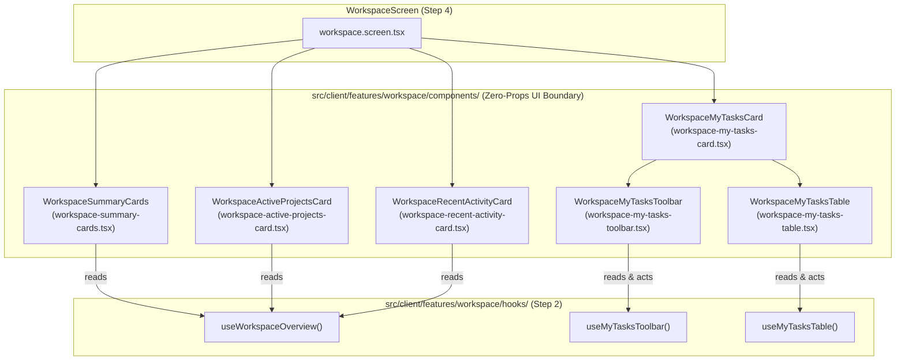

# Milestone 8 — Frontend Step 3: Feature Workspace Zero-Props Components (src/client/features/workspace/components/)

---

## 1. เป้าหมายและขอบเขต Boundary (Boundary Context & Goal)

ใน Step ที่ 3 ของฝั่ง Frontend เราจะสร้าง **Zero-Props Presentation Components (`src/client/features/workspace/components/`)** จำนวน 6 ไฟล์สำหรับหน้า Workspace Dashboard เพื่อแสดงผลตัวชี้วัดหลัก (KPI Summary Cards), ตารางงานที่ได้รับมอบหมายของฉันพร้อมแถบเครื่องมือค้นหา/กรอง, การ์ดโครงการที่กำลังเปิดใช้งานล่าสุด 5 โครงการ และการ์ดประวัติกิจกรรมความเคลื่อนไหวล่าสุด 10 รายการ

ทุก Component ในขั้นตอนนี้ปฏิบัติตามกฎเหล็กของฝั่ง Client อย่างเคร่งครัด:
1. **Zero Props (`client.md` ข้อ 2 & 3)**: ฟังก์ชัน Component ไม่มีพารามิเตอร์หรือ Props ใดๆ ทั้งสิ้น (`export function ComponentName() { ... }`)
2. **One Component per File (`client.md` ข้อ 19)**: 1 ไฟล์ `.tsx` มีเพียง 1 Component เท่านั้น
3. **No Raw Border/Ring & No Emoji (`client.md` ข้อ 15 & 18)**: ใช้ `<Card>`, `<Separator />`, `<Badge>` และ `<Button>` จาก shadcn ร่วมกับไอคอน SVG จาก `lucide-react` เท่านั้น

### ตารางสรุปไฟล์ใน Step นี้

| ลำดับ | เส้นทางไฟล์ (Path) | หน้าที่รับผิดชอบ (Responsibility) |
| :--- | :--- | :--- |
| 1 | `src/client/features/workspace/components/workspace-summary-cards.tsx` | แสดงการ์ดสรุปตัวเลข KPI 4 ใบ (งานค้างของฉัน, งานที่ปิดเสร็จแล้ว, โครงการที่เปิดใช้งาน, โครงการที่เก็บถาวร) |
| 2 | `src/client/features/workspace/components/workspace-my-tasks-toolbar.tsx` | แสดงแถบค้นหา (Search Input) และตัวกรองสถานะ/ความสำคัญของตารางงานที่ได้รับมอบหมาย |
| 3 | `src/client/features/workspace/components/workspace-my-tasks-table.tsx` | แสดงตารางงานที่ได้รับมอบหมายของฉันผ่าน `<AppDataTable>` พร้อมลิงก์เชื่อมไปยังหน้าโครงการและหน้ารายละเอียดงาน |
| 4 | `src/client/features/workspace/components/workspace-my-tasks-card.tsx` | การ์ดคอนเทนเนอร์ที่ประกอบ `WorkspaceMyTasksToolbar` และ `WorkspaceMyTasksTable` เข้าด้วยกันแบบ Zero Props |
| 5 | `src/client/features/workspace/components/workspace-active-projects-card.tsx` | แสดงรายการโครงการที่กำลังดำเนินการล่าสุด 5 อันดับแรก พร้อมจำนวนงานค้าง จำนวนสมาชิก บทบาท และปุ่มลัดเปิดดูงาน |
| 6 | `src/client/features/workspace/components/workspace-recent-activity-card.tsx` | แสดงฟีดกิจกรรมความเคลื่อนไหวล่าสุด 10 รายการในพื้นที่ทำงาน พร้อมปุ่มลัดไปยังงานหรือโครงการที่เกี่ยวข้อง |

### แผนผังขอบเขตสถาปัตยกรรม (Architecture Boundary Diagram)



---

## 2. ทฤษฎี ความสำคัญ และกฎสถาปัตยกรรมเฉพาะ Boundary นี้

### 2.1 การประกอบร่างแบบ Zero-Props Composition
สังเกตว่า `WorkspaceMyTasksCard` ทำหน้าที่เป็น Card Wrapper ที่วาง `<WorkspaceMyTasksToolbar />` และ `<WorkspaceMyTasksTable />` คู่กันโดยไม่รับและไม่ส่ง Props ใดๆ เลย:
- `WorkspaceMyTasksCard` ไม่ต้องดึงข้อมูลหรือถือ State ของตารางงานไว้ที่ตัวเอง
- เมื่อผู้ใช้พิมพ์ใน `WorkspaceMyTasksToolbar` เฉพาะ `WorkspaceMyTasksToolbar` เท่านั้นที่ Re-render ตามทุกจังหวะการพิมพ์ จนกระทั่งครบ Debounce 300ms จึงค่อยอัปเดต URL Search Params เพื่อให้ `WorkspaceMyTasksTable` โหลดข้อมูลชุดใหม่
- รูปแบบนี้ช่วยลด Re-render Cascade และทำให้แต่ละ Component แยกส่วนกันอย่างแท้จริงตามกฎ `client.md` ข้อ 2–5

### 2.2 กฎสถาปัตยกรรมที่บังคับใช้ใน Step นี้
- **`client.md` ข้อ 2 & 3 (Zero Props & Pure Presentation)**: ห้ามประกาศ Props หรือรับพารามิเตอร์ใดๆ ใน Feature Components
- **`client.md` ข้อ 14 & 15 (Design System & Visual Boundary)**: ใช้ `<Card>`, `<Separator />`, `<Badge>`, `<Skeleton>` จาก `#/client/shared/shadcn/components/ui/*` และใช้ Wrapper `<AppButtonLink>`, `<AppDataTable>` จาก `#/client/shared/components/*` ห้ามเขียนคลาส `border-*` หรือ `ring-*` เองโดยพลการ
- **`client.md` ข้อ 18 (No Emoji in UI)**: ใช้ไอคอนจาก `lucide-react` พร้อมระบุ `aria-hidden="true"` สำหรับไอคอนตกแต่งเสมอ
- **`client.md` ข้อ 19 (One Component per File)**: 1 ไฟล์ `.tsx` มีได้เพียง 1 Component เท่านั้น

---

## 3. ลงมือเขียนโค้ด (Step-by-Step Implementation)

### ไฟล์ที่ 1: `src/client/features/workspace/components/workspace-summary-cards.tsx`

สร้างไฟล์ `src/client/features/workspace/components/workspace-summary-cards.tsx` เพื่อแสดงการ์ดสรุป KPI ทั้ง 4 ใบ:

```tsx
import { CheckCircle2, Clock, FolderKanban, ListTodo } from "lucide-react";
import {
	Card,
	CardContent,
	CardDescription,
	CardHeader,
	CardTitle,
} from "#/client/shared/shadcn/components/ui/card";
import { Skeleton } from "#/client/shared/shadcn/components/ui/skeleton";
import { useWorkspaceOverview } from "../hooks/use-workspace-overview";

export function WorkspaceSummaryCards() {
	const { summary, isPending } = useWorkspaceOverview();

	if (isPending) {
		return (
			<div className="grid gap-4 sm:grid-cols-2 lg:grid-cols-4">
				<Skeleton className="h-28 w-full" />
				<Skeleton className="h-28 w-full" />
				<Skeleton className="h-28 w-full" />
				<Skeleton className="h-28 w-full" />
			</div>
		);
	}

	return (
		<div className="grid gap-4 sm:grid-cols-2 lg:grid-cols-4">
			<Card>
				<CardHeader className="flex flex-row items-center justify-between pb-2">
					<CardDescription>งานค้างของฉัน</CardDescription>
					<ListTodo className="size-4 text-primary" aria-hidden="true" />
				</CardHeader>
				<CardContent>
					<CardTitle className="text-2xl">
						{summary.assignedOpenTaskCount}
					</CardTitle>
				</CardContent>
			</Card>

			<Card>
				<CardHeader className="flex flex-row items-center justify-between pb-2">
					<CardDescription>งานที่ปิดเสร็จแล้ว</CardDescription>
					<CheckCircle2
						className="size-4 text-muted-foreground"
						aria-hidden="true"
					/>
				</CardHeader>
				<CardContent>
					<CardTitle className="text-2xl">
						{summary.assignedDoneTaskCount}
					</CardTitle>
				</CardContent>
			</Card>

			<Card>
				<CardHeader className="flex flex-row items-center justify-between pb-2">
					<CardDescription>โครงการที่เปิดใช้งาน</CardDescription>
					<FolderKanban className="size-4 text-primary" aria-hidden="true" />
				</CardHeader>
				<CardContent>
					<CardTitle className="text-2xl">
						{summary.activeProjectCount}
					</CardTitle>
				</CardContent>
			</Card>

			<Card>
				<CardHeader className="flex flex-row items-center justify-between pb-2">
					<CardDescription>โครงการที่เก็บถาวร</CardDescription>
					<Clock className="size-4 text-muted-foreground" aria-hidden="true" />
				</CardHeader>
				<CardContent>
					<CardTitle className="text-2xl">
						{summary.archivedProjectCount}
					</CardTitle>
				</CardContent>
			</Card>
		</div>
	);
}
```

---

### ไฟล์ที่ 2: `src/client/features/workspace/components/workspace-my-tasks-toolbar.tsx`

สร้างไฟล์ `src/client/features/workspace/components/workspace-my-tasks-toolbar.tsx` สำหรับแถบค้นหาและตัวกรองของตารางงานที่ได้รับมอบหมาย:

```tsx
import { Loader2, RotateCcw, Search, X } from "lucide-react";
import { Button } from "#/client/shared/shadcn/components/ui/button";
import { Input } from "#/client/shared/shadcn/components/ui/input";
import {
	Select,
	SelectContent,
	SelectItem,
	SelectTrigger,
	SelectValue,
} from "#/client/shared/shadcn/components/ui/select";
import { useMyTasksToolbar } from "../hooks/use-my-tasks-toolbar";

export function WorkspaceMyTasksToolbar() {
	const {
		searchInput,
		status,
		priority,
		statusOptions,
		priorityOptions,
		hasActiveFilters,
		isFetching,
		setSearchInput,
		handleClearSearch,
		handleStatusChange,
		handlePriorityChange,
		handleResetFilters,
	} = useMyTasksToolbar();

	return (
		<div className="flex flex-wrap items-center justify-between gap-3">
			<div className="flex flex-wrap items-center gap-2.5">
				<div className="flex w-64 items-center gap-1.5">
					<Search
						className="size-4 shrink-0 text-muted-foreground"
						aria-hidden="true"
					/>
					<Input
						type="search"
						value={searchInput}
						placeholder="ค้นหารหัสงาน ชื่องาน หรือโครงการ..."
						aria-label="ค้นหางานของฉัน"
						onChange={(event) => setSearchInput(event.target.value)}
					/>
					{searchInput ? (
						<Button
							type="button"
							variant="ghost"
							size="icon-sm"
							aria-label="ล้างคำค้นหา"
							onClick={handleClearSearch}
						>
							<X aria-hidden="true" />
						</Button>
					) : null}
				</div>

				<Select
					items={statusOptions}
					value={status}
					onValueChange={handleStatusChange}
				>
					<SelectTrigger size="sm" aria-label="กรองตามสถานะงาน">
						<SelectValue />
					</SelectTrigger>
					<SelectContent>
						{statusOptions.map((option) => (
							<SelectItem key={option.value} value={option.value}>
								{option.label}
							</SelectItem>
						))}
					</SelectContent>
				</Select>

				<Select
					items={priorityOptions}
					value={priority}
					onValueChange={handlePriorityChange}
				>
					<SelectTrigger size="sm" aria-label="กรองตามความสำคัญ">
						<SelectValue />
					</SelectTrigger>
					<SelectContent>
						{priorityOptions.map((option) => (
							<SelectItem key={option.value} value={option.value}>
								{option.label}
							</SelectItem>
						))}
					</SelectContent>
				</Select>

				{hasActiveFilters ? (
					<Button
						type="button"
						variant="ghost"
						size="sm"
						onClick={handleResetFilters}
					>
						<RotateCcw aria-hidden="true" />
						<span>ล้างตัวกรอง</span>
					</Button>
				) : null}

				{isFetching ? (
					<Loader2
						className="size-4 animate-spin text-muted-foreground"
						aria-hidden="true"
					/>
				) : null}
			</div>
		</div>
	);
}
```

---

### ไฟล์ที่ 3: `src/client/features/workspace/components/workspace-my-tasks-table.tsx`

สร้างไฟล์ `src/client/features/workspace/components/workspace-my-tasks-table.tsx` เพื่อแสดงตารางงานที่ได้รับมอบหมายของฉันผ่าน `<AppDataTable>`:

```tsx
import { Calendar, MessageSquare } from "lucide-react";
import { AppDataTable } from "#/client/shared/components/app-data-table";
import { AppButtonLink } from "#/client/shared/components/app-link";
import {
	formatTaskDueDate,
	TASK_PRIORITY_BADGE_VARIANTS,
	TASK_PRIORITY_LABELS,
	TASK_STATUS_BADGE_VARIANTS,
	TASK_STATUS_LABELS,
} from "#/client/shared/helpers/task-display";
import { Badge } from "#/client/shared/shadcn/components/ui/badge";
import { useMyTasksTable } from "../hooks/use-my-tasks-table";

export function WorkspaceMyTasksTable() {
	const { table, columnCount, isPending } = useMyTasksTable();

	return (
		<AppDataTable
			table={table}
			columnCount={columnCount}
			isLoading={isPending}
			emptyMessage="คุณยังไม่มีงานที่ได้รับมอบหมายหรือไม่มีงานที่ตรงกับตัวกรอง"
			renderCell={(cell) => {
				const task = cell.row.original;

				if (cell.column.id === "projectKey") {
					return (
						<AppButtonLink
							to="/projects/$projectId"
							params={{ projectId: task.projectId }}
							variant="link"
							size="sm"
							className="h-auto p-0"
						>
							<Badge variant="secondary">{task.projectKey}</Badge>
						</AppButtonLink>
					);
				}

				if (cell.column.id === "code") {
					return (
						<AppButtonLink
							to="/projects/$projectId/tasks/$taskId"
							params={{ projectId: task.projectId, taskId: task.id }}
							variant="link"
							size="sm"
							className="h-auto p-0"
						>
							<Badge variant="outline">{task.code}</Badge>
						</AppButtonLink>
					);
				}

				if (cell.column.id === "title") {
					return (
						<div className="flex max-w-sm flex-col gap-0.5">
							<AppButtonLink
								to="/projects/$projectId/tasks/$taskId"
								params={{ projectId: task.projectId, taskId: task.id }}
								variant="link"
								size="sm"
								className="h-auto justify-start p-0 text-left font-medium"
							>
								<span className="truncate">{task.title}</span>
							</AppButtonLink>
							<span className="truncate text-xs text-muted-foreground">
								{task.projectName}
							</span>
						</div>
					);
				}

				if (cell.column.id === "status") {
					return (
						<Badge variant={TASK_STATUS_BADGE_VARIANTS[task.status]}>
							{TASK_STATUS_LABELS[task.status]}
						</Badge>
					);
				}

				if (cell.column.id === "priority") {
					return (
						<Badge variant={TASK_PRIORITY_BADGE_VARIANTS[task.priority]}>
							{TASK_PRIORITY_LABELS[task.priority]}
						</Badge>
					);
				}

				if (cell.column.id === "dueDate") {
					return (
						<div className="flex items-center gap-1.5 text-xs text-muted-foreground">
							<Calendar className="size-3.5 shrink-0" aria-hidden="true" />
							<span>{formatTaskDueDate(task.dueDate)}</span>
						</div>
					);
				}

				if (cell.column.id === "commentCount") {
					return (
						<div className="flex items-center gap-1.5 text-muted-foreground">
							<MessageSquare className="size-3.5" aria-hidden="true" />
							<span>{task.commentCount}</span>
						</div>
					);
				}

				if (cell.column.id === "updatedAt") {
					return (
						<span className="text-xs text-muted-foreground">
							{new Date(task.updatedAt).toLocaleString()}
						</span>
					);
				}

				return null;
			}}
		/>
	);
}
```

---

### ไฟล์ที่ 4: `src/client/features/workspace/components/workspace-my-tasks-card.tsx`

สร้างไฟล์ `src/client/features/workspace/components/workspace-my-tasks-card.tsx` เพื่อห่อหุ้ม `WorkspaceMyTasksToolbar` และ `WorkspaceMyTasksTable` ไว้ในการ์ดเดียวกัน:

```tsx
import { Briefcase } from "lucide-react";
import {
	Card,
	CardContent,
	CardDescription,
	CardHeader,
	CardTitle,
} from "#/client/shared/shadcn/components/ui/card";
import { Separator } from "#/client/shared/shadcn/components/ui/separator";
import { WorkspaceMyTasksTable } from "./workspace-my-tasks-table";
import { WorkspaceMyTasksToolbar } from "./workspace-my-tasks-toolbar";

export function WorkspaceMyTasksCard() {
	return (
		<Card>
			<CardHeader>
				<div className="flex items-center gap-2">
					<Briefcase className="size-5 text-primary" aria-hidden="true" />
					<CardTitle>งานที่ได้รับมอบหมายของฉัน</CardTitle>
				</div>
				<CardDescription>
					รวมงานจากทุกโครงการที่คุณเป็นผู้รับผิดชอบ พร้อมค้นหาและกรองผ่าน URL Search Params
				</CardDescription>
				<Separator />
			</CardHeader>
			<CardContent className="flex flex-col gap-4">
				<WorkspaceMyTasksToolbar />
				<WorkspaceMyTasksTable />
			</CardContent>
		</Card>
	);
}
```

---

### ไฟล์ที่ 5: `src/client/features/workspace/components/workspace-active-projects-card.tsx`

สร้างไฟล์ `src/client/features/workspace/components/workspace-active-projects-card.tsx` เพื่อแสดงรายการโครงการล่าสุด 5 อันดับแรกที่เปิดใช้งานอยู่:

```tsx
import { ArrowUpRight, FolderKanban, ListTodo, Users } from "lucide-react";
import { AppButtonLink } from "#/client/shared/components/app-link";
import { Badge } from "#/client/shared/shadcn/components/ui/badge";
import {
	Card,
	CardContent,
	CardDescription,
	CardHeader,
	CardTitle,
} from "#/client/shared/shadcn/components/ui/card";
import { Separator } from "#/client/shared/shadcn/components/ui/separator";
import { Skeleton } from "#/client/shared/shadcn/components/ui/skeleton";
import { useWorkspaceOverview } from "../hooks/use-workspace-overview";

export function WorkspaceActiveProjectsCard() {
	const { activeProjects, isPending } = useWorkspaceOverview();

	return (
		<Card>
			<CardHeader>
				<div className="flex flex-wrap items-center justify-between gap-2">
					<div className="flex items-center gap-2">
						<FolderKanban className="size-5 text-primary" aria-hidden="true" />
						<CardTitle>โครงการที่กำลังดำเนินการ</CardTitle>
					</div>
					<AppButtonLink to="/projects" variant="outline" size="sm">
						<span>ดูทั้งหมด</span>
						<ArrowUpRight aria-hidden="true" />
					</AppButtonLink>
				</div>
				<CardDescription>
					ทางลัดเข้าสู่โครงการล่าสุด 5 อันดับแรกที่คุณมีสิทธิ์เข้าถึง
				</CardDescription>
				<Separator />
			</CardHeader>
			<CardContent className="flex flex-col gap-3">
				{isPending ? (
					<div className="flex flex-col gap-2">
						<Skeleton className="h-14 w-full" />
						<Skeleton className="h-14 w-full" />
					</div>
				) : activeProjects.length === 0 ? (
					<p className="text-sm text-muted-foreground">
						ยังไม่มีโครงการที่กำลังเปิดใช้งานในขณะนี้
					</p>
				) : (
					activeProjects.map((project, index) => (
						<div key={project.id} className="flex flex-col gap-3">
							<div className="flex flex-wrap items-center justify-between gap-2">
								<div className="flex min-w-0 flex-col gap-1">
									<div className="flex flex-wrap items-center gap-2">
										<Badge variant="outline">{project.key}</Badge>
										<AppButtonLink
											to="/projects/$projectId"
											params={{ projectId: project.id }}
											variant="link"
											size="sm"
											className="h-auto p-0 font-medium"
										>
											<span className="truncate">{project.name}</span>
										</AppButtonLink>
									</div>
									<div className="flex flex-wrap items-center gap-3 text-xs text-muted-foreground">
										<span className="flex items-center gap-1">
											<ListTodo className="size-3.5" aria-hidden="true" />
											<span>งานค้าง {project.openTaskCount}</span>
										</span>
										<span className="flex items-center gap-1">
											<Users className="size-3.5" aria-hidden="true" />
											<span>สมาชิก {project.memberCount}</span>
										</span>
										<span>
											{project.myRoleName
												? `บทบาท: ${project.myRoleName}`
												: "System Read-All"}
										</span>
									</div>
								</div>

								<AppButtonLink
									to="/projects/$projectId/tasks"
									params={{ projectId: project.id }}
									variant="secondary"
									size="sm"
								>
									<ListTodo aria-hidden="true" />
									<span>เปิดดูงาน</span>
								</AppButtonLink>
							</div>
							{index < activeProjects.length - 1 ? <Separator /> : null}
						</div>
					))
				)}
			</CardContent>
		</Card>
	);
}
```

---

### ไฟล์ที่ 6: `src/client/features/workspace/components/workspace-recent-activity-card.tsx`

สร้างไฟล์ `src/client/features/workspace/components/workspace-recent-activity-card.tsx` เพื่อแสดงประวัติกิจกรรมความเคลื่อนไหวล่าสุด 10 รายการ:

```tsx
import { Activity, ArrowUpRight, Clock } from "lucide-react";
import { AppButtonLink } from "#/client/shared/components/app-link";
import {
	Card,
	CardContent,
	CardDescription,
	CardHeader,
	CardTitle,
} from "#/client/shared/shadcn/components/ui/card";
import { Separator } from "#/client/shared/shadcn/components/ui/separator";
import { Skeleton } from "#/client/shared/shadcn/components/ui/skeleton";
import { useWorkspaceOverview } from "../hooks/use-workspace-overview";

export function WorkspaceRecentActivityCard() {
	const { recentActivities, isPending } = useWorkspaceOverview();

	return (
		<Card>
			<CardHeader>
				<div className="flex items-center gap-2">
					<Activity className="size-5 text-primary" aria-hidden="true" />
					<CardTitle>กิจกรรมล่าสุดในพื้นที่ทำงาน</CardTitle>
				</div>
				<CardDescription>
					เหตุการณ์ล่าสุด 10 รายการจากโครงการทั้งหมดที่คุณมีสิทธิ์เข้าดู
				</CardDescription>
				<Separator />
			</CardHeader>
			<CardContent className="flex flex-col gap-3">
				{isPending ? (
					<div className="flex flex-col gap-2">
						<Skeleton className="h-14 w-full" />
						<Skeleton className="h-14 w-full" />
					</div>
				) : recentActivities.length === 0 ? (
					<p className="text-sm text-muted-foreground">
						ยังไม่มีประวัติกิจกรรมในพื้นที่ทำงาน
					</p>
				) : (
					recentActivities.map((item, index) => (
						<div key={item.id} className="flex flex-col gap-3">
							<div className="flex flex-wrap items-start justify-between gap-2 text-sm">
								<div className="flex flex-col gap-0.5">
									<span className="font-medium text-foreground">
										{item.title}
									</span>
									<span className="text-xs text-muted-foreground">
										{item.detail} &mdash; โดย {item.actorName}
									</span>
									<div className="flex items-center gap-1 text-xs text-muted-foreground">
										<Clock className="size-3" aria-hidden="true" />
										<span>{item.createdAtLabel}</span>
									</div>
								</div>

								{item.taskId ? (
									<AppButtonLink
										to="/projects/$projectId/tasks/$taskId"
										params={{
											projectId: item.projectId,
											taskId: item.taskId,
										}}
										variant="ghost"
										size="sm"
									>
										<span>ดูงาน</span>
										<ArrowUpRight aria-hidden="true" />
									</AppButtonLink>
								) : (
									<AppButtonLink
										to="/projects/$projectId/activity"
										params={{ projectId: item.projectId }}
										variant="ghost"
										size="sm"
									>
										<span>ดูโครงการ</span>
										<ArrowUpRight aria-hidden="true" />
									</AppButtonLink>
								)}
							</div>
							{index < recentActivities.length - 1 ? <Separator /> : null}
						</div>
					))
				)}
			</CardContent>
		</Card>
	);
}
```

---

## 4. การตรวจสอบความถูกต้องและ Git Commit (Verification & Commit)

รันคำสั่งตรวจสอบ TypeScript และ Biome Linter/Formatter:

```bash
bun run typecheck
bun run check
```

เมื่อผ่านเรียบร้อยแล้ว ให้บันทึก Git Commit สำหรับ Step นี้:

```bash
git add src/client/features/workspace/components/workspace-summary-cards.tsx src/client/features/workspace/components/workspace-my-tasks-toolbar.tsx src/client/features/workspace/components/workspace-my-tasks-table.tsx src/client/features/workspace/components/workspace-my-tasks-card.tsx src/client/features/workspace/components/workspace-active-projects-card.tsx src/client/features/workspace/components/workspace-recent-activity-card.tsx
git commit -m "milestone-8.frontend.step-3: Zero-Props Workspace Dashboard Cards & Assigned Tasks Table"
```
