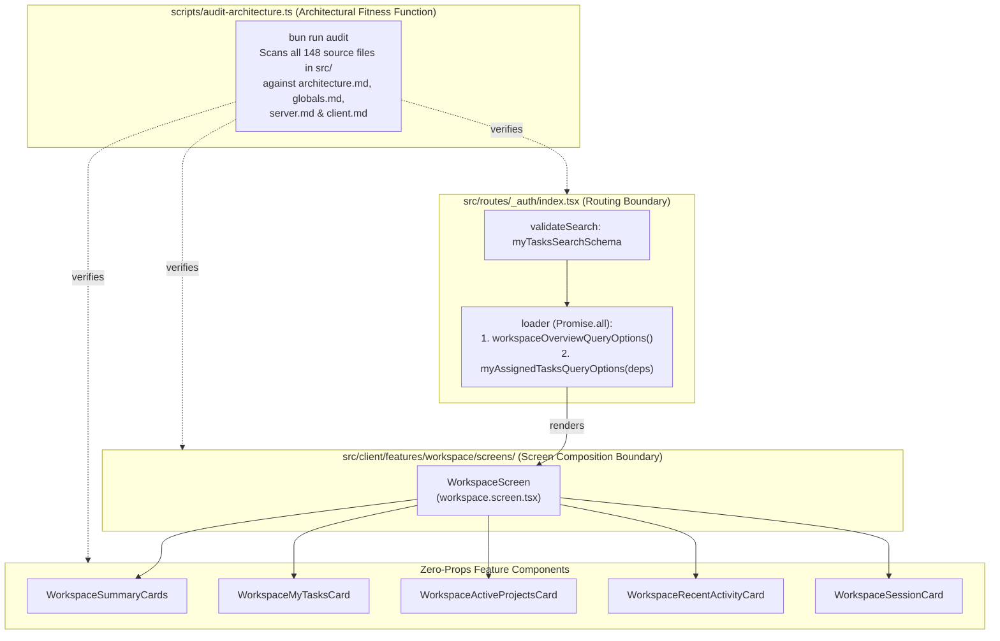

# Milestone 8 — Frontend Step 4: Feature Workspace Screen, Route & Automated Architecture Audit (src/client/features/workspace/screens/, src/routes/_auth/, scripts/)

---

## 1. เป้าหมายและขอบเขต Boundary (Boundary Context & Goal)

ยินดีด้วย! คุณเดินทางมาถึง **Step สุดท้ายของ Milestone 8 และของโปรเจกต์ TaskFlow** แล้ว ในขั้นตอนนี้เราจะดำเนินการ 3 ส่วนสำคัญเพื่อปิดจบระบบอย่างสมบูรณ์แบบ:
1. **อัปเดต Composition Root ของหน้า Dashboard (`src/client/features/workspace/screens/workspace.screen.tsx`)**: ประกอบร่าง `WorkspaceSummaryCards`, `WorkspaceMyTasksCard`, `WorkspaceActiveProjectsCard`, `WorkspaceRecentActivityCard` และ `WorkspaceSessionCard` เข้าด้วยกันแบบ Zero Props
2. **อัปเดต Route หน้าแรกหลังเข้าสู่ระบบ (`src/routes/_auth/index.tsx`)**: ผูก `validateSearch: myTasksSearchSchema`, `loaderDeps` และ `loader` เพื่อ Preload ทั้งข้อมูลภาพรวมพื้นที่ทำงาน (`workspaceOverviewQueryOptions()`) และตารางงานที่ได้รับมอบหมาย (`myAssignedTasksQueryOptions(deps)`) แบบขนาน (`Promise.all`) ตั้งแต่ระดับ Router/SSR
3. **สร้างระบบตรวจสอบสถาปัตยกรรมอัตโนมัติ (`scripts/audit-architecture.ts` และคำสั่ง `bun run audit` ใน `package.json`)**: สร้าง **Architectural Fitness Functions** ที่สแกนซอร์สโค้ดทุกไฟล์ใน `src/` เพื่อตรวจจับการละเมิดกฎใน `.agents/rules/{architecture,globals,server,client}.md` โดยอัตโนมัติ

### ตารางสรุปไฟล์ใน Step นี้

| ลำดับ | เส้นทางไฟล์ (Path) | หน้าที่รับผิดชอบ (Responsibility) |
| :--- | :--- | :--- |
| 1 | `src/client/features/workspace/screens/workspace.screen.tsx` | Screen Composition Root ของหน้า Workspace Dashboard ประกอบการ์ดทั้งหมดแบบ Zero Props |
| 2 | `src/routes/_auth/index.tsx` | TanStack Router File Route สำหรับ `/` ภายใต้ Route Guard `_auth` พร้อม `validateSearch`, `loaderDeps` และ Parallel `loader` |
| 3 | `scripts/audit-architecture.ts` | สคริปต์ Automated Architecture & Design Audit ตรวจจับการละเมิดกฎสถาปัตยกรรมและ Design System ทั่วทั้ง `src/` |
| 4 | `package.json` | ตรวจสอบและลงทะเบียนสคริปต์ `"audit": "bun scripts/audit-architecture.ts"` |

### แผนผังขอบเขตสถาปัตยกรรม (Architecture Boundary Diagram)



---

## 2. ทฤษฎี ความสำคัญ และกฎสถาปัตยกรรมเฉพาะ Boundary นี้

### 2.1 Parallel Data Preloading ใน TanStack Router (`loaderDeps` + `Promise.all`)
ในไฟล์ `src/routes/_auth/index.tsx`:
- เราใช้ `validateSearch: myTasksSearchSchema` เพื่อให้ URL Search Params บนหน้า `/` ได้รับการตรวจสอบและเติมค่าเริ่มต้นตั้งแต่ระดับ Router
- เราส่งออก `loaderDeps: ({ search }) => search` เพื่อให้เมื่อพารามิเตอร์การค้นหา/กรอง/แบ่งหน้าบน URL เปลี่ยนแปลง TanStack Router จะรับรู้และสั่งรัน `loader` เพื่อดึงข้อมูลหน้าใหม่ล่วงหน้าทันที
- ใน `loader` เราใช้ `Promise.all([context.queryClient.query(workspaceOverviewQueryOptions()), context.queryClient.query(myAssignedTasksQueryOptions(deps))])` เพื่อดึงทั้งข้อมูลภาพรวมและรายการงานพร้อมกันแบบขนาน โดยหาก `workspaceOverviewQueryOptions()` ยังไม่หมดอายุ (`staleTime: 15_000`) TanStack Query จะคืนค่าจากแคชทันทีโดยไม่ยิงซ้ำเมื่อผู้ใช้แค่เปลี่ยนหน้าตารางงาน

### 2.2 Architectural Fitness Functions (`scripts/audit-architecture.ts`)
ในหนังสือ *Building Evolutionary Architectures* แนวคิดเรื่อง **Architectural Fitness Function** คือกลไกอัตโนมัติที่ทำหน้าที่ตรวจสอบว่าเมื่อระบบเติบโตขึ้น โค้ดทุกส่วนยังคงรักษาคุณลักษณะและขอบเขตทางสถาปัตยกรรมตามที่ออกแบบไว้หรือไม่

สคริปต์ `scripts/audit-architecture.ts` ของเราทำหน้าที่สแกนไฟล์ `.ts` และ `.tsx` ทั้งหมดใน `src/` (ยกเว้น `shared/shadcn` และ `routeTree.gen.ts`) เพื่อตรวจสอบกฎสำคัญทั้ง 14 ข้อจาก `.agents/rules/`:
1. **`globals.md#5` (No Barrel Files)**: ห้ามมีไฟล์ `index.ts` นอกโฟลเดอร์ `routes/`
2. **`server.md#1` (Pure Domain Dependency)**: `server/domain/` ห้าม import โค้ดนอก `#/server/domain/` และ `#/shared/schemas/`
3. **`server.md#1 & #10` (Application Layer Isolation)**: `server/application/` ห้าม import `#/server/infrastructure/`, `#/server/composition/`, `#/server-functions/` หรือ `drizzle-orm`
4. **`client.md#1 & server.md#2` (Route Purity)**: `routes/` ห้ามประกอบ `features/**/components` โดยตรง และห้าม import `#/server/`
5. **`client.md#8` (Centralized Mutation Toast)**: ห้ามเรียก `toast.` นอก `client/caches/`
6. **`server.md#3` (Cache Gateway Ownership)**: `client/features/` ห้ามเรียก `#/server-functions/` โดยตรง ต้องผ่าน `client/caches/` เท่านั้น
7. **`server.md#18` (Server Function Middleware)**: ทุกไฟล์ `.fn.ts` ใน `server-functions/` ต้องมี `.middleware(` เสมอ
8. **`client.md#19` (1 Component per File)**: ไฟล์ `.tsx` ใน `client/features/` (ยกเว้น `contexts/`) ห้ามมี Component เกิน 1 ตัว
9. **`client.md#2` (Zero Props Architecture)**: Component ใน `client/features/**/components/*.tsx` ห้ามรับพารามิเตอร์ใดๆ
10. **`globals.md#2` (No Deep Relative Imports)**: ห้ามใช้ `../../` ในทุกไฟล์
11. **`globals.md#4` (No Wildcard Imports)**: ห้ามใช้ `import * as ...`
12. **`globals.md#8` (No Explicit `any` & No TS Error Suppression)**: ห้ามใช้ `: any`, `as any`, `<any>`, `@ts-ignore`, `@ts-expect-error`, `@ts-nocheck`
13. **`server.md#19` (Centralized `env.ts`)**: ห้ามเข้าถึง `process.env` นอก `server/config/env.ts`
14. **`client.md#15 & #18` (No Raw Border/Ring & No Emoji in UI)**: ห้ามใช้คลาส `border-*`/`ring-*` ดิบใน `client/` และห้ามมี Emoji ในโค้ดฝั่ง `client/`

---

## 3. ลงมือเขียนโค้ด (Step-by-Step Implementation)

### ไฟล์ที่ 1: `src/client/features/workspace/screens/workspace.screen.tsx`

อัปเดตไฟล์ `src/client/features/workspace/screens/workspace.screen.tsx` เพื่อประกอบหน้า Workspace Dashboard ฉบับสมบูรณ์:

```tsx
import { LayoutDashboard } from "lucide-react";
import { AppButtonLink } from "#/client/shared/components/app-link";
import { AppShellMain } from "#/client/shared/components/app-shell";
import {
	Card,
	CardDescription,
	CardHeader,
	CardTitle,
} from "#/client/shared/shadcn/components/ui/card";
import { WorkspaceActiveProjectsCard } from "../components/workspace-active-projects-card";
import { WorkspaceMyTasksCard } from "../components/workspace-my-tasks-card";
import { WorkspaceRecentActivityCard } from "../components/workspace-recent-activity-card";
import { WorkspaceSessionCard } from "../components/workspace-session-card";
import { WorkspaceSummaryCards } from "../components/workspace-summary-cards";

export function WorkspaceScreen() {
	return (
		<AppShellMain className="mx-auto max-w-6xl py-8">
			<Card>
				<CardHeader>
					<div className="flex flex-wrap items-center justify-between gap-3">
						<div className="flex items-center gap-2">
							<LayoutDashboard
								className="size-5 text-primary"
								aria-hidden="true"
							/>
							<div className="flex flex-col gap-0.5">
								<CardTitle className="text-xl">
									ภาพรวมพื้นที่ทำงาน TaskFlow
								</CardTitle>
								<CardDescription>
									ติดตามงานที่ได้รับมอบหมาย โครงการล่าสุด และความเคลื่อนไหวทั้งหมดในที่เดียว
								</CardDescription>
							</div>
						</div>
						<AppButtonLink to="/projects" variant="outline" size="sm">
							จัดการโครงการทั้งหมด
						</AppButtonLink>
					</div>
				</CardHeader>
			</Card>

			<WorkspaceSummaryCards />
			<WorkspaceMyTasksCard />

			<div className="grid gap-4 lg:grid-cols-2">
				<WorkspaceActiveProjectsCard />
				<WorkspaceRecentActivityCard />
			</div>

			<WorkspaceSessionCard />
		</AppShellMain>
	);
}
```

---

### ไฟล์ที่ 2: `src/routes/_auth/index.tsx`

อัปเดตไฟล์ `src/routes/_auth/index.tsx` เพื่อเชื่อม `validateSearch`, `loaderDeps`, `loader` และ `WorkspaceScreen`:

```tsx
import { createFileRoute } from "@tanstack/react-router";
import { myAssignedTasksQueryOptions } from "#/client/caches/workspace/queries/my-assigned-tasks.query";
import { workspaceOverviewQueryOptions } from "#/client/caches/workspace/queries/workspace-overview.query";
import { WorkspaceScreen } from "#/client/features/workspace/screens/workspace.screen";
import { myTasksSearchSchema } from "#/shared/schemas/workspace.schema";

export const Route = createFileRoute("/_auth/")({
	validateSearch: myTasksSearchSchema,
	loaderDeps: ({ search }) => search,
	loader: ({ context, deps }) =>
		Promise.all([
			context.queryClient.query(workspaceOverviewQueryOptions()),
			context.queryClient.query(myAssignedTasksQueryOptions(deps)),
		]),
	component: WorkspaceScreen,
});
```

---

### ไฟล์ที่ 3: `scripts/audit-architecture.ts`

สร้างไฟล์ `scripts/audit-architecture.ts` สำหรับตรวจสอบความสอดคล้องทางสถาปัตยกรรมและ Design System อัตโนมัติ:

```typescript
import { readdirSync, readFileSync, statSync } from "node:fs";
import { join, relative } from "node:path";
import process from "node:process";

interface AuditViolation {
	readonly rule: string;
	readonly file: string;
	readonly detail: string;
}

function walkSourceFiles(dir: string): string[] {
	const entries = readdirSync(dir);
	const collected: string[] = [];

	for (const entry of entries) {
		const fullPath = join(dir, entry);
		const stat = statSync(fullPath);
		if (stat.isDirectory()) {
			collected.push(...walkSourceFiles(fullPath));
		} else if (fullPath.endsWith(".ts") || fullPath.endsWith(".tsx")) {
			collected.push(fullPath);
		}
	}

	return collected;
}

const EMOJI_PATTERN = /[\u{1F300}-\u{1FAFF}\u{2600}-\u{27BF}]/u;
const IMPORT_SOURCE_PATTERN =
	/import\s+(?:type\s+)?[\s\S]*?\s+from\s+["']([^"']+)["']/g;
const EXPLICIT_ANY_PATTERN = /\b:\s*any\b|\bas\s+any\b|<any>/;
const TS_SUPPRESS_PATTERN = /@ts-(?:ignore|expect-error|nocheck)/;
const WILDCARD_IMPORT_PATTERN = /^\s*import\s+\*\s+as\s+/;

const allFiles = walkSourceFiles("src").filter(
	(filePath) =>
		!filePath.includes("shared\\shadcn") &&
		!filePath.includes("shared/shadcn") &&
		!filePath.endsWith("routeTree.gen.ts"),
);

const violations: AuditViolation[] = [];

for (const filePath of allFiles) {
	const relPath = relative("src", filePath).replaceAll("\\", "/");
	const content = readFileSync(filePath, "utf8");
	const lines = content.split(/\r?\n/);

	if (relPath.endsWith("/index.ts") && !relPath.startsWith("routes/")) {
		violations.push({
			rule: "globals.md#5 (No Barrel Files)",
			file: relPath,
			detail: "พบไฟล์ index.ts นอก routes/ ซึ่งอาจเป็น Barrel File",
		});
	}

	if (relPath.startsWith("server/domain/")) {
		const importMatches = [...content.matchAll(IMPORT_SOURCE_PATTERN)];
		for (const match of importMatches) {
			const source = match[1] ?? "";
			const isAllowedDomainImport =
				source.startsWith("#/server/domain/") ||
				source.startsWith("#/shared/schemas/") ||
				source.startsWith("./") ||
				source.startsWith("../");
			if (!isAllowedDomainImport) {
				violations.push({
					rule: "server.md#1 (Pure Domain Dependency)",
					file: relPath,
					detail: `Domain ห้าม import '${source}'`,
				});
			}
		}
	}

	if (relPath.startsWith("server/application/")) {
		const importMatches = [...content.matchAll(IMPORT_SOURCE_PATTERN)];
		for (const match of importMatches) {
			const source = match[1] ?? "";
			const isForbiddenApplicationImport =
				source.startsWith("#/server/infrastructure/") ||
				source.startsWith("#/server/composition/") ||
				source.startsWith("#/server-functions/") ||
				source.startsWith("drizzle-orm");
			if (isForbiddenApplicationImport) {
				violations.push({
					rule: "server.md#1 & #10 (Application Layer Isolation)",
					file: relPath,
					detail: `Application ห้าม import '${source}'`,
				});
			}
		}
	}

	if (
		relPath.startsWith("routes/") &&
		(content.includes("/components/") || content.includes("#/server/"))
	) {
		violations.push({
			rule: "client.md#1 & server.md#2 (Route Purity)",
			file: relPath,
			detail: "Route ห้ามประกอบ features/**/components หรือ import #/server/",
		});
	}

	if (
		relPath.startsWith("client/") &&
		!relPath.startsWith("client/caches/") &&
		content.includes("toast.")
	) {
		violations.push({
			rule: "client.md#8 (Centralized Mutation Toast)",
			file: relPath,
			detail: "พบการเรียก toast นอก client/caches/",
		});
	}

	if (
		relPath.startsWith("client/features/") &&
		content.includes("#/server-functions/")
	) {
		violations.push({
			rule: "server.md#3 (Cache Gateway Ownership)",
			file: relPath,
			detail:
				"Feature ห้ามเรียก #/server-functions/ โดยตรง ให้เรียกผ่าน client/caches/",
		});
	}

	if (relPath.startsWith("server-functions/") && relPath.endsWith(".fn.ts")) {
		if (!content.includes(".middleware(")) {
			violations.push({
				rule: "server.md#18 (Server Function Middleware)",
				file: relPath,
				detail: "Server Function ควรมี Auth/Permission/Error Middleware",
			});
		}
	}

	if (
		relPath.startsWith("client/features/") &&
		relPath.endsWith(".tsx") &&
		!relPath.includes("/contexts/")
	) {
		const exportedComponents = [
			...content.matchAll(/^export\s+(?:function|const)\s+[A-Z]/gm),
		];
		const localComponents = [
			...content.matchAll(/^function\s+[A-Z][A-Za-z0-9]*\s*\(/gm),
		];
		if (exportedComponents.length + localComponents.length > 1) {
			violations.push({
				rule: "client.md#19 (1 Component per File)",
				file: relPath,
				detail: "พบ Component มากกว่า 1 ตัวในไฟล์เดียวกัน",
			});
		}

		if (relPath.includes("/components/")) {
			const fnMatch = content.match(
				/export\s+function\s+([A-Z]\w*)\s*\(([^)]*)\)/,
			);
			const rawParams = fnMatch?.[2]?.trim() ?? "";
			if (rawParams.length > 0) {
				violations.push({
					rule: "client.md#2 (Zero Props Architecture)",
					file: relPath,
					detail: `Component '${fnMatch?.[1]}' รับ parameter '${rawParams}'`,
				});
			}
		}
	}

	lines.forEach((line, index) => {
		const lineNumber = index + 1;
		if (line.includes("../../")) {
			violations.push({
				rule: "globals.md#2 (No Deep Relative Imports)",
				file: `${relPath}:${lineNumber}`,
				detail: line.trim(),
			});
		}
		if (WILDCARD_IMPORT_PATTERN.test(line)) {
			violations.push({
				rule: "globals.md#4 (No Wildcard Imports)",
				file: `${relPath}:${lineNumber}`,
				detail: line.trim(),
			});
		}
		if (EXPLICIT_ANY_PATTERN.test(line)) {
			violations.push({
				rule: "globals.md#8 (No Explicit any)",
				file: `${relPath}:${lineNumber}`,
				detail: line.trim(),
			});
		}
		if (TS_SUPPRESS_PATTERN.test(line)) {
			violations.push({
				rule: "globals.md#8 (No TS Error Suppression)",
				file: `${relPath}:${lineNumber}`,
				detail: line.trim(),
			});
		}
		if (
			line.includes("process.env") &&
			!relPath.endsWith("server/config/env.ts")
		) {
			violations.push({
				rule: "server.md#19 (Centralized env.ts)",
				file: `${relPath}:${lineNumber}`,
				detail: "เข้าถึง process.env นอก server/config/env.ts",
			});
		}
		if (relPath.startsWith("client/") && line.includes("#/server/")) {
			violations.push({
				rule: "server.md#2 (Client/Server Boundary)",
				file: `${relPath}:${lineNumber}`,
				detail: line.trim(),
			});
		}
		if (
			relPath.startsWith("client/") &&
			(line.includes("border-") ||
				line.includes("ring-") ||
				(/\bborder\b/.test(line) && line.includes("className=")))
		) {
			violations.push({
				rule: "client.md#15 (No Raw Border/Ring)",
				file: `${relPath}:${lineNumber}`,
				detail: line.trim(),
			});
		}
		if (relPath.startsWith("client/") && EMOJI_PATTERN.test(line)) {
			violations.push({
				rule: "client.md#18 (No Emoji in UI)",
				file: `${relPath}:${lineNumber}`,
				detail: line.trim(),
			});
		}
	});
}

if (violations.length === 0) {
	console.log(
		`[PASS] Architecture & Design Audit ผ่านครบทุกข้อ (ตรวจสอบแล้ว ${allFiles.length} ไฟล์)`,
	);
} else {
	console.error(`[FAIL] พบความไม่สอดคล้อง ${violations.length} รายการ:`);
	for (const violation of violations) {
		console.error(
			`- [${violation.rule}] ${violation.file}: ${violation.detail}`,
		);
	}
	process.exitCode = 1;
}
```

---

### ไฟล์ที่ 4: `package.json`

ตรวจสอบว่าในไฟล์ `package.json` มีสคริปต์ `"audit": "bun scripts/audit-architecture.ts"` อยู่ในบล็อก `"scripts"` ครบถ้วน:

```json
{
	"name": "simple-start",
	"private": true,
	"type": "module",
	"scripts": {
		"preinstall": "bun x only-allow bun",
		"dev": "vite dev --port 3000",
		"generate-routes": "bun node_modules/@tanstack/router-cli/dist/esm/index.js generate",
		"build": "vite build",
		"preview": "vite preview",
		"lint": "biome lint .",
		"format": "biome check --write .",
		"check": "biome check .",
		"typecheck": "tsc --noEmit",
		"audit": "bun scripts/audit-architecture.ts",
		"db:generate": "drizzle-kit generate",
		"db:migrate": "drizzle-kit migrate",
		"db:studio": "drizzle-kit studio",
		"db:seed": "bun src/server/infrastructure/drizzle/seed.ts"
	},
	"dependencies": {
		"@base-ui/react": "^1.9.0",
		"@better-auth/drizzle-adapter": "^1.7.25",
		"@fontsource-variable/google-sans": "^5.3.2",
		"@fontsource-variable/outfit": "^5.3.0",
		"@tailwindcss/vite": "^4",
		"@tanstack/react-devtools": "latest",
		"@tanstack/react-form": "^1.33.5",
		"@tanstack/react-query": "^5.105.3",
		"@tanstack/react-router": "latest",
		"@tanstack/react-router-devtools": "latest",
		"@tanstack/react-router-ssr-query": "^1.167.3",
		"@tanstack/react-start": "latest",
		"@tanstack/react-table": "^9.3.1",
		"better-auth": "^1.7.25",
		"class-variance-authority": "^0.7.1",
		"cn": "^0.4.0",
		"drizzle-orm": "^0.45.4",
		"lucide-react": "^1.59.0",
		"pg": "^8.23.1",
		"react": "^19.3.0",
		"react-dom": "^19.3.0",
		"shadcn": "^4.22.0",
		"tailwindcss": "^4",
		"tw-animate-css": "^1.4.0",
		"zod": "^4.6.7"
	},
	"devDependencies": {
		"@biomejs/biome": "2.6.7",
		"@tanstack/devtools-vite": "latest",
		"@tanstack/router-cli": "^1.167.39",
		"@types/node": "^22",
		"@types/pg": "^8.23.1",
		"@types/react": "^19",
		"@types/react-dom": "^19",
		"@vitejs/plugin-react": "^6",
		"drizzle-kit": "^0.31.11",
		"typescript": "^6.0.2",
		"vite": "^8"
	}
}
```

---

## 4. การตรวจสอบความถูกต้องและ Git Commit (Verification & Commit)

### 4.1 Final Capstone Verification (ตรวจสอบระบบครบวงจร)

รันชุดคำสั่งตรวจสอบทั้ง 5 ขั้นตอนเพื่อยืนยันว่าระบบ TaskFlow ทั้งหมดผ่านทุกเกณฑ์มาตรฐานระดับ Production:

```bash
# 1. สร้าง Route Tree ล่าสุดของ TanStack Router
bun run generate-routes

# 2. ตรวจสอบ Type Safety ทั้งโปรเจกต์ด้วย TypeScript Compiler
bun run typecheck

# 3. ตรวจสอบ Formatting & Linting ด้วย Biome
bun run check

# 4. รัน Automated Architecture & Design Audit ตรวจซอร์สโค้ดทุกไฟล์ใน src/
bun run audit

# 5. ทดสอบ Production Bundle Build ทั้งฝั่ง Client และ SSR Server
bun run build
```

ผลลัพธ์ที่คาดหวังจาก `bun run audit`:
```text
[PASS] Architecture & Design Audit ผ่านครบทุกข้อ (ตรวจสอบแล้ว 148 ไฟล์)
```

### 4.2 End-to-End Walkthrough ทั้งระบบ
คุณสามารถรันเซิร์ฟเวอร์พัฒนาเพื่อทดสอบการทำงานตั้งแต่ต้นจนจบ:
```bash
bun run db:migrate
bun run db:seed
bun run dev
```
1. เปิดเบราว์เซอร์ไปที่ `http://localhost:3000/sign-in` และเข้าสู่ระบบด้วยบัญชีผู้ใช้ที่ถูก Seed ไว้ (หรือสมัครสมาชิกใหม่ที่ `/sign-up`)
2. ที่หน้าแรก `/` (**Workspace Dashboard**):
   - ตรวจสอบการ์ดสรุปตัวเลข KPI ทั้ง 4 ใบด้านบนสุด
   - ทดสอบค้นหาและกรองงานในตาราง **"งานที่ได้รับมอบหมายของฉัน"** สังเกตว่า URL Search Params (`?search=...&status=...&priority=...&sortBy=...`) อัปเดตอย่างแม่นยำ
   - ตรวจสอบการ์ด **"โครงการที่กำลังดำเนินการ"** และ **"กิจกรรมล่าสุดในพื้นที่ทำงาน"**
3. คลิกเข้าไปสร้างโครงการใหม่ที่ `/projects` เพิ่มสมาชิกในโครงการ สร้างงานใหม่ มอบหมายงานให้ตนเอง เปลี่ยนสถานะงาน และเพิ่มความคิดเห็นในหน้ารายละเอียดงาน
4. กดกลับมาที่หน้าแรก `/` จะพบว่าตัวเลข KPI, ตารางงานที่ได้รับมอบหมาย และฟีดกิจกรรมล่าสุดอัปเดตเป็นข้อมูลใหม่อัตโนมัติทันทีจาก Cross-Module Cache Invalidation!

### 4.3 บันทึก Git Commit ปิดท้าย Milestone 8

```bash
git add src/client/features/workspace/screens/workspace.screen.tsx src/routes/_auth/index.tsx scripts/audit-architecture.ts package.json
git commit -m "milestone-8.frontend.step-4: Workspace Dashboard Screen, Route & Automated Architecture Audit"
```
